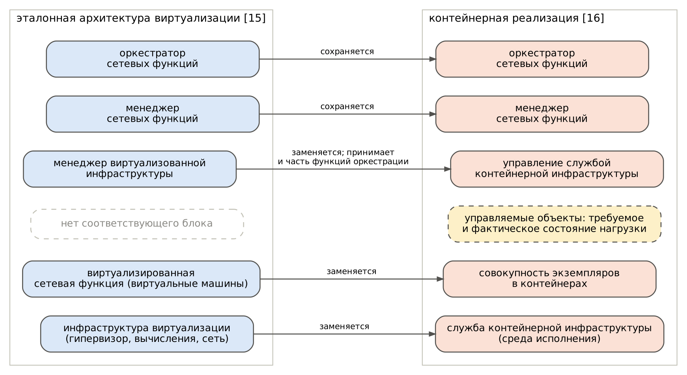
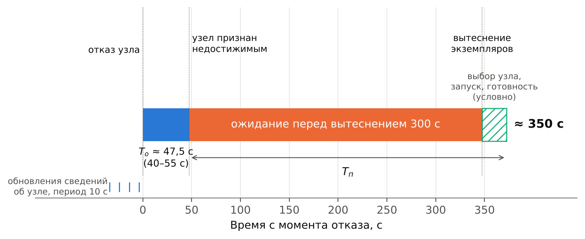
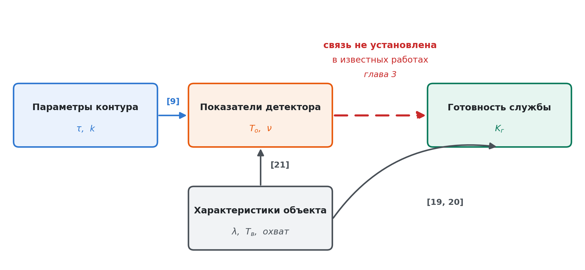

# ГЛАВА 1. Анализ механизмов обнаружения отказов и составляющих времени восстановления

В главе рассматриваются процессы восстановления обслуживания при отказах в контейнерной инфраструктуре инфокоммуникационных сетей. В разделе 1.1 прослеживается переход сетевых функций к контейнерной реализации и устанавливается её соответствие эталонной архитектуре виртуализации. Раздел 1.2 определяет нормативные требования к готовности и вытекающий из них бюджет недоступности. В разделе 1.3 разбираются механизмы обнаружения отказов и выделяются составляющие времени восстановления. В разделах 1.4 и 1.5 оценивается применимость известных моделей и известных решений. Выводы по главе содержат положения, составляющие основание научной задачи, сформулированной во введении.

## 1.1 Виртуализация сетевых функций и переход к контейнерной инфраструктуре

Настоящий раздел прослеживает изменение способа реализации функций телекоммуникационных сетей — от специализированных аппаратных устройств к программной реализации на оборудовании общего назначения и далее к контейнерной реализации, — а также устанавливает вытекающие из этого перехода требования к отказоустойчивости. Здесь же закрепляется терминология, применяемая в последующих главах.

**Реализация сетевых функций специализированными устройствами.** Исторически функции телекоммуникационных сетей — коммутация, маршрутизация, трансляция адресов, балансировка нагрузки, обеспечение безопасности — реализовывались специализированными аппаратными устройствами, поставляемыми в виде законченных изделий. Такой способ реализации обеспечивает предсказуемые характеристики и высокую надёжность отдельного изделия, однако обладает рядом свойств, ограничивающих развитие сетей. Ввод новой функции требует физической установки оборудования, вследствие чего срок ввода определяется циклом поставки, а не готовностью программного обеспечения. Производительность закладывается по пиковой нагрузке на весь срок службы изделия, что приводит к недоиспользованию ресурса в остальное время. Наконец, привязка функции к изделию конкретного производителя ограничивает возможность её замены и совместного использования оборудования несколькими функциями.

Перечисленные ограничения зафиксированы документально самими операторами связи. В белой книге, выпущенной в 2012 году совместно тринадцатью операторами, положение охарактеризовано следующим образом: сети операторов заполнены большим и растущим разнообразием проприетарных аппаратных устройств, ввод новой службы часто требует появления ещё одной их разновидности, а размещение и электропитание этих устройств становится всё более затруднительным, что усугубляется ростом стоимости энергии, сложностями капитальных вложений и редкостью навыков, необходимых для проектирования, объединения и эксплуатации всё более сложных аппаратных изделий [27]. Отдельно отмечена проблема жизненного цикла: аппаратные изделия быстро достигают конца срока службы, вследствие чего цикл «закупка — проектирование — объединение — развёртывание» приходится повторять с малой отдачей или без неё, причём сроки службы сокращаются по мере ускорения технологического и служебного развития, что само по себе сдерживает ввод новых доходных служб [27].

Предложенное решение состояло в том, чтобы применить стандартные средства виртуализации информационных технологий и объединить многие типы сетевого оборудования на серверах, коммутаторах и системах хранения массового выпуска, размещаемых в центрах обработки данных, узлах сети и на площадках пользователей [27]. Экономическое обоснование опиралось на различие масштабов производства: в документе приводится сопоставление около 9,5 млн серверов, поставленных в 2011 году, с примерно 1,5 млн маршрутизаторов, прогнозируемых к поставке в 2012 году [27].

**Виртуализация сетевых функций.** Ответом на перечисленные ограничения стало отделение программной реализации сетевой функции от аппаратуры, на которой она исполняется. Соответствующая эталонная архитектура закреплена в [15], где выделены три рабочих домена: виртуализированные сетевые функции, инфраструктура виртуализации и подсистема управления и оркестрации. В состав архитектуры входят восемь функциональных блоков: собственно виртуализированная сетевая функция; средство управления элементом; инфраструктура виртуализации, объединяющая аппаратные ресурсы и слой виртуализации; менеджер виртуализованной инфраструктуры, распоряжающийся вычислительными, сетевыми ресурсами и ресурсами хранения; оркестратор; менеджер жизненного цикла отдельных функций; подсистема описаний служб, функций и инфраструктуры; системы эксплуатационной и коммерческой поддержки [15].

Определяющим принципом архитектуры является отделение программного обеспечения от аппаратуры, обеспечивающее их независимое развитие. Слой виртуализации предоставляет сетевой функции жизненный цикл, не зависящий от конкретной аппаратной платформы, чем достигается переносимость функции между различными средствами виртуализации и вычислительными ресурсами [15]. Тем самым срок ввода функции определяется развёртыванием программного обеспечения, производительность может изменяться в соответствии с текущей нагрузкой, а оборудование становится общим для функций различного назначения.

Обзор состояния области, выполненный десятилетием позже, подтверждает как исходную постановку, так и её последствия. Традиционное предоставление услуг в отрасли связи характеризуется в [28] развёртыванием физических проприетарных устройств для каждой функции, входящей в состав услуги, что в сочетании с требованиями высокого качества, устойчивости и строгого соблюдения протоколов привело к длительным продуктовым циклам, крайне низкой гибкости услуг и сильной зависимости от специализированной аппаратуры. Отделение сетевых функций от физических устройств, на которых они исполняются, оценивается там же как обладающее возможностью существенно сократить эксплуатационные и капитальные затраты и облегчить развёртывание новых служб [28].

Вместе с тем виртуализация порождает собственный класс задач. В том же обзоре к неисследованным отнесены испытание и подтверждение соответствия, управление ресурсами, взаимная совместимость, порядок создания экземпляров и производительность виртуализированных функций [28]. Существенно, что задача обеспечения готовности при таком переходе не решается автоматически: свойства, ранее обеспечивавшиеся конструкцией отдельного изделия, теперь должны обеспечиваться средствами инфраструктуры и управления, а способы их достижения к моменту составления обзора не были устоявшимися.

**Переход к контейнерной реализации.** Первоначально виртуализированные сетевые функции размещались на виртуальных машинах. Последующим шагом стал переход к контейнерной реализации, рассмотренный в [16], где введены понятия службы контейнерной инфраструктуры, предоставляющей среду исполнения контейнеров, управления этой службой и управляемых объектов контейнерной инфраструктуры, описывающих требуемое и фактическое состояние размещённой нагрузки вместе с запрошенными и выделенными ей ресурсами.

Количественное основание такого перехода дают измерения накладных расходов обоих способов виртуализации. Согласно [29], где сопоставлялись исполнение без виртуализации, контейнерная реализация и полная виртуализация на одном и том же сервере и одном и том же приложении, контейнерная реализация показывает производительность, близкую к исполнению без виртуализации: расхождение асимптотически приближается к 2 % при высокой конкурентности, тогда как полная виртуализация во всех измеренных случаях даёт накладные расходы свыше 40 %. Существенна и природа этих расходов: и контейнеры, и виртуальные машины практически не создают накладных расходов по процессору и памяти, влияя лишь на операции ввода-вывода и взаимодействие с операционной системой [29]. Различие в длительности запуска составляет несколько порядков: загрузка виртуальной машины занимает минуты, тогда как запуск контейнера — миллисекунды, а совместное использование ядра операционной системы уменьшает потребный объём хранения [30].

Сетевые функции, изначально предназначенные для исполнения в контейнерах, выделяются в отдельный класс, рассматриваемый как развитие виртуализированных сетевых функций [30]. В настоящей работе принято обозначение «сетевая функция», а способ её реализации указывается там, где он существен.

Преимущества контейнерной реализации перед реализацией на виртуальных машинах состоят в меньшем объёме образа и потребляемой памяти, более быстром развёртывании и запуске, а также в простоте переноса и установки [16]. Совокупным следствием является более высокая плотность размещения функций на единице оборудования и сокращение времени ввода функции в работу. Одновременно отмечается возможность вложенной виртуализации, при которой контейнеры исполняются внутри виртуальных машин ради совместимости с существующей инфраструктурой, поддерживающей только гипервизоры; такое построение сохраняет накладные расходы обоих уровней и рассматривается как переходное [16].

**Соответствие функциональных блоков.** Функциональные блоки эталонной архитектуры [15] сохраняются при контейнерной реализации, изменяя способ реализации. Инфраструктуре виртуализации соответствует служба контейнерной инфраструктуры, предоставляющая среду исполнения; менеджеру виртуализованной инфраструктуры и части функций оркестрации — управление службой контейнерной инфраструктуры; виртуализированной сетевой функции — совокупность экземпляров, размещённых в контейнерах [16]. Дополнительным по отношению к эталонной архитектуре элементом являются управляемые объекты контейнерной инфраструктуры, описывающие требуемое и фактическое состояние размещённой нагрузки. Соответствие приведено на рисунке 1.1.

*Рисунок 1.1 — Соответствие функциональных блоков эталонной архитектуры виртуализации сетевых функций и их контейнерной реализации*

**Изменение модели обработки отказов.** Появление управляемых объектов, хранящих требуемое и фактическое состояние, изменяет принцип обработки отказов. При размещении сетевой функции на виртуальной машине отказ обнаруживается средствами слоя виртуализации, а восстановление сводится к перезапуску машины и выполняется менеджером виртуализованной инфраструктуры. При контейнерной реализации управление передаётся замкнутому контуру, непрерывно сопоставляющему фактическое состояние объектов с требуемым и устраняющему расхождение [16]. Отказ узла обработки проявляется как расхождение состояний, а восстановление — как действие контура по его устранению.

Следствие существенно для постановки задачи: длительность восстановления обслуживания определяется не свойствами самой сетевой функции и не быстродействием аппаратуры, а параметрами контура управления — периодичностью сопоставления состояний и предельными временами ожидания, при превышении которых расхождение признаётся отказом. Тем самым исследование времени восстановления сводится к исследованию контура управления платформы оркестрации, чему посвящён раздел 1.3.

**Требования к отказоустойчивости.** Требования к отказоустойчивости виртуализированных сетевых функций систематизированы в [6], где выделены три уровня доступности обслуживания и соответствующие им схемы резервирования. Услугам критического назначения — управлению сетью, экстренным службам, критической инфраструктуре — соответствует резервирование по схеме «один плюс один» с мгновенным переключением. Корпоративным услугам и услугам реального времени соответствует схема «один к одному» с быстрым переключением. Услугам массового обслуживания соответствует схема «M плюс один» с быстрым переключением при числе основных экземпляров, большем единицы [6]. Численных значений коэффициента готовности по уровням документ не устанавливает, указывая для массовых пользователей значение доступности лучше 99,9 % [6].

Для контейнерной реализации требования уточнены в [16]: отказоустойчивость обеспечивается резервированием по схеме «n плюс k» с распределением нагрузки между разнесёнными экземплярами сетевой функции, причём предполагается реализация функций без сохранения состояния, при которой вычислительные ресурсы отделены от ресурсов хранения. Для платформенных служб операторского класса в [16] установлено требование доступности «пяти и более девяток», то есть не ниже 99,999 %.

**Следствия для настоящей работы.** Из изложенного вытекают четыре положения, определяющие постановку задачи.

Во-первых, объектом рассмотрения является телекоммуникационная служба, реализованная программно и размещённая в контейнерной инфраструктуре, а её поведение при отказах определяется механизмами платформы контейнерной оркестрации.

Во-вторых, резервирование является не средством оптимизации, а нормативным способом развёртывания: обе рассмотренные спецификации предписывают его для всех уровней доступности обслуживания [6, 16]. Тем самым конфигурация с резервированием, а не одиночный экземпляр, представляет собой основной случай, подлежащий исследованию.

В-третьих, требование доступности не ниже 99,999 % для служб операторского класса является нормативным [16], а не выбранным для целей настоящей работы ориентиром.

В-четвёртых, предполагаемая спецификациями реализация функций без сохранения состояния [16] выполняется не для всех классов сетевых функций: балансировщики нагрузки транспортного уровня, шлюзы туннелей и средства трансляции адресов сохраняют сведения об установленных соединениях, утрата которых прерывает обслуживание. Расхождение между предполагаемой и фактической реализацией составляет отдельную задачу, рассматриваемую в главе 4.

**Терминология.** В работе приняты следующие обозначения. Телекоммуникационной службой именуется совокупность взаимодействующих сетевых функций, обеспечивающая заданный вид обслуживания. Виртуализированной сетевой функцией — сетевая функция, реализованная программно и развёртываемая в среде виртуализации или контейнеризации. Контейнерной инфраструктурой — совокупность узлов обработки под управлением платформы контейнерной оркестрации. Узлом обработки — сервер в составе контейнерной инфраструктуры, на котором размещаются экземпляры сетевых функций. Экземпляром сетевой функции — работающая копия сетевой функции, размещённая на узле обработки.

## 1.2 Требования к готовности телекоммуникационных служб

В настоящем разделе устанавливается показатель, по которому оценивается результат работы, приводятся нормативные требования к его значению и выводится связь этого показателя с длительностью восстановления обслуживания. Полученная связь определяет, какая именно величина подлежит сокращению для достижения заданного требования.

**Готовность в системе показателей надёжности.** Готовность рассматривается не изолированно, а как одна из составляющих более общего свойства. Согласно [7], надёжность в широком смысле объединяет готовность, безотказность, ремонтопригодность и обеспеченность технического обслуживания. Такое разделение существенно для настоящей работы: оно позволяет отличить свойства самой сетевой функции, определяющие частоту отказов, от свойств инфраструктуры и механизмов управления, определяющих длительность восстановления. Предметом работы выступает вторая группа свойств.

Общепринятое в области вычислительных и телекоммуникационных систем построение той же системы понятий дано в [32]. Надёжность в широком смысле определяется там как способность предоставлять обслуживание, которому оправданно доверять, и объединяет пять составляющих: готовность — способность к правильному обслуживанию в данный момент; безотказность — непрерывность правильного обслуживания; безопасность — отсутствие катастрофических последствий; целостность — отсутствие ненадлежащих изменений системы; ремонтопригодность — способность к изменениям и восстановлению [32]. Существенно для дальнейшего изложения различение готовности и безотказности: первая определяется как мгновенная характеристика, вторая — как характеристика непрерывности, вследствие чего короткие, но частые перерывы обслуживания снижают безотказность сильнее, чем готовность, а редкие длительные — наоборот.

Там же закреплена причинная последовательность, применяемая в настоящей работе при разборе процессов восстановления. Отказом называется событие, при котором предоставляемое обслуживание отклоняется от правильного; ошибкой — часть общего состояния системы, способная привести к последующему отказу обслуживания; неисправностью — установленная или предполагаемая причина ошибки [32]. Из этого следует, что момент физического возникновения неисправности и момент проявления отказа обслуживания разделены во времени, а обнаружение является отдельным событием, не совпадающим ни с тем, ни с другим. Разделение этих моментов положено в основу декомпозиции времени восстановления в разделе 1.3.

Показатели надёжности восстанавливаемых объектов закреплены национальным стандартом [8]. Готовность определяется там как способность объекта выполнять требуемые функции в заданных условиях, в заданный момент или период времени при условии обеспечения всех необходимых внешних ресурсов (пункт 7); коэффициент готовности — как вероятность того, что в данный момент времени объект находится в работоспособном состоянии (пункт 106); время восстановления — как время, затрачиваемое непосредственно на выполнение операций по восстановлению объекта (пункт 32), а среднее время восстановления — как математическое ожидание этой величины (пункт 100) [8]. Для восстанавливаемого объекта коэффициент готовности выражается через наработку и время восстановления соотношением, выводимым в разделе 3.1 и обозначенным там (3.6).

Терминологическое уточнение. В [8] различаются наработка до отказа (пункт 25) и наработка между отказами (пункт 26); термин «наработка на отказ» в стандарте отсутствует. В настоящей работе под наработкой на отказ *T*н понимается средняя наработка между отказами восстанавливаемого объекта, что соответствует пункту 26 указанного стандарта и совпадает с употреблением этой величины в [17].

**Бюджет недоступности.** Требования к доступности телекоммуникационных служб принято выражать числом девяток в записи коэффициента готовности. Практическая содержательность такой записи состоит в том, что каждой её ступени соответствует определённая суммарная длительность недоступности за период эксплуатации. Расчёт этой длительности приведён в таблице 1.1 при продолжительности года 365 сут и месяца 30 сут.

**Таблица 1.1 — Допустимая суммарная длительность недоступности обслуживания**

| Коэффициент готовности | Допустимая недоступность за год | То же, с | Допустимая недоступность за месяц |
|---|---|---|---|
| 0,99 | 3,65 сут | 315 360 | 7,20 ч |
| 0,999 | 8,76 ч | 31 536 | 43,20 мин |
| 0,9999 | 52,56 мин | 3 153,6 | 4,32 мин |
| 0,99999 | 5,26 мин | 315,4 | 25,9 с |
| 0,999999 | 31,5 с | 31,5 | 2,6 с |

Величина, приведённая в третьем столбце таблицы 1.1, далее именуется бюджетом недоступности: она задаёт суммарную длительность всех перерывов обслуживания за год, при превышении которой требование считается невыполненным независимо от числа и причин отдельных перерывов.

**Нормативные требования.** Требования к готовности телекоммуникационных служб установлены документами трёх уровней — национальными стандартами, спецификациями систем подвижной связи и отраслевыми спецификациями виртуализации. Сводка требований, существенных для настоящей работы, приведена в таблице 1.2.

**Таблица 1.2 — Нормативные требования к готовности телекоммуникационных служб**

| Вид службы | Документ | Требуемый коэффициент готовности | Бюджет недоступности за год |
|---|---|---|---|
| Сеть передачи данных | [17] | 0,99 | 3,65 сут |
| Междугородная и международная телефонная связь | [17] | 0,999 | 8,76 ч |
| Зоновая телефонная связь | [17] | 0,9995 | 4,38 ч |
| Местная телефонная связь, телеграфная связь | [17] | 0,9999 | 52,56 мин |
| Услуги массового обслуживания | [6] | лучше 0,999 | 8,76 ч |
| Мониторинг технологических процессов | [31] | 0,999 | 8,76 ч |
| Магистральный транспорт придорожной инфраструктуры | [31] | 0,999999 | 31,5 с |
| Управление движением в производстве | [31] | 0,999999 | 31,5 с |
| Платформенные службы операторского класса | [16] | не ниже 0,99999 | 315,4 с |

Национальный стандарт [17] задаёт коэффициент готовности отношением средней наработки на отказ к сумме этой наработки и среднего времени восстановления и устанавливает нормы по видам сетей электросвязи. Обозначения стандарта здесь не воспроизводятся: в нём наработка на отказ обозначена той же буквой, что в настоящей работе — время обнаружения отказа. Во избежание двоякого чтения всюду далее применяются обозначения, введённые в разделе 1.3: *T*н — наработка на отказ, *T*о — время обнаружения, *T*в — время восстановления обслуживания. Помимо коэффициента готовности стандарт вводит коэффициент оперативной готовности как произведение коэффициента готовности на вероятность сохранения работоспособности при внешних дестабилизирующих воздействиях [17].

Спецификации систем подвижной связи пятого поколения [31] различают два показателя, смешение которых приводит к ошибкам. Доступность службы связи определена там как доля времени, в течение которого сквозное обслуживание предоставляется с заданным качеством, от времени, в течение которого система должна его предоставлять; надёжность — как доля пакетов сетевого уровня, успешно доставленных заданному элементу системы в пределах требуемого срока, от всех переданных пакетов [31]. Для магистрального транспорта придорожной инфраструктуры установлены одновременно доступность службы связи 99,9999 %, надёжность 99,999 %, предельная сквозная задержка 30 мс и время выживания 100 мс [31]. Существенно, что требования различаются по видам обслуживания на три порядка: мониторингу технологических процессов соответствует сравнительно низкая доступность 99,9 %, тогда как управлению движением в производстве — 99,9999 % [31].

Из таблицы 1.2 следуют два обстоятельства, определяющих постановку задачи. Во-первых, разброс требований составляет четыре порядка — от 0,99 до 0,999999, — вследствие чего отнесение службы к тому или иному классу определяет всю последующую конфигурацию инфраструктуры. Во-вторых, требование к платформенным службам операторского класса [16] строже требований к большинству традиционных служб связи [17]: платформа, на которой размещаются сетевые функции, должна быть доступнее любой отдельной из них, поскольку её отказ прерывает обслуживание всех размещённых функций одновременно. Именно это требование — коэффициент готовности не ниже 0,99999 и бюджет недоступности не более 315,4 с в год — принимается в работе целевым.

**Связь бюджета недоступности с временем восстановления.** Коэффициент готовности определяется двумя величинами — частотой отказов и длительностью восстановления. Из соотношения (3.6) следует выражение для требуемой наработки на отказ при заданных коэффициенте готовности и времени восстановления:

$$T_\text{н} \ge T_\text{в}\,\frac{K_\text{г}}{1 - K_\text{г}}. \tag{1.1}$$

Соотношение (1.1) допускает наглядное истолкование. При времени восстановления обслуживания 340 с, соответствующем штатной конфигурации платформы контейнерной оркестрации и обоснованном в разделе 1.3, требование коэффициента готовности 0,999 выполняется при наработке на отказ не менее 4 сут, требование 0,9999 — не менее 40 сут, а требование 0,99999 — не менее 394 сут, то есть более года. Точные значения составляют 3,93, 39,35 и 393,5 сут и округлены вверх, поскольку задают нижние границы. Последнее означает, что при штатной конфигурации требование пяти девяток выполняется лишь в том случае, если узел обработки отказывает реже одного раза в 1,08 года; всякий второй отказ в течение года выводит службу за пределы норматива.

Обратная постановка задачи нагляднее. Из (1.1) следует ограничение на время восстановления при заданной наработке на отказ:

$$T_\text{в} \le T_\text{н}\,\frac{1 - K_\text{г}}{K_\text{г}}. \tag{1.2}$$

При наработке на отказ узла обработки в один год требование коэффициента готовности 0,999 допускает время восстановления до 31 568 с, требование 0,9999 — до 3 154 с, требование 0,99999 — до 315,4 с. Последняя величина и составляет предмет дальнейшего рассмотрения: она задаёт верхнюю границу суммарной длительности всех перерывов обслуживания, вызванных отказами узлов, за год эксплуатации.

**Выбор целевого показателя.** Из изложенного следует, что достижение нормативного требования доступности возможно двумя путями — повышением наработки на отказ либо сокращением времени восстановления. Первый путь ограничен: наработка на отказ узла обработки определяется характеристиками аппаратуры и условиями эксплуатации, изменение которых требует замены оборудования и выходит за рамки задач, решаемых средствами программного обеспечения. Второй путь свободен от этого ограничения, поскольку, как установлено в разделе 1.1, длительность восстановления при контейнерной реализации определяется параметрами контура управления платформы оркестрации, задаваемыми конфигурацией.

Соответственно в качестве целевого показателя работы принимается коэффициент готовности телекоммуникационной службы, а в качестве управляемой величины, посредством которой этот показатель повышается, — время восстановления обслуживания. Разложение времени восстановления на составляющие и установление того, какая из них поддаётся сокращению, выполняется в разделе 1.3.

## 1.3 Механизмы обнаружения отказов и восстановления в контейнерной среде

Раздел 1.2 установил, что достижение нормативного требования доступности сводится к сокращению времени восстановления обслуживания. В настоящем разделе это время раскладывается на составляющие, каждая из которых соотносится с определённым механизмом платформы контейнерной оркестрации, и оценивается их длительность при конфигурации по умолчанию. Полученные величины сопоставляются с бюджетом недоступности, вычисленным в разделе 1.2.

**Принцип управления состоянием.** Управление в контейнерной инфраструктуре построено на замкнутом контуре, непрерывно сопоставляющем требуемое состояние размещённой нагрузки с фактическим и устраняющем расхождение между ними [1]. Требуемое состояние задаётся оператором и хранится в подсистеме хранения состояния инфраструктуры; фактическое сообщается агентами, размещёнными на узлах обработки. Отказ проявляется в этом построении не как событие, о котором система извещается, а как расхождение состояний, обнаруживаемое очередным сопоставлением. Отсюда следует, что длительность обнаружения определяется периодичностью сопоставления и величиной предельного времени ожидания, по истечении которого расхождение признаётся отказом, а не физической природой самого отказа.

**Принципиальная неопределённость обнаружения.** Предельное время ожидания не может быть назначено произвольно малым по причине, лежащей вне свойств конкретной платформы. В асинхронной системе, где задержка доставки сообщений не ограничена сверху, отказавший узел принципиально неотличим от узла, отвечающего с большой задержкой [18]. Механизм, основанный на предельном времени ожидания, разрешает эту неопределённость волевым решением: истечение предельного времени толкуется как отказ, хотя узел может оставаться работоспособным. Отсюда два рода ошибок, неустранимых одновременно. Сокращение предельного времени ускоряет реакцию на действительный отказ, но увеличивает долю случаев, когда работоспособный узел признаётся отказавшим; увеличение предельного времени снижает эту долю, но замедляет реакцию. Механизмы такого рода охарактеризованы в [18] как ненадёжные детекторы отказов через свойства полноты и точности, причём установлено, что детектор, допускающий неограниченное число ошибочных подозрений, сохраняет практическую применимость.

Существенно, что ложное признание отказа не является безвредным событием. Оно влечёт вытеснение работоспособного экземпляра сетевой функции и его повторное размещение, то есть порождает перерыв обслуживания там, где отказа не было. Тем самым обе ошибки — запоздалое обнаружение и ложное срабатывание — снижают готовность, и выбор предельного времени ожидания представляет собой задачу отыскания компромисса, а не задачу минимизации. Количественная постановка этой задачи составляет содержание главы 3.

**Контроль состояния узла обработки.** Контур контроля состояния узла образован тремя параметрами, значения которых по умолчанию приведены в таблице 1.3 [1]. Агент, размещённый на узле обработки, периодически передаёт сведения о его состоянии. Контроллер жизненного цикла узла периодически проверяет поступление этих сведений. При отсутствии обновления в течение установленного предельного времени состояние узла признаётся неопределённым, а на узел налагается ограничение, предписывающее прекратить исполнение размещённых на нём экземпляров. Вытеснение экземпляров, однако, наступает не немедленно: экземпляры сохраняются на узле в течение дополнительного предельного времени, предусмотренного для того, чтобы кратковременная потеря связности не приводила к переразмещению.

**Таблица 1.3 — Параметры контура контроля состояния узла обработки при конфигурации по умолчанию**

| Параметр | Значение | Назначение |
|---|---|---|
| Периодичность передачи сведений о состоянии узла | 10 с | Частота обновления сведений агентом узла |
| Периодичность проверки контроллером | 5 с | Частота сопоставления состояний |
| Предельное время до признания узла недостижимым | 40 с | Отсутствие обновлений сверх этого времени толкуется как отказ |
| Предельное время до вытеснения экземпляров | 300 с | Задержка переразмещения после признания отказа |

Существенно соотношение первых двух параметров с третьим: предельное время в 40 с превышает периодичность передачи сведений в четыре раза, что и составляет заложенный запас на пропуск отдельных обновлений. Величина 300 с представляет собой не техническое ограничение, а принятое по умолчанию решение в пользу устойчивости к кратковременным нарушениям связности за счёт длительности восстановления.

**Контроль состояния экземпляра сетевой функции.** Помимо контроля узла, платформа контролирует работоспособность отдельных экземпляров посредством периодического опроса. Этот контур независим от предыдущего, действует на ином уровне и характеризуется иными значениями времени: экспериментальная оценка, приведённая в [3], даёт время обнаружения отказа экземпляра около 8,7 с при значениях периода опроса по умолчанию и около 0,7 с при частом опросе. Существенно, что опрос экземпляра выявляет отказ самого экземпляра, но не отказ несущего его узла: при отказе узла прекращается и передача сведений о состоянии узла, и ответы на опрос экземпляров, вследствие чего решение принимается по более медленному из двух контуров.

**Перенаправление трафика.** Прекращение направления трафика на неработоспособный экземпляр выполняется отдельным механизмом. Сведения о готовности экземпляров поддерживаются контроллером, обновляющим таблицу распределения трафика; изменения передаются через подсистему хранения состояния инфраструктуры на узлы, где применяются к правилам передачи [1]. Тем самым путь перенаправления включает обнаружение неготовности, обновление таблицы, распространение изменения и применение правил на каждом узле-отправителе.

Длительность этого пути документацией не нормируется: механизм описан как обеспечивающий обновление сведений, без указания предельных значений времени. Соответственно длительность перенаправления не может быть принята по документации и подлежит измерению, что и предусмотрено методикой главы 2.

**Внешнее нормирование той же величины.** Отсутствие норматива есть особенность контейнерной инфраструктуры, а не свойство самой величины. В электросвязи соответствующее понятие времени завершения переключения закреплено рекомендацией по архитектурам защиты [60], а для кольцевой защиты в сетях Ethernet установлено требование завершать переключение менее чем за 50 мс [61]. Показатель уровня обслуживания, определённый разработчиками платформы, нормирует своевременность обновления правил передачи, но не момент прекращения поступления трафика на отказавший экземпляр [55]. Опубликованное измерение найдено одно: при резервировании и конфигурации по умолчанию восстановление обслуживания после признания узла отказавшим заняло 0,028 с, при наиболее отзывчивой конфигурации — 0,022 с [13]. Тем самым величина в контейнерной инфраструктуре не нормирована, хотя достигаемые ею значения укладываются в норматив, установленный для сетей связи. Существенно это потому, что именно *T*р, а не *T*о, задаёт предел достижимого от ускорения обнаружения выигрыша, что показано в главе 3.

**Составляющие времени восстановления обслуживания.** Изложенное позволяет выделить три наблюдаемые стадии процесса восстановления, разграниченные событиями, каждое из которых регистрируется независимо. Соответствующие величины используются в последующих главах как измеряемые характеристики процесса.

**Время обнаружения отказа *T*о** — интервал от момента отказа до момента его фиксации механизмом контроля. Началом интервала служит физический отказ узла обработки или прекращение исполнения экземпляра, окончанием — изменение состояния, зафиксированное контроллером.

**Время переразмещения *T*п** — интервал от фиксации отказа до момента готовности вновь размещённого экземпляра к обслуживанию. Включает ожидание, предусмотренное перед вытеснением, выбор узла для размещения, запуск экземпляра и приведение его в состояние готовности.

**Время перенаправления трафика *T*р** — интервал от признания экземпляра неготовым до прекращения направления на него трафика узлами-отправителями. Определяется длительностью пути обновления таблицы распределения.

Разграничение трёх величин существенно потому, что они относятся к различным механизмам платформы и изменяются независимо. Из независимости механизмов вытекает следствие, определяющее дальнейший ход работы. Прекращение направления трафика на неработоспособный экземпляр выполняется контроллером таблицы распределения по признаку неготовности и не ожидает появления замещающего экземпляра. Следовательно, при развёртывании сетевой функции в единственном экземпляре восстановление обслуживания наступает только с готовностью нового экземпляра и включает *T*п, тогда как при наличии резервного экземпляра обслуживание восстанавливается переключением трафика на него, и *T*п покидает критический путь, оставляя в нём *T*о и *T*р. Такое поведение подтверждено измерениями: в [13] установлено, что при резервировании восстановление обслуживания не зависит от устранения отказа и наступает сразу по его обнаружении, вследствие чего длительность перерыва сокращается с 300,852 до 38,582 с. Различие между двумя случаями составляет, таким образом, разницу между сотнями секунд и десятками; количественно оно исследуется в главе 3.

**Оценка составляющих при конфигурации по умолчанию.** Последовательность событий при отказе узла обработки и соответствующие ей составляющие приведены на рисунке 1.2.

*Рисунок 1.2 — Последовательность событий при отказе узла обработки и составляющие времени восстановления при конфигурации по умолчанию. Длительность последнего отрезка — от вытеснения до готовности нового экземпляра — документацией не нормируется и показана условно*

Согласно значениям таблицы 1.3, время обнаружения отказа узла составляет 40 с. Время переразмещения включает предусмотренное ожидание длительностью 300 с, к которому добавляются выбор узла, запуск экземпляра и приведение его в готовность. Суммарное время восстановления обслуживания для сетевой функции, развёрнутой в единственном экземпляре, составляет тем самым около 340 с. Величина эта есть сумма двух документированных параметров конфигурации, а не результат измерения. Моменты отказа, передачи сведений о состоянии и проверки их контроллером между собой не согласованы, вследствие чего документированное значение и ожидаемое измеряемое различаются. Момент отказа с расписанием публикаций не согласован, и к моменту отказа с последней принятой публикации проходит время, распределённое равномерно на периоде публикации; проверка выполняется контроллером не непрерывно, а с периодом 5 с, что добавляет равномерно распределённое ожидание ближайшей проверки. Отсюда

$$T_\text{о} = 40 - U(0;\,10) + U(0;\,5) \tag{1.3}$$

где *U* обозначает равномерное распределение. Математическое ожидание составляет 40 − 5 + 2,5 = 37,5 с, диапазон — от 30 до 45 с, среднее квадратическое отклонение — √(125/12) = 3,23 с, коэффициент вариации — 0,086. Следствие существенно для дальнейшего: значение 40 с есть параметр конфигурации, а не ожидаемый результат измерения, и измеренное среднее, меньшее сорока примерно на 2,5 с, расхождением не является. Измеряемое суммарное время восстановления составляет соответственно от 330 до 345 с при ожидании 337,5 с, к которым добавляется длительность запуска экземпляра, зависящая от объёма образа и характеристик узла и в приведённую оценку не входящая. Расчёты ниже ведутся по документированному значению 340 с; подстановка 337,5 с ни одного из выводов не изменяет.

**Сопоставление с бюджетом недоступности.** Полученная оценка сопоставляется с результатами раздела 1.2. Бюджет недоступности при требовании коэффициента готовности 0,99999 составляет 315,4 с в год. Время восстановления при конфигурации по умолчанию составляет около 340 с, а по нижней границе разброса, установленной соотношением (1.3), — не менее 330 с. Обе величины превышают бюджет, вследствие чего вывод от точного значения не зависит. Отсюда следует, что **единственный отказ узла обработки исчерпывает годовой бюджет недоступности полностью**, и требование пяти девяток при конфигурации по умолчанию невыполнимо независимо от надёжности аппаратуры, если только узел не отказывает реже одного раза в 1,08 года. Полученная оценка совпадает с результатом расчёта по формуле (1.1), давшего в разделе 1.2 требуемую наработку на отказ не менее 394 сут, что подтверждает согласованность обеих оценок.

Установленное расхождение носит структурный характер. Оно не устраняется повышением надёжности оборудования, поскольку определяется не частотой отказов, а длительностью реакции на них. Оно не устраняется и простым сокращением предельных времён ожидания: как отмечается в [3], учащение опроса повышает вероятность ложного признания отказа и снижает доступность на 4 % вследствие излишних переразмещений. Тем самым сокращение времени восстановления представляет собой задачу, требующую обоснованного выбора параметров, а не их произвольного уменьшения.

**Классы отказов и полнота их охвата механизмами платформы.** Приведённый разбор относился к отказу узла обработки. Помимо него в контейнерной инфраструктуре инфокоммуникационных сетей выделяются ещё два класса отказов, существенно различающихся полнотой охвата штатными механизмами.

Первый класс — **отказ узла обработки либо экземпляра сетевой функции**. Механизм реагирования предусмотрен и разобран выше; недостаточна не его полнота, а его быстродействие. Задача сводится к обоснованному сокращению *T*о при ограниченной частоте ложных срабатываний и рассматривается в главе 3.

Второй класс — **утрата состояния сетевой функции при переразмещении**. Механизмы платформы восстанавливают экземпляр, но не контекст обслуживаемых им соединений: отказоустойчивость в рассматриваемой архитектуре опирается на реализацию сетевых функций без сохранения состояния [16]. Между тем значительная часть сетевых функций — трансляторы адресов, межсетевые экраны с контролем состояния соединений, узлы управления сессиями — сохраняет состояние по существу выполняемой задачи. Для такой функции формальное восстановление экземпляра не означает восстановления обслуживания: установленные соединения разрываются. Штатного механизма переноса состояния платформа не предусматривает, и этот класс отказов рассматривается в главе 4.

Третий класс — **разделение транспортной сети**. Здесь неопределённость, отмеченная выше, проявляется наиболее остро: разделение сети неотличимо от одновременного отказа группы узлов, поскольку в обоих случаях прекращается поступление сведений об их состоянии. Реакция платформы при этом определяется не механизмом контроля узлов, а кворумом подсистемы хранения состояния: утратившая кворум часть инфраструктуры теряет управляемость и не способна переразместить нагрузку независимо от значений предельных времён ожидания [11]. Условия сохранения управляемости и обоснованное размещение узлов кворума рассматриваются в главе 5.

Перечисленные три класса задают обстоятельства, при которых рассматриваются процессы обнаружения отказов и восстановления обслуживания, составляющие предмет исследования. Их общей чертой является то, что длительность восстановления определяется не аппаратурой, а решениями, принимаемыми механизмами управления, и потому поддаётся сокращению средствами конфигурирования и дополняющих методов.

**Вопросы, подлежащие дальнейшему рассмотрению.** Из проведённого анализа вытекают три вопроса, определяющие содержание последующих разделов. Первый: какая из выделенных составляющих преобладает в суммарном времени восстановления и, следовательно, подлежит сокращению в первую очередь. Установление этого требует измерения, методика которого разрабатывается в главе 2. Второй: существует ли аналитическая связь между параметрами контура контроля и коэффициентом готовности, позволяющая обосновать выбор предельного времени ожидания вместо его подбора; применимость известных моделей рассматривается в разделе 1.4. Третий: какие решения по сокращению времени восстановления предложены и какими ограничениями они обладают; анализ выполняется в разделе 1.5.

## 1.4 Модели надёжности и готовности распределённых систем

Раздел 1.3 завершился вопросом о существовании аналитической связи между параметрами контура обнаружения отказа и коэффициентом готовности. Настоящий раздел отвечает на него разбором трёх направлений, в которых такая связь могла бы быть установлена: моделей готовности восстанавливаемых систем, развитых в теории надёжности; моделей детекторов отказов, развитых в теории распределённых систем; работ по оценке готовности контейнерных платформ. Каждое направление оценивается по одному признаку — позволяет ли оно вычислить коэффициент готовности как функцию настраиваемых параметров контура контроля.

**Модели готовности восстанавливаемых систем.** Базовое соотношение теории надёжности выражает коэффициент готовности через наработку на отказ и время восстановления; в разделе 1.2 оно положено в основание формул (1.1) и (1.2). Процесс функционирования восстанавливаемого объекта при экспоненциальных распределениях наработки и времени восстановления описывается марковским процессом с непрерывным временем, стационарное решение уравнений которого даёт коэффициент готовности. Такое построение составляет стандартный аппарат теории надёжности [57] и в исходном виде не выделяет обнаружение отказа как отдельную стадию: предполагается, что восстановление начинается непосредственно после отказа.

Развитием этого аппарата служит семейство моделей с неполным охватом обнаружения. В них вводится коэффициент охвата — вероятность того, что возникший отказ будет обнаружен и обработан штатным образом; необнаруженный отказ переводит систему в состояние, из которого выход возможен лишь через перезапуск. Модели такого рода строятся с состояниями обнаружения, перезапуска и восстановления и дают выражения для коэффициента готовности и средней наработки до отказа системы [19, 20].

Применительно к рассматриваемой среде тот же аппарат развит в моделях готовности виртуализированных систем. В [33] построены марковские модели с непрерывным временем для подсистем узла — процессора, памяти, средства виртуализации и виртуальной машины, — причём **время обнаружения отказа входит в модель как самостоятельный параметр**: задаются средние времена обнаружения отказа узла и средства виртуализации, принятые равными 30 с. Расчёт выполняется численно, замкнутого выражения для коэффициента готовности не приводится. В [34] аналогичная задача решена сетями Петри с вознаграждениями, охватывающими состояния старения программного обеспечения и упреждающего перезапуска; отдельная стадия обнаружения там не выделяется.

**Заданная величина и управляемый параметр.** Для дальнейшего существенно различение двух способов, которыми время обнаружения может входить в модель готовности. В первом оно выступает заданной величиной: значение принимается известным, подставляется в расчёт и характеризует рассматриваемый объект. Во втором оно выступает управляемым параметром: значение назначается при конфигурировании инфраструктуры, а модель служит средством его выбора, то есть содержит критерий, по которому одно значение предпочитается другому.

Различение не сводится к терминологии и обладает проверяемым признаком. Величина входит в модель как управляемый параметр лишь тогда, когда модель содержит противодействующий член, делающий оптимум внутренним. При отсутствии такого члена коэффициент готовности монотонен по рассматриваемой величине, и собственный ответ модели на вопрос о её выборе — предельное значение, физически нереализуемое. Величина в этом случае определяется вне модели и функционирует в ней как константа, независимо от того, поименована ли она параметром и подставляется ли в расчёт числом.

Применительно к рассмотренным моделям признак даёт однозначный результат. Время обнаружения присутствует в [33] в явном виде и принято равным 30 с; коэффициент охвата в [19, 20] характеризует полноту диагностики и подлежит оценке по объекту. Однако **ни одна из моделей не содержит члена, порождающего ущерб от ускорения обнаружения**: коэффициент готовности монотонно возрастает с ростом интенсивности обнаружения, вследствие чего оптимального значения времени обнаружения не существует, а вопрос о том, до какого предела его сокращать, в рамках модели не ставится. Тем самым в известных моделях готовности время обнаружения отказа входит как заданная величина — как константа в указанном смысле, — а не как управляемый параметр. Между тем именно вопрос о его выборе поставлен разделом 1.3.

Показательно, что задача с внутренним оптимумом такого же вида в теории надёжности программных систем известна и решена — но для другого механизма. Явление старения программного обеспечения, состоящее в накоплении ошибок расходования ресурсов, породило способ противодействия в виде упреждающего перезапуска [36]. Здесь возникает тот же по форме компромисс: редкий перезапуск оставляет систему в состоянии повышенного риска отказа, частый — сам по себе создаёт перерывы обслуживания, вследствие чего существует периодичность, доставляющая максимум коэффициента готовности; соответствующие модели строятся и решаются [37]. Совпадение формы результата подтверждает, что оптимум подобного рода естествен для теории надёжности; отсутствует не аппарат, а его приложение к параметрам контура обнаружения, где роль второго члена играет не перезапуск, а ложное срабатывание.

**Модели детекторов отказов в распределённых системах.** Второе направление подходит к задаче с противоположной стороны. Понятие ненадёжного детектора отказов, введённое в [18], охарактеризовано свойствами полноты и точности качественно, без числовых показателей. Количественное развитие дано в [9], где определены пять показателей качества детектора: время обнаружения, время между ошибочными обнаружениями, длительность ошибочного подозрения, вероятность правильности опроса и средняя частота ошибок. Показатели аналитически связаны с двумя настраиваемыми параметрами — периодом отправки контрольных сообщений и величиной запаса времени ожидания, — и получены соотношения, позволяющие назначить параметры по заданным требованиям к показателям.

Тем самым в [9] присутствует именно то, чего недостаёт моделям надёжности: компромисс между быстродействием обнаружения и частотой ошибок выражен в замкнутой форме. Однако предметом анализа остаётся сам детектор. Влияние качества детектора на готовность обслуживаемой системы в работе не рассматривается, что отмечено в ней явно.

Дальнейшие работы этого направления сохраняют указанную границу. В [10] исследуется детектор с накопительной оценкой подозрения, в котором порог задаётся непрерывной величиной; компромисс между временем обнаружения и частотой ошибок изучается экспериментально, замкнутого выражения не приводится. В [21] показатели качества распространены на объекты, способные восстанавливаться после отказа, и установлено влияние наработки на отказ и времени восстановления объекта на качество детектора. Направление этой связи, однако, противоположно требуемому: определяется воздействие надёжности объекта на детектор, а не воздействие настроек детектора на готовность объекта.

Обзорная работа [22], охватывающая направление в целом, подтверждает такое положение. Компромисс при выборе предельного времени ожидания охарактеризован в ней как общеизвестный, а определение подходящего значения — как задача, представляющая затруднение даже для опытных разработчиков; при этом ни одной работы, связывающей выбор предельного времени с готовностью системы, обзор не называет.

**Отраслевой уровень.** Положение, сложившееся в исследованиях, воспроизводится и в отраслевой документации. Специальный документ по активному контролю и обнаружению отказов в виртуализированных сетевых функциях [26] перечисляет способы выявления неработоспособного компонента, но ни числовых значений времени обнаружения, ни периодичности контрольного обмена не устанавливает и вопроса о ложных срабатываниях не рассматривает. Приводимое в нём ожидание схождения менее 30 мс относится ко времени схождения сети связи и дано со ссылкой на сторонний источник, к обнаружению же отказа узла обработки не относится [26]. Обоснованный выбор предельного времени ожидания, таким образом, не обеспечен и нормативно.

**Оценка готовности контейнерных платформ.** Третье направление образовано работами, оценивающими готовность непосредственно в рассматриваемой среде. Наиболее близка к постановке настоящей работы [13], где измерена длительность перерыва обслуживания при отказах трёх видов — экземпляра сетевой функции, группы экземпляров и узла обработки — в четырёх сочетаниях: при конфигурации по умолчанию и при наиболее отзывчивой конфигурации, без резервирования и с резервированием. Результаты приведены в таблице 1.4.

**Таблица 1.4 — Длительность перерыва обслуживания при отказе узла обработки по данным [13], с**

| Конфигурация | Без резервирования | С резервированием |
|---|---|---|
| По умолчанию | 300,852 | 38,582 |
| Наиболее отзывчивая | 3,974 | 0,872 |

Приведённые значения подтверждают оба положения, установленные в разделе 1.3 из разбора механизмов. Во-первых, при резервировании перерыв обслуживания сокращается со 300,852 до 38,582 с, то есть до величины, определяемой практически одним временем обнаружения: в [13] это объяснено тем, что восстановление обслуживания не зависит от устранения отказа и наступает сразу по его обнаружении. Тем самым переразмещение действительно покидает критический путь. Во-вторых, при наличии резервирования сокращение параметров контура контроля даёт уменьшение перерыва с 38,582 до 0,872 с, то есть более чем в сорок раз, — обнаружение при резервировании является преобладающей составляющей.

Расхождение величины 300,852 с с оценкой 340 с, полученной в разделе 1.3, объясняется различием версий платформы: в [13] признание узла недостижимым наступало после четырёх пропущенных обновлений при периоде 10 с, а ожидание перед запуском нового экземпляра составляло около 260 с. Обе оценки относятся к одному порядку и приводят к одному выводу; при сопоставлении с собственными измерениями главы 2 версия платформы подлежит указанию.

Существенно, однако, каким способом получена наиболее отзывчивая конфигурация. Период передачи сведений о состоянии узла установлен в 1 с при одном допустимом пропуске, то есть выбран предельно достижимый уровень без обоснования его допустимости. Ограничение такого выбора признано в [13] прямо: отмечено, что для наиболее отзывчивой конфигурации возможны ложные сообщения об отказе узла, а согласование отзывчивости с их отсутствием названо сложной задачей, требующей значительных усилий. Числовых данных о частоте ложных срабатываний работа не содержит. Тем самым проблема обозначена, но не решена.

Количественное подтверждение её существенности даёт [3], где для контура контроля экземпляров установлено снижение доступности на 4 % при учащённом опросе именно вследствие ложных обнаружений. Методические работы направления, в частности [5], развивают технику внесения неисправностей и статистической обработки, но времени обнаружения и восстановления как отдельных величин не измеряют.

**Выявленный разрыв.** Сопоставление трёх направлений по признаку, названному в начале раздела, даёт следующую картину. Каждое из направлений содержит часть требуемого и не содержит другой. Модели надёжности выводят коэффициент готовности и содержат время обнаружения в явном виде [33], но не имеют члена, отражающего ущерб от ложного срабатывания, вследствие чего эта величина остаётся заданной извне, а оптимума в них не возникает. Модели детекторов содержат оба рода ошибок и связывают их с настраиваемыми параметрами, но останавливаются на показателях самого детектора, не переходя к готовности обслуживаемой системы. Работы по контейнерным платформам измеряют готовность и настраивают параметры, но делают это подбором, признавая невозможность обоснованного выбора существующими средствами.

Незанятым остаётся соединение этих направлений: **коэффициент готовности телекоммуникационной службы, выраженный через настраиваемые параметры контура обнаружения с одновременным учётом запаздывания обнаружения и ложных срабатываний**. Отсутствие такого выражения и составляет причину того, что предельное время ожидания в существующей практике назначается подбором, а его обоснованное значение неизвестно. Построение этого выражения и вывод из него оптимального времени обнаружения составляют содержание главы 3.

Приведённая оценка состояния области подтверждается обзором, специально посвящённым моделированию надёжности и готовности виртуализированных сетей [35]. Обзор охватывает стандартизацию, применяемые формализмы, программные средства моделирования и открытые задачи; в нём рассмотрены марковские модели, сети Петри с вознаграждениями, деревья отказов и иерархические построения. Ни модели, в которой коэффициент готовности выражался бы через параметры настройки контура обнаружения, ни учёта ложных срабатываний как члена, снижающего готовность, обзор не приводит; вопросы обнаружения отказов рассматриваются в нём со ссылкой на отраслевой документ [26], где, как отмечено выше, числовых значений и компромисса также нет. Тем самым отсутствие искомой связи подтверждается независимо тремя источниками разного рода: прямым указанием в [9], обзором направления детекторов отказов [22] и обзором направления моделей готовности виртуализированных сетей [35].

Соотношение рассмотренных направлений и незанятого места приведено на рисунке 1.3.

*Рисунок 1.3 — Установленные связи между параметрами контура обнаружения, показателями детектора и готовностью системы; пунктиром показана связь, не установленная в известных работах*

## 1.5 Анализ известных решений по сокращению времени восстановления

Раздел 1.4 установил отсутствие модели, позволяющей обоснованно выбрать параметры контура обнаружения. Настоящий раздел рассматривает предложенные решения самой задачи сокращения времени восстановления независимо от наличия такой модели. Подходы группируются по составляющей, на которую они воздействуют, и оцениваются по трём признакам: достигнутому значению, учёту ложных срабатываний и условиям применимости.

**Настройка штатных параметров платформы.** Простейший подход состоит в уменьшении предельных времён ожидания без изменения механизма. Достигаемые значения приведены в разделе 1.4 по данным [13]: перерыв обслуживания при отказе узла сокращается с 300,852 до 3,974 с без резервирования и с 38,582 до 0,872 с при резервировании. Уменьшение составляет 76 раз без резервирования и 44 раза при резервировании и достигается изменением конфигурации, без вмешательства в аппаратуру и в программное обеспечение.

Ограничение подхода состоит не в достигнутых значениях, а в способе их получения. Период передачи сведений о состоянии узла установлен в [13] равным 1 с при одном допустимом пропуске, то есть выбрано предельно достижимое значение, а не обоснованное. Возможность ложных сообщений об отказе при такой настройке авторами признана, но не измерена. Косвенная оценка их стоимости следует из [3], где для контура контроля экземпляров установлено снижение доступности на 4 % при учащённом опросе именно вследствие ложных обнаружений. Тем самым подход даёт значения без указания того, при каких условиях они остаются допустимыми, и вопрос о границе сокращения остаётся открытым.

**Замена опроса сигнализацией.** Второй подход изменяет способ получения сведений о работоспособности: вместо периодического опроса извне экземпляр сетевой функции сам сообщает об изменении своего состояния. Согласно [3], такая замена даёт время обнаружения около 0,1 с против 0,7 с при частом опросе и 8,7 с при опросе с параметрами по умолчанию, причём выигрыш достигается без учащения обмена, а следовательно, без роста частоты ложных срабатываний.

Ограничения подхода трояки. Он требует изменения самой сетевой функции, поскольку сообщение о состоянии формируется её кодом. Он относится к контуру контроля экземпляров и не решает задачи контроля узла: при отказе узла прекращается и передача сигналов, вследствие чего обнаружение вновь определяется предельным временем ожидания. Наконец, экспериментальная проверка в [3] выполнена на одноузловом стенде, что не позволяет судить о поведении при отказе узла как такового.

**Использование внутренних сведений системы вместо предельного времени ожидания.** Третий подход устраняет неопределённость, описанную в разделе 1.3, не выбором предельного времени, а получением достоверных сведений об отказе. В [23] предложена сеть модулей контроля, встраиваемых на четырёх уровнях программного стека — в приложение, операционную систему, монитор виртуальных машин и коммутатор, — каждый из которых наблюдает вышестоящий уровень изнутри и способен принудительно прекратить его работу. Исчезновение процесса из таблицы процессов операционной системы служит достоверным признаком отказа, не требующим истечения предельного времени. Достигнутые медианные значения времени обнаружения составляют от 75 до 370 мс против нескольких секунд у механизмов, основанных на предельном времени ожидания.

Существенно, каким способом обеспечивается достоверность. Подход построен как достоверный детектор отказов, для которого сообщение об отказе означает, что отказ действительно произошёл. При невозможности установить состояние наблюдаемого уровня достоверность обеспечивается принудительным прекращением его работы: подозрение обращается в отказ вместо того, чтобы быть проверенным. Компромисс, таким образом, не разрешается, а переносится — ложное срабатывание сохраняется, но заведомо влечёт перерыв обслуживания.

Ограничением служат условия применимости. Требуется изменение четырёх уровней программного стека, включая коммутатор и код каждой сетевой функции, и единая административная принадлежность всех уровней. Для инфраструктуры оператора связи, использующей платформу оркестрации в неизменяемом виде, подход в исходной постановке неприменим, однако он устанавливает достижимую границу времени обнаружения при отказе от предельного времени ожидания.

**Специализированные средства управления доступностью.** Четвёртый подход состоит в отказе от механизмов платформы оркестрации в пользу средств, разработанных для систем связи. Такие средства определены спецификациями, устанавливающими интерфейсы для построения систем операторского класса на аппаратуре общего назначения [24]; управление доступностью в них возложено на отдельную составляющую, координирующую назначение активной и резервной нагрузки по состоянию компонентов и конфигурации системы, и поддерживающую различные схемы резервирования.

Сопоставление такого средства с платформой оркестрации выполнено в [13] на одном и том же приложении; результаты приведены в таблице 1.5.

**Таблица 1.5 — Длительность перерыва обслуживания при управлении доступностью средствами платформы оркестрации и специализированным средством по данным [13], с**

| Уровень внесённого отказа | Платформа оркестрации, конфигурация по умолчанию | Специализированное средство |
|---|---|---|
| Прикладной процесс | 1,766 (отказ контейнера) | 0,795 (отказ процесса) |
| Среда исполнения экземпляра | 32,019 (отказ контейнера в составе объекта) | 3,351 (отказ виртуальной машины) |
| Узел обработки | 300,852 (отказ узла) | 3,346 (отказ физического узла) |

Сопоставление ведётся по уровню, на котором внесён отказ. Наименования внесённых отказов у двух средств различаются, поскольку средства действуют в разных средах исполнения, и приведены в скобках; сопоставимы строго лишь значения последней строки, на которой и строится дальнейший вывод.

Приведённые значения существенны для обоснования настоящей работы. При отказе узла обработки специализированное средство обеспечивает перерыв обслуживания 3,346 с против 300,852 с у платформы оркестрации — различие в 90 раз. Отсюда следует, что требуемое время восстановления достижимо на той же аппаратуре и для того же приложения, а отставание платформы оркестрации не является свойством контейнерной реализации как таковой. Отмечено в [13], что причина отставания заключена в поздней реакции, определяемой конфигурацией по умолчанию, и что при изменённой конфигурации значения становятся сопоставимыми. Тем самым переход к контейнерной инфраструктуре, оправданный по совокупности прочих свойств, сопровождается ухудшением готовности, сосредоточенным именно в стадии обнаружения.

Ограничение подхода состоит в том, что специализированное средство предполагает реализацию сетевыми функциями его интерфейсов и образует самостоятельную архитектуру, а не составную часть платформы оркестрации. Замена одной платформы другой обесценивает преимущества контейнерной реализации, изложенные в разделе 1.1, и потому не рассматривается как решение поставленной задачи.

**Сокращение времени переразмещения и сохранение состояния.** Пятый подход воздействует на составляющую *T*п и на утрату состояния. В [4] предложено снятие образа состояния процесса и его развёртывание на другом узле; получено медианное время восстановления 5,87 с при разбросе от 4,5 до 7,5 с и накладных расходах от 2 до 6 % процессорного времени. Существенно, что составляющая обнаружения занимает в этой величине около 3 с, то есть более половины: сокращение переразмещения доводит время восстановления до предела, определяемого обнаружением. Подход служит основой главы 4 и на время обнаружения не воздействует.

**Резервирование.** Шестой подход не сокращает ни одной из составляющих, а изменяет их состав на критическом пути. Резервирование предусмотрено нормативно [6, 16], а его действие подтверждено измерениями [13]. Существенно для постановки задачи то, что при резервировании доля обнаружения в перерыве обслуживания возрастает: из 38,582 с при конфигурации по умолчанию практически всё приходится на обнаружение. Резервирование, следовательно, не снижает, а повышает значимость задачи сокращения времени обнаружения.

**Контроль пересылки на сетевом уровне.** Седьмой подход в контексте платформ оркестрации к задаче обнаружения отказа узла не применялся, однако сам механизм стандартизован и распространён в сетях связи. Двусторонний контроль пересылки (BFD) предназначен для обнаружения неисправностей двустороннего тракта между двумя устройствами пересылки, включая интерфейсы, каналы передачи данных и по возможности сами устройства, и обеспечивает обнаружение отказов тракта с малыми накладными расходами и малой длительностью [2]. Механизм не зависит от среды передачи, протокола передачи данных и протокола маршрутизации, вследствие чего применим поверх произвольного транспорта. Длительность обнаружения определяется произведением согласованного интервала передачи на кратность обнаружения, то есть двумя настраиваемыми параметрами.

В контейнерных платформах этот механизм уже применяется, но на ином участке: им подкрепляются сессии протокола внешней маршрутизации между узлами платформы и маршрутизаторами сети, обеспечивая обнаружение отказа тракта быстрее, чем это делает сам протокол маршрутизации [25]. Тем самым контроль пересылки защищает участок между платформой и внешней сетью, оставаясь вне контура управления состоянием, разобранного в разделе 1.3: обнаружение отказа узла обработки для нужд этого контура им не выполняется, и связи между настройками контроля пересылки и готовностью телекоммуникационной службы не установлено.

**Итог раздела.** Сопоставление подходов приведено в таблице 1.6.

**Таблица 1.6 — Известные подходы к сокращению времени восстановления**

| Подход | Сокращаемая составляющая | Достигнутое значение | Ложные срабатывания учтены | Условие применения |
|---|---|---|---|---|
| Настройка параметров платформы [13] | *T*о | 0,872 с перерыва | нет | отсутствует |
| Сигнализация вместо опроса [3] | *T*о экземпляра | 0,1 с обнаружения | не требуется | изменение сетевой функции |
| Внутренние сведения системы [23] | *T*о | 0,075–0,370 с обнаружения | обращаются в отказ | изменение четырёх уровней стека |
| Специализированное средство [24], измерено в [13] | *T*о, *T*п | 3,346 с перерыва | нет данных | замена платформы |
| Снятие и развёртывание состояния [4] | *T*п | 5,87 с восстановления, из них около 3 с обнаружение | не рассматриваются | средства ядра операционной системы, сетевая функция не изменяется |
| Резервирование [6, 16], измерено в [13] | исключает *T*п | 38,582 с перерыва | не рассматриваются | кратные ресурсы |
| Двусторонний контроль пересылки [2, 25] | *T*о узла | к задаче не применялся | не рассматривались | штатные средства сетевого уровня |

Столбец достигнутых значений содержит величины разной природы — длительность перерыва обслуживания либо время обнаружения, — что оговорено в каждой ячейке; сопоставимы между собой лишь значения одного рода.

Ни один из подходов не даёт обоснованного значения параметров контура обнаружения. Подходы, сохраняющие механизм предельного времени ожидания, достигают малых значений подбором и оставляют вопрос о ложных срабатываниях открытым. Подходы, отказывающиеся от предельного времени ожидания, требуют изменения программного стека либо замены платформы и потому неприменимы к инфраструктуре, использующей платформу оркестрации в неизменяемом виде. Резервирование, предписанное нормативно, переносит преобладание на составляющую обнаружения и тем усиливает потребность в её обоснованном сокращении.

Незанятым остаётся сочетание: сокращение времени обнаружения отказа узла обработки стандартизованным механизмом сетевого уровня, не требующим изменения ни платформы, ни сетевых функций, при выборе его параметров по критерию максимума коэффициента готовности с учётом частоты ложных срабатываний. Разработка такого метода составляет содержание раздела 3.4, а модель, дающая критерий выбора, — содержание разделов 3.1–3.3.

## Выводы по главе 1

1. Требование готовности 0,99999 к телекоммуникационным службам в контейнерной инфраструктуре нормативно, а резервирование предписано как обязательное средство его достижения [6, 16].

2. Бюджету недоступности 315,4 с в год противостоит время восстановления около 340 с в одиночной конфигурации и 38,582 с при резервировании [13]: в первом случае бюджет исчерпывает единственный отказ узла, во втором — восьмой.

3. Время восстановления разложено на обнаружение *T*о, переразмещение *T*п и перенаправление трафика *T*р. Резервирование выводит *T*п из критического пути, вследствие чего преобладает обнаружение.

4. Сокращение *T*о ограничено снизу не техническими средствами, а ростом частоты ложных срабатываний [3, 18]; величина *T*р в контейнерной инфраструктуре не нормирована в отличие от сетей связи [61].

5. Аналитической связи между параметрами контура обнаружения и коэффициентом готовности не установлено ни в моделях надёжности, ни в моделях детекторов, ни на отраслевом уровне [22, 26, 35].

Научная задача, вытекающая из положений 1–5, сформулирована во введении.
