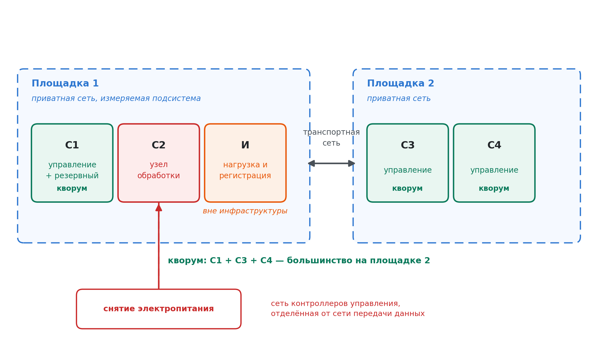
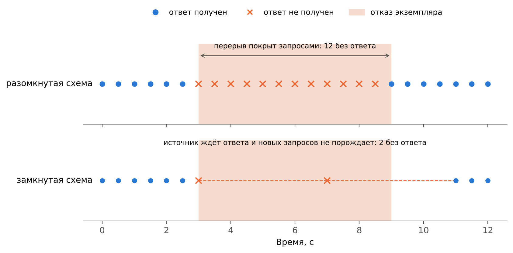
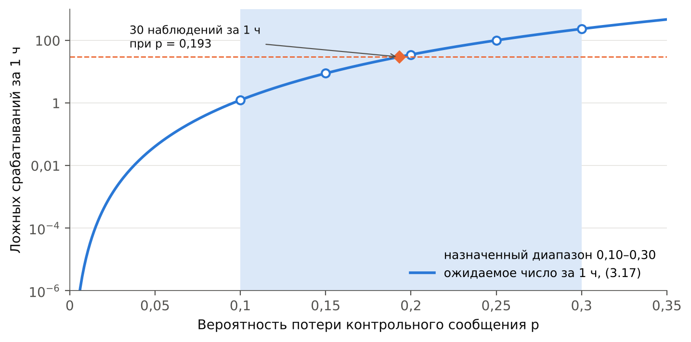
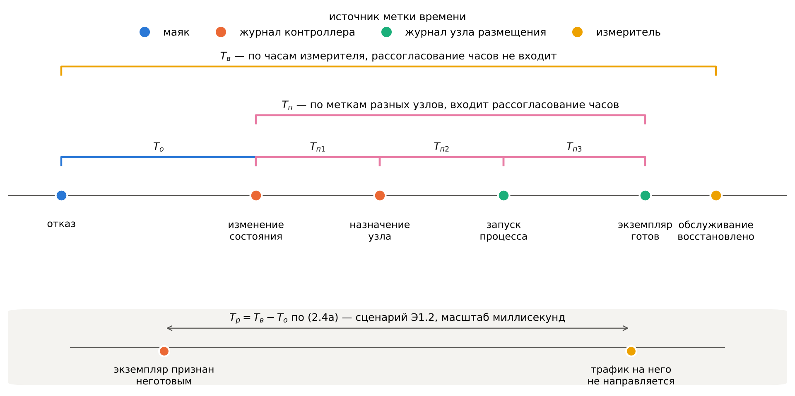
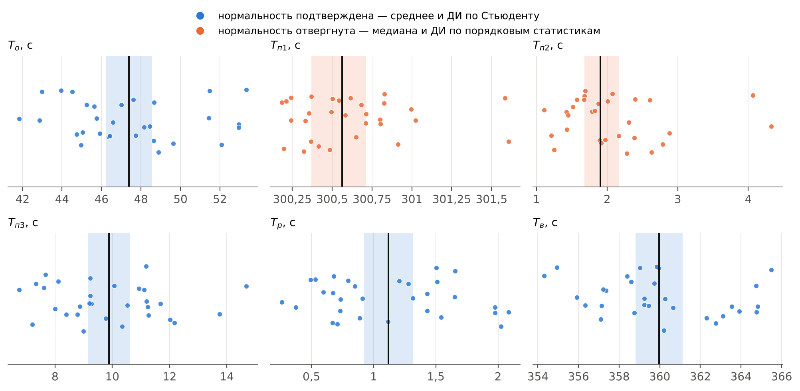
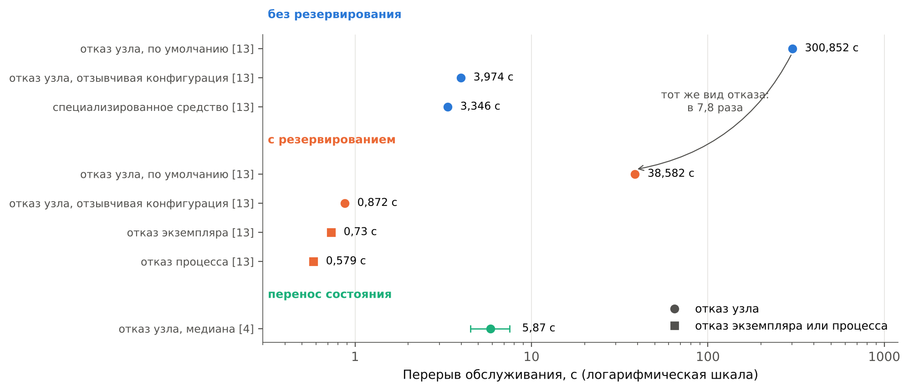

# ГЛАВА 2. Методика экспериментального исследования времени восстановления обслуживания

В главе разрабатывается методика измерения времени восстановления обслуживания при отказах в контейнерной инфраструктуре. В разделе 2.1 определяется объект испытаний, формулируются требования к экспериментальному стенду и обосновывается его состав. Раздел 2.2 задаёт модель нагрузки и профили трафика, раздел 2.3 — способы воспроизводимого внесения отказов, раздел 2.4 — точки измерения, разложение времени восстановления на составляющие и статистическую обработку. В разделе 2.5 излагается программа эксперимента Э1, назначаются предсказания и критерии, служащие проверкой гипотезы работы, и устанавливается порядок обработки полученных данных.

## 2.1 Экспериментальный стенд

Настоящий раздел определяет, что подвергается испытаниям, какие требования предъявляются к стенду для получения достоверных результатов и каким составом оборудования и программного обеспечения эти требования обеспечиваются. Здесь же объявляются ограничения стенда и оценивается их влияние на область применимости результатов.

**Объект испытаний.** Испытаниям подвергается не платформа оркестрации как изделие и не сетевая функция сама по себе, а процесс восстановления обслуживания при отказе — последовательность действий механизмов управления, разобранная в разделе 1.3 и разложенная там на стадии обнаружения *T*о, переразмещения *T*п и перенаправления трафика *T*р. Объектом испытаний служит совокупность контейнерной инфраструктуры, размещённой в ней сетевой функции и механизмов контроля и восстановления; измеряемыми величинами — длительности перечисленных стадий и суммарная длительность перерыва обслуживания.

В качестве сетевой функции принят балансировщик нагрузки транспортного уровня, сохраняющий таблицу состояний обслуживаемых соединений. Выбор обоснован тремя обстоятельствами. Функция относится к транспортному уровню и принадлежит к классу, для которого отраслевыми спецификациями предусмотрено резервирование [6], вследствие чего результаты относятся к объекту исследования, а не к произвольному приложению. Функция сохраняет состояние соединений, из-за чего пригодна и для экспериментов главы 4 без замены объекта испытаний: утрата состояния при переразмещении наблюдается на ней непосредственно. Наконец, обслуживаемый ею трафик допускает непрерывное измерение извне, что необходимо для выполнения требования Т3, формулируемого ниже. Шлюз туннелей привлекается в разделе 4.5 исключительно для проверки переносимости метода и полной характеризации не подвергается.

**Требования к стенду.** Структура эксперимента с внесением отказов задана методологией, восходящей к [38]: входная область эксперимента образована множеством вносимых отказов и множеством воздействий, функционально возбуждающих систему, выходная — множеством регистрируемых величин и множеством выводимых из них мер; к реализации внесения отказов предъявляются требования минимальной возмущаемости, управляемости и воспроизводимости. Систематизация современного состояния направления дана в [39]. Применительно к настоящей работе из указанной методологии следуют пять требований.

**Т1. Управляемость внесения отказа.** Момент отказа назначается экспериментатором, а не ожидается. Требование вытекает из необходимости получить не менее 30 повторностей на сценарий: при частоте естественных отказов оборудования порядка единиц в год такое число повторностей недостижимо.

**Т2. Воспроизводимость.** Повторное выполнение сценария при тех же настройках даёт результат, отличающийся лишь в пределах статистического разброса. Требование определяет способ внесения отказа: он должен быть одинаков во всех повторностях и не зависеть от состояния программного обеспечения, которое этим отказом нарушается.

**Т3. Невозмущающее измерение.** Средства измерения не входят в состав испытуемой инфраструктуры и не влияют на её поведение. Требование существенно именно для настоящей работы: измеряемые величины определяются работой контура управления, и размещение измерителя внутри инфраструктуры изменило бы нагрузку на тот самый механизм, длительность работы которого измеряется.

**Т4. Представительность вносимого отказа.** Вносимый отказ воспроизводит отказ, наблюдаемый при эксплуатации, а не удобную его имитацию. Для настоящей работы требование конкретизируется так: отказ узла обработки должен приводить к внезапному прекращению обмена сообщениями без предварительного оповещения, поскольку именно такой ход событий обрабатывается контуром контроля состояния узла и именно он порождает разобранные в разделе 1.3 предельные времена ожидания.

**Т5. Разграничимость стадий.** Стенд обеспечивает раздельную регистрацию событий, разграничивающих стадии *T*о, *T*п и *T*р. Требование вытекает из гипотезы работы: её проверка состоит в установлении соотношения между стадиями, и измерение одного лишь суммарного времени восстановления гипотезу не проверяет.

**Состав и топология стенда.** Стенд образован пятью физическими серверами на процессорах архитектуры x86 с выделенными вычислительными ядрами, арендованными у одного поставщика услуг и размещёнными на двух географически разнесённых площадках: трёх на первой площадке и двух на второй. Серверы в пределах площадки объединены приватной сетью поставщика; связь между площадками осуществляется его же транспортной сетью. Схема приведена на рисунке 2.1, распределение ролей и размещение — в таблице 2.1.

*Рисунок 2.1 — Схема экспериментального стенда: размещение серверов по двум площадкам, состав кворума, измеряемая подсистема и цепь управления питанием*

**Таблица 2.1 — Распределение ролей и размещение серверов стенда**

| Обозначение | Площадка | Назначение | Входит в кворум |
|---|---|---|---|
| С1 | Первая | Управление, хранение состояния инфраструктуры; резервный экземпляр функции | да |
| С2 | Первая | Узел обработки, объект внесения отказа | нет |
| И | Первая | Источник нагрузки и измеритель, вне инфраструктуры | нет |
| С3 | Вторая | Управление, хранение состояния инфраструктуры | да |
| С4 | Вторая | Управление, хранение состояния инфраструктуры | да |

**Обоснование распределения ролей.** Размещение не выбрано, а выведено из требований Т3 и Т5 совместно с условием сохранения определённости при разделении сети.

Требование Т5 предписывает раздельную наблюдаемость стадий восстановления, откуда следует, что путь трафика от источника нагрузки к экземплярам сетевой функции не должен проходить через транспортную сеть между площадками: время перенаправления трафика лежит по оценке раздела 1.3 в области единиц миллисекунд и было бы этой сетью определено, а не свойствами исследуемого механизма. Следовательно, узел обработки, узел с резервным экземпляром и измеритель размещаются на одной площадке. Требование Т3 не допускает совмещения измерителя с узлами инфраструктуры, а условие невозмущаемости кворума не допускает совмещения объекта внесения отказа с узлом кворума: иначе отказ узла обработки затрагивал бы состав кворума и становился неотличим от потери управляемости. Отсюда первая площадка занята тремя серверами — измерителем, узлом обработки вне кворума и узлом кворума, несущим резервный экземпляр.

Оставшиеся два сервера образуют вместе с узлом С1 кворум из трёх узлов, большинство в котором составляют два. При разделении сети между площадками большинство оказывается на второй площадке, вследствие чего она сохраняет управляемость, а первая её утрачивает. Исход определён, чем и обеспечивается разграничение двух классов отказов: отказ узла обработки не затрагивает кворума, разделение сети лишает кворума одну определённую площадку. Симметричное размещение узлов кворума по площадкам такого разграничения не даёт — при равном разделении ни одна сторона не располагает большинством, инфраструктура теряет управляемость целиком, и оба класса отказов проявляются одинаково.

Следствием принятого размещения является то, что при разделении сети управляемость утрачивает именно та площадка, которая несёт нагрузку. Случай этот не побочен, а составляет наиболее тяжёлый из подлежащих рассмотрению в главе 5: переразмещение нагрузки невозможно ни средствами платформы, ни изменением её настроек, поскольку решение о переразмещении принимать некому. Противоположный случай — сохранение управляемости площадкой с нагрузкой — получается переназначением ролей без изменения состава стенда, поскольку серверы однотипны, и рассматривается в разделе 5.4 как второй сценарий.

**Обоснование числа серверов.** Число серверов определяется не соображениями масштаба, а минимальным составом, при котором испытуемые механизмы наблюдаемы раздельно, и полностью задаётся приведённым выше выводом: три сервера на площадке с нагрузкой по требованиям Т3 и Т5, два на второй площадке для образования кворума из трёх узлов с определённым исходом при разделении. Сокращение любого из пяти нарушает одно из требований: удаление измерителя нарушает Т3, совмещение объекта отказа с узлом кворума лишает разграничения классов отказов, уменьшение кворума до двух узлов делает любой отказ неотличимым от потери управляемости.

Достаточность такого масштаба подтверждается независимо. Экспериментальная проверка отказоустойчивости сетевых функций с сохранением состояния выполнена в [4] на двух узлах; измерение длительности перерыва обслуживания при отказах различных видов, результаты которого приведены в разделе 1.4, получено в [13] на трёх виртуальных машинах; методическая работа по внесению неисправностей [5] выполнена на инфраструктурах из четырёх и восьми узлов. Существенно и то, что стенд настоящей работы образован физическими серверами, тогда как в [13] применялись виртуальные машины: при измерении длительностей, определяемых контуром управления, отсутствие промежуточного слоя виртуализации устраняет источник разброса, которым та работа не управляла. Измеряемые величины определяются предельными временами ожидания контура управления, а они от числа узлов не зависят: увеличение масштаба изменяет нагрузку на подсистему хранения состояния и длительность распространения изменений, но не пороги, по которым принимается решение об отказе.

**Способ внесения отказа узла.** Отказ узла обработки вносится снятием электропитания средствами контроллера управления платформой, входящего в состав сервера и доступного по сети независимо от состояния его основной вычислительной части. Соответствующая операция стандартизована: в спецификации интерфейса управления она определена как немедленное выключение изделия без корректного завершения работы и явно противопоставлена операции корректного завершения с последующим выключением [41]. Более ранним стандартом того же назначения служит интеллектуальный интерфейс управления платформой [42].

Такой способ удовлетворяет всем требованиям, предъявленным к внесению отказа. Требование Т4 выполняется буквально: прекращение электропитания есть тот самый отказ, который обрабатывается контуром контроля состояния узла, а не его имитация. Требование Т1 выполняется постольку, поскольку момент воздействия назначается экспериментатором подачей команды. Требование Т2 выполняется постольку, поскольку воздействие осуществляется вне основной вычислительной части сервера и не зависит от состояния её программного обеспечения. Требование Т3 выполняется постольку, поскольку цепь управления питанием образована сетью контроллеров управления, отделённой от сети передачи данных испытуемой инфраструктуры.

Неопределённость момента отказа определяется задержкой обработки команды контроллером управления; величина эта измеряется и учитывается при оценке погрешности в разделе 2.4. Порядок внесения отказов всех рассматриваемых видов излагается в разделе 2.3.

**Программная конфигурация.** Воспроизводимость результатов требует фиксации версий всего программного обеспечения, участвующего в измерении. Значения по умолчанию, приведённые в разделе 1.3, между выпусками платформы оркестрации изменялись, вследствие чего указание версии является не формальностью, а условием сопоставимости результатов с приведёнными в [3], [4] и [13]. Перечень величин, заносимых в протокол стенда при его развёртывании, приведён в таблице 2.2.

**Таблица 2.2 — Величины, фиксируемые в протоколе стенда**

| Составляющая | Фиксируемая величина |
|---|---|
| Серверы | Модель процессора, число ядер, объём памяти, тип накопителя |
| Операционная система | Наименование, версия, версия ядра |
| Среда исполнения контейнеров | Наименование, версия |
| Платформа оркестрации | Версия; значения периодов и предельных времён контура контроля |
| Сетевая функция | Версия образа, число экземпляров, схема резервирования |
| Детектор отказа | Версия, значения периода передачи τ и кратности обнаружения k |
| Средства измерения | Наименование и версия источника нагрузки, версия службы синхронизации времени |
| Приватная сеть площадки | Пропускная способность, задержка при отсутствии нагрузки, потери |
| Транспортная сеть между площадками | Задержка при отсутствии нагрузки, её разброс, потери |
| Управление питанием | Наименование интерфейса контроллера, задержка обработки команды выключения |

Основные измерения выполняются на платформе оркестрации в базовой конфигурации, без надстроек: результат должен определяться механизмами самой платформы, а не особенностями конкретного средства развёртывания. Параметры контура контроля состояния узла при измерении базовой линии в разделе 2.5 принимаются равными значениям по умолчанию, приведённым в разделе 1.3; их изменение является независимой переменной экспериментов главы 3 и в настоящей главе не производится. Проверка переносимости результатов на отечественный дистрибутив платформы в настоящей работе не выполняется и отнесена к ограничениям, перечисленным ниже.

Отдельно фиксируется размещение управляющей составляющей, принимающей решение об отказе узла: при разнесении узлов кворума по площадкам это размещение определяет, проходят ли сведения о состоянии отказывающего узла через транспортную сеть между площадками. На измерение времени обнаружения указанное обстоятельство существенного влияния не оказывает ввиду соотношения величин, установленного ниже, однако как источник разброса подлежит регистрации в протоколе каждого опыта.

**Точность измерения времени.** Принятое размещение делает задачу измерения времени разрешимой без специальных средств, что и составляет одно из оснований этого размещения.

Величины, соизмеримые с достижимым рассогласованием часов, регистрируются одним устройством по его собственным часам. Измеритель регистрирует перерыв обслуживания как интервал между последним обслуженным запросом к отказавшему экземпляру и первым обслуженным запросом к резервному; обе метки ставятся одними и теми же часами, и рассогласование в результат не входит вовсе. Возможность такого измерения обеспечена размещением измерителя и обоих экземпляров сетевой функции на одной площадке. Само время перенаправления трафика, определённое в разделе 1.3 от признания экземпляра неготовым, получается вычитанием из этого интервала времени обнаружения, измеренного в том же опыте; порядок вычитания и его вклад в неопределённость установлены в разделе 2.4.

Величины, вычисляемые по меткам разных узлов, — время обнаружения и время переразмещения — составляют десятки и сотни секунд. Согласование часов серверов в пределах площадки выполняется службой синхронизации времени, для которой при работе в быстродействующей локальной сети заявлена точность порядка сотен микросекунд [40]; вносимая ею погрешность составляет для указанных величин доли процента. Транспортная сеть между площадками входит лишь в путь передачи сведений о состоянии узла и в согласование часов узлов кворума; при задержке этой сети порядка единиц и десятков миллисекунд её вклад во время обнаружения, составляющее десятки секунд, не превышает долей процента. Численная оценка погрешности по всем её источникам, включая фактически достигнутое рассогласование часов и фактическую задержку транспортной сети, выполняется в разделе 2.4.

**Ограничения стенда.** Стенд не воспроизводит инфраструктуру оператора связи и не предназначен для этого. Ограничения и вытекающие из них границы применимости результатов приводятся здесь совместно.

Число серверов ограничивает масштаб, на котором справедливы выводы: результаты относятся к инфраструктуре, где длительность распространения изменений между узлами мала по сравнению с предельными временами ожидания. Аппаратные метки времени недоступны, вследствие чего все интервалы регистрируются программно. Транспортная сеть между площадками принадлежит поставщику услуг и её характеристики управлению не поддаются: они измеряются и заносятся в протокол, но не задаются, вследствие чего опыты с управляемым изменением задержки канала, предусмотренные разделами 2.3 и 5.4, выполняются внесением дополнительной задержки средствами узлов, а не изменением свойств самой сети. Проверка переносимости на отечественный дистрибутив платформы не выполняется: результаты относятся к той сборке, версия которой занесена в протокол. Физический доступ к оборудованию отсутствует, из-за чего отказы, требующие вмешательства в аппаратуру — отсоединение сетевого кабеля, извлечение накопителя, — из рассмотрения исключаются; вносимыми остаются отказы, воспроизводимые снятием электропитания и воздействием на программное обеспечение и сетевой обмен. Профили нагрузки, задаваемые разделом 2.2, воспроизводят постоянную интенсивность и пуассоновский поток, но не самоподобную структуру эксплуатационного трафика; результаты относятся поэтому к длительности реакции механизмов управления, от структуры потока не зависящей, а не к поведению службы под эксплуатационной нагрузкой. Наконец, полной характеризации подвергается одна сетевая функция; проверка переносимости на функцию иного назначения выполняется в разделе 4.5 и полным обоснованием переносимости не является.

## 2.2 Модель нагрузки и профили трафика

Нагрузка в настоящей работе не является предметом исследования. Она служит измерительным инструментом: перерыв обслуживания наблюдается как промежуток в потоке успешно обслуженных запросов, и свойства этого потока определяют, какая длительность перерыва вообще может быть измерена. Отсюда модель нагрузки строится не по признаку сходства с эксплуатационной, а по признаку пригодности к измерению, а сходство с эксплуатационной проверяется отдельным профилем. Настоящий раздел устанавливает четыре требования к порождаемой нагрузке, выводит из них численные значения её параметров и задаёт профили трафика.

**Н1. Разомкнутая схема порождения.** Порождение запросов не должно зависеть от получения ответов на предшествующие. Требование является определяющим и вытекает из существа измеряемой величины.

Различие двух схем порождения нагрузки установлено в [43]: в замкнутой схеме поступление новых заявок вызывается завершением предыдущих, тогда как в разомкнутой заявки поступают независимо от завершений. Применительно к измерению перерыва обслуживания это различие принципиально. Источник нагрузки, работающий по замкнутой схеме, при отказе обслуживающего экземпляра перестаёт получать ответы и тем самым перестаёт порождать запросы; промежуток в потоке обслуженных запросов сокращается не потому, что обслуживание восстановилось, а потому, что источник замолчал. Длительность перерыва при такой схеме систематически занижается, причём тем сильнее, чем перерыв длиннее.

Явление это известно и в средствах порождения нагрузки: указывается, что при схеме, когда каждое соединение отправляет очередной запрос лишь по получении ответа, наибольшие задержки, проявленные испытуемой системой, оказываются не учтены [46]. Устранение состоит в отсчёте от момента, в который запрос должен был быть отправлен согласно заданной постоянной интенсивности, а не от момента фактической отправки [46]. Настоящая работа принимает разомкнутую схему как обязательную: источник нагрузки поддерживает заданную интенсивность независимо от поведения испытуемой системы, а неполученные ответы регистрируются как отказы в обслуживании, а не как отсутствие запросов. Различие двух схем при измерении перерыва обслуживания показано на рисунке 2.2.

*Рисунок 2.2 — Разомкнутая и замкнутая схемы порождения нагрузки при измерении перерыва обслуживания: в разомкнутой схеме запросы отправляются независимо от получения ответов, вследствие чего перерыв покрыт запросами и его границы определяются с точностью до промежутка между ними; в замкнутой схеме источник, не получив ответа, новых запросов не порождает*

**Н2. Интенсивность, обеспечивающая разрешение измеряемой величины.** Поток запросов дискретен, вследствие чего момент отказа и момент восстановления определяются с точностью до промежутка между соседними запросами. Момент отказа с моментами отправки не согласован, поэтому вносимая дискретностью ошибка распределена равномерно на промежутке между запросами, а её среднее квадратическое отклонение при интенсивности λи составляет

$$\sigma_1 = \frac{1}{\lambda_и \sqrt{12}} \tag{2.1}$$

Измеряемый промежуток ограничен двумя событиями потока — последним запросом, обслуженным до перерыва, и первым, обслуженным после него, — и дискретность вносит независимую ошибку на каждой из границ, вследствие чего дисперсия удваивается. При усреднении по *n* независимым повторностям среднее квадратическое отклонение оценки среднего убывает в √*n* раз. Требование, чтобы вносимая дискретностью погрешность оценки среднего не превышала доли ε от измеряемой величины *T*, даёт условие на интенсивность

$$\lambda_и \geqslant \frac{\sqrt{2}}{\varepsilon\, T \sqrt{12 n}} \tag{2.2}$$

Определяющей является наименьшая из измеряемых величин — время перенаправления трафика, для которого в разделе 1.3 установлена нижняя оценка порядка единиц миллисекунд. При *T* = 1 мс, ε = 0,05 и *n* = 30 условие (2.2) даёт λи ≥ 1491 запр./с. Принимается значение 2000 запр./с. При такой интенсивности среднее квадратическое отклонение единичного измерения составляет 204 мкс, оценки среднего по 30 повторностям — 37 мкс, то есть 3,7 % от величины 1 мс. Помимо случайной составляющей дискретность вносит систематическое смещение, устраняемое поправкой (2.4) раздела 2.4. Для времени обнаружения и времени переразмещения, составляющих десятки и сотни секунд, та же интенсивность даёт погрешность, не превышающую тысячных долей процента, вследствие чего условие (2.2) для них выполняется с многократным запасом и отдельного рассмотрения не требует.

**Н3. Отсутствие насыщения.** Нагрузка не должна приближать инфраструктуру к пределу пропускной способности: измеряемые величины определяются работой контура управления, и насыщение любого из ресурсов внесло бы в них зависимость от загруженности, посторонней для предмета исследования. При интенсивности 2000 запр./с и размерах сообщений, принятых ниже, порождаемый поток составляет 3,2 Мбит/с на основном профиле и 8,4 Мбит/с на контрольном, что на два порядка ниже пропускной способности приватной сети площадки. Фактическая загруженность процессора и сетевых интерфейсов узлов измеряется при прогреве и заносится в протокол; при превышении 30 % интенсивность подлежит снижению с соответствующей проверкой условия (2.2).

**Н4. Наличие длительных соединений.** Испытуемая сетевая функция сохраняет таблицу состояний обслуживаемых соединений, и утрата этого состояния при переразмещении составляет предмет главы 4. Наблюдаемость такой утраты требует, чтобы часть нагрузки составляли соединения, существующие дольше времени восстановления: соединение, завершившееся до отказа, утрату состояния не проявляет. Отсюда в профиль включается доля длительных соединений с продолжительностью, превышающей наибольшее ожидаемое время восстановления.

**Профили трафика.** Требования Н1–Н4 задают основной профиль; сходство с эксплуатационной нагрузкой проверяется вторым, контрольным профилем. Параметры обоих приведены в таблице 2.3.

**Таблица 2.3 — Профили нагрузки**

| Параметр | Основной профиль | Контрольный профиль |
|---|---|---|
| Схема порождения | Разомкнутая | Разомкнутая |
| Закон следования запросов | Постоянная интенсивность | Пуассоновский поток |
| Интенсивность, запр./с | 2000 | 2000 в среднем |
| Размер сообщения, байт | 200 | 40 и 1500 в отношении 2:1 |
| Доля длительных соединений | 0,2 | 0,2 |
| Продолжительность длительного соединения, с | не менее 600 | не менее 600 |
| Назначение | Измерение составляющих времени восстановления | Проверка независимости результата от профиля |

Основной профиль задаёт постоянную интенсивность. Выбор обоснован назначением нагрузки: постоянная интенсивность равномерно покрывает ось времени, вследствие чего разрешающая способность измерения одинакова независимо от момента внесения отказа. Неравномерный поток такого свойства не имеет: при попадании отказа в промежуток между пачками разрешение падает, и результат приобретает зависимость от случайного положения отказа относительно структуры потока.

Выбор этот, однако, расходится с известными свойствами эксплуатационного трафика, и расхождение подлежит признанию, а не умолчанию. Установлено, что пуассоновская модель пригодна лишь для части процессов: поступление сеансов, инициируемых пользователями, описывается пуассоновским потоком с постоянной часовой интенсивностью, тогда как поступление прочих соединений от него существенно отклоняется, а моделирование промежутков между пакетами показательным распределением грубо занижает пачечность трафика [44]. Заключение той же работы состоит в том, что процессы поступления пакетов в сетях широкого охвата лучше описываются самоподобными процессами [44]. Отсюда следует, что ни постоянная интенсивность, ни пуассоновский поток эксплуатационного трафика не воспроизводят.

Принятое разрешение состоит в разделении назначений. Измерение составляющих времени восстановления выполняется на основном профиле, где важна равномерность покрытия оси времени, а не сходство с эксплуатацией: измеряется длительность реакции механизмов платформы, которая от структуры потока не зависит. Контрольный профиль с пуассоновским потоком применяется для проверки того, что полученные значения от профиля действительно не зависят; расхождение результатов двух профилей сверх доверительного интервала означало бы наличие такой зависимости и потребовало бы отдельного рассмотрения. Воспроизведение самоподобного трафика в задачи настоящей работы не входит и отнесено к ограничениям стенда, перечисленным в разделе 2.1.

**Размеры сообщений.** Основной профиль использует сообщения постоянного размера 200 байт: величина эта достаточна для размещения служебных сведений, необходимых при регистрации, и мала настолько, что требование Н3 выполняется с запасом. Контрольный профиль воспроизводит наблюдаемое в сетях распределение размеров, которое характеризуется как двумодальное с модами при 40 и 1500 байт, дающими соответственно около 40 и 20 % пакетов [45]; отношение долей в профиле принято равным 2:1 в соответствии с этими значениями. Отмечается в том же источнике, что наблюдавшаяся до 2000 года третья мода при 576 байт впоследствии практически исчезла [45], вследствие чего в профиль она не включается.

**Средства порождения нагрузки.** К средству порождения предъявляются требования, вытекающие из Н1 и Н2: поддержание заданной постоянной интенсивности независимо от поведения испытуемой системы; отсчёт задержки от момента, в который запрос должен был быть отправлен; регистрация неполученных ответов как отказов в обслуживании с меткой времени каждого; способность поддерживать длительные соединения одновременно с потоком коротких. Средства, работающие по замкнутой схеме, для настоящей работы непригодны независимо от прочих их свойств. Существующие средства, удовлетворяющие перечисленным требованиям, известны — таково, в частности, средство, реализующее порождение с постоянной интенсивностью и исправленную регистрацию задержек [46]; конкретное средство и его версия заносятся в протокол стенда согласно таблице 2.2.

Метки времени, поставленные средством порождения, служат основой измерения времени перенаправления трафика согласно порядку, установленному в разделе 2.1: обе границы промежутка регистрируются одними часами измерителя, вследствие чего рассогласование часов узлов в эту величину не входит. Порядок регистрации прочих величин излагается в разделе 2.4.

## 2.3 Методика воспроизводимого внесения отказов

Отказы, длительность реакции на которые исследуется, при эксплуатации происходят редко и непредсказуемо, вследствие чего получение необходимого числа повторностей требует их внесения. Настоящий раздел классифицирует вносимые отказы, устанавливает способ внесения каждого из них, обосновывает выбор диапазона управляемой деградации канала и определяет порядок фиксации момента отказа, от точности которого зависит измерение всех составляющих времени восстановления.

**Классификация вносимых отказов.** Классификация строится по виду отказа обслуживания, определённому в [32]. Различаются отказы по содержанию, при которых сведения на границе обслуживания отклоняются от предписанных, и отказы по времени, при которых отклоняются момент поступления сведений или их продолжительность. Среди первых выделяется остановка, при которой обслуживание прекращается и внешнее состояние объекта становится постоянным, а среди её разновидностей — молчание, при котором на границе обслуживания не выдаётся ничего, в частности не отправляется ни одного сообщения [32]. Границы исследования, объявленные во введении, ограничивают рассмотрение отказами типа остановки; отказы с произвольным поведением, называемые в [32] беспорядочными, не вносятся и не рассматриваются.

Вносятся отказы четырёх видов, соответствие которых этой классификации указано при каждом.

**О1. Снятие электропитания узла обработки.** По [32] — остановка с молчанием: узел прекращает и работу, и обмен. Проверяемый механизм — контур контроля состояния узла.

**О2. Прекращение обмена узла при сохранении его работоспособности.** Молчание без остановки: узел работает, но на границе обслуживания не выдаёт ничего. Проверяется разграничение отказа и задержки.

**О3. Приостановка процесса экземпляра сетевой функции.** Остановка на уровне экземпляра. Проверяемый механизм — контур контроля экземпляра.

**О4. Внесение задержки и потерь в канал.** Отказ по времени: отклоняется момент поступления сведений. Проверяется частота ложных срабатываний.

Существенно различие отказов О1 и О2. При снятии электропитания узел прекращает и работу, и обмен; при прекращении обмена узел продолжает работать, но становится недостижимым. Для механизма контроля, наблюдающего узел извне, оба случая неразличимы — в этом и состоит принципиальная неопределённость, установленная в разделе 1.3 со ссылкой на [18]. Внесение обоих отказов позволяет установить, различает ли их платформа фактически и совпадают ли измеренные времена реакции; совпадение подтверждает неразличимость, различие означало бы наличие в платформе не учтённого моделью источника сведений.

**Снятие электропитания узла (О1).** Способ внесения установлен в разделе 2.1: подача команды немедленного выключения контроллеру управления платформой, определённой стандартом как выключение без корректного завершения работы [41]. Отказ вносится в узел С2, не входящий в кворум, вследствие чего управляемость инфраструктуры сохраняется и измеряемая величина определяется контуром контроля состояния узла.

**Прекращение обмена при сохранении работоспособности (О2).** Отказ вносится установкой на узле правил, отбрасывающих все пакеты, входящие и исходящие, кроме относящихся к цепи управления и к маяку, описанному ниже. Узел при этом продолжает исполнять размещённые на нём экземпляры, но не участвует в обмене, вследствие чего для контроллера неотличим от отказавшего. Требование Т2 выполняется постольку, поскольку набор правил задан заранее и не зависит от состояния программного обеспечения узла; требование Т1 — постольку, поскольку момент установки правил назначается экспериментатором.

**Приостановка процесса экземпляра (О3).** Отказ вносится подачей процессу экземпляра сигнала приостановки. Выбор именно этого способа обоснован требованием Т2: приостановка и принудительное завершение относятся к сигналам, которые, согласно документации, не могут быть перехвачены, заблокированы или проигнорированы [47], вследствие чего результат воздействия не зависит от того, как написана сетевая функция и предусмотрена ли в ней обработка сигналов. Приостановка предпочтена принудительному завершению, поскольку воспроизводит зависание: процесс существует, но не отвечает, — тогда как завершение приводит к немедленному изменению состояния, наблюдаемому платформой по иному пути.

**Внесение задержки и потерь в канал (О4).** Деградация канала вносится средством эмуляции сетевых характеристик, входящим в подсистему управления трафиком операционной системы. Средство реализовано как дисциплина очереди, размещаемая между выходом протокола и сетевым устройством, и позволяет вносить постоянную и случайную задержку, потери, дублирование и переупорядочение пакетов [48]. Задержка задаётся с распределением по равномерному, нормальному, степенному или смешанному закону; потери — по одной из трёх моделей: независимой, когда потеря каждого пакета не зависит от прочих, четырёхсостоянием марковской цепью и моделью пачечных потерь [49].

Существенно наличие двух моделей потерь, независимой и пачечной. Выражение частоты ложных срабатываний, полученное в разделе 3.3 и обозначенное там (3.18), опирается на предположение о независимости потерь: вероятность потери *k* подряд идущих сообщений принята равной *p**k*. Предположение это для действительных каналов связи не выполняется — пачечный характер потерь известен и описывается моделями, восходящими к работам [50] и [51], реализованным в применяемом средстве [49]. Отсюда порядок проверки: измерения при независимых потерях проверяют выражение (3.18) в тех условиях, для которых оно выведено, а измерения при пачечных потерях устанавливают величину и направление отклонения при нарушении предположения. Второе измерение существенно для практической применимости метода и выполняется в разделе 3.5 как отдельный сценарий.

**Обоснование диапазона потерь.** Вероятность потери является независимой переменной эксперимента по измерению частоты ложных срабатываний, и её диапазон не может быть назначен произвольно: при малых значениях ложные срабатывания не наблюдаются за разумное время опыта, при больших — канал перестаёт соответствовать эксплуатационному. Нижняя граница диапазона определяется требуемым числом наблюдений.

Согласно (3.18), ложное срабатывание требует потери *k* подряд идущих сообщений, вследствие чего частота ложных срабатываний убывает как *p**k*. Расчёт для настроек, принятых в разделе 3.3 в качестве иллюстративных, — кратность обнаружения *k* = 5 и период передачи τ = 26 мс, чему соответствует время обнаружения 0,117 с, — приведён в таблице 2.4.

**Таблица 2.4 — Ожидаемая частота ложных срабатываний при независимых потерях (k = 5, τ = 26 мс)**

| Вероятность потери *p* | Частота ν, с⁻¹ | Ожидаемое число срабатываний за 1 ч |
|---|---|---|
| 0,01 | 3,8·10⁻⁹ | 0,00 |
| 0,05 | 1,1·10⁻⁵ | 0,04 |
| 0,10 | 3,5·10⁻⁴ | 1,25 |
| 0,15 | 2,5·10⁻³ | 8,94 |
| 0,20 | 9,8·10⁻³ | 35,45 |
| 0,25 | 2,8·10⁻² | 101,41 |
| 0,30 | 6,5·10⁻² | 235,52 |

Из таблицы 2.4 следует, что при вероятности потери 0,01 одно ложное срабатывание ожидается раз в несколько тысяч суток, а при 0,05 — раз в сутки, вследствие чего измерение частоты при таких значениях неосуществимо. Требуемое для статистической обработки число наблюдений порядка 30 за час опыта достигается при вероятности потери 0,193. Принимается диапазон независимой переменной от 0,10 до 0,30 с шагом 0,05: нижнее значение даёт единичные наблюдения и служит проверкой того, что расчёт не завышает частоту, верхнее — обильные наблюдения при сохранении осмысленности канала. Настройка *k* = 5 при τ = 26 мс принята иллюстративной и отвечает внутреннему оптимуму раздела 3.3; при настройке, рекомендуемой разделом 3.4 после округления периода к общеупотребительному ряду, то же число наблюдений достигается при близкой вероятности потери, и назначенный диапазон остаётся пригодным без изменений. Зависимость и назначенный диапазон представлены на рисунке 2.3.

*Рисунок 2.3 — Зависимость частоты ложных срабатываний от вероятности потери при k = 5 и τ = 26 мс: логарифмическая ось ординат, закрашен назначенный диапазон независимой переменной, отмечено значение, дающее 30 наблюдений за час опыта*

Значения эти существенно превосходят наблюдаемые в исправных каналах связи, и это обстоятельство подлежит оговорке при изложении результатов: измерения выполняются в области, где ложные срабатывания наблюдаемы, а перенос на область эксплуатационных значений производится по установленной зависимости, а не непосредственно. Такой порядок вынужден и является общим для измерения редких событий.

**Фиксация момента отказа.** Все составляющие времени восстановления отсчитываются от момента отказа, вследствие чего точность его определения входит в результат непосредственно. Момент этот не наблюдаем прямо: отказавший узел о своём отказе не сообщает.

Принят следующий порядок. Узел, в который вносится отказ, передаёт измерителю поток коротких сообщений — маяк — с постоянной частотой λм. Момент отказа заключён между временем приёма последнего маяка и временем, на один период маяка позднее, поскольку следующий маяк не поступил. Вторая, независимая граница даётся временем завершения команды внесения отказа. Две границы совместно ограничивают момент отказа сверху и снизу, что позволяет не только оценить его, но и проверить согласованность оценки.

Ошибка, вносимая дискретностью маяка, распределена равномерно на его периоде, и требование, чтобы её среднее квадратическое отклонение не превышало доли ε от наименьшей измеряемой величины, даёт по аналогии с (2.1) условие

$$\lambda_м \geqslant \frac{1}{\varepsilon\, T_о^{\min} \sqrt{12}} \tag{2.3}$$

Наименьшим измеряемым временем обнаружения является время обнаружения предлагаемого метода, составляющее по расчётам главы 3 от 25 до 120 мс в зависимости от настройки; расчёт ведётся по наименьшему значению 25 мс. При ε = 0,05 и *T*о^min = 0,1 с условие (2.3) даёт λм ≥ 58 маяк/с, при *T*о^min = 25 мс — λм ≥ 231 маяк/с. Принимается значение 1000 маяк/с, обеспечивающее среднее квадратическое отклонение 289 мкс, что составляет 1,2 % от 25 мс, 0,29 % от 0,1 с и 0,0006 % от штатного времени обнаружения 50 с. Порождаемый маяком поток при длине сообщения 64 байта составляет 0,512 Мбит/с и требование Н3 не нарушает.

Маяк передаётся на измеритель, размещённый согласно разделу 2.1 на той же площадке, вследствие чего время приёма регистрируется теми же часами, что и метки потока запросов, и рассогласование часов узлов в оценку момента отказа не входит. При внесении отказа О2 маяк исключается из отбрасываемых потоков: узел продолжает работать, и прекращение маяка означало бы не отказ, а его имитацию.

**Обеспечение повторяемости.** Повторяемость обеспечивается тремя мерами.

**Восстановление исходного состояния.** После каждого опыта инфраструктура приводится к исходному состоянию: узел, в который вносился отказ, возвращается в работу, размещение экземпляров восстанавливается, внесённые правила и характеристики канала снимаются. Опыт не начинается, пока не подтверждено выполнение условий исходного состояния — готовность всех предусмотренных экземпляров, полнота кворума, отсутствие остаточных записей об отказавших экземплярах в таблице распределения трафика, соответствие измеренной задержки канала значению без внесённой деградации. Перечень проверяемых условий и способ проверки фиксируются в протоколе.

**Прогрев.** Каждому опыту предшествует подача нагрузки в течение времени, достаточного для установления стационарного режима; результаты периода прогрева в обработку не включаются. Продолжительность прогрева определяется по выходу измеряемых характеристик на постоянный уровень и заносится в протокол.

**Рандомизация порядка.** Опыты различных сценариев выполняются в случайном порядке, а не последовательными сериями. Мера направлена против систематического смещения, вносимого медленным изменением условий — накоплением состояния в инфраструктуре, изменением загруженности оборудования поставщика услуг, суточным ходом характеристик транспортной сети. При последовательном выполнении такое изменение неотличимо от влияния исследуемого фактора; при случайном порядке оно переходит в разброс, оцениваемый статистически.

Три перечисленные меры совместно с управляемостью и независимостью способа внесения, установленными выше для каждого из отказов О1–О4, обеспечивают выполнение требований Т1 и Т2, сформулированных в разделе 2.1. Соответствие вносимых отказов эксплуатационным, то есть требование Т4, обеспечивается для О1 буквальным характером воздействия, для О2 и О3 — независимостью способа внесения от программного обеспечения объекта, для О4 — применением моделей потерь, установленных в теории каналов связи.

## 2.4 Методика измерения и декомпозиции времени восстановления

Настоящий раздел устанавливает, какими событиями разграничиваются составляющие времени восстановления и откуда берётся метка времени каждого события; вводит оценки, свободные от систематического смещения; составляет бюджет неопределённости измерения и определяет порядок статистической обработки результатов.

**Точки измерения и разложение времени восстановления.** Составляющие *T*о, *T*п и *T*р введены в разделе 1.3 как наблюдаемые стадии, разграниченные регистрируемыми событиями. Для целей измерения стадия переразмещения разлагается дополнительно на три части: ожидание перед вытеснением и выбор узла размещения, запуск экземпляра, приведение его в состояние готовности. Разложение это служит диагностике: модель главы 3 оперирует величиной *T*п целиком, но при опровержении гипотезы работы, то есть при преобладании составляющей запуска, потребуется знать, какая именно из частей преобладает. События и источники меток приведены в таблице 2.5.

**Таблица 2.5 — Регистрируемые события и источники меток времени**

| Величина | Начальное событие | Конечное событие | Источник метки |
|---|---|---|---|
| *T*о | Отказ узла или экземпляра | Изменение состояния, зафиксированное контроллером | Маяк и журнал контроллера |
| *T*п | Изменение состояния, зафиксированное контроллером | Готовность нового экземпляра к обслуживанию | Журналы узлов |
| *T*п1 | То же | Назначение узла размещения | Журнал контроллера |
| *T*п2 | Назначение узла размещения | Запуск процесса экземпляра | Журнал узла размещения |
| *T*п3 | Запуск процесса экземпляра | Признание экземпляра готовым | Журнал узла размещения |
| *T*р | Признание экземпляра неготовым | Прекращение направления на него трафика | Журнал контроллера и измеритель, по (2.4а) |
| *T*в | Отказ | Восстановление обслуживания | Измеритель |

Существенно различие источников. Суммарное время перерыва обслуживания *T*в регистрируется измерителем по его собственным часам согласно порядку, установленному в разделе 2.1, вследствие чего рассогласование часов узлов в него не входит; время перенаправления трафика *T*р выделяется из него по (2.4а) и наследует неопределённость обеих входящих величин. Величины *T*о, *T*п и её составляющие вычисляются по меткам, поставленным разными узлами, и рассогласование часов в них входит. Схема разграничения составляющих и распределение источников меток по событиям приведены на рисунке 2.4.

*Рисунок 2.4 — Схема регистрации событий и разложения времени восстановления: разграничение составляющих регистрируемыми событиями, источник метки времени для каждого события и обособленное измерение времени перенаправления трафика в ином масштабе времени*

**Оценки, свободные от систематического смещения.** Дискретность потоков запросов и маяка вносит не только случайную погрешность, рассмотренную в разделах 2.2 и 2.3, но и систематическое смещение, которое подлежит устранению.

Перерыв обслуживания измеряется как промежуток между последним запросом, обслуженным отказавшим экземпляром, и первым запросом, обслуженным резервным. Оба момента принадлежат дискретному потоку с интервалом 1/λи, вследствие чего измеренная величина превышает действительную на сумму двух отрезков — от последнего успешного запроса до начала перерыва и от конца перерыва до первого успешного запроса. Каждый из них распределён равномерно на интервале между запросами, и их сумма в среднем равна 1/λи. Оценка, свободная от смещения, получается вычитанием этой величины:

$$\hat{T}_в = T_в^{изм} - \frac{1}{\lambda_и} \tag{2.4}$$

**Выделение времени перенаправления трафика.** Величина *T*р определена в разделе 1.3 от признания экземпляра неготовым, а не от отказа, вследствие чего непосредственно измерителем не наблюдается: начальное её событие принадлежит журналу контроллера. При резервировании измеренный перерыв обслуживания равен сумме времени обнаружения и времени перенаправления, откуда

$$\hat{T}_р = \hat{T}_в - \hat{T}_о \tag{2.4а}$$

причём вычитание выполняется по каждому опыту в отдельности, а не по средним: обе величины содержат одно и то же значение *T*о данного опыта, и при поопытном вычитании его разброс, составляющий по (1.3) единицы секунд, сокращается полностью. В неопределённость *T*р входят поэтому не разброс времени обнаружения, а лишь инструментальные составляющие обеих величин.

Момент отказа определяется маяком с точностью до его периода: отказ произошёл после приёма последнего маяка и до момента, на период позднее. Принятие времени приёма последнего маяка за момент отказа завысило бы все отсчитываемые от него величины в среднем на половину периода. Оценкой, свободной от смещения, служит середина интервала:

$$\hat{t}_{отк} = t_{маяк}^{посл} + \frac{1}{2\lambda_м} \tag{2.5}$$

Обе поправки вносятся до статистической обработки. Величина каждой из них заносится в протокол наряду с исходными значениями, чтобы результат допускал пересчёт при изменении параметров нагрузки или маяка.

**Бюджет неопределённости.** Оценка неопределённости выполняется по правилам, установленным руководством [53], где различаются вычисление по типу A — статистическим анализом ряда наблюдений — и по типу B — иными способами, а суммарная стандартная неопределённость при независимых входных величинах определяется как положительный квадратный корень из суммы квадратов составляющих [53].

Составляющие типа B определяются свойствами измерительной схемы и вычислены по границам соответствующих интервалов в предположении равномерного распределения. Дискретность потока запросов при интенсивности 2000 запр./с даёт 144 мкс, дискретность маяка при 1000 маяк/с — 289 мкс, рассогласование часов узлов при границе 500 мкс, принятой по заявленной точности службы синхронизации [40], — 289 мкс. Для величины *T*р, выделяемой по (2.4а), составляющие обеих входящих величин суммируются по квадратам: √(204² + 408²) = 456 мкс. Результаты суммирования приведены в таблице 2.6.

**Таблица 2.6 — Бюджет неопределённости измерения, тип B**

| Величина | Составляющие | Суммарная стандартная неопределённость, мкс | Для единичного измерения | Для среднего по 30 |
|---|---|---|---|---|
| *T*в при 350 с | Две дискретности потока запросов | 204 | 0,00006 % | 0,00001 % |
| *T*р при 1,6 мс | Составляющие *T*в и *T*о по (2.4а) | 456 | 28,5 % | 5,2 % |
| *T*р при 1,12 с | То же | 456 | 0,04 % | 0,007 % |
| *T*о при 0,1 с | Дискретность маяка, рассогласование часов | 408 | 0,41 % | 0,07 % |
| *T*о при 47,5 с | То же | 408 | 0,0009 % | 0,0002 % |
| *T*п при 300 с | Двукратное рассогласование часов | 408 | 0,0001 % | 0,00002 % |

Из таблицы 2.6 следует вывод, определяющий порядок представления результатов. **Единичное измерение времени перенаправления трафика при значениях порядка единиц миллисекунд непригодно: инструментальная неопределённость составляет более четверти измеряемой величины.** Осмысленной характеристикой является только среднее по совокупности повторностей, для которого неопределённость снижается до 5,2 %. Ограничение это связывает не при штатном механизме, где перенаправление занимает по оценке раздела 3.2 около секунды, а при значениях, ожидаемых от метода главы 3, — единицы миллисекунд. Отсюда результаты по *T*р приводятся исключительно как средние с доверительными интервалами, а единичные значения — только в составе распределений, без самостоятельного истолкования. Для прочих величин ограничения не возникает: инструментальная неопределённость для них пренебрежимо мала по сравнению с ожидаемым естественным разбросом, и суммарная неопределённость определяется составляющей типа A.

Существенно, что из двух составляющих неопределённости *T*р интенсивностью нагрузки управляема лишь одна. Дискретность потока запросов, дающая 204 мкс, убывает с ростом λи согласно (2.2); дискретность маяка и рассогласование часов, дающие совместно 408 мкс, от параметров нагрузки не зависят и составляют предел разрешающей способности схемы. Повышение интенсивности сверх принятых 2000 запр./с суммарную неопределённость поэтому снижает незначительно.

Расширенная неопределённость при необходимости получается умножением суммарной стандартной на коэффициент охвата, принимаемый согласно [53] в пределах от 2 до 3; в настоящей работе принято значение 2, соответствующее доверительной вероятности около 0,95 при нормальном распределении.

**Число повторностей.** Требуемое число повторностей определяется не общим правилом, а требуемой шириной доверительного интервала. Полуширина интервала для среднего составляет *t*(*P*, *n* − 1)·*s*/√*n*, где *s* — оценка среднего квадратического отклонения. Требование, чтобы она не превышала доли δ от среднего значения, даёт условие

$$t(P,\, n-1)\,\frac{V}{\sqrt{n}} \leqslant \delta \tag{2.6}$$

где *V* = *s*/*x̄* — коэффициент вариации. Величина *V* до измерений неизвестна, вследствие чего порядок принимается двухступенчатым: сначала выполняется пробная серия из десяти повторностей по каждому сценарию, по ней оценивается *V* для каждой измеряемой величины, затем из (2.6) определяется требуемое *n*.

**Число повторностей принимается единым для всех сценариев и всех измеряемых величин** и равным наибольшему из требуемых, но не менее тридцати. Основание — сопоставимость: значения, полученные при разном числе повторностей, имеют доверительные интервалы разной ширины, и различие между сценариями оказывается отчасти следствием различия объёмов выборок, а не свойств испытуемых механизмов. Поскольку сопоставление сценариев Э1.1 и Э1.2 составляет содержание проверяемого положения, а сопоставление Э1.1 и Э1.6 — проверку неразличимости отказов О1 и О2, различие объёмов выборок между ними недопустимо. Избыточность числа повторностей для величин с малым разбросом принимается как плата за сопоставимость; стоимость её мала, поскольку опыты выполняются в одной серии.

Расчёт по (2.6) при *P* = 0,95 показывает, что для δ = 0,05 требуется 18 повторностей при *V* = 0,10, 38 при *V* = 0,15 и 64 при *V* = 0,20. Принятое в качестве исходного число 30 обеспечивает достижение δ = 0,05 при коэффициенте вариации до 0,13; при большем разбросе серия подлежит расширению. Обратный расчёт: при 30 повторностях достижимая относительная полуширина интервала составляет 3,7 % при *V* = 0,10, 5,6 % при *V* = 0,15 и 7,5 % при *V* = 0,20. Значение 30 удовлетворяет также требованию [52], согласно которому число измерений должно быть не менее четырёх.

**Обработка результатов.** Обработка выполняется по порядку, установленному национальным стандартом [52], и включает три действия в указанной последовательности.

**Проверка принадлежности результатов нормальному распределению.** Согласно [52], при числе результатов от 15 до 50 проверка выполняется составным критерием, приведённым в приложении Б указанного стандарта. Проверка обязательна и предшествует всему остальному, поскольку последующие действия на предположении о нормальности основаны. Для измеряемых величин это предположение не очевидно: время восстановления ограничено снизу и не ограничено сверху, вследствие чего его распределение может оказаться скошенным.

**Исключение грубых погрешностей.** При подтверждении нормальности грубые погрешности исключаются по критерию Граббса, который согласно [52] основан на предположении о принадлежности группы результатов нормальному распределению; критические значения берутся из приложения А указанного стандарта. Исключённые результаты не удаляются из протокола, а помечаются, и их число приводится при изложении результатов: систематическое появление выбросов само является наблюдением, подлежащим объяснению, а не помехой, подлежащей устранению.

**Вычисление доверительного интервала.** Доверительный интервал случайной погрешности определяется согласно [52] произведением коэффициента Стьюдента на среднее квадратическое отклонение оценки среднего. При доверительной вероятности 0,95 и 30 результатах коэффициент Стьюдента равен 2,045. К случайной составляющей добавляется неопределённость типа B из таблицы 2.6 по правилу суммирования квадратов [53].

**Порядок при нарушении нормальности.** Если составной критерий отвергает гипотезу о нормальном распределении, критерий Граббса неприменим, а среднее перестаёт быть устойчивой характеристикой. В этом случае принимается порядок, не опирающийся на вид распределения: характеристикой положения служит медиана, границами доверительного интервала — порядковые статистики выборки. При 30 результатах и доверительной вероятности не ниже 0,95 границами служат десятый и двадцать первый члены вариационного ряда, чему соответствует фактическая доверительная вероятность 0,957. Выбросы при таком порядке не исключаются: медиана и порядковые статистики к ним устойчивы, а исключение по критерию, предполагающему нормальность, при её отсутствии неправомерно.

Выбор между двумя порядками производится по результату проверки и фиксируется для каждой измеряемой величины отдельно: одна величина может оказаться распределённой нормально, другая — нет. Применённый порядок указывается при изложении каждого результата.

## 2.5 Программа эксперимента Э1 и обработка его результатов

Настоящий раздел содержит программу эксперимента Э1, назначенные до его проведения предсказания и критерии, а также разбор порядка обработки результатов на порождённых данных. Эксперимент является контрольной точкой работы: в нём проверяется гипотеза, и от его исхода зависит, сохраняется ли принятое направление исследования.

Предсказания и критерии назначены до проведения измерений: этого требует принятый в работе порядок обеспечения достоверности, изложенный во введении. Числовые значения, приведённые в разделе для показа порядка обработки, получены статистическим моделированием; их происхождение указано при соответствующей таблице.

**Назначение эксперимента.** Эксперимент Э1 решает три задачи. Первая — получить базовые значения составляющих времени восстановления при конфигурации платформы по умолчанию, служащие точкой отсчёта для оценки эффекта методов, разрабатываемых в главах 3–5. Вторая — проверить гипотезу работы, то есть установить соотношение между составляющими. Третья — подтвердить состоятельность стенда сопоставлением с независимо опубликованными измерениями.

**Сценарии.** Программа эксперимента образована шестью сценариями; обозначения вносимых отказов соответствуют разделу 2.3, образ экземпляра предзагружен всюду, кроме Э1.3.

**Э1.1.** Отказ О1 без резервирования. Доставляет базовые значения составляющих и служит проверке гипотезы.

**Э1.2.** Отказ О1 при резервировании. Проверяет выход переразмещения с критического пути.

**Э1.3.** Отказ О1 без резервирования, образ не предзагружен. Оценивает вклад загрузки образа.

**Э1.4.** Отказ О3 без резервирования. Характеризует контур контроля экземпляра.

**Э1.5.** Отказ О3 при резервировании. То же при выведенном с критического пути переразмещении.

**Э1.6.** Отказ О2 без резервирования. Проверяет неразличимость О2 и О1 для механизма контроля.

Число повторностей определяется по правилу раздела 2.4 и принимается **единым для всех шести сценариев**: по пробной серии из десяти опытов оценивается коэффициент вариации каждой измеряемой величины, из (2.6) определяется требуемое число, и наибольшее из полученных применяется ко всем сценариям, но не менее тридцати. Единство числа повторностей необходимо для сопоставимости: сравнение сценариев Э1.1 и Э1.2 составляет содержание проверяемого положения, и различие ширины доверительных интервалов из-за разных объёмов выборок исказило бы его. Порядок выполнения опытов случаен согласно разделу 2.3.

**Разделение сценариев по признаку предзагрузки образа.** Сценарии Э1.1 и Э1.3 различаются только наличием образа экземпляра на узле размещения к моменту переразмещения. Разделение введено ввиду известного соотношения составляющих запуска контейнера: установлено, что загрузка образа занимает 76 % времени запуска, причём фактически прочитывается лишь 6,4 % загруженных данных [54]. Отсюда следует, что при непредзагруженном образе измеряемая величина определяется преимущественно пропускной способностью канала до хранилища образов и объёмом образа, то есть свойствами, посторонними для предмета исследования.

Проверка гипотезы выполняется поэтому на сценарии Э1.1, где образ предзагружен и составляющая запуска представляет нижнюю достижимую границу. Сценарий Э1.3 служит оценке того, насколько велик может быть вклад загрузки образа, и приводится отдельно; на проверку гипотезы он не влияет. Объём образа и пропускная способность канала до хранилища заносятся в протокол согласно таблице 2.2.

**Уточнение предсказания для времени обнаружения.** Документированное значение предельного времени ожидания составляет 50 с в версиях платформы начиная с 1.32 и 40 с в предшествующих [1]; применяемая версия фиксируется в протоколе стенда. Ожидаемое измеряемое время обнаружения, однако, документированному значению не равно, и различие подлежит установлению до опытов, иначе оно будет истолковано как расхождение с документацией.

Соотношение, связывающее документированное предельное время ожидания с ожидаемым измеряемым временем обнаружения, выведено в разделе 1.3 из трёх параметров контура контроля и обозначено там (1.3). Согласно ему при значении 50 с математическое ожидание составляет 47,5 с, диапазон — от 40 до 55 с, среднее квадратическое отклонение — 3,23 с, коэффициент вариации — 0,068; при значении 40 с — соответственно 37,5 с, от 30 до 45 с и 0,086. Проверка численным моделированием при двух миллионах реализаций даёт те же величины.

Следствия существенны для проверки. Значение 50 с является параметром конфигурации, а не ожидаемым результатом измерения; измеренное среднее, отличающееся от него примерно на 2,5 с в меньшую сторону, расхождением не является и объяснения не требует. Напротив, измеренное среднее, равное документированному значению или превышающее его, означало бы наличие дополнительной задержки, не учтённой разбором раздела 1.3. Коэффициент вариации 0,068 позволяет по формуле (2.6) заранее оценить достижимую точность: при 30 повторностях относительная полуширина доверительного интервала составит около 2,5 %.

**Предсказания, назначенные до измерений.** Значения, ожидаемые по документации платформы, по расчёту (1.3) и по независимо опубликованным измерениям, приведены в таблице 2.7. Назначение их до проведения опытов обращает эксперимент в проверку: расхождение с предсказанием требует объяснения, а не подгонки.

**Таблица 2.7 — Предсказания, назначенные до проведения эксперимента Э1**

| Величина | Сценарий | Предсказание | Источник |
|---|---|---|---|
| *T*о при отказе узла | Э1.1, Э1.2 | 47,5 с; диапазон 40–55 с | расчёт (1.3) по [1], версия 1.32 и новее |
| *T*п1, ожидание перед вытеснением | Э1.1 | 300 с | [1] |
| *T*в, время восстановления | Э1.1 | не менее 340 с; около 347,5 с без учёта запуска | расчёт (1.3), [1] |
| То же | Э1.1 | 300,852 с | [13] |
| *T*в при резервировании | Э1.2 | 38,582 с | [13] |
| *T*п2, запуск экземпляра | Э1.1 | 99-й процентиль ≤ 5 с | [55] |
| *T*п3, приведение в готовность | Э1.1 | нормативом не охвачено | [55] |
| *T*п2 без предзагрузки образа | Э1.3 | не нормируется; загрузка образа — 76 % времени запуска | [54], [55] |
| *T*о при отказе экземпляра | Э1.4 | 8,7 с | [3] |
| *T*в при отказе экземпляра с резервированием | Э1.5 | *T*о + *T*р; 0,730 с в [13] при ином способе внесения | [3], [13] |
| *T*р | Э1.2 | около 1 с при схеме с резервным экземпляром; 0,028 с при схеме «N активных» | раздел 3.2, [13], [55] |
| *T*в при прекращении обмена | Э1.6 | совпадает с Э1.1 | раздел 2.3 |

**Оговорка к предсказаниям сценариев Э1.4 и Э1.5.** Оба сценария вносят отказ О3 — приостановку процесса, — и при резервировании время восстановления равно сумме *T*о и *T*р, вследствие чего значение 0,730 с, приведённое в [13], при предсказанном времени обнаружения 8,7 с недостижимо. Причина расхождения в способе внесения: в [13] отказ вносился завершением контейнера, которое платформа наблюдает немедленно по изменению состояния процесса, тогда как приостановка процесса завершения не вызывает и обнаруживается только опросом работоспособности с его периодом. Значения [13] для отказов этого рода приводятся поэтому как справочные, а предсказанием для Э1.5 служит сумма измеренного в Э1.4 времени обнаружения и времени перенаправления.

**Нормативы самой платформы.** Три строки таблицы 2.7 опираются на документ, устанавливающий показатели уровня обслуживания платформы оркестрации [55]. Документ существен по трём обстоятельствам.

Во-первых, он даёт норматив на запуск экземпляра: 99-й процентиль не свыше 5 с в установке по умолчанию. Показатель определён как задержка запуска размещаемых экземпляров без сохранения состояния, **исключая время загрузки образов и исполнения подготовительных контейнеров**, измеряемая от создания описания экземпляра до момента, когда все его контейнеры сообщают о запуске [55]. Исключение загрузки образа обосновано в самом документе тем, что она зависит от местонахождения образа, быстродействия хранилища и объёма образа, то есть от обстоятельств вне управления платформы. Обоснование это совпадает с приведённым выше основанием разделения сценариев Э1.1 и Э1.3, что подтверждает правильность разделения.

Во-вторых, показатель доведён в нормативе до момента запуска контейнеров, а не до готовности экземпляра к обслуживанию. Стадия приведения в готовность *T*п3, следующая за запуском и определяемая настройками опроса работоспособности, нормативом не охвачена ни в каком виде.

В-третьих, и это существенно для постановки всей работы, документ содержит показатель, определённый в точности как *T*р: задержка программирования механизма распределения нагрузки внутри инфраструктуры, измеряемая от изменения перечня готовых экземпляров до отражения этого изменения в механизме распределения [55]. **Норматив для него не установлен: значение обозначено как подлежащее определению, а сам показатель отнесён к разрабатываемым.** Утверждение раздела 1.3 о том, что длительность перенаправления трафика не нормируется, тем самым усиливается: речь идёт не о пробеле в описании, а о показателе, который определён и норматив для которого сознательно оставлен незаполненным.

Существенно и отсутствующее. Документ [55] устанавливает показатели для обращений к подсистеме управления, для запуска экземпляров, для программирования механизма распределения нагрузки и для задержек внутри инфраструктуры, **однако показателя, относящегося к обнаружению отказа узла или к вытеснению нагрузки, не содержит вовсе**. Отсутствие норматива на время обнаружения обнаруживается тем самым на двух независимых уровнях: отраслевом, установленном в разделе 1.4 по документу [26], и на уровне самой платформы. Это подкрепляет постановку задачи наблюдением, не зависящим от исследовательской литературы.

Расхождение предсказаний 347,5 с и 300,852 с объяснено в разделе 1.4 различием версий платформы и подлежит проверке: измеренное значение должно согласоваться с тем из них, которое соответствует применяемой версии, а версия фиксируется в протоколе.

**Критерий состоятельности стенда.** Стенд признаётся состоятельным, если измеренные значения времени восстановления в сценариях Э1.1, Э1.2 и Э1.5 согласуются со значениями [13] в пределах, объяснимых различием версий и конфигураций. Количественным критерием принято отклонение не более 25 % при совпадении версии предельных времён ожидания. Отклонение сверх этой величины не отвергает результат, но требует установления причины до перехода к главам 3–5: неустановленное расхождение с независимым измерением обесценивает все последующие сопоставления.

**Условие опровержения гипотезы.** Гипотеза работы утверждает, что время восстановления определяется преимущественно длительностью обнаружения отказа и восстановления состояния, а не длительностью запуска экземпляра. Условие опровержения формулируется количественно на сценарии Э1.1:

**Гипотеза отвергается, если доля составляющих запуска и приведения в готовность в суммарном времени восстановления превысит половину**, то есть если (*T*п2 + *T*п3) / *T*в > 0,5 при предзагруженном образе, с учётом доверительных интервалов обеих величин.

Критерий этот проверяет ровно то, что гипотеза утверждает, и не более. Существенно, что противопоставляемые гипотезой составляющие не исчерпывают времени восстановления: в сценарии Э1.1 преобладает третья — *T*п1, предусмотренное платформой ожидание перед вытеснением, — не относящаяся ни к обнаружению, ни к запуску, ни к переносу состояния. Малость доли (*T*п2 + *T*п3) / *T*в при этом обеспечивается преимущественно величиной *T*п1, а не быстротой запуска, вследствие чего выполнение критерия само по себе не означает, что время восстановления определяется обнаружением. Поэтому наряду с проверкой критерия по каждому сценарию приводится и доля *T*п1 / *T*в: именно её величина показывает, насколько сокращение времени обнаружения способно повлиять на результат, и именно её выведение с критического пути составляет содержание перехода к резервированию, обосновываемого в разделе 3.1. Значение *T*п1 / *T*в для сценария Э1.1 приводится в протоколе наряду с проверяемой долей.

Ожидаемое по предсказаниям таблицы 2.7 значение проверяемой доли (*T*п2 + *T*п3)/*T*в не превосходит 0,05: при *T*о = 47,5 с и *T*п1 = 300 с превышение половины потребовало бы, чтобы запуск и приведение в готовность заняли свыше 347 с. Условие тем самым является различающим: оно не выполняется при ожидаемых значениях, но достижимо при существенно большей длительности запуска, и его выполнение означало бы, что сокращать надлежит именно запуск, а не обнаружение.

**Второе проверяемое положение.** Помимо гипотезы эксперимент проверяет положение, установленное в разделах 1.3 и 1.5 и составляющее основание всей постановки: при резервировании переразмещение покидает критический путь. Количественная форма проверки — сопоставление сценариев Э1.1 и Э1.2:

**Положение подтверждается, если в сценарии Э1.2 суммарное время восстановления не превосходит суммы *T*о и *T*р более чем на величину их совместного доверительного интервала.** Превышение означало бы, что переразмещение входит в критический путь и при резервировании, вследствие чего преобладание составляющей обнаружения, на котором построены главы 3 и 5, не имеет места.

Положение это отличается от гипотезы по последствиям опровержения. Опровержение гипотезы меняет направление исследования; опровержение настоящего положения означает ошибку в разборе механизмов платформы, выполненном в разделе 1.3, и требует его пересмотра.

**Пример обработки результатов.** Ниже приведён полный разбор обработки одной серии по порядку раздела 2.4. Пример показывает применение поправок, проверку нормальности, выбор порядка обработки и проверку условия опровержения.

Значения, приведённые в таблице 2.8, получены статистическим моделированием по генератору `harness/e1_example.py` при зерне 20260904 и результатами измерений не являются. Структура моделирования задана механизмом, разобранным в разделе 1.3: время обнаружения — по соотношению (1.3), время запуска — логарифмически нормальным распределением, согласованным с нормативом [55] (медиана 1,9 с, 99-й процентиль 4,5 с при нормативе 5 с), время приведения в готовность — тем же законом, время перенаправления — распределением, скошенным вправо, со средним 1,12 с, отвечающим пути через интерфейс управления, принятому в разделе 3.2 для штатного механизма. Назначение примера — показать применимость порядка обработки и последовательность его выполнения.

Обработка каждой величины выполнена в четыре действия: внесение поправки на систематическое смещение по (2.4) или (2.5); проверка принадлежности нормальному распределению; выбор порядка — параметрического при подтверждении нормальности, непараметрического при её отсутствии; вычисление характеристики положения и доверительного интервала. Результаты приведены в таблице 2.8.

**Таблица 2.8 — Пример обработки серии из 30 опытов сценария Э1.1 (данные порождены)**

| Величина | Среднее | Медиана | СКО | Коэффициент вариации | Нормальность | Порядок | Результат |
|---|---|---|---|---|---|---|---|
| *T*о, с | 47,39 | 46,79 | 3,157 | 0,067 | подтверждена | параметрический | 47,39 ± 1,18 (2,5 %) |
| *T*п1, с | 300,6 | 300,6 | 0,360 | 0,001 | отвергнута | непараметрический | 300,6; [300,4; 300,7] |
| *T*п2, с | 2,072 | 1,904 | 0,742 | 0,358 | отвергнута | непараметрический | 1,904; [1,679; 2,277] |
| *T*п3, с | 9,885 | 9,520 | 1,936 | 0,196 | подтверждена | параметрический | 9,885 ± 0,72 (7,3 %) |
| *T*р, с | 1,120 | 1,013 | 0,531 | 0,474 | подтверждена | параметрический | 1,120 ± 0,198 (17,7 %) |
| *T*в, с | 360,0 | 359,6 | 3,094 | 0,009 | подтверждена | параметрический | 360,0 ± 1,16 (0,3 %) |

Распределения обработанных значений приведены на рисунке 2.5.

*Рисунок 2.5 — Распределения величин, обработанных в примере (30 порождённых значений на величину): показаны характеристика положения и границы доверительного интервала; цветом различён исход проверки нормальности, определивший порядок обработки*

Пример показателен четырьмя обстоятельствами.

**Оба порядка обработки оказались востребованы.** Из шести величин нормальность подтверждена для четырёх и отвергнута для двух, вследствие чего к ним применён непараметрический порядок. Предусмотренный в разделе 2.4 запасной порядок, таким образом, не является формальностью: в одной серии встречаются величины обоих родов, и выбор делается для каждой отдельно.

**Поправки внесены, но при штатном механизме малы.** Смещение, устраняемое поправкой (2.4), равно 1/λи = 0,500 мс; измеренное среднее перерыва обслуживания превысило действительное на 0,495 мс, что расчёту соответствует. При величине перенаправления 1,12 с, отвечающей штатному пути, поправка составляет 0,04 % и на результат не влияет; при времени обнаружения 47,4 с поправка (2.5) даёт 0,001 %. Малость эта — свойство не поправок, а значений: обе внесены по одному и тому же правилу независимо от того, велики они или нет.

**Связывающим ограничение становится при значениях метода главы 3.** Расчёт по составляющим таблицы 2.6 показывает, где схема измерения упирается в свой предел. При *T*р = 1,6 мс — значении, ожидаемом от метода раздела 3.4, — смещение, устраняемое поправкой (2.4), составляет 31 % измеряемой величины, инструментальная неопределённость единичного измерения 28,5 %, среднего по тридцати повторностям 5,2 %. При *T*р = 1,12 с эти же величины равны 0,04 %, 0,04 % и 0,007 %. Отсюда следует, что невнесение поправки обесценило бы измерение метода независимо от числа повторностей, а единичные значения непригодны к истолкованию именно там, где метод даёт выигрыш. Требование раздела 2.4 приводить *T*р исключительно как среднее подтверждается тем самым численно и относится в первую очередь к главам 3–5.

**Условие опровержения гипотезы не выполняется.** Доля составляющих запуска и приведения в готовность в суммарном времени восстановления составила 0,033 при верхней границе доверительного интервала 0,035, что существенно ниже порога 0,5. Проверка показывает, что при значениях, соответствующих механизму, разобранному в разделе 1.3, гипотеза не отвергается; выполнение условия потребовало бы длительности запуска, превышающей наблюдаемую более чем на порядок.

**Опубликованные измерения для сопоставления.** Каждому сценарию таблицы 2.8 сопоставлено измерение, опубликованное в независимых работах и полученное в сходных условиях. Сводка приведена в таблице 2.9. Назначение её двоякое: она задаёт величины, с которыми сверяются полученные на стенде значения при проверке его состоятельности, и показывает разброс, наблюдаемый в литературе для одного и того же вида отказа при различающихся условиях.

**Таблица 2.9 — Опубликованные измерения, привлекаемые для сопоставления с результатами эксперимента Э1**

| Сценарий | Измеряемая величина и условия получения | Значение | Источник |
|---|---|---|---|
| Э1.1 | Перерыв обслуживания при отказе узла, конфигурация по умолчанию | 300,852 с | [13] |
| Э1.1 | То же, наиболее отзывчивая конфигурация | 3,974 с | [13] |
| Э1.2 | Перерыв обслуживания при отказе узла с резервированием, по умолчанию | 38,582 с | [13] |
| Э1.2 | То же, наиболее отзывчивая конфигурация | 0,872 с | [13] |
| Э1.2 | Перенаправление трафика, норматив платформы | Не установлен | [55] |
| Э1.2 | Перенаправление трафика при схеме «N активных» | 0,028 с | [13] |
| Э1.1, Э1.2 | Время обнаружения отказа узла, расчёт по параметрам платформы | 47,5 с; 40–55 с (версия 1.32 и новее; ранее 37,5 с; 30–45 с) | расчёт (1.3), [1] |
| Э1.1 | Запуск экземпляра, 99-й процентиль, без загрузки образа | Не свыше 5 с | [55] |
| Э1.3 | Доля загрузки образа во времени запуска, образ не предзагружен | 76 % | [54] |
| Э1.4 | Обнаружение отказа экземпляра, опрос с параметрами по умолчанию | 8,7 с | [3] |
| Э1.4 | То же, частый опрос | 0,7 с | [3] |
| Э1.4 | То же, сигнальный контроль | 0,1 с | [3] |
| Э1.5 | Перерыв при отказе экземпляра с резервированием | 0,730 с | [13] |
| Э1.5 | Перерыв при отказе процесса с резервированием | 0,579 с | [13] |
| Э1.1 | Восстановление при отказе узла с переносом состояния, два узла | 5,87 с; 4,5–7,5 с | [4] |
| Э1.1, Э1.2 | Составляющая обнаружения в том же измерении | Около 3 с | [4] |
| Э1.1 | Отказ узла при управлении доступностью специализированным средством | 3,346 с | [13] |

Опубликованные значения перерыва обслуживания представлены на рисунке 2.6.

*Рисунок 2.6 — Опубликованные значения перерыва обслуживания при отказе узла и экземпляра, логарифмическая ось абсцисс: значения разделены по наличию резервирования, отмечено расхождение при одном и том же виде отказа*

Из таблицы 2.9 следуют четыре обстоятельства, существенные для истолкования будущих результатов.

**Разброс при одном и том же отказе достигает двух порядков и определяется конфигурацией, а не оборудованием.** При отказе узла без резервирования опубликованные значения составляют 300,852 и 3,974 с, при резервировании — 38,582 и 0,872 с; в обеих парах различаются только предельные времена ожидания. Отсюда следует требование к протоколу: значения, полученные на стенде, сопоставимы с опубликованными лишь при совпадении конфигурации контура контроля, и потому эта конфигурация фиксируется согласно таблице 2.2 прежде всякого сопоставления.

**Составляющая обнаружения преобладает при резервировании, что подтверждается двумя независимыми измерениями.** Значение 38,582 с при резервировании и конфигурации по умолчанию практически совпадает с расчётным временем обнаружения 37,5 с для применявшейся в [13] версии платформы с предельным временем 40 с, а в работе [4] составляющая обнаружения оценена примерно в 3 с из 5,87 с суммарного времени восстановления, то есть также превышает половину. Совпадение получено на разных стендах, разных приложениях и разными способами измерения, вследствие чего служит независимым подтверждением положения, проверяемого сценарием Э1.2.

**Условия получения опубликованных значений различны, и точность их ниже, чем позволяет предположить запись.** Число повторностей в привлекаемых работах составляет от десяти до ста, а характеристики разброса приводятся лишь в одной из них.

Работа [13], доставляющая большинство привлекаемых значений — все строки таблицы 2.9, относящиеся к отказу узла и к отказу экземпляра при резервировании, — выполнена при десяти повторностях на сценарий, причём приводятся исключительно средние арифметические без доверительных интервалов, средних квадратических отклонений или иных характеристик разброса. Работа [3], доставляющая значения времени обнаружения отказа экземпляра, выполнена при тридцати повторностях на конфигурацию, также без указания разброса. Работа [4] выполнена при ста повторностях и является единственной, приводящей разброс: медианному значению 5,87 с сопутствует диапазон от 4,5 до 7,5 с. Строки, опирающиеся на норматив [55] и на расчёт (1.3), повторностей не имеют по существу: первые устанавливают требуемое значение, вторые вычисляются из параметров конфигурации.

Следствия двояки. Во-первых, значение, записанное как 300,852 с, содержит шесть значащих цифр, тогда как обоснованность даже трёх из них по десяти опытам без указания разброса установить невозможно; назначенный выше допуск сопоставления в 25 % является поэтому не смягчением требований, а необходимой мерой — более узкий допуск сравнивал бы измеренное значение с величиной, точность которой неизвестна. Во-вторых, методика настоящей работы — единое для всех сценариев число повторностей не менее тридцати, поправки на систематическое смещение, доверительные интервалы и раздельно указываемый порядок обработки — даёт результат, обоснованный полнее, чем привлекаемые для сопоставления, и это обстоятельство подлежит указанию при изложении результатов.

**Опубликованное измерение времени перенаправления трафика найдено одно.** В [13] при резервировании столбец восстановления отделён от столбца реакции, и разность между перерывом обслуживания и временем реакции составляет 0,028 с при отказе узла, 0,034 с при отказе экземпляра в конфигурации по умолчанию и 0,022 с в наиболее отзывчивой конфигурации. Величина эта отвечает определению *T*р, хотя самим источником так не названа. Норматива для неё по-прежнему нет [55], а второго независимого измерения не существует.

Существенно, что значение 0,028 с получено при схеме резервирования «N активных», где оба экземпляра обслуживают трафик одновременно и восстановление сводится к исключению отказавшего из распределения нагрузки. В настоящей работе принята схема с резервным экземпляром, не обслуживающим трафик до отказа, вследствие чего перенаправление включает и перевод резервного экземпляра в обслуживание; ожидаемое значение поэтому больше и составляет по оценке раздела 3.2 около секунды. Две величины сопоставимы не непосредственно, а с указанием схемы резервирования, и это обстоятельство подлежит оговорке при изложении результатов. Самостоятельное значение эксперимента Э1 в части *T*р состоит тем самым не в отсутствии данных, а в том, что измерение выполняется для иной схемы резервирования, при большем числе повторностей и с указанием доверительного интервала.

**Форма представления результатов опытов.** Результаты, полученные на стенде, представляются по каждому из шести сценариев таблицы 2.8 в том же виде, что и разобранный выше пример: характеристика положения, доверительный интервал, число повторностей, число исключённых результатов и применённый порядок обработки. Порядок указывается отдельно для каждой величины, поскольку исход проверки нормальности для разных величин различается, что показано примером. Значения времени перенаправления трафика приводятся исключительно как средние с доверительными интервалами по причине, установленной в разделе 2.4.

Каждое полученное значение сопоставляется с предсказанием таблицы 2.7, а расхождение сверх назначенного допуска объясняется до перехода к главам 3–5. Протоколы опытов с исходными значениями до внесения поправок сохраняются полностью и в текст работы не выносятся.

**Действия при опровержении.** Порядок действий при каждом из двух исходов назначается заранее, чтобы решение не принималось под впечатлением от полученных чисел.

При опровержении гипотезы, то есть при преобладании составляющей запуска, предметом исследования становится сокращение времени размещения экземпляра, а модель главы 3 подлежит перестроению: управляемым параметром вместо времени обнаружения выступит длительность подготовки к запуску. Главы 3 и 5 в этом случае утрачивают основание в принятом виде.

При опровержении второго положения, то есть при вхождении переразмещения в критический путь и при резервировании, пересмотру подлежит раздел 1.3: разбор механизма платформы, выполненный по документации, окажется неполным, и потребуется установить, какой механизм удерживает переразмещение на критическом пути.

При подтверждении обоих положений измеренные значения принимаются как базовые, и работа продолжается в принятом направлении; полученные значения *T*о и *T*р при штатном механизме служат в разделе 3.5 точкой отсчёта, относительно которой оценивается выигрыш предлагаемого метода.

Интенсивность отказов, входящая в модель раздела 3.1, экспериментом Э1 не определяется и определена быть не может: требование Т1 предписывает назначать момент отказа, вследствие чего наблюдаемая частота отказов задаётся программой опытов, а не свойствами оборудования. Величина эта принимается по справочным данным о надёжности применяемого оборудования либо варьируется в расчётах главы 3 в пределах, соответствующих эксплуатационным значениям; способ её задания указывается при изложении расчётов.

## Выводы по главе 2

Разработана методика экспериментального исследования времени восстановления обслуживания, обеспечивающая раздельную регистрацию его составляющих.

Установлено, что состав стенда не выбирается, а выводится из условий раздельной наблюдаемости: минимальный состав образуют пять серверов при размещении узлов кворума по площадкам в отношении один к двум, дающем определённость исхода при разделении сети.

Получены соотношения, связывающие параметры измерительной схемы с достижимой точностью: интенсивность нагрузки, частота маяка и число повторностей определены формулами (2.2), (2.3) и (2.6), диапазон вероятности потери — условием наблюдаемости ложных срабатываний и составил от 0,10 до 0,30.

Выявлены и устранены два систематических смещения, вносимых дискретностью; при значениях времени перенаправления, ожидаемых от метода главы 3, невнесение поправки (2.4) даёт погрешность 31 %, усреднением не устраняемую. Из бюджета неопределённости следует, что единичное измерение этой величины при значениях порядка миллисекунд непригодно, а предел разрешающей способности схемы задан не интенсивностью нагрузки, а рассогласованием часов.
