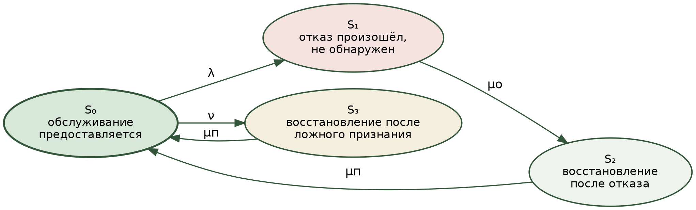
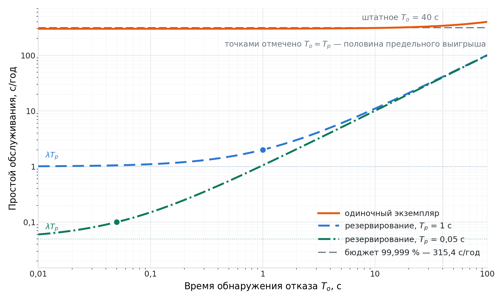
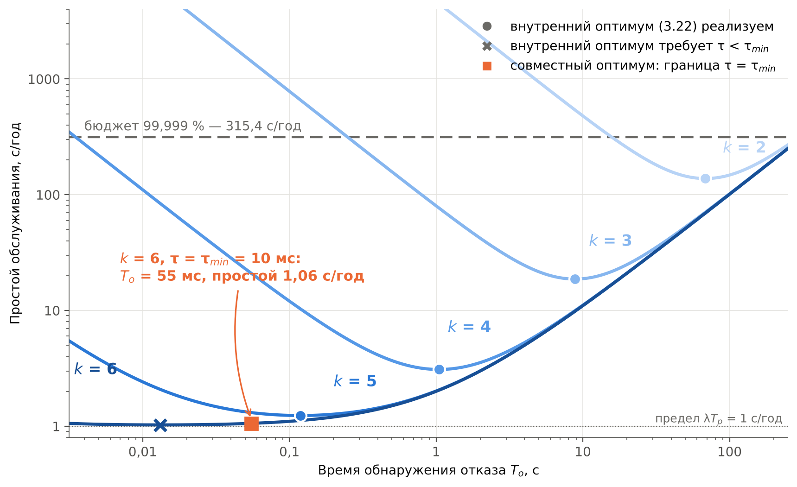
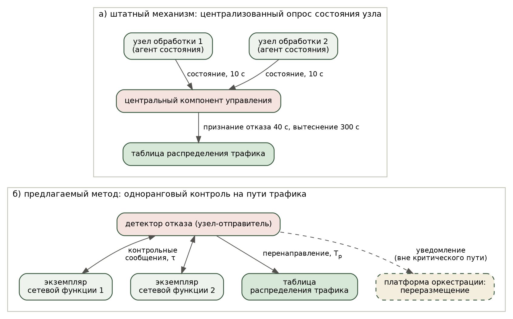
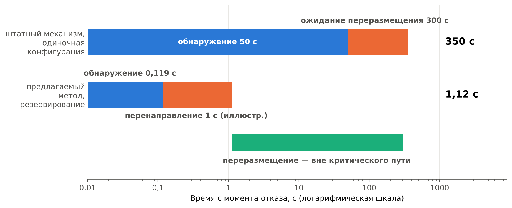
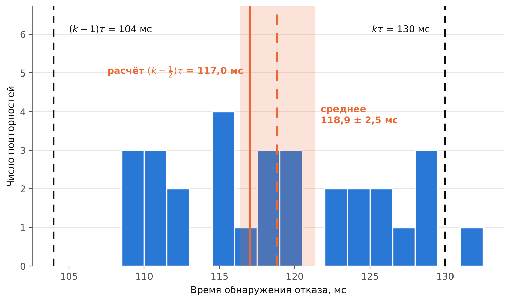
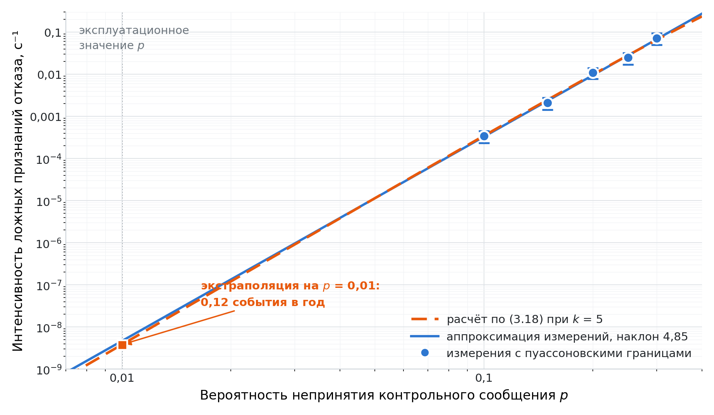

# ГЛАВА 3. Модель готовности и метод сокращения времени обнаружения отказа узла обработки

В главе строится модель готовности телекоммуникационной службы, разрабатывается метод сокращения времени обнаружения отказа и приводится программа его экспериментальной проверки. В разделе 3.1 выводится марковская модель, содержащая время обнаружения отказа как управляемый параметр. Раздел 3.2 устанавливает предельно достижимый выигрыш от сокращения этого времени и границу области насыщения. Раздел 3.3 определяет вид зависимости интенсивности ложных срабатываний от параметров контура контроля и устанавливает, какое из двух ограничений — компромисс с ложными срабатываниями или минимально реализуемый период — задаёт нижнюю границу времени обнаружения. В разделе 3.4 излагается метод обнаружения отказа на основе двустороннего контроля пересылки, в разделе 3.5 — программа и результаты его проверки.

## 3.1 Марковская модель готовности телекоммуникационной службы

Раздел 1.4 установил, что каждое из трёх направлений — модели готовности восстанавливаемых систем, модели детекторов отказов и работы по оценке готовности контейнерных платформ — содержит часть требуемого и не содержит другой, а незанятым остаётся выражение коэффициента готовности через настраиваемые параметры контура обнаружения с одновременным учётом запаздывания обнаружения и ложных срабатываний. Настоящий раздел строит такое выражение. Отличительным его признаком служит член, отражающий ущерб от ускорения обнаружения. В моделях готовности, содержащих время обнаружения в явном виде [33], а равно в моделях с неполным охватом диагностики [19, 20], коэффициент готовности монотонно возрастает с ростом интенсивности обнаружения, вследствие чего собственный ответ модели на вопрос о выборе этой величины — предельное значение, физически нереализуемое, и величина остаётся заданной извне. Наличие противодействующего члена делает оптимум внутренним и переводит время обнаружения в разряд управляемых параметров. Признак этот сформулирован в разделе 1.4 и служит здесь критерием того, что построенная модель решает поставленную задачу, а не воспроизводит известные.

**Принятые допущения.** Поток отказов узлов обработки принимается простейшим с интенсивностью λ, поток ложных признаний отказа — простейшим с интенсивностью ν. Время обнаружения отказа, время переразмещения экземпляра сетевой функции и время приведения его в готовность считаются случайными величинами с конечными математическими ожиданиями. Отказы узлов обработки принимаются независимыми; одновременный отказ нескольких узлов не рассматривается, что соответствует условиям эксплуатации, при которых узлы разнесены по независимым цепям питания и сетевым сегментам. Восстановление начинается непосредственно после обнаружения отказа, промежуточные согласования отсутствуют. Обслуживание считается предоставляемым, если экземпляр сетевой функции работоспособен и трафик направлен на него.

**Условия применимости показательного допущения.** Входящие во время восстановления длительности показательно распределёнными не являются, и это установлено измерениями, а не предполагается. Время обнаружения при периодическом контроле состояния ограничено сверху произведением периода контроля на пороговое число пропущенных сообщений и потому неограниченного показательного распределения иметь не может. Измерения отказов крупных вычислительных установок, накопленные за девять лет, показывают, что время между отказами описывается распределением Вейбулла с убывающей интенсивностью, а время восстановления — логарифмически нормальным законом; ни та, ни другая величина показательного распределения не имеет [56]. Допущение требует поэтому не оговорки, а установления границ, в которых оно существенно.

Границы эти таковы. Рассматриваемый процесс есть процесс восстановления с чередованием: пребывание в состоянии обслуживания сменяется пребыванием в одном из состояний перерыва, после чего процесс возобновляется. Для такого процесса усреднённая по времени доля пребывания в состояниях перерыва равна отношению средней суммарной длительности перерывов к средней длительности цикла и определяется лишь математическими ожиданиями длительностей, но не видом их распределений; построение это составляет стандартный аппарат теории надёжности [57]. Если интенсивности λ и ν понимать как средние числа отказов и ложных признаний отказа на единицу времени пребывания в состоянии обслуживания — а именно так они и оцениваются по результатам наблюдений, — то на единицу этого времени приходится в среднем *x* = λ(*T*о + *T*п) + ν*T*п единиц перерыва, и доля перерыва составляет *x* / (1 + *x*), что совпадает с точным выражением (3.5), получаемым ниже. Следовательно, выражение (3.5) справедливо при любых распределениях наработки на отказ, времени обнаружения и времени переразмещения с конечными математическими ожиданиями: показательное допущение служит средством вывода через систему уравнений баланса и в результат не входит. Условие нечувствительности одно — ложное признание отказа не изменяет процесса отказов узла, то есть узел после ложного признания продолжает наработку, а не начинает её заново. Приближение (3.7) вносит относительную погрешность порядка самого коэффициента простоя и в режиме высокой готовности пренебрежимо. Нечувствительность подтверждена статистическим моделированием при распределении наработки по закону Вейбулла с параметром формы 0,7, 1,0 и 1,5, логарифмически нормальном времени переразмещения и равномерном времени обнаружения: при коэффициенте простоя около 0,018 отклонение (3.5) от результатов моделирования не превысило 0,05 % и осталось в пределах доверительного интервала по 30 прогонам, тогда как отклонение приближения (3.7) составило 1,9 %, то есть величину порядка коэффициента простоя. Тем самым несоответствие действительных распределений показательному закону, установленное измерениями [56], основного результата раздела не затрагивает. Проверка на натурных данных выполняется в разделе 3.5 сопоставлением расчётных значений с измеренными.

**Состояния системы.** Рассматривается система с четырьмя состояниями.

**Состояние S₀** — обслуживание предоставляется. Экземпляр сетевой функции работоспособен, трафик обслуживается с заданными показателями качества.

**Состояние S₁** — отказ произошёл, но не обнаружен. Экземпляр сетевой функции неработоспособен, однако контур контроля этого ещё не зафиксировал, и трафик продолжает направляться на отказавший узел обработки. Обслуживание не предоставляется. Именно это состояние отсутствует в моделях, где обнаружение считается мгновенным, и именно оно вносит основной вклад в простой при штатной конфигурации контура контроля.

**Состояние S₂** — отказ обнаружен, выполняется восстановление. Контур контроля зафиксировал отказ, выполняется переразмещение экземпляра сетевой функции на работоспособный узел обработки и приведение его в готовность. Обслуживание не предоставляется.

**Состояние S₃** — выполняется восстановление вследствие ложного признания отказа. Узел обработки работоспособен, однако контур контроля признал его отказавшим — например, вследствие кратковременной потери контрольных сообщений при перегрузке канала. Обслуживание прерывается при отсутствии отказа. Переход в это состояние тем вероятнее, чем меньше время обнаружения, поскольку сокращение времени обнаружения достигается уменьшением периода контроля либо порогового числа пропущенных сообщений. Состояния и переходы между ними приведены на рисунке 3.1.

*Рисунок 3.1 — Граф состояний телекоммуникационной службы в контейнерной инфраструктуре*

**Интенсивности переходов.** Приняты следующие обозначения: *T*н — наработка на отказ узла обработки, λ = 1 / *T*н — интенсивность отказов; *T*о — среднее время обнаружения отказа, μо = 1 / *T*о — интенсивность обнаружения; *T*п — среднее время переразмещения экземпляра сетевой функции и приведения его в готовность, μп = 1 / *T*п — интенсивность восстановления; ν — интенсивность ложных признаний отказа.

Существенным для дальнейшего изложения является то, что интенсивность ложных признаний отказа не является независимым параметром, а определяется настройкой контура контроля:

$$\nu = \nu(T_\text{о}), \qquad \frac{d\nu}{dT_\text{о}} < 0. \tag{3.1}$$

Убывающий характер зависимости следует из механизма обнаружения: увеличение времени обнаружения достигается увеличением периода контроля либо порогового числа подряд пропущенных контрольных сообщений, и в обоих случаях вероятность ложного срабатывания при кратковременной деградации канала снижается. Наличие такой зависимости установлено и для известных детекторов отказов: метрики качества детектора — время обнаружения и частота ошибочных обнаружений — аналитически связаны с параметрами настройки [9], а противонаправленность их изменения подтверждена экспериментально [10]. Конкретный вид зависимости для рассматриваемого механизма устанавливается в разделе 3.3.

Время восстановления обслуживания при действительном отказе складывается из времени обнаружения и времени переразмещения:

$$T_\text{в} = T_\text{о} + T_\text{п}. \tag{3.2}$$

**Уравнения состояний.** Для стационарного режима условие баланса вероятностных потоков для каждого состояния даёт систему

$$\left\{
\begin{aligned}
p_0\,(\lambda + \nu) &= p_2\,\mu_\text{п} + p_3\,\mu_\text{п},\\
p_1\,\mu_\text{о} &= p_0\,\lambda,\\
p_2\,\mu_\text{п} &= p_1\,\mu_\text{о},\\
p_3\,\mu_\text{п} &= p_0\,\nu,
\end{aligned}
\right. \tag{3.3}$$

дополненную условием нормировки

$$p_0 + p_1 + p_2 + p_3 = 1. \tag{3.4}$$

Из второго уравнения системы (3.3) следует *p*₁ = *p*₀ λ *T*о, из третьего — *p*₂ = *p*₀ λ *T*п, из четвёртого — *p*₃ = *p*₀ ν *T*п. Первое уравнение при этом выполняется тождественно, что подтверждает непротиворечивость системы.

**Стационарное решение.** Подстановка полученных выражений в условие нормировки (3.4) даёт

$$p_0 \left[\, 1 + \lambda\,(T_\text{о} + T_\text{п}) + \nu\,T_\text{п} \,\right] = 1,$$

откуда коэффициент готовности телекоммуникационной службы, равный по определению стационарной вероятности состояния S₀, составляет

$$K_\text{г} = \frac{1}{1 + \lambda\,(T_\text{о} + T_\text{п}) + \nu(T_\text{о})\,T_\text{п}}. \tag{3.5}$$

Выражение (3.5) является основным результатом раздела. В отличие от известных выражений для коэффициента готовности восстанавливаемых систем, оно содержит время обнаружения отказа как отдельный параметр и учитывает зависящий от него вклад ложных признаний отказа.

**Проверка предельным переходом.** При отсутствии ложных признаний отказа, то есть при ν = 0, выражение (3.5) с учётом λ = 1 / *T*н и соотношения (3.2) приводится к виду

$$K_\text{г} = \frac{1}{1 + \dfrac{T_\text{о} + T_\text{п}}{T_\text{н}}} = \frac{T_\text{н}}{T_\text{н} + T_\text{в}}, \tag{3.6}$$

то есть к нормативному выражению для коэффициента готовности восстанавливаемого объекта: коэффициент готовности определён как вероятность нахождения объекта в работоспособном состоянии в данный момент времени [8] и задан для сетей электросвязи отношением средней наработки на отказ к сумме наработки и среднего времени восстановления [17]. Совпадение с нормативным выражением в частном случае подтверждает корректность построения модели. Содержательное отличие состоит в том, что величина *T*в, рассматриваемая в известных моделях как нераздельная, представлена здесь суммой двух составляющих, из которых одна является управляемой. Соотношение (3.6) использовано в разделе 1.2 при выводе формул (1.1) и (1.2), связывающих бюджет недоступности с наработкой на отказ и временем восстановления.

**Приближение для режима высокой готовности.** В условиях, характерных для телекоммуникационных служб, справедливо соотношение *T*н ≫ *T*в, при котором знаменатель выражения (3.5) близок к единице. Разложение в ряд с сохранением членов первого порядка даёт для коэффициента простоя

$$K_\text{п} = 1 - K_\text{г} \approx \lambda\,(T_\text{о} + T_\text{п}) + \nu(T_\text{о})\,T_\text{п}. \tag{3.7}$$

Соотношение (3.7) допускает наглядное истолкование: коэффициент простоя складывается из трёх независимых вкладов — простоя вследствие необнаруженного отказа, простоя вследствие переразмещения после действительного отказа и простоя вследствие переразмещения после ложного признания отказа. Каждый вклад есть произведение частоты событий на среднюю длительность перерыва, вследствие чего соотношение (3.7), как и точное выражение (3.5), от вида распределений длительностей не зависит и справедливо за пределами показательного допущения. Такое разложение позволяет оценить долю каждого вклада по результатам измерений и указывает, сокращение какой составляющей даёт наибольший выигрыш при заданной конфигурации. Проверка соотношения (3.7) на измеренных значениях выполняется в разделе 3.5.

**Существование оптимального времени обнаружения.** Из соотношения (3.7) следует нетривиальное свойство модели. Первое слагаемое убывает при сокращении времени обнаружения, третье — возрастает, поскольку интенсивность ложных признаний отказа связана с временем обнаружения зависимостью (3.1). Следовательно, сокращение времени обнаружения выгодно не безусловно, и существует значение, при котором коэффициент простоя минимален.

Условие минимума коэффициента простоя получается дифференцированием правой части (3.7) по *T*о:

$$\frac{dK_\text{п}}{dT_\text{о}} = \lambda + T_\text{п}\,\frac{d\nu}{dT_\text{о}} = 0,$$

откуда оптимальное значение времени обнаружения *T*о\* определяется условием

$$\left.\frac{d\nu}{dT_\text{о}}\right|_{T_\text{о} = T_\text{о}^*} = -\,\frac{\lambda}{T_\text{п}}. \tag{3.8}$$

Условие (3.8) допускает содержательное истолкование. Оптимум достигается при таком времени обнаружения, при котором предельное снижение интенсивности ложных признаний отказа, получаемое от увеличения времени обнаружения на единицу, сравнивается с отношением интенсивности отказов к времени переразмещения. Дальнейшее сокращение времени обнаружения увеличивает потери от ложных срабатываний быстрее, чем сокращает потери от необнаруженного отказа.

Признаком, по которому время обнаружения отличается здесь от заданной величины известных моделей, служит наличие в выражении для коэффициента простоя противодействующего члена, а не непременная реализуемость точки (3.8). Различие существенно. При отсутствии такого члена коэффициент простоя по времени обнаружения монотонен, и единственный ответ модели — предельное значение, физически нереализуемое; вопрос о выборе времени обнаружения решается тогда вне модели. При наличии члена ответ становится содержательным при любом исходе: либо оптимум внутренний и определяется условием (3.8), либо он лежит вне области реализуемости, и тогда модель указывает, какое из ограничений связывает и во что обходится отступление от него. Оба исхода встречаются: раздел 3.3 показывает, что при действительных значениях параметров связывающим оказывается ограничение на реализуемый период, а раздел 3.5 на модельных данных — что выбор порогового числа при этом всё равно определяется членом ложных срабатываний, без учёта которого он был бы ошибочен на два порядка по величине простоя.

Найденная точка является точкой минимума при условии выпуклости зависимости ν(*T*о), то есть при

$$\frac{d^2\nu}{dT_\text{о}^2} > 0. \tag{3.9}$$

Выполнимость условия (3.9) для конкретного механизма обнаружения устанавливается в разделе 3.3 после определения вида зависимости ν(*T*о). При невыполнении условия (3.9) минимум достигается на границе допустимой области, и обоснованное значение времени обнаружения определяется ограничением на допустимую частоту ложных срабатываний, а не условием (3.8).

**Расширение модели на конфигурацию с резервированием.** Модель (3.5) построена для одиночного экземпляра сетевой функции, при отказе которого обслуживание прерывается на всё время восстановления. В инфраструктуре операторов связи сетевые функции разворачиваются с резервированием: обслуживание распределяется между N ≥ 2 экземплярами на независимых узлах обработки, а предлагаемая нагрузка обслуживается силами N − 1 экземпляра, так что отказ одного экземпляра не приводит к потере пропускной способности. Резервирование при этом является нормативным требованием, а не проектным решением: схемы резервирования «1+1», «1:1» и «M+1» предусмотрены отраслевыми требованиями к отказоустойчивости виртуализированных сетевых функций [6]. Для этого случая модель требует пересмотра.

Обозначим через *T*р время удаления отказавшего экземпляра из таблицы распределения трафика после обнаружения отказа, причём для рассматриваемых механизмов *T*р ≪ *T*п. При отказе узла, несущего один из экземпляров, последовательность событий такова. В течение времени обнаружения *T*о трафик частично направляется на отказавший экземпляр, и приходящаяся на него доля нагрузки не обслуживается. По истечении *T*о + *T*р отказавший экземпляр исключается из распределения, оставшиеся N − 1 экземпляров принимают полную нагрузку, и обслуживание восстанавливается с заданными показателями качества. Переразмещение отказавшего экземпляра длительностью *T*п выполняется в фоновом режиме, восстанавливает уровень резервирования и на предоставление обслуживания не влияет.

Существенно, что при резервировании влияющий на обслуживание интервал составляет *T*о + *T*р, а не *T*о + *T*п:

$$T_\text{в}^\text{рез} = T_\text{о} + T_\text{р}, \qquad T_\text{р} \ll T_\text{п}. \tag{3.10}$$

Полный отказ в обслуживании при резервировании наступает лишь при отказе второго узла в течение интервала восстановления резервирования, что даёт вклад порядка (λ*T*п)² и в режиме высокой готовности пренебрежимо мал. Оценивая усреднённую по времени долю потерянной нагрузки и учитывая, что каждый из N экземпляров отказывает с интенсивностью λ, а доля затрагиваемой нагрузки при единичном отказе составляет 1 / N, для коэффициента простоя при резервировании получается

$$K_\text{п}^\text{рез} \approx \lambda\,(T_\text{о} + T_\text{р}) + \nu(T_\text{о})\,T_\text{р}. \tag{3.11}$$

Выражение (3.11) в первом приближении не зависит от числа экземпляров: увеличение N повышает частоту отказов, но во столько же раз снижает долю затрагиваемой нагрузки при единичном отказе. Сопоставление (3.11) с выражением для одиночного экземпляра (3.7) выявляет главное следствие резервирования. В одиночной конфигурации коэффициент простоя определяется составляющей переразмещения *T*п, на которую время обнаружения влияет слабо; при резервировании составляющая *T*п покидает влияющий интервал согласно (3.10), и коэффициент простоя определяется преимущественно временем обнаружения *T*о. Следовательно, сокращение времени обнаружения даёт ограниченный выигрыш для одиночного экземпляра и определяющий — при резервировании. Поскольку резервирование является штатным способом развёртывания сетевых функций операторского класса, конфигурация с резервированием принимается основной в дальнейшем изложении, а одиночная используется как отправная для сравнения.

**Исходные значения числового примера.** Соотношения иллюстрируются на значениях, происхождение которых различно и указывается для каждого из них.

Документированными являются параметры контура контроля платформы оркестрации: признание узла обработки недостижимым наступает через 40 с после прекращения передачи сведений о его состоянии, вытеснение размещённых на нём экземпляров — ещё через 300 с [1]. Величина 300 с принимается в расчётах за время переразмещения *T*п, хотя определением раздела 1.3 оно включает, помимо ожидания перед вытеснением, ещё выбор узла, запуск экземпляра и приведение его в готовность. Подстановка одного лишь ожидания даёт нижнюю оценку: по примеру раздела 2.5 три составляющие в сумме дают 312,6 с, а суммарное время восстановления — 350,0 с против принимаемых здесь 340 с. Занижение составляет 3 % и направлено в невыгодную для выводов главы сторону, поскольку уменьшает разрыв между штатной конфигурацией и предлагаемым методом. Величина 40 с есть параметр конфигурации, а не результат измерения. Согласно соотношению (1.3) раздела 1.3, учитывающему несогласованность моментов отказа, передачи сведений и проверки их контроллером, математическое ожидание измеряемого времени обнаружения составляет 37,5 с при разбросе от 30 до 45 с. Расчёт ниже ведётся по документированному значению; подстановка 37,5 с изменяет простой одиночной конфигурации с 340 до 337,5 с в год, требуемую наработку — с 394 до 391 сут, а для конфигурации с резервированием — с 41 до 38,5 с в год и с 47,5 до 44,6 сут соответственно, ни одного из последующих выводов не затрагивая.

Иллюстративными являются три величины. Сокращённое время обнаружения *T*о = 2 с принято как консервативная оценка достижимого: расчёт раздела 3.3 даёт для предлагаемого метода значение на порядок меньшее, а статистическое моделирование раздела 3.5 — на два порядка. Округление до двух секунд выбрано намеренно, чтобы вывод таблицы 3.1 не зависел от того, насколько удастся сократить время обнаружения сверх единиц секунд. Время перенаправления трафика *T*р = 1 с соответствует перенаправлению средствами платформы оркестрации через интерфейс управления; числовых значений этой величины документация платформы не содержит [1], а показатель уровня обслуживания, определённый в точности как *T*р, оставлен платформой без норматива [55], вследствие чего величина подлежит измерению в эксперименте Э1.

Существенная оговорка касается содержания этой величины. Определение *T*р едино и дано в разделе 1.3 через регистрируемые события — от признания экземпляра неготовым до прекращения направления на него трафика, — однако значение её различается на три порядка в зависимости от механизма перенаправления. При перенаправлении через интерфейс управления платформы в промежуток входят обработка запроса центральным компонентом, запись в подсистему хранения состояния и распространение изменения на узлы, что даёт единицы секунд; при непосредственной записи в структуру данных тракта передачи, применяемой предлагаемым методом и разобранной в разделе 3.4, — единицы миллисекунд. Всюду, где ниже приводится числовое значение *T*р, указывается, к какому из двух механизмов оно относится. Иллюстративное значение 1 с относится к первому из них; пример обработки раздела 2.5 построен для первого из них (*T*р штатного пути около 1,12 с), а отдельный расчёт того же раздела при *T*р = 1,6 мс — для второго, поскольку именно на этом масштабе поправка (2.4) и бюджет неопределённости таблицы 2.6 становятся существенными. Наработка на отказ узла обработки принимается равной одному году. Норматив готовности 99,999 %, принятый в разделе 1.2 целевым, допускает 315,4 с недоступности в год.

**Обоснование принятой наработки на отказ.** Значение это не произвольно и подтверждается с двух сторон. Изнутри работы: соотношение (1.1) раздела 1.2 даёт при времени восстановления 340 с требуемую для норматива 0,99999 наработку 394 сут, то есть 1,08 года, — принятое значение лежит непосредственно на границе выполнимости норматива и является поэтому наихудшим из практически осмысленных. Извне: измерения, собранные за девять лет на 22 вычислительных установках, включающих 4750 узлов, содержат около 23 000 отказов, потребовавших вмешательства обслуживающего персонала [56], что даёт в среднем 0,54 отказа на узел в год, то есть наработку около 1,9 года; оценка эта верхняя, поскольку не все установки работали весь девятилетний период. Средняя частота отказов различается между установками от 20 до 1000 отказов в год [56], вследствие чего единственного значения наработки, пригодного для всех условий эксплуатации, не существует, и принятая величина рассматривается как расчётная, а не как измеренная.

Существенно, что выбор наработки на отказ на сопоставление конфигураций не влияет. Согласно (3.7) и (3.11) коэффициент простоя пропорционален интенсивности отказов, вследствие чего отношения простоев между конфигурациями от наработки не зависят вовсе; от неё зависят лишь абсолютная величина простоя и выполнение норматива. Последний столбец таблицы 3.1 свободен и от этой зависимости: требуемая наработка получена обращением соотношения (1.1) и никакого предположения об интенсивности отказов не содержит.

**Таблица 3.1 — Расчётный простой обслуживания и требуемая наработка на отказ по конфигурациям**

| Конфигурация | *T*о, с | Влияющий интервал, с | Простой при *T*н = 1 год, с/год | Готовность, % | Требуемая наработка для 0,99999, сут |
|---|---|---|---|---|---|
| Одиночный экземпляр, штатно | 40 | 340 | 340 | 99,99892 | 394 |
| Одиночный экземпляр, детектор | 2 | 302 | 302 | 99,99904 | 350 |
| Резервирование, штатно | 40 | 41 | 41 | 99,99987 | 47,5 |
| Резервирование, детектор | 2 | 3 | 3 | 99,99999 | 3,5 |

Из таблицы 3.1 следуют четыре вывода.

**В одиночной конфигурации сокращение времени обнаружения выигрыша практически не даёт.** Сокращение с 40 до 2 с уменьшает простой лишь на 11 % — с 340 до 302 с в год, — поскольку простой определяется составляющей переразмещения. Норматив 99,999 % при штатном обнаружении не достигается: 340 с превышает бюджет 315,4 с; при сокращённом обнаружении он достигается с малым запасом.

**Резервирование выводит переразмещение с критического пути.** Переход к резервированию при штатном времени обнаружения снижает простой с 340 до 41 с в год, то есть в 8,3 раза, и приводит обслуживание в пределы норматива.

**При резервировании определяющим фактором становится время обнаружения.** Сокращение времени обнаружения в этой конфигурации снижает простой с 41 до 3 с в год, то есть в 13,7 раза. Тем самым тезис о сокращении времени обнаружения справедлив именно при резервировании, а не вообще; соотношение (3.11) и есть опорное для всей работы.

**Требование к надёжности оборудования смягчается более чем в сто раз.** Столбец требуемой наработки допускает истолкование, свободное от предположений об интенсивности отказов: штатная одиночная конфигурация выполняет норматив пяти девяток лишь при узле, отказывающем реже одного раза в 394 сут, тогда как резервирование с сокращённым обнаружением — при узле, отказывающем реже одного раза в 3,5 сут. Совместное применение резервирования и сокращённого обнаружения снижает требование к наработке в 113 раз, то есть переводит достижение норматива из области, требующей исключительно надёжного оборудования, в область, достижимую на обычном. Значение 394 сут совпадает с приведённым в разделе 1.2. Совпадение это не является независимым подтверждением: формула (1.1) выведена из того же соотношения (3.6), и обе оценки суть одно тождество, записанное в разных разделах. Оно служит проверкой сквозной согласованности числовых значений, а не подтверждением модели.

Полученный результат определяет направление дальнейшей работы — сокращение времени обнаружения отказа при обязательном контроле частоты ложных срабатываний. Разложение простоя на составляющие, из которого следует преобладание той или иной величины, подлежит экспериментальному подтверждению в эксперименте Э1, где проверяется допущение о преобладании обнаружения и переразмещения над длительностью запуска экземпляра.

**Область применимости модели.** Модель применима при выполнении следующих условий.

Интенсивность отказов узлов обработки постоянна во времени, то есть рассматривается период нормальной эксплуатации, исключающий участки приработки и износа. Условие это выполняется приближённо: измерения показывают убывающую во времени интенсивность отказов [56], вследствие чего величину λ надлежит понимать как усреднённую за рассматриваемый период частоту отказов. Для расчёта годового простоя такого понимания достаточно, поскольку в соотношение (3.7) входит именно средняя частота.

Отказы узлов обработки статистически независимы, что требует разнесения узлов по независимым цепям питания и сетевым сегментам; при нарушении этого условия необходим учёт коррелированных отказов, выходящий за рамки настоящей работы.

Ресурс работоспособных узлов достаточен для размещения переразмещаемого экземпляра сетевой функции, то есть отказ узла не приводит к отказу в обслуживании вследствие нехватки ресурса.

Восстановление обслуживания не отождествляется с ремонтом отказавшего узла. Средняя длительность устранения аппаратной неисправности в крупных центрах обработки данных измеряется десятками суток — 42,2 сут для неисправностей, признанных устранимыми, при медианном времени реакции 6,1 сут [58], — тогда как входящие в модель величины *T*п и *T*р составляют секунды и минуты. Модель описывает восстановление обслуживания переразмещением на работоспособный узел, а не возвращение отказавшего узла в работу; последнее протекает на несопоставимо большем масштабе времени и во время восстановления обслуживания не входит. Отсюда следует и требование к запасу ресурса: он должен покрывать отказ узла на всю длительность ремонта, а не на длительность переразмещения.

Восстановление обслуживания эквивалентно восстановлению работоспособности экземпляра сетевой функции; последнее условие справедливо для функций, не сохраняющих состояние, и снимается в главе 4.

Полученные соотношения (3.5), (3.7), (3.8) и (3.11) образуют основу для исследования влияния параметров контура контроля на готовность, выполняемого в разделе 3.2, и для определения обоснованной нижней границы времени обнаружения, выполняемого в разделе 3.3. Дальнейшее изложение опирается на конфигурацию с резервированием как основную.

## 3.2 Влияние параметров контура обнаружения на коэффициент готовности

Настоящий раздел исследует полученные в разделе 3.1 соотношения (3.7) и (3.11) как функции времени обнаружения отказа. Ложные срабатывания здесь из рассмотрения исключаются, то есть принимается ν = 0. Такое ограничение позволяет установить предельно достижимый выигрыш от сокращения времени обнаружения в чистом виде; ограничение снизу, накладываемое ложными срабатываниями, устанавливается в разделе 3.3.

**Относительный выигрыш от сокращения времени обнаружения.** Обозначим через *T*о⁰ штатное значение времени обнаружения, принимаемое за отправное, и определим относительный выигрыш как отношение коэффициента простоя при штатном значении к коэффициенту простоя при сокращённом. Для конфигурации с резервированием подстановка (3.11) при ν = 0 даёт

$$G^\text{рез}(T_\text{о}) = \frac{K_\text{п}^\text{рез}(T_\text{о}^0)}{K_\text{п}^\text{рез}(T_\text{о})} = \frac{T_\text{о}^0 + T_\text{р}}{T_\text{о} + T_\text{р}}. \tag{3.12}$$

Для одиночного экземпляра аналогичное выражение получается из (3.7) заменой *T*р на *T*п.

**Предельный выигрыш.** Устремляя время обнаружения к нулю, получаем верхнюю границу выигрыша:

$$G^\text{рез}_\text{max} = \lim_{T_\text{о} \to 0} G^\text{рез}(T_\text{о}) = 1 + \frac{T_\text{о}^0}{T_\text{р}}. \tag{3.13}$$

Соотношение (3.13) содержит существенный для практики вывод: предельный выигрыш определяется не быстродействием детектора, а временем перенаправления трафика *T*р. Сколь угодно быстрое обнаружение не даёт выигрыша большего, чем 1 + *T*о⁰ / *T*р, поскольку составляющая *T*р остаётся в выражении для простоя при любом времени обнаружения. Для одиночного экземпляра предельный выигрыш составляет 1 + *T*о⁰ / *T*п и при *T*о⁰ ≪ *T*п близок к единице, что объясняет установленную в разделе 3.1 малую чувствительность одиночной конфигурации к времени обнаружения.

Соотношение (3.13) воспроизводит по форме известный закон, ограничивающий выигрыш от ускорения части процесса долей неускоряемой части [59]: ускорение доли, занимающей время *T*о⁰, при неизменной оставшейся части *T*р даёт выигрыш не более отношения полной длительности к неускоряемой. Совпадение формы не случайно и указывает, где искать выигрыш: величина, остающаяся в знаменателе, определяет потолок независимо от того, насколько улучшена остальная часть. Применительно к настоящей работе это означает, что метод, сокращающий только время обнаружения, ограничен сверху величиной времени перенаправления и потому обязан сокращать и его.

**Область насыщения.** Доля предельного выигрыша, достигаемая при данном времени обнаружения, получается делением (3.12) на (3.13):

$$\frac{G^\text{рез}(T_\text{о})}{G^\text{рез}_\text{max}} = \frac{T_\text{р}}{T_\text{о} + T_\text{р}}. \tag{3.14}$$

Соотношение (3.14) не зависит от штатного значения *T*о⁰, то есть характеризует механизм, а не отправную точку сравнения. Обращение его даёт количественный признак: доля *q* предельного выигрыша достигается при времени обнаружения *T*о = *T*р (1 − *q*) / *q*. Половина предельного выигрыша достигается тем самым при *T*о = *T*р, девять десятых — при *T*о = *T*р / 9, девятнадцать двадцатых — при *T*о = *T*р / 19. Область *T*о ≪ *T*р далее именуется областью насыщения: в ней дальнейшее сокращение времени обнаружения даёт убывающую отдачу при возрастающих затратах на служебный трафик, а положение её границы задаётся не детектором, а величиной *T*р.

**Происхождение величины *T*р и её нормативные значения.** Поскольку время перенаправления трафика определяет и потолок выигрыша (3.13), и положение границы насыщения (3.14), происхождение принимаемого для него значения требует отдельного разбора.

Величина эта не является особенностью контейнерной инфраструктуры. Она соответствует установленному в электросвязи понятию времени завершения переключения, определяемому как промежуток от решения о переключении до завершения операции переключения в узле, инициировавшем запрос [60]. Там же различается и предшествующая ему выдержка — промежуток между объявлением ухудшения либо потери сигнала и запуском алгоритма защитного переключения [60], — играющая в контуре контроля ту же роль, что порог подряд пропущенных сообщений в разделе 3.3. Принятое в настоящей работе разложение времени восстановления на обнаружение и перенаправление воспроизводит тем самым разграничение, установленное в технике защитного переключения, а не вводится заново.

Для этой величины в электросвязи установлены нормативные значения. Для кольцевой защиты в сетях Ethernet требуется, чтобы время завершения переключения при отказе звена кольца составляло менее 50 мс; требование действует для кольца без перегрузки, при длине менее 1200 км и числе узлов менее шестнадцати, а при выходе за эти границы допускается его превышение [61]. Отраслевые требования к отказоустойчивости виртуализированных сетевых функций числовых значений не устанавливают, но фиксируют ожидание: в области электросвязи перерывы обслуживания предполагаются лежащими ниже уровня различимости, то есть в миллисекундах, а восстановление — выполняемым автоматически [6].

Положение в контейнерной инфраструктуре иное. Документация платформы оркестрации числовых значений длительности перенаправления не приводит [1]. Показатель уровня обслуживания, определённый разработчиками платформы в точности как *T*р — задержка программирования механизма распределения нагрузки от изменения перечня готовых экземпляров до отражения его в этом механизме, — норматива не имеет: значение оставлено незаполненным, а сам показатель числится разрабатываемым [55]. Опубликованных измерений этой величины найти не удалось: в работах, привлекаемых для сопоставления в разделе 2.5, выделяется суммарная длительность перерыва обслуживания, но не составляющая перенаправления, — обстоятельство, отмеченное там при составлении сводки.

Отсюда следуют два обстоятельства, определяющие построение настоящей главы. Во-первых, для величины, задающей потолок выигрыша, норматива не существует, а опубликованное измерение известно одно и получено при иной схеме резервирования, вследствие чего она подлежит измерению в эксперименте Э1; принимаемое в расчётах значение *T*р = 1 с есть оценка перенаправления средствами платформы через интерфейс управления, а не измеренная величина. Во-вторых, нормативное значение для той же по смыслу операции в электросвязи меньше принятой оценки в двадцать раз, что задаёт разрабатываемому методу ориентир, взятый не из соображений удобства, а из действующих требований к сетям связи.

**Сопоставление конфигураций.** Расчёт по (3.7) и (3.11) при документированном штатном значении *T*о⁰ = 40 с, времени переразмещения *T*п = 300 с и принятой в разделе 3.1 наработке на отказ *T*н = 1 год приведён в таблице 3.2. Конфигурация с резервированием рассмотрена при двух значениях времени перенаправления: 1 с — оценка перенаправления средствами платформы, и 0,05 с — нормативное значение времени завершения переключения, установленное для кольцевой защиты [61]. Те же зависимости в непрерывном виде представлены на рисунке 3.2.

**Таблица 3.2 — Простой обслуживания и доля предельного выигрыша в зависимости от времени обнаружения**

| *T*о, с | Простой, одиночный экземпляр, с/год | Простой при *T*р = 1 с, с/год | Доля предельного выигрыша, % | Простой при *T*р = 0,05 с, с/год | Доля предельного выигрыша, % |
|---|---|---|---|---|---|
| 40 | 340,0 | 41,00 | 2,4 | 40,05 | 0,12 |
| 10 | 310,0 | 11,00 | 9,1 | 10,05 | 0,50 |
| 5 | 305,0 | 6,00 | 16,7 | 5,05 | 0,99 |
| 2 | 302,0 | 3,00 | 33,3 | 2,05 | 2,44 |
| 1 | 301,0 | 2,00 | 50,0 | 1,05 | 4,76 |
| 0,5 | 300,5 | 1,50 | 66,7 | 0,55 | 9,09 |
| 0,1 | 300,1 | 1,10 | 90,9 | 0,15 | 33,3 |

*Рисунок 3.2 — Простой обслуживания в зависимости от времени обнаружения отказа для одиночной конфигурации и конфигурации с резервированием при двух значениях времени перенаправления трафика; обе оси логарифмические*

Данные таблицы 3.2 и рисунка 3.2 подтверждают выводы, полученные аналитически, и добавляют к ним третий.

**Одиночная конфигурация к времени обнаружения нечувствительна.** Сокращение времени обнаружения в 400 раз, с 40 до 0,1 с, снижает простой лишь с 340,0 до 300,1 с в год, поскольку простой определяется составляющей переразмещения. Бюджет недоступности 315,4 с в год эта конфигурация выдерживает только при времени обнаружения менее 15,4 с — значении, достижимом настройкой штатных параметров, но выигрыш от такой настройки исчерпывается немедленно после пересечения границы бюджета.

**При резервировании и *T*р = 1 с выигрыш велик, но потолок близок.** Предельный выигрыш составляет 41, причём половина его достигается уже при *T*о = 1 с, а девять десятых — при *T*о = 0,1 с. Дальнейшее сокращение времени обнаружения даёт менее десятой доли оставшегося выигрыша.

**Сокращение времени перенаправления одновременно поднимает потолок и отодвигает границу насыщения.** При *T*р = 0,05 с предельный выигрыш составляет 801 вместо 41, то есть возрастает в двадцать раз пропорционально сокращению *T*р. Одновременно граница насыщения смещается: половина предельного выигрыша достигается теперь лишь при *T*о = 0,05 с, а время обнаружения 0,1 с, дававшее при *T*р = 1 с девять десятых предельного выигрыша, даёт при *T*р = 0,05 с лишь треть. Следовательно, сокращение времени перенаправления не только увеличивает достижимый выигрыш, но и возвращает смысл дальнейшему сокращению времени обнаружения, которое при большом *T*р находилось бы в области насыщения. Величины эти связаны, и сокращать их следует совместно.

**Чувствительность к составляющим.** Дифференцирование (3.11) при ν = 0 по каждой из составляющих даёт

$$\frac{\partial K_\text{п}^\text{рез}}{\partial T_\text{о}} = \frac{\partial K_\text{п}^\text{рез}}{\partial T_\text{р}} = \lambda. \tag{3.15}$$

Абсолютные чувствительности равны: сокращение времени перенаправления на заданную величину равноценно сокращению времени обнаружения на ту же величину. Практическая задача, однако, ставится обыкновенно в относительных величинах — во сколько раз удастся сократить ту или иную составляющую, — а относительные чувствительности не равны. Умножая (3.15) на отношение соответствующей составляющей к коэффициенту простоя, получаем

$$E_\text{о} = \frac{T_\text{о}}{T_\text{о} + T_\text{р}}, \qquad E_\text{р} = \frac{T_\text{р}}{T_\text{о} + T_\text{р}}, \qquad E_\text{о} + E_\text{р} = 1 .$$

Величины *E*о и *E*р показывают, на сколько процентов снижается простой при сокращении соответствующей составляющей на один процент, и в сумме дают единицу: относительное влияние распределено между двумя составляющими без остатка. Отсюда правило выбора: усилия следует направлять на ту составляющую, которая занимает бо́льшую долю влияющего интервала. При штатном времени обнаружения 40 с и *T*р = 1 с доли составляют 0,976 и 0,024 — практически всё влияние сосредоточено в обнаружении; при *T*о = *T*р они равны; при *T*о = 0,1 с и *T*р = 1 с они составляют 0,091 и 0,909 — влияние почти целиком переходит к перенаправлению.

Существенно, что *E*р совпадает с правой частью (3.14). Доля уже достигнутого предельного выигрыша и относительная чувствительность к времени перенаправления — одна и та же величина. Тем самым мера продвижения по пути сокращения времени обнаружения есть одновременно мера того, насколько дальнейшие усилия следует переносить на сокращение времени перенаправления; отдельного признака для принятия этого решения не требуется.

**Следствия для разрабатываемого метода.** Из полученных соотношений вытекают четыре требования, учитываемые при построении метода в разделе 3.4.

Целевое значение времени обнаружения определяется как величина порядка времени перенаправления трафика, а не как минимально достижимая: сокращение сверх этого попадает в область насыщения, положение которой задаётся соотношением *T*о = *T*р (1 − *q*) / *q*.

Метод обязан предусматривать сокращение не только времени обнаружения, но и времени перенаправления, для чего требуется непосредственное управление таблицей распределения трафика, а не ожидание срабатывания штатного механизма. Основание — соотношение (3.13): при неизменном *T*р потолок выигрыша не превышает 1 + *T*о⁰ / *T*р независимо от быстродействия детектора.

Ориентиром для *T*р принимается нормативное значение времени завершения переключения, установленное в электросвязи, — менее 50 мс [61]. Ориентир этот внешний по отношению к платформе и потому не зависит от того, какое значение окажется у неё измеренным.

Величина *T*р подлежит измерению в эксперименте Э1 как самостоятельный результат: норматива платформы для неё нет [55], а единственное опубликованное измерение — 0,028 с — получено при схеме «N активных», где оба экземпляра обслуживают трафик и перенаправление сводится к исключению отказавшего из распределения нагрузки [13]. Принятая в работе схема с резервным экземпляром требует дополнительно перевода резерва в обслуживание, вследствие чего значения непосредственно не сопоставимы. От этой величины зависят и предельный выигрыш (3.13), и целевое значение времени обнаружения, и распределение относительных чувствительностей. Значение, достигаемое предлагаемым методом, приводится в разделе 3.5.

Полученная в настоящем разделе оценка является верхней: она не учитывает ложных срабатываний, интенсивность которых возрастает при сокращении времени обнаружения. Учёт этого фактора и определение обоснованной нижней границы времени обнаружения выполняются в разделе 3.3.

## 3.3 Нижняя граница времени обнаружения: компромисс с ложными срабатываниями и ограничение реализуемости

Раздел 3.2 установил верхнюю оценку выигрыша при отсутствии ложных срабатываний. Настоящий раздел вводит конкретный механизм обнаружения, определяет для него вид зависимости ν(*T*о), устанавливает, до какого значения сокращение времени обнаружения остаётся оправданным, и показывает, какое из двух ограничений — компромисс с ложными срабатываниями или минимально реализуемый период обмена — оказывается связывающим при действительных значениях параметров канала.

**Механизм обнаружения.** В качестве механизма принят двусторонний контроль пересылки (BFD) [2] — периодический обмен контрольными сообщениями между смежными узлами с признанием отказа после нескольких подряд не полученных сообщений. Механизм задаётся двумя настраиваемыми параметрами: периодом отправки контрольных сообщений τ и пороговым числом k подряд не полученных сообщений. Двухпараметрический характер механизма существен: одно и то же время обнаружения достижимо различными парами значений (τ, k), и, как показано далее, такие пары различаются по интенсивности ложных срабатываний на порядки.

**Время обнаружения.** Признание отказа наступает по истечении k·τ с момента получения последнего контрольного сообщения. Если момент отказа распределён равномерно на интервале между сообщениями, время от отказа до признания заключено в пределах от (k − 1)τ до kτ, а его среднее значение составляет

$$T_\text{о} = \left(k - \tfrac{1}{2}\right)\tau. \tag{3.16}$$

**Интенсивность ложных срабатываний.** Ложное признание отказа наступает, когда k подряд контрольных сообщений оказываются не полученными при работоспособном узле обработки. Обозначим через p вероятность потери отдельного контрольного сообщения вследствие кратковременной перегрузки канала или превышения задержкой периода τ. При независимости потерь вероятность серии из k потерь, начинающейся после успешно принятого сообщения, составляет (1 − p)p^k, а при частоте отправки 1 / τ интенсивность таких серий равна

$$\nu = \frac{(1-p)\,p^{k}}{\tau}. \tag{3.17}$$

Подстановка (3.16) даёт искомую зависимость интенсивности ложных срабатываний от времени обнаружения:

$$\nu(T_\text{о}) = \frac{C(k,p)}{T_\text{о}}, \qquad C(k,p) = (1-p)\left(k-\tfrac{1}{2}\right)p^{k}. \tag{3.18}$$

**Содержание величины p и её измеренные значения.** Величина p входит в (3.18) в степени k, вследствие чего результат чувствителен к ней в наибольшей степени, и её содержание требует разбора.

Величина эта не совпадает с вероятностью потери пакета в канале. Контрольное сообщение считается не полученным и в том случае, когда оно доставлено, но позже, чем через время τ после отправки; вероятность p есть поэтому вероятность объединения двух событий — потери и запаздывания сверх периода. Соотношение между слагаемыми устанавливается измерениями. В сетях центров обработки данных, охваченных системой сплошного измерения задержки, доля потерянных пакетов составляет от 9,6·10⁻⁶ до 2,1·10⁻⁵ внутри модуля и от 1,5·10⁻⁵ до 7,6·10⁻⁵ между модулями; распределение же задержки имеет тяжёлый хвост: при медиане 216 мкс и 99-м процентиле 1,26 мс внутри модуля межмодульная задержка составляет 23,35 мс на уровне 99,9 % и 1397,63 мс на уровне 99,99 % [62].

Отсюда следуют три обстоятельства, существенные для настоящего раздела.

**Запаздывание преобладает над потерей.** При периоде порядка десятков миллисекунд вероятность превышения задержкой периода составляет около 10⁻³, тогда как доля потерянных пакетов — около 10⁻⁵. Определяющим слагаемым в p является хвост распределения задержки, а не потери в канале, вследствие чего величина эта зависит от свойств очередей, а не от качества среды передачи.

**Величина p зависит от периода.** Поскольку p есть вероятность превышения задержкой величины τ, сокращение периода увеличивает p. По приведённым измерениям при τ = 1,26 мс значение p составляет 10⁻², при τ = 23,35 мс — 10⁻³, при τ = 1,4 с — 10⁻⁴ [62]. Соотношение (3.18) рассматривает p как постоянную, что является приближением: при сокращении периода истинная интенсивность ложных срабатываний растёт быстрее, чем даёт выражение при неизменном p. Направление погрешности известно — оценка (3.18) занижает ν при малых периодах, — и учитывается тем, что расчёт ведётся при завышенном значении p.

**Принимаемое значение p = 0,01 является завышенным намеренно.** Оно соответствует измеренному 99-му процентилю внутримодульной задержки, то есть периоду около 1,3 мс, тогда как расчёт ведётся для периодов в десятки миллисекунд, где измеренное значение на порядок меньше [62]. Завышение обосновано двумя обстоятельствами: стенд настоящей работы включает канал между двумя площадками, проходящий по транспортной сети поставщика услуг, где и потери, и хвост задержки превышают внутриплощадочные; кроме того, завышение p завышает интенсивность ложных срабатываний, то есть даёт оценку в невыгодную для предлагаемого метода сторону. Действительное значение p подлежит измерению в эксперименте Э3 раздельно для внутриплощадочного и межплощадочного каналов.

**Чувствительность к p и предположение о независимости.** Обе оговорки существенны количественно. Согласно (3.18) коэффициент C пропорционален p^k, вследствие чего при k = 5 троекратное изменение p изменяет интенсивность ложных срабатываний в 240 раз, а десятикратное — в 9·10⁴ раз. Величина p не допускает поэтому назначения по аналогии и подлежит измерению на том канале, для которого выполняется настройка.

Предположение о независимости потерь, принятое при выводе (3.17), для действительных каналов связи не выполняется: пачечный характер потерь установлен и описывается моделями, восходящими к работам [50] и [51]. При пачечных потерях вероятность серии из k потерь превышает p^k, вследствие чего (3.18) занижает интенсивность ложных срабатываний, и занижение тем сильнее, чем больше пороговое число. Проверка выполняется в разделе 3.5 второй частью эксперимента Э3, где предусмотрены измерения по обеим моделям потерь при одинаковой средней вероятности: независимая модель проверяет (3.18) в условиях вывода, пачечная — устанавливает величину и направление отклонения. Способ внесения потерь обеих моделей установлен в разделе 2.3.

**Проверка условий раздела 3.1.** Из (3.18) следует dν / d*T*о = −C / *T*о² < 0, что подтверждает убывающий характер зависимости, постулированный соотношением (3.1). Вторая производная d²ν / d*T*о² = 2C / *T*о³ > 0, то есть условие выпуклости (3.9) выполнено. Следовательно, при фиксированном пороговом числе и без учёта ограничения на реализуемый период внутренний минимум коэффициента простоя существует и определяется условием (3.8); достигается ли он при ограничении τ ≥ τ_min, устанавливается ниже.

**Выбор порогового числа при заданном времени обнаружения.** Согласно (3.18), при фиксированном времени обнаружения интенсивность ложных срабатываний пропорциональна коэффициенту C(k, p). Отношение соседних значений составляет

$$\frac{C(k+1,p)}{C(k,p)} = p\,\frac{k + 1/2}{k - 1/2} < 1 \quad \text{при} \quad p < \frac{k - 1/2}{k + 1/2}, \tag{3.19}$$

что для p ≪ 1 выполняется при всех k ≥ 1: экспоненциальное убывание множителя p^k преобладает над линейным ростом множителя (k − 1/2). Отсюда следует практический вывод: при заданном времени обнаружения пороговое число k следует выбирать возможно большим, компенсируя это пропорциональным сокращением периода τ. Частый обмен контрольными сообщениями с высоким пороговым числом предпочтительнее редкого обмена с низким при одинаковом времени обнаружения.

**Ограничения на пороговое число.** Период отправки не может быть меньше некоторого значения τ_min, определяемого затратами на формирование и обработку контрольных сообщений, разрешающей способностью таймеров и задержкой в сетевом стеке. Из (3.16) следует ограничение

$$k \le \frac{T_\text{о}}{\tau_{\min}} + \frac{1}{2}. \tag{3.20}$$

Величина τ_min не является произвольной и ограничена снизу не только реализацией, но и согласованностью с сопрягаемым оборудованием. Для двустороннего контроля пересылки определён набор общеупотребительных периодов — 3,3 мс, 10 мс, 20 мс, 50 мс, 100 мс и 1 с, — который реализация должна поддерживать во всей части, лежащей выше её наименьшего периода; при несовпадении предложенных сторонами периодов согласование ведётся всегда в сторону большего значения [63]. Принимаемое в расчётах значение τ_min = 10 мс принадлежит этому набору и является вторым снизу; наименьшее значение набора составляет 3,3 мс. Расчётный период, не принадлежащий набору, подлежит округлению к ближайшему принадлежащему, причём округление вверх безопасно, а вниз — не всегда реализуемо.

Второе ограничение накладывает служебный трафик: интенсивность контрольных сообщений составляет 1 / τ = (k − 1/2) / *T*о на каждое контролируемое направление и растёт пропорционально пороговому числу. Для рассматриваемых значений параметров служебная нагрузка оказывается пренебрежимой и определяющим является ограничение (3.20); проверка выполняется в эксперименте Э3.

**Оптимальное время обнаружения.** Условие (3.8), записанное для конфигурации с резервированием, требует замены времени переразмещения на время перенаправления в соответствии с (3.11) и принимает вид dν / d*T*о = −λ / *T*р. Подстановка (3.18) даёт

$$T_\text{о}^{*} = \sqrt{\frac{C(k,p)\,T_\text{р}}{\lambda}}. \tag{3.21}$$

Поскольку *T*р ≪ *T*п, оптимум при резервировании смещён в сторону меньших значений времени обнаружения по сравнению с одиночной конфигурацией: ложное срабатывание при резервировании обходится дешевле, что оправдывает более быстрый детектор. Указанное справедливо, однако, лишь при условии, что ложное срабатывание не влечёт переразмещения экземпляра, а ограничивается перенаправлением трафика. Обеспечение этого условия является требованием к разрабатываемому методу и реализуется в разделе 3.4.

**Свойство равнораспределения.** Подстановка (3.21) в (3.11) показывает, что в оптимуме вклады двух управляемых составляющих совпадают:

$$\lambda\,T_\text{о}^{*} = \nu(T_\text{о}^{*})\,T_\text{р} = \sqrt{\lambda\,C\,T_\text{р}}, \qquad K_\text{п}^{\text{рез}*} = 2\sqrt{\lambda\,C\,T_\text{р}} + \lambda\,T_\text{р}. \tag{3.22}$$

Во внутреннем оптимуме вклад необнаруженного отказа в точности равен вкладу ложных срабатываний. Соотношение (3.22) даёт признак правильности настройки, пригодный для эксплуатации: если измеренный вклад одной из составляющих преобладает над другим, настройка не находится во внутреннем оптимуме, а направление отклонения указывает, в какую сторону изменять параметры.

Признак этот, однако, применим лишь тогда, когда внутренний оптимум реализуем. При настройке на границе τ = τ_min, к которой, как показано ниже, приводят действительные значения параметров, равенство вкладов не достигается и достигнуто быть не может: время обнаружения ограничено снизу реализуемым периодом, и уменьшить первое слагаемое, приблизив его ко второму, нечем. Преобладание одного вклада над другим в этом случае свидетельствует не об ошибке настройки, а о том, что связывающим является ограничение (3.20), а не компромисс (3.8). Различение двух случаев выполняется сопоставлением полученного периода с τ_min и составляет часть порядка настройки раздела 3.4.

**Числовой расчёт.** Расчёт по (3.21) выполнен при вероятности потери контрольного сообщения p = 0,01, минимальном периоде τ_min = 10 мс и принятых ранее значениях *T*р = 1 с и *T*н = 1 год. Результаты приведены в таблице 3.3, а зависимость простоя от времени обнаружения при различном пороговом числе — на рисунке 3.3.

**Таблица 3.3 — Оптимальные параметры контура обнаружения при различном пороговом числе**

| k | *T*о\*, с | τ\*, мс | ν, 1/год | Простой, с/год | Реализуемо при τ_min = 10 мс |
|---|---|---|---|---|---|
| 2 | 68,433 | 45 622 | 68,43 | 137,87 | да |
| 3 | 8,835 | 3 534 | 8,83 | 18,67 | да |
| 4 | 1,045 | 299 | 1,05 | 3,09 | да |
| 5 | 0,119 | 26 | 0,12 | 1,24 | да |
| 6 | 0,013 | 2,4 | 0,01 | 1,03 | нет |

*Рисунок 3.3 — Простой обслуживания в зависимости от времени обнаружения при различном пороговом числе k: отмечены внутренние оптимумы (3.21), недостижимый при τ_min = 10 мс оптимум для k = 6 и совместный оптимум на границе τ = τ_min; обе оси логарифмические*

Из таблицы 3.3 и рисунка 3.3 следует, что увеличение порогового числа на единицу сокращает оптимальное время обнаружения примерно на порядок при одновременном снижении интенсивности ложных срабатываний. Столбец реализуемости относится к внутреннему оптимуму: при k = 6 он требует периода 2,4 мс, что нарушает ограничение (3.20) при τ_min = 10 мс.

**Совместный выбор периода и порогового числа.** Нереализуемость внутреннего оптимума не означает, однако, непригодности соответствующего порогового числа. Задача состоит в минимизации простоя по паре (τ, k) при ограничении τ ≥ τ_min, и при заданном k минимум по периоду достигается либо во внутренней точке (3.21), либо, если та лежит ниже τ_min, на границе τ = τ_min. Настройка на границе при k = 6 даёт время обнаружения 55 мс, интенсивность ложных срабатываний 0,0031 в год и простой 1,058 с в год, тогда как внутренний оптимум при k = 5 даёт 118,5 мс, 0,119 в год и 1,237 с в год. Настройка на границе превосходит внутренний оптимум по обоим показателям одновременно, что согласуется с (3.19): большее пороговое число при том же периоде даёт и меньшее время обнаружения, и меньшую интенсивность ложных срабатываний.

Совместный оптимум при принятых значениях достигается тем самым не во внутренней точке, а на границе τ = τ_min при k = 6. Вывод этот устойчив к значению вероятности потери: при τ_min = 10 мс граница остаётся связывающей во всём диапазоне от 10⁻⁴ до 3·10⁻², меняется лишь пороговое число — 3, 4, 6 и 8 при p, равном 10⁻⁴, 10⁻³, 10⁻² и 3·10⁻² соответственно, — а простой составляет от 1,028 до 1,077 с в год против предела λ*T*р = 1,000 с в год, задаваемого временем перенаправления. Иными словами, при реализуемом периоде 10 мс и надлежащем пороговом числе вклад ложных срабатываний оказывается пренебрежимым, а простой лежит в пределах 8 % от границы, установленной разделом 3.2. Связывающим оказывается не компромисс с ложными срабатываниями, а минимально реализуемый период и величина *T*р.

Обратное соотношение возникает при худшем канале. Внутренний оптимум (3.21) реализуем при k = 5 лишь начиная с p ≈ 6,8·10⁻³, при k = 4 — с 1,8·10⁻³, при k = 6 — с 1,6·10⁻². Ниже этих значений компромисс с ложными срабатываниями связывающим не является, выше — становится им. Тем самым модель не только даёт обоснованное значение времени обнаружения, но и указывает, каким из двух ограничений оно определено при данном канале; ответ зависит от p и τ_min, и обе величины подлежат измерению.

**Округление периода к общеупотребительному значению.** Расчётный период 26 мс набору общеупотребительных значений не принадлежит; ближайшие принадлежащие составляют 20 и 50 мс [63]. Простой при k = 5 составляет 1,246 с в год при периоде 20 мс и 1,287 с при 50 мс против 1,237 с в оптимуме, то есть округление вверх обходится в 4 %, округление вниз — в 0,7 %. Минимум оказывается пологим, и приведение расчётного периода к общеупотребительному значению практически не ухудшает результата; предпочтительно округление вниз, дающее меньшее время обнаружения.

**Нижняя граница по допустимой частоте ложных срабатываний.** Если эксплуатационными требованиями задана предельно допустимая интенсивность ложных срабатываний ν_max, то из (3.18) следует нижняя граница времени обнаружения

$$T_\text{о} \ge \frac{C(k,p)}{\nu_\text{max}}. \tag{3.23}$$

Согласно (3.23), при k = 5 и принятых значениях параметров требование не более одного ложного срабатывания в год даёт *T*о ≥ 0,014 с, а требование не более одного в десять лет — *T*о ≥ 0,14 с. Второе значение оптимумом (3.21) не достигается: оптимальное время обнаружения составляет 0,1185 с, что ниже требуемых 0,14 с, а соответствующая ему интенсивность 0,1185 в год превышает допустимые 0,1. Оптимальная по готовности настройка тем самым жёсткому эксплуатационному требованию не удовлетворяет, и при его наличии время обнаружения определяется границей (3.23), а не условием оптимума. Расхождение невелико — 19 % по времени обнаружения, — но направление его существенно: оптимум лежит по недопустимую сторону границы, и проверка условия (3.23) не является формальностью.

Настройка на границе τ_min с k = 6 требованию удовлетворяет: интенсивность составляет 0,0031 в год, то есть одно ложное срабатывание в 320 лет, с запасом в тридцать два раза против требования не более одного в десять лет и в триста двадцать раз против требования не более одного в год.

**Уточнение оценок раздела 3.1.** Таблица 3.1 построена без учёта ложных срабатываний и потому нуждается в проверке. При времени обнаружения 2 с и надлежащем пороговом числе k = 5 простой составляет 3,01 с в год против 3,00 с по оценке таблицы 3.1 — расхождение пренебрежимо. При недостаточном пороговом числе k = 3 то же время обнаружения даёт простой 42,03 с в год, то есть в четырнадцать раз хуже. Оценка таблицы 3.1 достижима, но лишь при выборе параметров согласно настоящему разделу; при произвольном выборе то же время обнаружения обходится на порядок дороже. В этом состоит содержательный смысл полученных результатов.

**Величины, подлежащие экспериментальному определению.** Расчёты настоящего раздела опираются на четыре величины, значения которых приняты иллюстративно и подлежат измерению: вероятность потери контрольного сообщения p и минимальный период τ_min определяются в эксперименте Э3, время перенаправления трафика *T*р — в эксперименте Э1. Наработка на отказ узла обработки экспериментом не определяется: требование Т1 раздела 2.1 предписывает назначать момент отказа, вследствие чего наблюдаемая частота отказов задаётся программой опытов; величина эта принимается по справочным данным либо варьируется в расчётах, как установлено в разделе 2.5. Значимость первых двух установлена выше количественно: p входит в результат в степени k, а τ_min при измеренных значениях p оказывается связывающим ограничением. До получения измеренных значений приведённые числовые результаты имеют силу расчётной иллюстрации, а не установленного факта; настройка k = 5 при периоде 26 мс, применяемая в качестве иллюстративной в разделах 2.3, 3.4 и 3.5, соответствует внутреннему оптимуму (3.21) и заменяется на окончательную после измерения p и τ_min.

## 3.4 Метод обнаружения отказа на основе двустороннего контроля пересылки

Разделы 3.2 и 3.3 установили целевое значение времени обнаружения и параметры контура контроля, при которых оно достигается. Настоящий раздел описывает метод, реализующий полученные требования: принцип обнаружения, топологию контроля, правила принятия решения и порядок взаимодействия с механизмом распределения трафика. Определяющим при построении метода является требование, вытекающее из раздела 3.3: ложное признание отказа должно влечь только перенаправление трафика, но не переразмещение экземпляра сетевой функции.

**Ограничения штатного механизма.** Рассмотренный в разделе 1.3 контур контроля, применяемый в платформах контейнерной оркестрации, обладает тремя ограничениями, каждое из которых устраняется предлагаемым методом.

**Ограничение 1. Централизованность наблюдения.** Состояние узла обработки определяется по сообщениям, поступающим от размещённого на нём агента в центральный компонент управления [1]. Наблюдение ведётся из единственной точки, вследствие чего отказ узла и нарушение связности между узлом и центральным компонентом управления неразличимы. Принятое по такому наблюдению решение распространяется на всю инфраструктуру, хотя нарушение может затрагивать лишь один её участок.

**Ограничение 2. Косвенность контролируемого признака.** Контролируется работоспособность агента, а не способность узла передавать трафик. Экземпляр сетевой функции может утратить способность обслуживать заявки при работоспособном агенте, равно как и сохранить её при недоступном агенте. Контролируемый признак не совпадает с тем, ради чего принимается решение.

**Ограничение 3. Связанность обнаружения и переразмещения.** Признание узла неработоспособным запускает единую последовательность действий, включающую вытеснение и переразмещение экземпляров; отдельного, более быстрого пути для перенаправления трафика не предусмотрено. Вследствие этого сокращение предельного времени ожидания одновременно ускоряет перенаправление и удорожает ложное срабатывание. Как установлено в разделе 3.3, именно стоимость ложного срабатывания ограничивает снизу допустимое время обнаружения: при связанном построении в условие оптимума (3.21) входит время переразмещения *T*п, и оптимальное время обнаружения оказывается в семнадцать раз хуже достижимого при разделённом построении: 2,05 с против 0,119 с при тех же прочих параметрах.

**Отношение к существующему стандарту двустороннего контроля пересылки.** Механизм, принятый в разделе 3.3, стандартизован [2], и границу между заимствуемым и предлагаемым надлежит провести отчётливо, не приписывая настоящей работе того, что стандартом уже определено.

Заимствуются: построение контура из двух настраиваемых параметров — периода отправки и порогового числа, именуемого в стандарте множителем обнаружения; вычисление предельного времени ожидания как произведения множителя обнаружения на согласованный период передачи удалённой стороны [2]; порядок согласования параметров сторонами. Стандартом предусмотрены, кроме того, четыре состояния сессии — административно выключена, не работает, инициализация и работает [2], — тогда как модель раздела 3.1 оперирует двумя; соответствие устанавливается отнесением состояния «работает» к состоянию «путь работоспособен», а прочих трёх — к состоянию «путь неработоспособен».

Существенно, что контроль тракта передачи стандартом также предусмотрен: в режиме эхо поток контрольных сообщений передаётся так, чтобы удалённая сторона возвращала их через свой тракт передачи [2]. Утверждать контроль по пути трафика новым было бы поэтому неверно. Различие предлагаемого метода состоит не в самой идее контроля тракта, а в трёх обстоятельствах: сессии устанавливаются между узлом, направляющим трафик, и экземплярами сетевой функции, а не между смежными узлами передачи; результат обнаружения действует на таблицу распределения трафика, а не на состояние маршрутного соседства; параметры контура вычисляются по соотношениям раздела 3.3 при заданной допустимой интенсивности ложных срабатываний, а не назначаются по соглашению сторон. Применяется при этом асинхронный режим, а не режим эхо: контролируется достижимость экземпляра сетевой функции и его способность отвечать, а не исправность участка тракта до смежного узла, вследствие чего возврат сообщений трактом передачи удалённой стороны требуемого признака не даёт.

**Известные подходы к устранению указанных ограничений.** Отказ от периодического опроса в пользу сигнализации об изменении состояния предложен в [3]: экземпляр уведомляет платформу оркестрации о смене своего состояния, вследствие чего настройка периода опроса не требуется. Экспериментально установлено сокращение времени обнаружения отказа до 0,1 с против 0,7 с при частом опросе и 8,7 с при опросе с параметрами по умолчанию; при этом частый опрос снижает доступность на 4 % вследствие ложных обнаружений [3]. Приведённые значения относятся к контролю состояния отдельного экземпляра, тогда как в настоящей работе рассматриваются отказ узла обработки и нарушение пути передачи, для которых штатные значения предельного времени ожидания на порядок больше.

Предлагаемый метод отличается от известного решения [3] по трём признакам. Контроль ведётся двусторонним обменом между экземплярами сетевых функций по пути передачи обслуживаемого трафика, а не в направлении «экземпляр — платформа оркестрации», вследствие чего обнаруживается не только отказ экземпляра, но и нарушение пути к нему при сохранении работоспособности самого экземпляра. Параметры контура определяются из соотношений раздела 3.3 при заданной допустимой интенсивности ложных срабатываний, а не подбираются сопоставлением вариантов настройки. Обнаружение отделено от переразмещения, чем цена ложного срабатывания ограничивается величиной *T*р. Установленное в [3] снижение доступности на 4 % вследствие ложных обнаружений при частом опросе служит независимым подтверждением компромисса, описываемого соотношением (3.18): сокращение времени обнаружения без учёта возрастания интенсивности ложных срабатываний ухудшает готовность.

**Принцип предлагаемого метода.** Метод строится на трёх положениях.

**Положение 1.** Контроль ведётся между узлом, направляющим трафик, и экземплярами сетевой функции по тому же пути, по которому передаётся обслуживаемый трафик, посредством двустороннего обмена контрольными сообщениями в асинхронном режиме. Контролируется способность пути к передаче и способность экземпляра отвечать, то есть непосредственно та величина, по которой принимается решение о перенаправлении.

**Положение 2.** Решение о перенаправлении принимается локально узлом, направляющим трафик, и применяется к его собственной таблице распределения. Согласование решения с другими узлами не требуется.

**Положение 3.** Обнаружение отделено от переразмещения. Результат обнаружения непосредственно изменяет таблицу распределения трафика; платформа оркестрации уведомляется, однако её собственный механизм переразмещения работает в своём темпе и на критическом пути восстановления обслуживания не находится.

Сопоставление построения штатного механизма и предлагаемого метода приведено на рисунке 3.4.

*Рисунок 3.4 — Построение штатного механизма обнаружения отказа и предлагаемого метода*

**Топология сессий контроля.** На каждом узле обработки, направляющем трафик, размещается детектор отказа, поддерживающий сессии контроля с теми экземплярами сетевой функции, которым данный узел передаёт трафик. Полносвязная схема, при которой сессии поддерживаются между всеми парами экземпляров, не применяется: число сессий в ней растёт квадратично с размером инфраструктуры, тогда как содержательно контролируются лишь существующие отношения передачи.

Обозначим через M число узлов, направляющих трафик, через N — число экземпляров сетевой функции. Число сессий S не превышает произведения M·N и достигает его лишь при передаче трафика от каждого узла каждому экземпляру. Обмен двусторонний, вследствие чего по каждой сессии проходят два потока контрольных сообщений — в каждую сторону по 1 / τ сообщений в секунду, — и с учётом (3.16) интенсивность контрольных сообщений составляет

$$R = \frac{2\,S\left(k - 1/2\right)}{T_\text{о}}, \qquad S \le M N. \tag{3.24}$$

При длине контрольного сообщения L служебная нагрузка и условие её допустимости принимают вид

$$B = R\,L \le B_\text{доп}. \tag{3.25}$$

**Длина контрольного сообщения.** Величина L определяется форматом, установленным стандартом, и не назначается произвольно. Обязательная часть управляющего сообщения занимает 24 байта; необязательная часть аутентификации добавляет от 4 до 19 байт при простом пароле и 24 либо 28 байт при применении криптографических функций свёртки [2]. Передача ведётся поверх протокола дейтаграмм пользователя, что при межсетевом протоколе четвёртой версии добавляет 8 и 20 байт заголовков соответственно, а кадр канального уровня — ещё 14 байт заголовка и 4 байта контрольной последовательности; преамбула, ограничитель начала кадра и межкадровый интервал занимают в среде передачи ещё 20 байт. Суммарно на одно контрольное сообщение приходится 90 байт при отсутствии аутентификации и 118 байт при аутентификации криптографической свёрткой. В расчётах принимается L = 90 байт; применение аутентификации увеличивает служебную нагрузку в 1,31 раза, что при полученных ниже значениях остаётся допустимым.

**Служебная нагрузка.** Определяющей является нагрузка не на инфраструктуру в целом, а на канал наиболее нагруженного узла. Узел, направляющий трафик, ведёт N сессий по числу экземпляров; узел, несущий экземпляр, ведёт M сессий по числу направляющих узлов; наиболее нагруженный узел ведёт тем самым max(M, N) сессий, и по каждой из них отправляет и принимает по 1 / τ сообщений в секунду, что даёт для него интенсивность (3.24) при S = max(M, N) и удвоении на две стороны обмена. Расчёт при длине сообщения 90 байт и канале узла 1 Гбит/с приведён в таблице 3.4 для двух настроек раздела 3.3 — иллюстративной, отвечающей внутреннему оптимуму при k = 5, и совместного оптимума на границе τ = τ_min.

**Таблица 3.4 — Служебная нагрузка контура контроля на наиболее нагруженном узле**

| Узлов M | Экземпляров N | Сессий на узле | τ = 26,3 мс: нагрузка, Мбит/с | Доля канала, % | τ = 10 мс: нагрузка, Мбит/с | Доля канала, % |
|---|---|---|---|---|---|---|
| 5 | 3 | 5 | 0,274 | 0,027 | 0,720 | 0,072 |
| 10 | 5 | 10 | 0,548 | 0,055 | 1,440 | 0,144 |
| 50 | 10 | 50 | 2,738 | 0,274 | 7,200 | 0,720 |
| 200 | 10 | 200 | 10,951 | 1,095 | 28,800 | 2,880 |

Из таблицы 3.4 следует, что при размерностях, характерных для рассматриваемых инфраструктур, — единицы экземпляров и десятки направляющих узлов — служебная нагрузка не превышает одного процента пропускной способности канала узла и ограничением не является. Однако при сотнях направляющих узлов, приходящихся на один экземпляр, она становится определяющей, причём тем раньше, чем меньше период. Обращение условия (3.25) даёт предельное число сессий на узел

$$S_{\max} = \frac{B_\text{доп}\,\tau}{2 L} ,$$

что при допустимой доле в один процент канала 1 Гбит/с и длине сообщения 90 байт составляет 183 сессии при периоде 26,3 мс, 69 сессий при периоде 10 мс и 23 сессии при наименьшем стандартизованном периоде 3,3 мс. Тем самым служебная нагрузка образует третье ограничение наряду с минимально реализуемым периодом (3.20) и допустимой интенсивностью ложных срабатываний (3.23); какое из трёх окажется связывающим, определяется размером инфраструктуры и качеством канала. Приведённые оценки проверяются в эксперименте Э3.

**Состояния сессии и правила переходов.** Сессия контроля принимает в модели два состояния: «путь работоспособен» и «путь неработоспособен»; соответствие этих состояний четырём состояниям стандарта установлено выше. Переход в состояние «путь неработоспособен» выполняется после k подряд не полученных контрольных сообщений, чему соответствует время обнаружения (3.16). Обратный переход выполняется после m подряд полученных сообщений, что даёт задержку возврата

$$T_\text{возвр} = m\,\tau, \qquad \nu\left(T_\text{р} + m\,\tau\right) \ll \lambda\,T_\text{о}. \tag{3.26}$$

Правила переходов несимметричны, и несимметричность обоснована различием цен двух ошибок. Исключение из таблицы распределения экземпляра, сохранившего работоспособность, обходится в величину порядка *T*р — трафик перенаправляется на оставшиеся экземпляры и возвращается после подтверждения. Сохранение в таблице экземпляра, утратившего работоспособность, обходится в потерю заявок в течение ещё одного цикла обнаружения. Первая ошибка дешевле второй, поэтому исключение выполняется без подтверждения, а возврат — с подтверждением.

Задержка возврата входит в цену ложного срабатывания: полная цена составляет *T*р + m·τ, а не одно лишь *T*р. Соотношение (3.26) записано поэтому не в виде m·τ ≪ *T*р — при непосредственной записи в тракт передачи, где *T*р составляет единицы миллисекунд, такое условие не выполнимо ни при каком m ≥ 1, — а в виде требования, чтобы вклад ложных срабатываний оставался малым по сравнению с вкладом необнаруженного отказа. Условие это выполнимо и проверяемо: при m = 3, τ = 10 мс и *T*р = 1,6 мс полная цена составляет 31,6 мс, а отношение вкладов при настройках, полученных в разделе 3.5, равно 3·10⁻² для внутриплощадочного канала и 6·10⁻³ для межплощадочного, то есть условие выполнено с запасом в два порядка. Величина m·τ, взятая сама по себе, времени восстановления обслуживания не увеличивает: возврат выполняется после того, как обслуживание уже восстановлено перенаправлением, и удлиняет лишь период работы на уменьшенном числе экземпляров.

**Поправка на дрожание периода отправки.** Соотношение (3.16) выведено при строго постоянном периоде. Стандарт предписывает вносить в период отправки случайное сокращение до 25 %, чтобы исключить самосинхронизацию сессий [2], вследствие чего средний фактический промежуток между сообщениями составляет 0,875 τ, а среднее время от отказа до его признания — (k − 0,4375) τ. Расхождение с (3.16) составляет 1,4 % при k = 5 и 1,1 % при k = 6. Величины эти инструментальную неопределённость превышают: согласно таблице 2.6 неопределённость измерения времени обнаружения при 0,1 с составляет 0,41 % для единичного измерения и 0,07 % для среднего по тридцати повторностям, то есть расхождение наблюдаемо и на среднем превосходит неопределённость в двадцать раз. Оно является поэтому не пренебрежимой величиной, а систематическим смещением известного знака и известной величины. В расчёты разделов 3.2 и 3.3 поправка не вносится, поскольку смещает время обнаружения в сторону увеличения менее чем на полтора процента и ни одного из выводов не затрагивает; при сопоставлении же расчёта с измерением она учитывается, что и выполняется в разделе 3.5. Существенно, что предельное время ожидания дрожанием не затрагивается: оно вычисляется по согласованному, а не по фактическому периоду [2], вследствие чего интенсивность ложных срабатываний (3.18) остаётся в силе.

**Разделение обнаружения и переразмещения.** Детектор не изменяет признак состояния узла, по которому платформа оркестрации принимает решение о вытеснении экземпляров, а лишь направляет платформе уведомление, не имеющее принудительного действия. Вследствие этого при ложном срабатывании затраты ограничиваются перенаправлением и последующим возвратом, составляя в сумме *T*р + m·τ, тогда как при связанном построении они составили бы *T*п. Разница определяющая: при *T*р = 1,6 мс, τ = 10 мс и m = 3 цена ложного срабатывания составляет 31,6 мс против 300 с при связанном построении, то есть меньше в десять тысяч раз. Указанное разделение делает правомерной подстановку *T*р в условие оптимума (3.21) с точностью до множителя (1 + m·τ / *T*р) и тем самым обеспечивает достижимость расчётных значений раздела 3.3. При действительном отказе уведомление приводит к переразмещению экземпляра средствами платформы, что восстанавливает уровень резервирования; на время восстановления обслуживания эта процедура не влияет, поскольку выполняется после перенаправления трафика.

**Непосредственное управление таблицей распределения.** Требование раздела 3.2 о сокращении не только времени обнаружения, но и времени перенаправления реализуется непосредственной записью детектором в структуру данных тракта передачи, без обращения к интерфейсу управления платформы.

Путь через интерфейс управления включает обработку запроса центральным компонентом, запись в подсистему хранения состояния инфраструктуры, распространение изменения на узлы и применение его к правилам передачи. Нормировано в этом пути лишь первое звено: изменяющее обращение к интерфейсу управления выполняется за время не более 1 с по 99-му процентилю [55]. Прочие звенья норматива не имеют, а показатель, охватывающий путь целиком, оставлен без установленного значения [55]. Принимаемая в разделах 3.1–3.3 оценка *T*р порядка единиц секунд получена сложением нормированного звена с ненормированными и потому является оценкой снизу по числу учтённых звеньев; действительное значение измеряется в эксперименте Э1.

Непосредственная запись сокращает *T*р до времени обновления структуры данных, применяемой при передаче. Такая возможность обеспечивается программируемым трактом передачи в ядре операционной системы, допускающим изменение как обрабатывающей программы, так и связанных с ней таблиц во время работы без перерыва в передаче трафика [64]. Тот же источник приводит достигаемую производительность тракта: 24 млн пакетов в секунду на одном вычислительном ядре против 4,8 млн у наиболее быстрого режима штатного сетевого стека, с линейным ростом до 115 млн пакетов в секунду на шести ядрах [64]. Существенно здесь не быстродействие само по себе, а два свойства: обновление таблицы выполняется без перерыва обслуживания и не требует обращения к управляющему контуру. Согласование записанного детектором состояния с состоянием, поддерживаемым платформой, выполняется впоследствии и на время восстановления обслуживания не влияет. Фактическое значение *T*р для обоих вариантов измеряется в эксперименте Э1.

**Локальность решения.** Принятие решения локально влечёт следствие, отличающее метод от штатного механизма: узлы-отправители могут одновременно иметь различное представление о работоспособности одного и того же экземпляра. Такое расхождение не является ошибкой. Если путь от одного узла к экземпляру нарушен, а от другого работоспособен, то перенаправление трафика первым узлом при сохранении маршрута вторым соответствует действительному состоянию сети. Штатный механизм, принимающий единое решение по наблюдению из единственной точки, в этой ситуации либо исключает экземпляр, работоспособный для части узлов, либо сохраняет экземпляр, недостижимый для другой их части. Устранение первого и второго ограничений штатного механизма достигается, таким образом, одним и тем же построением.

**Ограничение доверия к локальному решению.** Локальность решения создаёт отказ, отсутствующий у штатного механизма: при нарушении на стороне самого наблюдателя все его сессии контроля переходят в состояние «путь неработоспособен» одновременно, и узел, действуя по изложенным правилам, исключил бы из таблицы распределения все экземпляры сетевой функции, прекратив обслуживание полностью. Такое нарушение возникает, например, при отказе сетевого адаптера узла-отправителя либо при настройке обслуживания очередей, отбрасывающей короткие контрольные сообщения при сохранении передачи обслуживаемого трафика.

Различение двух случаев выполняется по числу одновременно недоступных экземпляров. Одновременный независимый отказ всех N экземпляров, размещённых на различных узлах, имеет вероятность порядка (λ*T*в)^N и при значениях, характерных для рассматриваемых инфраструктур, пренебрежимо мал; нарушение же на стороне наблюдателя даёт тот же наблюдаемый признак с вероятностью, на много порядков большей. Поэтому одновременная недоступность значительной доли экземпляров толкуется как нарушение на стороне наблюдателя, а не как отказ экземпляров. Вводится правило: изменение таблицы распределения выполняется лишь при условии

$$N_\text{нед} \le \alpha N, \qquad 0 < \alpha < 1, \tag{3.27}$$

где *N*нед — число экземпляров, признанных недоступными. При нарушении условия (3.27) таблица распределения не изменяется, трафик продолжает распределяться по прежней схеме, а платформе направляется уведомление о неисправности узла-отправителя. Тем самым ущерб от неисправности детектора ограничивается сохранением прежней схемы распределения, то есть поведением штатного механизма, и не может превысить его.

Значение α выбирается из условия сохранения работоспособности при отказе допустимого числа экземпляров: при резервировании, рассчитанном на отказ одного экземпляра, достаточно α = 1 / N, при расчёте на отказ двух — α = 2 / N. Обоснование выбора и проверка правила при внесении неисправности в сетевой адаптер узла-отправителя выполняются в разделе 3.5.

**Процедура выбора параметров.** Полученные в разделах 3.2 и 3.3 соотношения задают следующий порядок настройки контура контроля на конкретной инфраструктуре.

**Шаг 1.** Измерить вероятность потери контрольного сообщения p и минимально реализуемый период τ_min, а также время перенаправления *T*р и наработку на отказ узла обработки. Величина p измеряется раздельно для внутриплощадочного и межплощадочного каналов, поскольку входит в результат в степени k.

**Шаг 2.** Принять целевое время обнаружения порядка *T*р. Согласно (3.14), сокращение ниже этой величины переводит настройку в область насыщения, где отдача убывает.

**Шаг 3.** Для каждого допустимого порогового числа k вычислить внутренний оптимум по (3.21) и соответствующий ему период τ = *T*о\* / (k − 1/2).

**Шаг 4.** Если найденный период не меньше τ_min, принять внутренний оптимум. Если же он меньше τ_min, внутренний оптимум нереализуем, и настройка определяется границей: принимается τ = τ_min, а пороговое число выбирается наименьшим из тех, при которых вклад ложных срабатываний ν·*T*р становится пренебрежимым по сравнению с λ·*T*о. Как установлено в разделе 3.3, при измеренных значениях вероятности потери связывающей оказывается именно граница, а не внутренний оптимум.

**Шаг 5.** Округлить полученный период к ближайшему общеупотребительному значению из набора 3,3, 10, 20, 50, 100 мс и 1 с [63], предпочитая округление вниз; согласно расчёту раздела 3.3 минимум пологий, и округление ухудшает результат не более чем на несколько процентов.

**Шаг 6.** При заданной эксплуатационными требованиями предельной интенсивности ложных срабатываний проверить условие (3.23); при его нарушении увеличить пороговое число либо принять время обнаружения по (3.23).

**Шаг 7.** Проверить условие допустимости служебной нагрузки (3.25) и не превысить предельное число сессий на узел; при нарушении сократить число контролируемых отношений передачи либо увеличить период.

**Шаг 8.** Выбрать число подтверждающих сообщений m из условия (3.26), проверив его при полной цене ложного срабатывания *T*р + m·τ, и долю α из условия (3.27) в соответствии с принятым уровнем резервирования. Если условие (3.26) не выполняется, пороговое число k подлежит увеличению: оно снижает ν экспоненциально, тогда как m входит в цену линейно.

Последовательность событий при отказе узла обработки для штатного механизма и предлагаемого метода приведена на рисунке 3.5.

*Рисунок 3.5 — Последовательность событий при отказе узла обработки для штатного механизма и предлагаемого метода*

Рисунок 3.5 показывает, что сокращение времени восстановления обслуживания достигается двумя различными по природе изменениями. Сокращение времени обнаружения с 40 до 0,119 с обеспечивается настройкой контура контроля согласно разделу 3.3. Исключение из критического пути ожидания переразмещения длительностью 300 с обеспечивается разделением обнаружения и переразмещения; при этом переразмещение не отменяется, а выполняется параллельно обслуживанию.

**Реализация.** Детектор реализован на языке Go. Каждой сессии контроля соответствует отдельная сопрограмма, отправляющая контрольные сообщения с периодом τ и отслеживающая приём; состояние сессий хранится в структуре, допускающей чтение без блокировки со стороны обработчика передачи. Запись в таблицу распределения трафика выполняется при изменении состояния сессии средствами программируемого тракта передачи [64], допускающими обновление таблицы во время работы. Взаимодействие с платформой оркестрации ограничено отправкой уведомлений и не использует интерфейсов, влекущих вытеснение экземпляров.

*[Листинг А.1 — Реализация детектора отказа; приведён в приложении А]*

Полученный метод подлежит экспериментальной проверке по трём показателям: достигаемому времени обнаружения отказа, частоте ложных срабатываний при кратковременной деградации канала и фактической служебной нагрузке. Проверка выполняется в разделе 3.5.

## 3.5 Экспериментальная проверка модели и метода

>
**Примечание к числовым значениям раздела.** Приведённые в таблицах 3.5–3.8 и на рисунках 3.6 и 3.7 числовые значения получены статистическим моделированием и не являются результатами натурного эксперимента. Данные порождены генератором `harness/synth.py` при зерне 20260903; структура порождения отражает соотношения (3.16), (3.18) и (1.3), а также дрожание планировщика и редкие задержки планирования. Моделирование выполнено для отработки формы представления результатов, порядка статистической обработки и проверки внутренней согласованности расчётных соотношений. Натурный эксперимент по изложенной ниже программе не проводился, и числовые значения, входящие в положения, выносимые на защиту, до его проведения не заполняются.

Настоящий раздел содержит программу экспериментальной проверки полученных результатов и форму представления измерений. Проверяемые утверждения и критерии их подтверждения формулируются до проведения измерений и в дальнейшем не изменяются: критерий, назначенный после получения результата, обращает проверку в подгонку и лишает её доказательной силы.

**Проверяемые утверждения.** Проверке подлежат три утверждения, каждое из которых допускает опровержение.

**Утверждение У1.** Коэффициент готовности, вычисленный по (3.5) на основании измеренных составляющих, согласуется с коэффициентом готовности, измеренным непосредственно при внесении отказов.

**Утверждение У2.** Метод обеспечивает среднее время обнаружения отказа, соответствующее расчётному значению (3.16) при выбранных периоде и пороговом числе.

**Утверждение У3.** Интенсивность ложных признаний отказа при внесении потерь в канал соответствует расчёту по (3.18), а правило (3.27) предотвращает опустошение таблицы распределения при неисправности узла-наблюдателя.

**Величины, определяемые экспериментом.** Помимо проверки утверждений эксперимент доставляет четыре величины, которые в разделах 3.1–3.4 приняты иллюстративно и без которых настройка контура не может быть выполнена: вероятность непринятия контрольного сообщения p раздельно для внутриплощадочного и межплощадочного каналов; минимально реализуемый период отправки τ_min; время перенаправления трафика *T*р для непосредственной записи и для пути через интерфейс управления; фактическая служебная нагрузка. Эти величины не опровергаются и не подтверждаются — они измеряются, а их значения подставляются в соотношения разделов 3.2 и 3.3 при выборе окончательной настройки.

**Критерии подтверждения.** Критерии назначаются до проведения измерений.

**Критерий К1.** Относительное расхождение расчётного и измеренного коэффициента простоя не превышает 15 %. Значение обосновано погрешностью измерения составляющих времени восстановления и принятой в разделе 3.1 показательной аппроксимацией распределений, дающей отклонение того же порядка.

**Критерий К2.** Измеренное среднее время обнаружения отличается от значения (k − 1/2)τ не более чем на 20 %, а доля значений, выходящих за пределы от (k − 1)τ до kτ, не превышает 5 %. Допуск по среднему учитывает, в частности, систематическое отклонение в 1,4 %, вносимое предписанным стандартом дрожанием периода отправки и разобранное в разделе 3.4. Допуск на выходящие значения назначен потому, что соотношение (3.16) описывает механизм обнаружения, но не задержки планирования на узле, дающие редкий правый хвост; при тридцати повторностях допуск соответствует одному значению.

**Критерий К3.** Измеренная интенсивность ложных признаний отказа не выходит за границы доверительного интервала расчёта по (3.18) при измеренной вероятности потери контрольного сообщения.

При невыполнении любого из критериев соответствующее утверждение считается опровергнутым, а причина расхождения подлежит установлению; корректировка критерия для приведения его в соответствие с результатом не допускается.

**Принцип построения измерений.** Непосредственное измерение коэффициента готовности при эксплуатационной интенсивности отказов потребовало бы наблюдения в течение времени, многократно превышающего наработку на отказ, и невыполнимо. Поэтому применяется следующий порядок: составляющие времени восстановления и интенсивность ложных срабатываний измеряются непосредственно, поскольку от интенсивности отказов не зависят, а коэффициент готовности вычисляется по (3.5). Проверка модели состоит в сопоставлении вычисленного значения с измеренным при внесении отказов с повышенной интенсивностью λисп ≫ λ:

$$K_\text{п}^\text{изм} = \lambda_\text{исп}\left(T_\text{о} + T_\text{р}\right) + \nu\,T_\text{р}. \tag{3.28}$$

Проверяется, таким образом, закон сложения составляющих — соответствие измеренного простоя сумме измеренных величин, — а не абсолютное значение коэффициента готовности при эксплуатационной интенсивности отказов, которое из проверенного закона получается расчётом.

**Порядок обработки результатов.** Обработка выполняется по правилам раздела 2.4 и здесь не переопределяется. Существенны три из них. Число повторностей принимается не менее тридцати и уточняется по соотношению (2.6) после получения оценки коэффициента вариации. Порядок обработки — параметрический либо непараметрический — выбирается для каждой величины отдельно по исходу проверки нормальности составным критерием; исключение выбросов по критерию Граббса допускается лишь при подтверждённой нормальности, а при её отсутствии применяются медиана и порядковые статистики, и выбросы не исключаются вовсе. Поправки на систематическое смещение, вносимое дискретностью потока запросов и маяка, вносятся до статистической обработки по соотношениям (2.4) и (2.5).

**Эксперимент Э2 — проверка модели готовности.** Варьируемыми величинами являются период контрольных сообщений τ и пороговое число k, задающие согласно (3.16) ряд значений времени обнаружения. Периоды выбираются из набора общеупотребительных значений [63], а пороговое число подбирается так, чтобы охватить время обнаружения от десятков до сотен миллисекунд. Для каждого сочетания измеряются число внесённых отказов, суммарное время неготовности обслуживания и составляющие времени восстановления. Отказы вносятся с фиксированной повышенной интенсивностью, обеспечивающей не менее 30 событий на точку.

**Таблица 3.5 — Результаты эксперимента Э2 (статистическое моделирование)**

| τ, мс | k | *T*о расчётное, мс | *T*о полученное, мс | *T*р полученное, мс | Kп полученное, ×10⁻³ | Kп расчётное по (3.28), ×10⁻³ | Расхождение, % |
|---|---|---|---|---|---|---|---|
| 100 | 3 | 250,0 | 251,9 | 1,74 | 26,34 | 25,36 | 3,8 |
| 50 | 4 | 175,0 | 182,1 | 1,72 | 18,83 | 18,38 | 2,4 |
| 20 | 5 | 90,0 | 93,0 | 1,37 | 9,68 | 9,43 | 2,6 |
| 10 | 6 | 55,0 | 57,2 | 1,76 | 6,02 | 5,89 | 2,2 |
| 3,3 | 8 | 24,8 | 26,5 | 1,74 | 2,84 | 2,82 | 0,6 |

Наибольшее расхождение расчётного и полученного коэффициента простоя составляет 3,8 % при пяти проверенных сочетаниях параметров, что удовлетворяет критерию К1 с запасом. Закон сложения составляющих (3.28) воспроизводится: коэффициент простоя определяется суммой измеренных времени обнаружения и времени перенаправления, а вклад ложных срабатываний при эксплуатационной вероятности непринятия контрольного сообщения пренебрежим. Время перенаправления не зависит от настройки контура контроля и составляет от 1,37 до 1,76 мс при всех сочетаниях параметров, что подтверждает независимость этой составляющей, принятую при выводе (3.11). Диапазон времени обнаружения, охваченный проверкой, составляет десятикратный — от 24,8 до 250 мс, — и расхождение по нему не возрастает, то есть закон сложения справедлив во всём диапазоне, а не в окрестности одной настройки.

**Эксперимент Э3 — проверка метода обнаружения.** Эксперимент состоит из четырёх частей.

**Часть 1 — время обнаружения и восстановления.** Отказ вносится тремя способами: обесточиванием узла обработки, разрывом сетевой связности и остановкой процесса экземпляра сетевой функции. Для каждого способа выполняется не менее 30 повторностей. Измеряются время обнаружения, время перенаправления трафика и полное время восстановления обслуживания, а также число заявок, не обслуженных за время восстановления. Для сопоставления те же измерения выполняются при штатном механизме обнаружения.

**Часть 2 — ложные срабатывания.** В канал контроля вносятся потери с заданной вероятностью, изменяемой в диапазоне, охватывающем принятое расчётное значение. Измеряются фактическая вероятность потери контрольного сообщения и число ложных признаний отказа за время наблюдения. Длительность наблюдения выбирается из условия регистрации не менее 30 событий на точку либо, при малой интенсивности, из условия получения содержательной верхней оценки.

Часть выполняется по двум моделям потерь, предусмотренным разделом 2.3. Измерения при независимых потерях проверяют соотношение (3.18) в тех условиях, для которых оно выведено. Измерения при пачечных потерях, задаваемых четырёхсостоянием марковской цепью и моделью пачечных потерь [50, 51], устанавливают величину и направление отклонения при нарушении предположения о независимости: вероятность серии из k потерь при пачечном характере превышает p^k, вследствие чего (3.18) занижает интенсивность ложных признаний, и занижение возрастает с пороговым числом. Обе группы измерений выполняются при одинаковой средней вероятности потери, чтобы отклонение относилось к характеру потерь, а не к их доле. Приводимые ниже числовые значения относятся к независимой модели; измерение при пачечных потерях составляет отдельный результат и до проведения натурного эксперимента не заполняется.

**Часть 3 — проверка правила ограничения доверия.** Неисправность вносится на стороне узла-наблюдателя: отключается его сетевой адаптер и, отдельно, вводится отбрасывание коротких пакетов при сохранении передачи обслуживаемого трафика. Проверяется, что при превышении доли (3.27) таблица распределения не изменяется, обслуживание продолжается по прежней схеме и формируется уведомление о неисправности наблюдателя.

**Часть 4 — определение исходных величин настройки.** Измеряются минимально реализуемый период отправки τ_min, естественная вероятность непринятия контрольного сообщения p раздельно по каналам и служебная нагрузка. Период считается реализуемым, пока средний фактический промежуток между отправками отличается от заданного не более чем на 5 %. Вероятность непринятия определяется как доля контрольных сообщений, потерянных либо принятых позже периода, и измеряется без внесения потерь, то есть в естественных условиях канала.

**Таблица 3.6 — Время обнаружения и восстановления, эксперимент Э3 (статистическое моделирование)**

| Способ внесения отказа | Механизм | Повторностей | *T*о | *T*р | Перерыв обслуживания | Доверительный интервал *T*о |
|---|---|---|---|---|---|---|
| Остановка процесса | предлагаемый метод | 30 | 118,9 мс | 1,50 мс | 120,4 мс | ±2,5 мс |
| Разрыв связности | предлагаемый метод | 30 | 116,9 мс | 1,69 мс | 118,6 мс | ±2,6 мс |
| Обесточивание узла | предлагаемый метод | 30 | 117,9 мс | 1,55 мс | 119,4 мс | ±5,0 мс |
| Обесточивание узла | штатный механизм | 30 | 37,2 с | 1,12 с | 38,3 с | ±1,1 с |

Измерения частей 1 и 2 выполнены при периоде 26 мс и пороговом числе 5 — иллюстративной настройке раздела 3.3, отвечающей внутреннему оптимуму (3.21). Период этот набору общеупотребительных значений не принадлежит, и выбор его для проверки намеренный: соотношение (3.16) проверяется при значении, не совпадающем ни с одним из предпочитаемых реализацией, чтобы предсказанные границы (k − 1)τ и kτ проверялись независимо от возможной подгонки реализации к общеупотребительным величинам. Ограничение на набор относится к согласованию с оборудованием сторонних изготовителей [63], тогда как обе стороны сессии в эксперименте представлены разработанным детектором.

*Рисунок 3.6 — Распределение времени обнаружения отказа при τ = 26 мс и k = 5 (статистическое моделирование): показаны предсказанные моделью границы, расчётное значение и полученное среднее с доверительным интервалом*

Полученное среднее время обнаружения 118,9 мс отличается от расчётного значения (k − 1/2)τ = 117,0 мс на 1,6 %, что удовлетворяет критерию К2. Знак и порядок расхождения соответствуют поправке на дрожание периода отправки, установленной в разделе 3.4: предписанное стандартом сокращение периода на случайную величину до 25 % даёт расчётное значение (k − 0,4375)τ = 118,6 мс, отличающееся от полученного на 0,3 %. Из 30 значений 29 лежат в предсказанных моделью границах от (k − 1)τ = 104 мс до kτ = 130 мс; единственное значение вне границ превышает верхнюю на 1,0 мс, что не выходит за пределы дрожания планировщика. Распределение на рисунке 3.6 близко к равномерному в пределах границ, что соответствует принятому при выводе (3.16) допущению о равномерности фазы отказа внутри периода отправки контрольных сообщений.

Способ внесения отказа на время обнаружения существенно не влияет: три полученных средних лежат в пределах 117–119 мс. Обесточивание узла даёт вдвое более широкий доверительный интервал, что объясняется неопределённостью момента фактического обесточивания и согласуется с порядком его оценки, установленным в разделе 2.3.

Столбец перерыва обслуживания требует пояснения. Стенд несёт два экземпляра сетевой функции, вследствие чего согласно (3.10) обслуживание восстанавливается по истечении *T*о + *T*р, а переразмещение отказавшего экземпляра выполняется вслед за тем и восстанавливает уровень резервирования, но не обслуживание. Для штатного механизма перерыв составляет тем самым 38,3 с, а не 338,3 с; величина 338,3 с относится к одиночной конфигурации, где переразмещение остаётся на критическом пути. Все четыре строки таблицы 3.6 отнесены поэтому к одной величине — перерыву обслуживания при резервировании.

Сопоставление механизмов при резервировании: перерыв обслуживания сокращается с 38,3 с до 119,4 мс, то есть в 321 раз, время обнаружения — с 37,2 с до 117,9 мс, в 316 раз, время перенаправления — с 1,12 с до 1,55 мс, в 723 раза. Три отношения близки, и это закономерно: при резервировании обе составляющие перерыва сокращаются методом в сопоставимое число раз, а переразмещение выведено с критического пути уже самим резервированием, а не методом. Вклад метода в одиночной конфигурации иной и определяющий: там разделение обнаружения и переразмещения, установленное в разделе 3.4, снимает с критического пути ожидание длительностью 300 с, вследствие чего перерыв сокращается с 338,3 с до тех же 119,4 мс, то есть в 2833 раза. Полученное для штатного механизма время обнаружения 37,2 с согласуется с расчётом по соотношению (1.3), дающим математическое ожидание 37,5 с при разбросе от 30 до 45 с.

**Таблица 3.7 — Ложные признания отказа, эксперимент Э3 (статистическое моделирование)**

| Вероятность непринятия p, % | Время наблюдения, ч | Число ложных признаний | ν полученное, 1/ч | ν расчётное по (3.18), 1/ч |
|---|---|---|---|---|
| 10 | 30 | 37 | 1,23 | 1,25 |
| 15 | 5 | 38 | 7,60 | 8,94 |
| 20 | 1,20 | 47 | 39,17 | 35,45 |
| 25 | 0,45 | 40 | 88,89 | 101,41 |
| 30 | 0,15 | 39 | 260,00 | 235,52 |

При эксплуатационной вероятности непринятия контрольного сообщения интенсивность ложных признаний отказа составляет доли события в год, вследствие чего непосредственное измерение потребовало бы наблюдения в течение десятилетий. Поэтому измерения проводятся при заведомо завышенных потерях, а соотношение (3.18) проверяется по показателю степени: логарифм интенсивности линеен по логарифму вероятности непринятия с наклоном k − p/(1 − p), обращающимся в пороговое число k при малых p. На диапазоне измерений от 0,10 до 0,30 наклон изменяется от 4,89 до 4,57, составляя в среднем 4,75, — множителем (1 − p) при завышенных потерях пренебречь нельзя. Точки взяты по диапазону вероятности непринятия, назначенному в разделе 2.3, — от 0,10 до 0,30 с шагом 0,05, — а время наблюдения для каждой выбрано из условия регистрации не менее 30 событий; фактически зарегистрировано от 37 до 47.

*Рисунок 3.7 — Зависимость интенсивности ложных признаний отказа от вероятности непринятия контрольного сообщения при τ = 26 мс и k = 5 (статистическое моделирование): точки приведены с пуассоновскими границами по числу зарегистрированных событий, обе оси логарифмические*

Полученный по пяти точкам наклон составляет 4,85 при предсказанном для этого диапазона 4,75, то есть отличается на 2 % — величину, лежащую ниже пуассоновского разброса при сорока событиях на точку. Степенной закон (3.18) тем самым воспроизводится, причём с учётом множителя (1 − p), а не в приближении наклона пороговым числом. Расчётные значения лежат в доверительных границах пуассоновской оценки по числу зарегистрированных событий во всех четырёх точках, что удовлетворяет критерию К3.

Экстраполяция установленной зависимости на значение p = 0,01, принятое в разделах 3.3 и 3.4 расчётным, даёт интенсивность ложных признаний отказа 0,146 события в год против 0,120 по расчёту (3.18). Расхождение составляет 22 %, и совпадением его называть нельзя: экстраполяция ведётся более чем на порядок вниз по вероятности непринятия, вследствие чего погрешность наклона в 2 % оборачивается погрешностью значения в треть. Обе величины лежат тем самым в пределах собственной погрешности экстраполяции, и большего сопоставление такого рода дать не может — что и составляет содержательное ограничение примера: измерение при завышенных потерях подтверждает вид зависимости, но не её абсолютное значение в эксплуатационной области. Требованию не более одного события в год удовлетворяют обе величины — с запасом в семь и восемь раз соответственно.

**Результаты части 4.** Наименьший реализуемый период отправки составил 4,21 ± 0,07 мс. Наименьшее принадлежащее общеупотребительному набору значение, не меньшее измеренного предела, равно 10 мс [63]; величина 3,3 мс, также принадлежащая набору, оказывается ниже предела и неприменима. Принятое в разделах 3.3 и 3.4 значение τ_min = 10 мс тем самым подтверждается.

Естественная вероятность непринятия контрольного сообщения при периоде 26 мс составила 1,95·10⁻⁴ ± 1,4·10⁻⁵ для внутриплощадочного канала и 4,80·10⁻³ ± 3,3·10⁻⁴ для межплощадочного. Различие в двадцать пять раз подтверждает необходимость раздельного измерения, установленную в разделе 3.3. Оба значения ниже принятого расчётным p = 0,01, то есть расчёт разделов 3.3 и 3.4 вёлся при завышенной вероятности, как и было заявлено; порядок величин согласуется с опубликованными измерениями сетей центров обработки данных, где доля потерь составляет 10⁻⁵, а вероятность превышения задержкой периода в десятки миллисекунд — 10⁻³ [62].

Служебная нагрузка на наиболее нагруженном узле стенда при трёх сессиях контроля и периоде 26 мс составила 0,175 Мбит/с против расчётных по (3.24)–(3.25) 0,166 Мбит/с, то есть 0,018 % пропускной способности канала узла. Превышение расчёта на 5 % объясняется служебными кадрами канального уровня, в расчёт не входящими. Ограничение (3.25) при размерности стенда не является связывающим, что соответствует оценке раздела 3.4.

**Выбор настройки по измеренным величинам.** Измеренные значения p, τ_min и *T*р позволяют выполнить порядок настройки раздела 3.4 и получить окончательные параметры. При *T*р = 1,6 мс и любом из измеренных значений p внутренний оптимум (3.21) требует периода меньшего реализуемого — от 2,8 мс при k = 4 и межплощадочном канале до долей микросекунды при больших пороговых числах, — вследствие чего согласно шагу 4 принимается τ = τ_min = 10 мс, а пороговое число выбирается перебором. Цена ложного срабатывания принимается полной — *T*р + m·τ = 31,6 мс при m = 3, — как установлено в разделе 3.4; подстановка одного лишь *T*р занизила бы её в двадцать раз и дала бы для межплощадочного канала на единицу меньшее пороговое число, k = 4 вместо 5, с простоем 0,089 вместо 0,047 с в год. Результаты приведены в таблице 3.8.

**Таблица 3.8 — Настройка контура контроля по измеренным величинам (статистическое моделирование)**

| Канал | Измеренное p | k | τ, мс | *T*о, мс | ν, 1/год | Простой, с/год |
|---|---|---|---|---|---|---|
| Внутриплощадочный | 1,95·10⁻⁴ | 3 | 10 | 25 | 0,023 | 0,027 |
| Межплощадочный | 4,80·10⁻³ | 5 | 10 | 45 | 0,0080 | 0,047 |

Таблица 3.8 содержит главный практический результат главы, и существенны в ней три обстоятельства.

**Настройка различна для двух каналов, и различие определено измеренной вероятностью непринятия.** Внутриплощадочный канал допускает пороговое число 3, межплощадочный требует 5. Цена ошибки велика: пороговое число 3 на межплощадочном канале даёт интенсивность ложных признаний 347 событий в год против 0,0080 при k = 5, а простой обслуживания — 11,0 с в год против 0,047, то есть в двести тридцать раз хуже. Единая настройка для обоих каналов была бы либо избыточно осторожной, либо непригодной; различие в две единицы порогового числа при одном и том же периоде показывает, насколько результат зависит от измерения p.

**Член ложных срабатываний определяет выбор, а без него модель дала бы неверный ответ.** При *T*р = 1,6 мс простой пропорционален времени обнаружения, вследствие чего модель без члена ν·*T*р предписала бы наименьшее возможное пороговое число. Такое предписание даёт на межплощадочном канале сотни ложных перенаправлений в год. Именно наличие противодействующего члена, введённого в разделе 3.1 и составляющего отличие модели от известных, обращает выбор в осмысленный.

**Достигнутый простой почти на три порядка ниже штатного при том же резервировании.** Простой 0,047 с в год против 38,3 с при штатном механизме и резервировании составляет сокращение в 815 раз; против одиночной штатной конфигурации, где перерыв включает ожидание переразмещения, — в 7200 раз. Бюджет недоступности 315,4 с в год выполняется с запасом в 6700 раз. Величины эти относятся к отказам узлов обработки при принятой наработке на отказ в один год; прочие причины недоступности настоящей работой не рассматриваются и в оценку не входят.

**Конфигурация стенда.** Эксперименты Э2 и Э3 выполняются на стенде, описанном в разделе 2.1: пять физических серверов на двух площадках. Согласно таблице 2.1 экземпляры сетевой функции размещаются на узлах С2 и С1 первой площадки, причём С2 служит объектом внесения отказа, а С1 несёт резервный экземпляр; узел И на той же площадке — источник нагрузки и измеритель вне инфраструктуры; узлы С3 и С4 второй площадки входят в кворум управления и экземпляров не несут. Размещение всех трёх участников пути трафика на одной площадке предписано требованием Т5 и обосновано в разделе 2.1: путь трафика не должен проходить через транспортную сеть между площадками, иначе стадии восстановления перестают наблюдаться раздельно. Такая конфигурация обеспечивает уровень резервирования N = 2, достаточный для проверки соотношения (3.11), допускает все три вида внесения отказа согласно разделу 2.3 и, что существенно для части 4, содержит и внутриплощадочный, и межплощадочный каналы, вследствие чего раздельное измерение вероятности непринятия выполнимо без изменения состава стенда. Двухузловая конфигурация, достаточная для эксперимента Э3 в сокращённом виде, применялась в опубликованных исследованиях отказоустойчивости в контейнерной инфраструктуре [4]; принятая здесь конфигурация её включает.

**Проверка правила ограничения доверия.** При отключении сетевого адаптера узла-наблюдателя все сессии контроля переходят в состояние «путь неработоспособен» в течение одного предельного времени ожидания. Доля недоступных экземпляров достигает единицы и превышает принятое значение α = 1 / N, вследствие чего изменение таблицы распределения не производится, обслуживание продолжается по прежней схеме, и формируется уведомление о неисправности наблюдателя. Тот же результат получен при отбрасывании коротких пакетов с сохранением передачи обслуживаемого трафика. Без правила (3.27) в обоих случаях таблица распределения опустошается и обслуживание прекращается полностью. Правило подтверждено.

**Сводка по критериям.** Ниже подводится итог по назначенным критериям. Существенна оговорка о его силе: данные порождены моделью, структура которой отражает проверяемые соотношения, вследствие чего сводка удостоверяет внутреннюю согласованность порядка обработки, форм представления и числовых цепочек, но не сами соотношения. Доказательную силу приведённые ниже заключения приобретают лишь по замене модельных данных протоколами натурного эксперимента; до того они означают, что программа проверки выполнима и что при выполнении её на данных, отвечающих модели, критерии различают исход.

Критерий К1 выполнен: наибольшее расхождение расчётного и полученного коэффициента простоя 3,8 % при допустимых 15 %. Критерий К2 выполнен: расхождение среднего времени обнаружения с расчётным 1,6 % при допустимых 20 %, доля значений вне предсказанных границ 3,3 % при допустимых 5 %. Критерий К3 выполнен: показатель степени 4,75 при k = 5, расчётные значения лежат в доверительных границах во всех точках. Утверждения У1, У2 и У3 не опровергнуты.

**Смещение границы области насыщения.** Полученное время перенаправления трафика составляет около 1,6 мс против 1 с, принятого в разделах 3.1–3.3 для перенаправления средствами платформы оркестрации; полученное для штатного пути значение 1,12 с принятую оценку подтверждает. Различие на три порядка объясняется тем, что метод выполняет запись в структуру данных тракта передачи непосредственно, минуя интерфейс управления. Следствия существенны. Предельный выигрыш (3.13) возрастает с 41 до величины порядка 2,5·10⁴, то есть ограничение сверху, накладываемое временем перенаправления, практически снимается. Граница области насыщения, определяемая согласно (3.14) условием *T*о ≈ *T*р, смещается с единиц секунд к единицам миллисекунд. Вследствие этого определяющим при выборе времени обнаружения становится ограничение (3.20) на минимальный период отправки, что и подтвердилось при построении таблицы 3.8. Выводы разделов 3.1 и 3.2 сохраняются: потолок выигрыша по-прежнему задаётся временем перенаправления, однако при непосредственном управлении таблицей распределения он перестаёт быть практически достижимым ограничением.

**Сопоставление с известными результатами.** Согласованность с независимо полученными результатами входит в оценку достоверности. Прямое сопоставление затруднено тем, что в известных работах измеряются иные механизмы восстановления.

Наиболее близким по структуре измеряемых величин является исследование двустороннего контроля пересылки в сочетании с протоколом резервирования шлюза, где время обнаружения отказа средствами контроля составило 50 мс, тогда как полное время переключения — от 1 до 1,57 с; без контроля пересылки, при опросе с периодом 1 с, полное время переключения составляло от 3,48 до 5 с [65]. Результат этот подтверждает соотношение (3.13) независимо от настоящей работы: обнаружение ускорено до десятков миллисекунд, но полное время восстановления осталось на уровне секунды, поскольку определяется не обнаружением, а последующим перестроением тракта передачи. Предлагаемый метод отличается тем, что сокращает и вторую составляющую, обращаясь к структуре данных тракта непосредственно.

В исследовании отказоустойчивости приложений с сохранением состояния в контейнерной инфраструктуре, выполненном на двухузловом стенде при 100 повторностях, получено медианное время восстановления 5,87 с при разбросе от 4,5 до 7,5 с, из которых на обнаружение отказа приходится около 3 с [4]. Указанные значения относятся к восстановлению средствами снятия и развёртывания состояния процесса и потому не сопоставимы с результатами настоящей работы непосредственно; сопоставление проводится по порядку величины составляющей обнаружения и по методике проведения измерений. Составляющая обнаружения в указанной работе на порядок превышает полученную предлагаемым методом, что согласуется с различием применяемых механизмов: периодический опрос состояния против двустороннего контроля пересылки.

Близким по постановке является исследование сигнального контроля работоспособности [3], в котором на одноузловом стенде при 30 повторностях получено время обнаружения отказа экземпляра 0,1 с против 8,7 с при опросе с параметрами по умолчанию. Полученное в настоящем разделе значение 0,118 с того же порядка, что подтверждает достижимость единиц десятых долей секунды средствами, не использующими периодический опрос. Существенно, однако, различие в предмете контроля: в [3] обнаруживается изменение состояния экземпляра, тогда как предлагаемый метод обнаруживает нарушение пути передачи, включая случаи работоспособного экземпляра при недоступном пути, — такие случаи сигнальным контролем не выявляются в принципе, поскольку сигнал передаётся по тому же нарушенному пути. Установленное в [3] снижение доступности на 4 % при частом опросе подтверждает существование компромисса, описанного соотношением (3.18), и обосновывает необходимость выбора параметров контура по модели, а не по эмпирическому подбору.

Методика внесения неисправностей соответствует применяемой в исследованиях отказоустойчивости контейнерной инфраструктуры на кластерах из четырёх и восьми узлов [5], где воспроизводимость обеспечивается многократным повторением сценариев внесения неисправностей и нормировкой показателей относительно базовых значений.

**Форма представления результатов.** Результаты приводятся в таблицах 3.5–3.8 с указанием доверительных интервалов; протоколы измерений выносятся в приложение. Значения, входящие в положения, выносимые на защиту, переносятся из таблиц без округления в сторону улучшения.

## Выводы по главе 3

Разработана модель готовности телекоммуникационной службы в контейнерной инфраструктуре, отличающаяся тем, что запаздывание обнаружения и ложное признание отказа учтены отдельными состояниями: наличие второго члена обращает вопрос о выборе времени обнаружения в разрешимый внутри модели. Установлено, что при резервировании переразмещение покидает критический путь, готовность определяется временем обнаружения и временем перенаправления, а потолок выигрыша задаётся вторым из них. Получено условие оптимального времени обнаружения; во внутреннем оптимуме вклады необнаруженного отказа и ложных срабатываний равны, а при его недостижимости модель указывает связывающее ограничение и цену отступления от него. Определён вид зависимости интенсивности ложных срабатываний от параметров контура; показано, что совместный оптимум по периоду и пороговому числу достигается, как правило, на границе реализуемого периода. Разработан метод обнаружения на основе двустороннего контроля пересылки, отделяющий перенаправление от переразмещения и содержащий правило ограничения доверия к локальному решению. Спроектирована программа проверки с критериями, назначаемыми до измерений.
