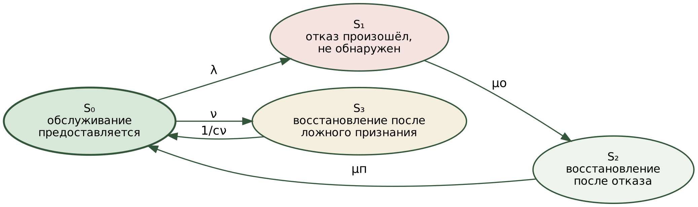
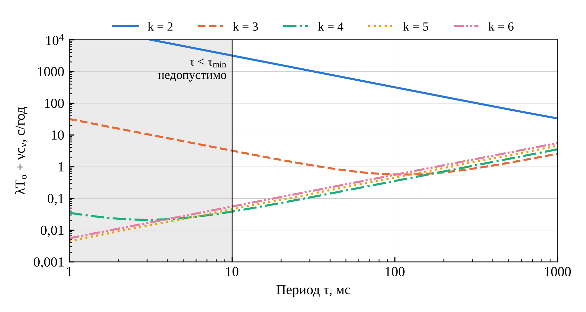
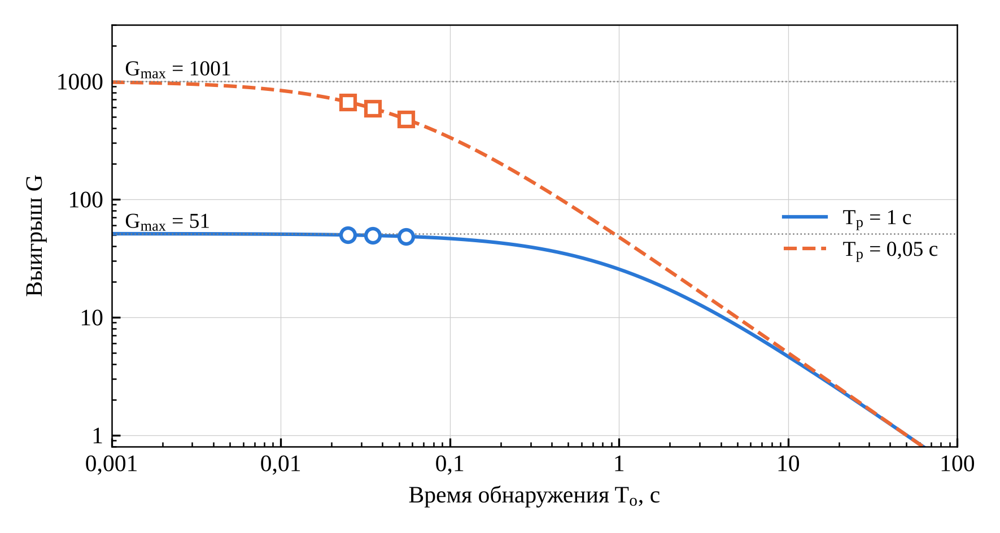
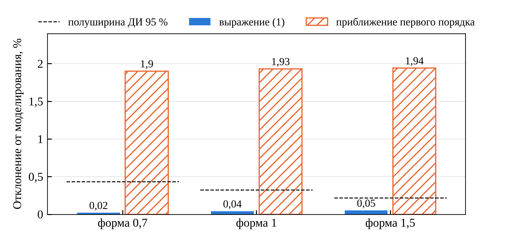
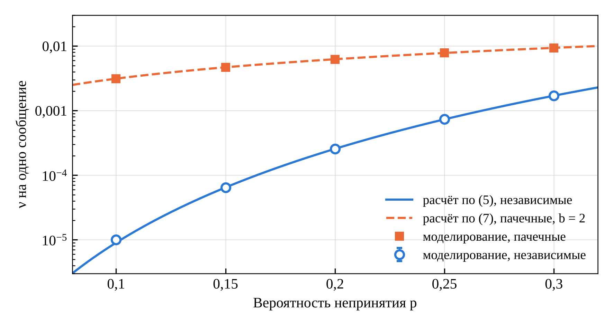

УДК 621.391

# Модель готовности телекоммуникационной службы с управляемым временем обнаружения отказа и учётом ложных срабатываний

*[Ф. И. О. автора]*, *[должность]*, *[организация, город]*, *[e-mail]*

**Аннотация.** Предложена модель готовности телекоммуникационной службы, в которой время обнаружения отказа узла задаётся периодом и пороговым числом двустороннего контроля пересылки, а ложное признание отказа учтено собственной ценой. Доказана независимость модели от вида распределений, показано, что оптимум лежит на минимальном периоде, получена формула оптимального порогового числа.

**Ключевые слова:** коэффициент готовности; время обнаружения отказа; ложное срабатывание; двусторонний контроль пересылки; контейнерная инфраструктура; виртуализированная сетевая функция; марковская модель.

## Введение

Перевод сетевых функций в программную форму и их размещение на инфраструктуре общего назначения закреплены эталонной архитектурой виртуализации [1], а переход от виртуальных машин к контейнерной реализации — отраслевыми спецификациями [2]; размещение контейнерных сетевых функций стало основным предметом исследований в сетях пятого поколения [3]. Требования к отказоустойчивости при этом не ослаблены: для платформенных служб операторского класса установлена готовность не ниже 0,99999 [2], что соответствует 315,4 с недоступности в год, для отдельных видов обслуживания систем пятого поколения требуется 99,9999 % [4], а схемы резервирования «1+1», «1:1» и «M+1» предписаны как штатные [5]. Отраслевой документ по активному контролю называет способы выявления отказавшего компонента, но не задаёт ни времени обнаружения, ни периодичности контроля [6].

Платформы контейнерной оркестрации этому требованию по умолчанию не отвечают. Узел обработки признаётся недостижимым через 50 с после прекращения обновления сведений о нём (версия 1.32 и новее; ранее — 40 с), а вытеснение размещённых на нём экземпляров наступает ещё через 300 с [7–9]. Единственный отказ узла исчерпывает тем самым годовой бюджет недоступности. Резервирование выводит переразмещение из критического пути, однако и тогда перерыв определяется обнаружением: при отказе узла измерено 38,582 с при резервировании против 300,852 с без него [10]. Сокращение предельного времени ожидания наталкивается на принципиальное ограничение: отказавший узел неотличим от отвечающего с задержкой [11], и учащение контроля повышает частоту ложных признаний отказа; экспериментально показано снижение доступности частым опросом именно по этой причине [12]. Устойчивость платформ изучается внесением неисправностей [13, 14], а для функций с состоянием — снятием и развёртыванием состояния процесса [15], однако выбор параметров контура обнаружения в этих работах остаётся эмпирическим.

Связь качества детектора отказов с его параметрами исследована подробно: определены показатели времени обнаружения и частоты ошибок [16], экспериментально изучен компромисс между ними [17], показатели распространены на восстанавливаемые объекты [18], предложены адаптивные и кооперативные детекторы [19, 20], протоколы с пониженной частотой ложных подозрений [21, 22] и достоверные детекторы ценой принудительного прекращения работы узла [23]; обнаружение перенесено в программируемую плоскость данных с миллисекундными периодами [24–26], а цена ложного объявления отказа в резервированной паре показана на примере двух одновременно ведущих контроллеров [27]. Однако предметом этих работ остаётся сам детектор, а не готовность обслуживаемой системы [28]. Модели готовности, напротив, учитывают неполноту обнаружения коэффициентом охвата [29–31], обнаружение — отдельной стадией [32] или отказами самого средства обнаружения [33], задержку обнаружения — как заданную величину [34, 35], виртуализированную и контейнерную реализацию — сетями Петри с вознаграждениями, полумарковскими и структурными моделями [36–46]; обзор методов отказоустойчивости облачных систем дан в [47]. Внутренний оптимум по временному параметру известен для омоложения программного обеспечения [48, 49] и для детектора аномалий [50], но не для времени обнаружения отказа в модели готовности. В отечественных работах учтён недостоверный контроль [51–55] и оптимизирована периодичность контроля [56, 57]; во всех случаях речь идёт о периодических проверках, а не о непрерывном пороговом обнаружении, и ложное срабатывание не наделено собственной ценой. Обзоры моделирования готовности виртуализированных сетей [58] модели, выражающей готовность через настраиваемые параметры контура обнаружения с ущербом от ложного признания отказа как отдельным членом, не приводят.

Цель работы — установить аналитическую связь параметров контура обнаружения с коэффициентом готовности и построить на её основе метод их выбора. Вклад работы составляют три результата: модель готовности с ценой ложного признания отказа и доказательство её нечувствительности к виду распределений; выражение интенсивности ложных признаний через период и пороговое число контроля, включая случай пачечных потерь; метод выбора параметров, указывающий связывающее ограничение и дающий оптимальное пороговое число в замкнутом виде.

## 1. Модель готовности

**Допущения.** Отказы узлов обработки независимы (отказы по общей причине [59] не рассматриваются), их интенсивность λ = 1/*T*н постоянна в среднем; ложные признания отказа образуют поток интенсивности ν, зависящей от настройки контура. Отказы рассматриваются типа остановки. Обслуживание считается предоставляемым, если экземпляр сетевой функции работоспособен и трафик направлен на него.

**Состояния.** S₀ — обслуживание предоставляется; S₁ — отказ произошёл, но не обнаружен, трафик направляется на отказавший узел; S₂ — отказ обнаружен, выполняется восстановление; S₃ — восстановление вследствие ложного признания отказа (рис. 1). Среднее время пребывания в S₁ есть время обнаружения *T*о, в S₂ — время переразмещения *T*п, в S₃ — цена ложного признания *c*ν.

*Рисунок 1 — Граф состояний телекоммуникационной службы: μо = 1/Tо, μп = 1/Tп, 1/cν — интенсивность выхода из состояния ложного признания*

Уравнения баланса для стационарного режима дают *p*₁ = *p*₀λ*T*о, *p*₂ = *p*₀λ*T*п, *p*₃ = *p*₀ν*c*ν, откуда

$$K_\text{г} = \frac{1}{1 + \lambda\,(T_\text{о} + T_\text{п}) + \nu\,c_\nu}. \tag{1}$$

При ν = 0 выражение (1) переходит в нормативное *K*г = *T*н / (*T*н + *T*в) [60–62], что подтверждает корректность построения.

**Утверждение 1.** Если λ и ν понимать как средние числа отказов и ложных признаний на единицу времени пребывания в S₀, то (1) справедливо при любых распределениях наработки, времени обнаружения, времени переразмещения и цены ложного признания с конечными математическими ожиданиями, при единственном условии: ложное признание не изменяет процесса отказов узла.

*Доказательство.* Процесс есть процесс восстановления с чередованием периодов обслуживания и перерывов. По теореме о процессе восстановления с вознаграждением [63] доля времени перерыва равна отношению средней длительности перерывов к средней длительности цикла. На единицу времени в S₀ приходится в среднем λ отказов, каждый с перерывом средней длительности *T*о + *T*п, и ν ложных признаний с перерывом *c*ν; суммарный перерыв *x* = λ(*T*о + *T*п) + ν*c*ν, доля перерыва *x* / (1 + *x*), что совпадает с 1 − *K*г по (1). Если бы ложное признание обновляло узел, наработка между отказами зависела бы от потока ложных признаний, и λ перестала бы быть свойством узла. ∎

Утверждение существенно потому, что измерения отказов крупных вычислительных установок показывают распределение наработки по закону Вейбулла с убывающей интенсивностью [64], а время обнаружения при периодическом контроле ограничено сверху и показательным быть не может. Показательное допущение, принятое и национальным стандартом применения марковских методов [65], служит тем самым лишь средством вывода (1) и в результат не входит. Приближение первого порядка *K*п ≈ *x* вносит относительную погрешность порядка самого коэффициента простоя.

**Цена ложного признания.** В одиночной конфигурации ложное признание влечёт переразмещение, и *c*ν = *T*п. При резервировании с *N* ≥ 2 экземплярами, рассчитанными на нагрузку силами *N* − 1, исключение из распределения работоспособного экземпляра само по себе обслуживания не прерывает, и *c*ν определяется классом функции: для функции без сохранения состояния — потерями заявок, находившихся в обработке, то есть величиной порядка времени перенаправления трафика *T*р; для функции с таблицей сессий — повторным установлением оборванных соединений. Условие *c*ν ≪ *T*п выполнимо лишь при разделении обнаружения и переразмещения: ложное признание должно изменять таблицу распределения трафика, но не запускать вытеснение.

**Резервирование.** При отказе одного из *N* экземпляров затрагивается доля нагрузки 1/*N* на время *T*о + *T*р, после чего обслуживание продолжают оставшиеся экземпляры; переразмещение восстанавливает уровень резервирования вне критического пути. Усреднение по *N* экземплярам даёт

$$K_\text{п} \approx \lambda\,(T_\text{о} + T_\text{р}) + \nu\,c_\nu, \tag{2}$$

независимо от *N* в первом приближении. При ν = 0 отношение простоя при штатном времени обнаружения *T*о⁰ к простою при сокращённом ограничено сверху величиной

$$G_\text{max} = 1 + \frac{T_\text{о}^0}{T_\text{р}}, \tag{3}$$

что по форме есть закон Амдала [66]: потолок выигрыша задаёт не детектор, а время перенаправления. Доля *q* этого потолка достигается при *T*о = *T*р(1 − *q*)/*q*; область *T*о ≪ *T*р есть область насыщения. В электросвязи соответствующая величина нормирована — время завершения переключения менее 50 мс для кольцевой защиты [67, 68], — тогда как для контейнерной инфраструктуры норматива нет [69], а опубликованное значение 0,028 с [10] относится лишь к обновлению перечня конечных точек на управляющем уровне.

## 2. Интенсивность ложных признаний при двустороннем контроле пересылки

Механизм двустороннего контроля пересылки задаётся периодом отправки контрольных сообщений τ и пороговым числом *k*: сессия признаётся неработоспособной после *k* подряд не принятых сообщений [70–72]; оба параметра входят в стандартную модель конфигурации сессии [73]. Правило сохранено и в актуальных расширениях стандарта [74, 75]. Сочетание контроля с резервированием шлюза показало, что обнаружение за десятки миллисекунд не сокращает пропорционально полного времени переключения [76, 77], что согласуется с (3). При равномерном распределении момента отказа внутри периода время обнаружения заключено между (*k* − 1)τ и *k*τ, а его среднее

$$T_\text{о} = \left(k - \tfrac{1}{2}\right)\tau. \tag{4}$$

В литературе и документации производителей встречаются записи *k*τ и (*k* + 1)τ [78]; они дают верхнюю границу либо учитывают иную точку отсчёта и с (4), относящимся к среднему по фазе отказа, не расходятся.

Обозначим через *p* вероятность того, что контрольное сообщение не принято за период, — потеряно либо запоздало более чем на τ. Ложное признание наступает, когда серия из *k* и более непринятых сообщений начинается после принятого. При независимости событий непринятия интенсивность таких серий

$$\nu = \frac{(1-p)\,p^{k}}{\tau}, \qquad \nu(T_\text{о}) = \frac{C(k,p)}{T_\text{о}}, \quad C(k,p) = (1-p)\left(k-\tfrac{1}{2}\right)p^{k}. \tag{5}$$

Соотношение (5) получено в настоящей работе из правила стандарта [70]; рецензируемого источника, выводящего его, не обнаружено. Из (5) следуют убывание и выпуклость ν(*T*о), а при фиксированном *T*о — убывание ν с ростом *k*:

$$\frac{C(k+1,p)}{C(k,p)} = p\,\frac{k+1/2}{k-1/2} < 1 \quad \text{при} \quad p < \frac{k-1/2}{k+1/2}. \tag{6}$$

**Содержание величины p.** В сетях центров обработки данных доля потерянных пакетов составляет 10⁻⁵–10⁻⁴, тогда как хвост распределения задержки тяжёлый: в одном из обследованных центров 99,9-й процентиль межмодульной задержки равен 23,35 мс, 99,99-й — 1397,63 мс, в другом — 11,07 и 105,84 мс [79]. При периодах в десятки миллисекунд *p* определяется поэтому запаздыванием, а не потерей, и зависит от периода и от конкретной сети; значение подлежит измерению на канале, для которого выполняется настройка.

**Пачечные потери.** Для действительных каналов независимость не выполняется [80, 81]. В модели Гилберта — Эллиотта с теми же средней вероятностью *p* и средней длиной пачки *b*, в которой сообщение теряется в «плохом» состоянии и принимается в «хорошем», пачки начинаются с интенсивностью *p*/(*b*τ), а пачка длины не менее *k* имеет вероятность (1 − 1/*b*)^(*k*−1), откуда

$$\nu_\text{Г} = \frac{p}{b\,\tau}\left(1 - \frac{1}{b}\right)^{k-1}. \tag{7}$$

Отношение ν_Г/ν растёт с *k* как ((1 − 1/*b*)/*p*)^(*k*−1): соотношение (5) при пачечных потерях занижает интенсивность ложных признаний, и занижение тем сильнее, чем больше пороговое число.

## 3. Метод выбора параметров контура обнаружения

Задача состоит в минимизации (2) по паре (τ, *k*) при ограничениях τ ≥ τ_min, где τ_min — минимально реализуемый период, ν ≤ ν_max и допустимой служебной нагрузке. Период выбирается, кроме того, из набора общеупотребительных значений 3,3; 10; 20; 50; 100 мс и 1 с [82].

При фиксированном *k* подстановка (5) в (2) даёт внутренний оптимум

$$T_\text{о}^{*} = \sqrt{\frac{C(k,p)\,c_\nu}{\lambda}}, \qquad \lambda\,T_\text{о}^{*} = \nu\!\left(T_\text{о}^{*}\right) c_\nu, \tag{8}$$

в котором вклады необнаруженного отказа и ложных признаний равны. Существенно, однако, что при свободном выборе *k* этот оптимум не является совместным.

**Утверждение 2.** Пусть *p* < 1/3 и оптимальное пороговое число не меньше двух. Тогда совместный минимум (2) по (τ, *k*) при τ ≥ τ_min достигается при τ = τ_min; если τ_min принадлежит набору [82], тот же вывод справедлив и при выборе периода из набора.

*Доказательство.* Пусть τ ≥ τ_min(*k* + ½)/(*k* − ½). Пара (*k* + 1, τ(*k* − ½)/(*k* + ½)) реализуема, даёт по (4) то же *T*о и по (6) — меньшее ν, то есть меньший простой; условие (6) при *p* < 1/3 выполняется для всех *k* ≥ 1. Следовательно, оптимальная точка лежит в полосе τ_min ≤ τ < τ_min(*k* + ½)/(*k* − ½). Пусть далее оптимум достигается при *k* ≥ 2 и τ = *r*τ_min, *r* > 1. Тогда это внутренний оптимум при данном *k*, в нём λ(*k* − ½)τ = ν*c*ν и *r* < (*k* + ½)/(*k* − ½). Переход к паре (*k* + 1, τ_min) изменяет простой на λτ_min *f*(*r*), где *f*(*r*) = (*k* + ½) − 2(*k* − ½)*r* + *p*(*k* − ½)*r*². Функция *f* выпукла, *f*(1) = 3/2 − *k* + *p*(*k* − ½) < 0 и *f*((*k* + ½)/(*k* − ½)) = (*k* + ½)[*p*(*k* + ½)/(*k* − ½) − 1] < 0, следовательно, *f* < 0 на всей полосе, что противоречит оптимальности; значит, *r* = 1. Множество допустимых пар при выборе из набора содержится в непрерывном и при τ_min из набора содержит найденную точку. ∎

Утверждение разделяет роли двух ограничений: период задаётся границей реализуемости, пороговое число — компромиссом с ложными признаниями. При τ = τ_min увеличение *k* на единицу добавляет к простою λτ_min и снимает *c*ν(1 − *p*)²*p*^*k*/τ_min, откуда оптимальное пороговое число выражается в замкнутом виде:

$$k^{*} = \max\left(1,\ \left\lceil \frac{\ln\!\left(\lambda\,\tau_{\min}^{2} \big/ \left(c_\nu\,(1-p)^{2}\right)\right)}{\ln p} \right\rceil\right), \qquad \nu\!\left(k^{*}\right) c_\nu \le \frac{\lambda\,\tau_{\min}}{1-p}. \tag{9}$$

Второе соотношение (9) даёт содержательную гарантию: при оптимальной настройке простой от ложных признаний не превышает простоя, вносимого одним периодом контроля на каждый действительный отказ.

Сказанное иллюстрирует рис. 2: при *k* ≥ 4 минимум суммы лежит левее τ_min, и связывающей оказывается граница периода, тогда как при *k* = 2 и 3 простой определяется ложными признаниями и на порядок и более выше.

*Рисунок 2 — Вклад обнаружения и ложных признаний в простой в зависимости от периода контроля: p = 10⁻³, cν = 1 с, λ = 1 год⁻¹; затенена область τ < τmin = 10 мс*

**Алгоритм 1 — выбор параметров контура обнаружения.**

1. Измерить на настраиваемом канале *p* (непринятие за период), τ_min, *T*р; определить *c*ν для класса сетевой функции; принять λ по данным эксплуатации.
2. Принять τ = τ_min, округлённое вверх к набору [82].
3. Вычислить *k*\* по (9).
4. Если ν(*k*\*) > ν_max, увеличивать *k* до выполнения ν ≤ ν_max.
5. Проверить служебную нагрузку 2(1/τ)*L* на наиболее нагруженном узле; при превышении увеличить τ и повторить шаги 3–4.
6. Вычислить *T*о по (4), простой по (2) и сопоставить вклады λ*T*о и ν*c*ν: их неравенство указывает, что связывающим является τ_min, а не компромисс (8).
7. Исключение экземпляра из таблицы распределения выполнять без подтверждения, возврат — после *m* подряд принятых сообщений, причём *m*τ ≪ 1/ν.

Метод отличается от подбора параметров по показателям детектора тем, что пороговое число определяется по цене ложного признания для данного класса сетевой функции и по измеренной вероятности непринятия, а результат сопровождается указанием связывающего ограничения.

## 4. Численные результаты и статистическая проверка

**Исходные данные.** Значения параметров приняты по опубликованным данным и приведены в таблице 1.

**Таблица 1 — Исходные данные расчёта**

| Величина | Значение | Основание |
|---|---|---|
| Интенсивность отказов узла λ, 1/год | 1 (диапазон 0,08–2,8) | [64, 83–85] |
| Штатное время обнаружения *T*о⁰, с | 50 | [7], версия 1.32 и новее |
| Время перенаправления *T*р, с | 1; 0,05 | оценка пути через интерфейс управления; норматив [68] |
| Цена ложного признания *c*ν, с | *T*р; 1 | функция без состояния; с таблицей сессий |
| Вероятность непринятия *p* | 10⁻⁴; 10⁻³; 10⁻² | порядок по [79] |
| Минимальный период τ_min, мс | 10 | [82] |

Интенсивность отказов, полученная делением числа отказов на число узлов и длительность наблюдения [64], занижена, поскольку большинство установок наблюдалось не весь период; опубликованные оценки по центрам обработки данных охватывают от ≈ 0,08 до ≈ 2,8 событий на узел в год, и значение 1 в год лежит внутри диапазона. Простой пропорционален λ, поэтому отношения между настройками от λ не зависят. Время запуска экземпляра, входящее в *T*п, составляет от сотен миллисекунд до десятков секунд [86] и при резервировании на результат не влияет.

**Результаты метода.** Результаты алгоритма 1 приведены в таблице 2. Во всех случаях связывающим оказывается τ_min: внутренний оптимум (8) требует периода от 0,5 до 3,6 мс. Пороговое число растёт с ухудшением канала — 3, 4 и 6 при *p*, равном 10⁻⁴, 10⁻³ и 10⁻², — а интенсивность ложных признаний остаётся около 0,003 в год в согласии с (9).

**Таблица 2 — Параметры контура, выбранные алгоритмом 1**

| *T*р, с | *c*ν, с | *p* | *k*\* | *T*о, мс | ν, 1/год | Простой, с/год | Выигрыш |
|---|---|---|---|---|---|---|---|
| 1 | 1 | 10⁻⁴ | 3 | 25 | 0,0032 | 1,028 | 50 |
| 1 | 1 | 10⁻³ | 4 | 35 | 0,0032 | 1,038 | 49 |
| 1 | 1 | 10⁻² | 6 | 55 | 0,0031 | 1,058 | 48 |
| 0,05 | 0,05 | 10⁻⁴ | 3 | 25 | 0,0032 | 0,075 | 666 |
| 0,05 | 0,05 | 10⁻³ | 4 | 35 | 0,0032 | 0,085 | 588 |
| 0,05 | 0,05 | 10⁻² | 6 | 55 | 0,0031 | 0,105 | 476 |
| 0,05 | 1 | 10⁻² | 6 | 55 | 0,0031 | 0,108 | 463 |

Таблица и рис. 3 подтверждают (3): при *T*р = 1 с выигрыш относительно штатной настройки ограничен величиной 51 и достигает 48–50, то есть насыщения; лишь сокращение *T*р до нормативных 50 мс поднимает его до сотен раз. Бюджет 315,4 с в год выполняется во всех случаях с запасом не менее чем в 290 раз. Простой при штатной настройке и резервировании составляет 51 и 50,05 с в год соответственно.

*Рисунок 3 — Выигрыш от сокращения времени обнаружения относительно штатного Tо⁰ = 50 с по (3) при ν = 0; маркеры — настройки таблицы 2*

**Проверка утверждения 1.** Моделировались отказы как процесс восстановления по наработке с распределением Вейбулла при параметре формы 0,7, 1,0 и 1,5 и средней наработке 2·10⁴ с, ложные признания — пуассоновским потоком с интенсивностью 5·10⁻⁶ 1/с, время обнаружения — равномерным на [40; 55] с, время переразмещения — логарифмически нормальным со средним 300 с и коэффициентом вариации 0,5; *c*ν = *T*п. Наработка сжата, чтобы погрешность приближения первого порядка была различима. Выполнено 30 прогонов по 2·10⁴ отказов; доверительные интервалы построены по распределению Стьюдента [87, 88] (табл. 3).

**Таблица 3 — Коэффициент простоя: моделирование и расчёт**

| Форма Вейбулла | *K*п, моделирование (ДИ 95 %) | Отклонение (1) | Отклонение приближения 1-го порядка |
|---|---|---|---|
| 0,7 | 0,01852 ± 0,00008 | +0,02 % | +1,90 % |
| 1,0 | 0,01852 ± 0,00006 | +0,04 % | +1,93 % |
| 1,5 | 0,01852 ± 0,00004 | +0,05 % | +1,94 % |

Отклонение (1) лежит в пределах доверительного интервала при всех формах распределения (рис. 4), тогда как приближение первого порядка завышает простой на величину, близкую к самому *K*п = 0,0185, что соответствует утверждению 1.

*Рисунок 4 — Отклонение выражения (1) и приближения первого порядка от результатов моделирования при разных параметрах формы распределения Вейбулла*

**Проверка (5) и (7).** Моделировалась сессия контроля из 2·10⁶ сообщений при *k* = 5, 30 прогонов на точку, по двум моделям непринятия с одинаковой средней *p* (табл. 4). Диапазон *p* = 0,10–0,30 выбран завышенным, чтобы число событий было достаточным для оценки.

**Таблица 4 — Интенсивность ложных признаний на одно сообщение, k = 5**

| *p* | Независимые: моделирование | Расчёт по (5) | Пачечные, *b* = 2: моделирование | Расчёт по (7) | Занижение (5) |
|---|---|---|---|---|---|
| 0,10 | (9,98 ± 0,95)·10⁻⁶ | 9,00·10⁻⁶ | 3,120·10⁻³ | 3,125·10⁻³ | 347 раз |
| 0,15 | (6,42 ± 0,20)·10⁻⁵ | 6,45·10⁻⁵ | 4,678·10⁻³ | 4,688·10⁻³ | 72 раза |
| 0,20 | (2,554 ± 0,055)·10⁻⁴ | 2,560·10⁻⁴ | 6,227·10⁻³ | 6,250·10⁻³ | 24 раза |
| 0,25 | (7,363 ± 0,071)·10⁻⁴ | 7,324·10⁻⁴ | 7,832·10⁻³ | 7,813·10⁻³ | 11 раз |
| 0,30 | (1,696 ± 0,010)·10⁻³ | 1,701·10⁻³ | 9,370·10⁻³ | 9,375·10⁻³ | 5,5 раза |

Расчёт по (5) лежит в доверительных границах моделирования во всех точках (рис. 5); наклон зависимости ln ν от ln *p* составил 4,69 при расчётном среднем *k* − *p*/(1 − *p*) = 4,74. Выражение (7) воспроизводит моделирование с расхождением не более 0,4 %. Занижение интенсивности ложных признаний при пачечных потерях составляет от 5,5 до 347 раз и растёт с уменьшением *p*, то есть именно в эксплуатационной области. Отсюда практическое следствие: *p* в (9) надлежит заменять эквивалентной величиной, оцениваемой по измеренному распределению длин серий непринятия, а не по средней доле.

*Рисунок 5 — Интенсивность ложных признаний на одно сообщение при k = 5 для независимых и пачечных (b = 2) потерь: линии — расчёт, маркеры — моделирование с ДИ 95 %*

## Заключение

Получены три результата. Построена модель готовности телекоммуникационной службы, в которой время обнаружения отказа выражено через параметры контура контроля, а ложное признание отказа учтено ценой *c*ν, зависящей от класса сетевой функции; доказано, что выражение коэффициента готовности не зависит от вида распределений длительностей. Получено выражение интенсивности ложных признаний через период, пороговое число и вероятность непринятия контрольного сообщения для независимых и пачечных потерь; моделирование подтвердило оба выражения. Доказано, что при вероятности непринятия менее 1/3 и пороговом числе не менее двух совместный оптимум параметров лежит на границе минимально реализуемого периода, и получено замкнутое выражение оптимального порогового числа с гарантией, что вклад ложных признаний не превышает одного периода контроля на отказ; на этой основе построен алгоритм выбора параметров.

При значениях параметров таблицы 1 предложенная настройка снижает простой при резервировании в 48–50 раз при времени перенаправления 1 с и в 460–670 раз при 50 мс, что указывает на время перенаправления как на следующий предмет сокращения. Ограничение работы — допущение о независимости отказов узлов; учёт отказов по общей причине составляет направление дальнейших исследований.

## Литература

1. Network Functions Virtualisation (NFV); Architectural Framework : ETSI GS NFV 002 V1.2.1 (2014-12). – ETSI, 2014. – URL: https://www.etsi.org/deliver/etsi_gs/NFV/001_099/002/01.02.01_60/gs_NFV002v010201p.pdf
2. Network Functions Virtualisation (NFV) Release 3; Architecture; Report on the Enhancements of the NFV architecture towards «Cloud-native» and «PaaS» : ETSI GR NFV-IFA 029 V3.3.1 (2019-11). – ETSI, 2019. – URL: https://www.etsi.org/deliver/etsi_gr/NFV-IFA/001_099/029/03.03.01_60/gr_NFV-IFA029v030301p.pdf
3. VNF and CNF Placement in 5G: Recent Advances and Future Trends / W. Attaoui, E. Sabir, H. Elbiaze, M. Guizani // IEEE Transactions on Network and Service Management. – 2023. – Vol. 20, No. 4. – P. 4698–4733. – DOI 10.1109/TNSM.2023.3264005.
4. 5G; Service requirements for the 5G system : 3GPP TS 22.261 version 19.12.0 Release 19 (ETSI TS 122 261 V19.12.0, 2025-10). – ETSI / 3GPP, 2025. – URL: https://www.etsi.org/deliver/etsi_ts/122200_122299/122261/
5. Network Functions Virtualisation (NFV); Resiliency Requirements : ETSI GS NFV-REL 001 V1.1.1 (2015-01). – ETSI, 2015. – URL: https://www.etsi.org/deliver/etsi_gs/NFV-REL/001_099/001/01.01.01_60/gs_NFV-REL001v010101p.pdf
6. Network Functions Virtualisation (NFV); Assurance; Report on Active Monitoring and Failure Detection : ETSI GS NFV-REL 004 V1.1.1 (2016-04). – ETSI, 2016. – URL: https://www.etsi.org/deliver/etsi_gs/nfv-rel/001_099/004/01.01.01_60/gs_nfv-rel004v010101p.pdf
7. Kubernetes Documentation. Concepts: Cluster Architecture — Nodes; Controllers; Services, Load Balancing, and Networking — EndpointSlices / The Kubernetes Authors. – URL: https://kubernetes.io/docs/concepts/architecture/nodes/ ; https://kubernetes.io/docs/concepts/architecture/controller/ ; https://kubernetes.io/docs/concepts/services-networking/endpoint-slices/
8. Kubernetes Documentation (v1.37): kube-controller-manager; Node Status; Kubelet Configuration (v1beta1); kube-apiserver / The Kubernetes Authors. – URL: https://kubernetes.io/docs/reference/command-line-tools-reference/kube-controller-manager/ ; https://kubernetes.io/docs/reference/node/node-status/ ; https://kubernetes.io/docs/reference/config-api/kubelet-config.v1beta1/ ; https://kubernetes.io/docs/reference/command-line-tools-reference/kube-apiserver/ (дата обращения: 06.11.2026)
9. Kubernetes v1.32.0 Release Notes (CHANGELOG-1.32) / The Kubernetes Authors. – URL: https://github.com/kubernetes/kubernetes/blob/master/CHANGELOG/CHANGELOG-1.32.md (дата обращения: 06.11.2026)
10. Kubernetes as an Availability Manager for Microservice Applications : preprint / L. Abdollahi Vayghan, M. A. Saied, M. Toeroe, F. Khendek. – 2019. – arXiv:1901.04946 [cs.SE]. – DOI 10.48550/arXiv.1901.04946.
11. Chandra, T. D. Unreliable Failure Detectors for Reliable Distributed Systems / T. D. Chandra, S. Toueg // Journal of the ACM. – 1996. – Vol. 43, No. 2. – P. 225–267. – DOI 10.1145/226643.226647.
12. Roberts, J. Signalling Health for Improved Kubernetes Microservice Availability : preprint / J. Roberts, B. Archibald, P. Trinder. – 2025. – arXiv:2507.02158 [cs.DC]. – DOI 10.48550/arXiv.2507.02158.
13. Chen, Z. Resilience Evaluation of Kubernetes in Cloud–Edge Environments : preprint / Z. Chen, M. Goudarzi, A. Nadjaran Toosi. – 2025. – arXiv:2507.16109.
14. Hecht, M. Software Reliability and Availability Testing of a Kubernetes Cluster / M. Hecht // Proceedings of the 2026 Annual Reliability and Maintainability Symposium (RAMS). – IEEE, 2026. – P. 1–6. – DOI 10.1109/RAMS50514.2026.11424466.
15. Transparent Fault Tolerance for Stateful Applications in Kubernetes with Checkpoint/Restore / H. Schmidt, Z. Rejiba, R. Eidenbenz, K.-T. Förster // Proceedings of the 42nd International Symposium on Reliable Distributed Systems (SRDS). – IEEE, 2023. – P. 129–139. – DOI 10.1109/SRDS60354.2023.00022.
16. Chen, W. On the Quality of Service of Failure Detectors / W. Chen, S. Toueg, M. K. Aguilera // IEEE Transactions on Computers. – 2002. – Vol. 51, No. 5. – P. 561–580. – DOI 10.1109/TC.2002.1004595.
17. The φ Accrual Failure Detector / N. Hayashibara, X. Défago, R. Yared, T. Katayama // Proceedings of the 23rd IEEE International Symposium on Reliable Distributed Systems (SRDS). – IEEE, 2004.
18. Ma, T. On the Quality of Service of Crash-Recovery Failure Detectors / T. Ma, J. Hillston, S. Anderson // IEEE Transactions on Dependable and Secure Computing. – 2010. – Vol. 7, No. 3. – P. 271–283. – DOI 10.1109/TDSC.2009.35.
19. Chaurasia, B. IHFD: an improved heartbeat-based failure detector of ◇P class for partially synchronous hierarchical distributed systems / B. Chaurasia, A. Verma, P. Verma // Complex & Intelligent Systems. – 2026. – Vol. 12, No. 12. – Article 312. – DOI 10.1007/s40747-026-02423-z.
20. Stab-FD: A cooperative and adaptive failure detector for wide area networks / P. Sens, L. Arantes, A. G. de M. Rossetto, O. Marin // Journal of Parallel and Distributed Computing. – 2024. – Vol. 186. – Article 104803. – DOI 10.1016/j.jpdc.2023.104803.
21. Das, A. SWIM: Scalable Weakly-consistent Infection-style Process Group Membership Protocol / A. Das, I. Gupta, A. Motivala // Proceedings of the International Conference on Dependable Systems and Networks (DSN 2002). – IEEE, 2002. – P. 303–312. – DOI 10.1109/DSN.2002.1028914.
22. Dadgar, A. Lifeguard: Local Health Awareness for More Accurate Failure Detection / A. Dadgar, J. Phillips, J. Currey // Proceedings of the 48th Annual IEEE/IFIP International Conference on Dependable Systems and Networks Workshops (DSN-W). – IEEE, 2018. – P. 22–25. – DOI 10.1109/DSN-W.2018.00017.
23. Detecting failures in distributed systems with the Falcon spy network / J. B. Leners, H. Wu, W.-L. Hung [et al.] // Proceedings of the 23rd ACM Symposium on Operating Systems Principles (SOSP). – ACM, 2011. – P. 279–294. – DOI 10.1145/2043556.2043583.
24. Wang, Y. An Approach for Fast Fault Detection in Virtual Network / Y. Wang, R. Fang // Tehnički vjesnik — Technical Gazette. – 2023. – Vol. 30, No. 4. – P. 1146–1151. – DOI 10.17559/TV-20230207000330.
25. Ji, C. FASTR: Fast Resilience for Stateful Programmable Data Planes / C. Ji, F. Kuipers // Proceedings of the 21st International Conference on Network and Service Management (CNSM 2025). – IFIP/IEEE, 2025. – P. 1–7. – DOI 10.23919/CNSM67658.2025.11297557.
26. A Survey on Rerouting Techniques with P4 Programmable Data Plane Switches / A. Mazloum, E. Kfoury, J. Gomez, J. Crichigno // Computer Networks. – 2023. – Vol. 230. – Article 109795. – DOI 10.1016/j.comnet.2023.109795.
27. Consistency Before Availability: Network Reference Point based Failure Detection for Controller Redundancy / B. Johansson, M. Rågberger, A. V. Papadopoulos, T. Nolte // Proceedings of the 2023 IEEE 28th International Conference on Emerging Technologies and Factory Automation (ETFA). – IEEE, 2023. – P. 1–8. – DOI 10.1109/ETFA54631.2023.10275664.
28. Freiling, F. C. The Failure Detector Abstraction / F. C. Freiling, R. Guerraoui, P. Kuznetsov // ACM Computing Surveys. – 2011. – Vol. 43, No. 2. – Article 9. – 40 p. – DOI 10.1145/1883612.1883616.
29. Arnold, T. F. The Concept of Coverage and Its Effect on the Reliability Model of a Repairable System / T. F. Arnold // IEEE Transactions on Computers. – 1973. – Vol. C-22, No. 3. – P. 251–254. – DOI 10.1109/T-C.1973.223703.
30. Ke, J.-C. On a repairable system with detection, imperfect coverage and reboot: Bayesian approach / J.-C. Ke, S.-L. Lee, Y.-L. Hsu // Simulation Modelling Practice and Theory. – 2008. – Vol. 16, No. 3. – P. 353–367. – DOI 10.1016/j.simpat.2007.12.001.
31. Ke, J.-C. Parametric Programming Approach for a Two-Unit Repairable System With Imperfect Coverage, Reboot and Fuzzy Parameters / J.-C. Ke, H.-I. Huang, C.-H. Lin // IEEE Transactions on Reliability. – 2008. – Vol. 57, No. 3. – P. 498–506. – DOI 10.1109/TR.2008.927703.
32. Kumar, A. Bayesian Modeling of Repairable Systems With Imperfect Coverage and Delayed Detection Dynamics / A. Kumar, C. Shekhar // Quality and Reliability Engineering International. – 2025. – Vol. 41, No. 4. – P. 1630–1641. – DOI 10.1002/qre.3742.
33. Na, S. Repair policies of failure detection equipments and system availability / S. Na, S.-H. Bang // Communications for Statistical Applications and Methods. – 2022. – Vol. 29, No. 2. – P. 151–160. – DOI 10.29220/csam.2022.29.2.151.
34. Kim, D. S. Availability Modeling and Analysis of a Virtualized System / D. S. Kim, F. Machida, K. S. Trivedi // Proceedings of the 15th IEEE Pacific Rim International Symposium on Dependable Computing (PRDC). – IEEE, 2009. – P. 365–371. – DOI 10.1109/PRDC.2009.64.
35. Availability Modeling of SIP Protocol on IBM© WebSphere© / K. Trivedi, D. Wang, D. J. Hunt [et al.] // Proceedings of the 14th IEEE Pacific Rim International Symposium on Dependable Computing (PRDC 2008). – IEEE, 2008. – P. 323–330. – DOI 10.1109/PRDC.2008.50.
36. Nguyen, T. A. A Comprehensive Availability Modeling and Analysis of a Virtualized Servers System Using Stochastic Reward Nets / T. A. Nguyen, D. S. Kim, J. S. Park // The Scientific World Journal. – 2014. – Vol. 2014. – Article 165316. – 18 p. – DOI 10.1155/2014/165316.
37. Sebastio, S. An Availability Analysis Approach for Deployment Configurations of Containers / S. Sebastio, R. Ghosh, T. Mukherjee // IEEE Transactions on Services Computing. – 2021. – Vol. 14, No. 1. – P. 16–29. – DOI 10.1109/TSC.2017.2788442.
38. Comparative Performability Assessment of SFCs: The Case of Containerized IP Multimedia Subsystem / M. Di Mauro, G. Galatro, M. Longo [et al.] // IEEE Transactions on Network and Service Management. – 2021. – Vol. 18, No. 1. – P. 258–272. – DOI 10.1109/TNSM.2020.3044232.
39. Tola, B. Model-Driven Availability Assessment of the NFV-MANO With Software Rejuvenation / B. Tola, Y. Jiang, B. E. Helvik // IEEE Transactions on Network and Service Management. – 2021. – Vol. 18, No. 3. – P. 2460–2477. – DOI 10.1109/TNSM.2021.3090208.
40. Performability of Network Service Chains: Stochastic Modeling and Assessment of Softwarized IP Multimedia Subsystem / M. Di Mauro, G. Galatro, F. Postiglione, M. Tambasco // IEEE Transactions on Dependable and Secure Computing. – 2022. – Vol. 19, No. 5. – P. 3071–3086. – DOI 10.1109/TDSC.2021.3082626.
41. Impact of Service Function Aging on the Dependability for MEC Service Function Chain / J. Bai, X. Chang, F. Machida [et al.] // IEEE Transactions on Dependable and Secure Computing. – 2023. – Vol. 20, No. 4. – P. 2811–2824. – DOI 10.1109/TDSC.2022.3150782.
42. Hecht, M. A Reliability and Availability Model of a Kubernetes Cluster Using SysML / M. Hecht, S. Agena // Proceedings of the 2024 Annual Reliability and Maintainability Symposium (RAMS). – IEEE, 2024. – P. 1–7. – DOI 10.1109/RAMS51492.2024.10457826.
43. Mandal, P. Availability and Reliability of Core Networks (4G/5G) From a Deployment Standpoint / P. Mandal // IEEE Transactions on Services Computing. – 2025. – Vol. 18, No. 2. – P. 647–659. – DOI 10.1109/TSC.2025.3528332.
44. Богатырев, В. А. Оценка надежности восстанавливаемого кластера контейнерной виртуализацией / В. А. Богатырев, Фунг Ван Кю // Научно-технический вестник информационных технологий, механики и оптики. – 2025. – Т. 25, № 5. – С. 988–995. – DOI 10.17586/2226-1494-2025-25-5-988-995.
45. До Мань Кием. Полумарковская модель надежности компьютерной системы с контейнерной виртуализацией / До Мань Кием, В. А. Богатырев // Информатика и автоматизация. – 2026. – Т. 25, № 5. – С. 1604–1639. – DOI 10.15622/ia.25.5.10.
46. Богатырев, В. А. Оценка готовности компьютерной системы к своевременному обслуживанию запросов при его совмещении с информационным восстановлением памяти после отказов / В. А. Богатырев, С. В. Богатырев, А. В. Богатырев // Научно-технический вестник информационных технологий, механики и оптики. – 2023. – Т. 23, № 3. – С. 608–617. – DOI 10.17586/2226-1494-2023-23-3-608-617.
47. Mukwevho, M. A. Toward a Smart Cloud: A Review of Fault-Tolerance Methods in Cloud Systems / M. A. Mukwevho, T. Celik // IEEE Transactions on Services Computing. – 2021. – Vol. 14, No. 2. – P. 589–605. – DOI 10.1109/TSC.2018.2816644.
48. Vaidyanathan, K. A Comprehensive Model for Software Rejuvenation / K. Vaidyanathan, K. S. Trivedi // IEEE Transactions on Dependable and Secure Computing. – 2005. – Vol. 2, No. 2. – P. 124–137. – DOI 10.1109/TDSC.2005.15.
49. Model-Driven Dependability Assessment of Microservice Chains in MEC-Enabled IoT / J. Bai, X. Chang, F. Machida [et al.] // IEEE Transactions on Services Computing. – 2023. – Vol. 16, No. 4. – P. 2769–2785. – DOI 10.1109/TSC.2023.3241430.
50. A Model-Based Approach to Anomaly Detection Trading Detection Time and False Alarm Rate / C. F. Goncalves, D. S. Menasche, A. Avritzer [et al.] // Proceedings of the 2020 Mediterranean Communication and Computer Networking Conference (MedComNet). – IEEE, 2020. – P. 1–8. – DOI 10.1109/MedComNet49392.2020.9191549.
51. Зеленцов, Б. П. Модель надежности объекта при недостоверном контроле / Б. П. Зеленцов // Надежность и качество сложных систем. – 2020. – № 3 (31). – С. 46–54. – DOI 10.21685/2307-4205-2020-3-6.
52. Зеленцов, Б. П. Модель надежности объекта с учетом мониторинга технического состояния / Б. П. Зеленцов // Вестник СибГУТИ. – 2020. – № 4 (52). – С. 14–27.
53. Зеленцов, Б. П. Метод расчета для коэффициента готовности пассивной оптической сети доступа в условиях недостоверного контроля / Б. П. Зеленцов, Е. П. Ионикова, В. П. Шувалов // T-Comm: Телекоммуникации и транспорт. – 2019. – Т. 13, № 7. – С. 10–15. – DOI 10.24411/2072-8735-2018-10285.
54. Шувалов, В. П. Методика оценки коэффициента готовности системы с резервированием. Пассивный режим / В. П. Шувалов, Б. П. Зеленцов, И. Г. Квиткова // T-Comm: Телекоммуникации и транспорт. – 2020. – Т. 14, № 8. – С. 21–25. – DOI 10.36724/2072-8735-2020-14-8-21-25.
55. Зеленцов, Б. П. Модели элементов оптической сети доступа в условиях резервирования и учета недостоверного контроля их технического состояния / Б. П. Зеленцов, Е. П. Ионикова, В. П. Шувалов // Вестник СибГУТИ. – 2019. – № 1. – С. 3–15.
56. Богатырев, В. А. Оптимизация периодичности инициализации контроля на основе дублированных вычислений / В. А. Богатырев, Д. Э. Лисичкин // Программные продукты и системы. – 2019. – Т. 32, № 2. – С. 214–220. – DOI 10.15827/0236-235X.126.214-220.
57. Тахаутдинова, К. И. Оптимизация периодичности тестирования памяти вычислительных систем / К. И. Тахаутдинова, В. А. Богатырев // International Journal of Open Information Technologies. – 2026. – Т. 14, № 3. – С. 14–18.
58. Reliability and Availability in Virtualized Networks: A Survey on Standards, Modeling Approaches, and Research Challenges / M. Di Mauro, W. Cerroni, F. Postiglione [et al.] // IEEE Communications Surveys & Tutorials. – 2026. – Vol. 28. – P. 5121–5158. – DOI 10.1109/COMST.2026.3670039.
59. Нетес, В. А. Отказы по общей причине и их влияние на устойчивость сетей и систем связи / В. А. Нетес // T-Comm: Телекоммуникации и транспорт. – 2024. – Т. 18, № 2. – С. 4–9. – DOI 10.36724/2072-8735-2024-18-2-4-9.
60. ГОСТ Р 27.102-2021. Надежность в технике. Надежность объекта. Термины и определения : национальный стандарт Российской Федерации : дата введения 2022-01-01. – Москва : Стандартинформ.
61. ГОСТ Р 53111-2008. Устойчивость функционирования сети связи общего пользования. Требования и методы проверки : национальный стандарт Российской Федерации : введен в действие приказом Ростехрегулирования от 18.12.2008 № 529-ст : дата введения 2009-10-01.
62. ГОСТ Р 27.010-2019 (МЭК 61703:2016). Надежность в технике. Математические выражения для показателей безотказности, готовности, ремонтопригодности : национальный стандарт Российской Федерации : утвержден приказом Росстандарта от 12.09.2019 № 673-ст : дата введения 2019-12-01.
63. Trivedi, K. S. Probability and Statistics with Reliability, Queuing, and Computer Science Applications / K. S. Trivedi. – 2nd ed. – New York : John Wiley & Sons, 2001. – 848 p. – ISBN 978-0-471-33341-8.
64. Schroeder, B. A Large-Scale Study of Failures in High-Performance Computing Systems / B. Schroeder, G. A. Gibson // Proceedings of the International Conference on Dependable Systems and Networks (DSN'06). – Philadelphia, PA : IEEE, 2006. – P. 249–258. – DOI 10.1109/DSN.2006.5.
65. ГОСТ Р МЭК 61165-2019. Надежность в технике. Применение марковских методов : национальный стандарт Российской Федерации : утвержден приказом Росстандарта от 05.09.2019 № 635-ст : дата введения 2019-12-01.
66. Amdahl, G. M. Validity of the single processor approach to achieving large scale computing capabilities / G. M. Amdahl // Proceedings of the AFIPS Spring Joint Computer Conference. – Atlantic City, NJ, 1967. – Vol. 30. – P. 483–485. – DOI 10.1145/1465482.1465560.
67. Types and characteristics of SDH network protection architectures : ITU-T Recommendation G.841 (10/98). – ITU-T, 1998. – URL: https://www.itu.int/rec/T-REC-G.841-199810-I/en
68. Ethernet ring protection switching : ITU-T Recommendation G.8032/Y.1344 (03/2020). – ITU-T, 2020. – URL: https://www.itu.int/rec/T-REC-G.8032/en
69. Kubernetes Scalability and Performance SLIs/SLOs / Kubernetes Community, SIG Scalability. – URL: https://github.com/kubernetes/community/tree/master/sig-scalability/slos
70. Katz, D. Bidirectional Forwarding Detection (BFD) : RFC 5880 / D. Katz, D. Ward. – IETF, 2010. – Standards Track. – URL: https://www.rfc-editor.org/rfc/rfc5880.txt
71. Katz, D. Bidirectional Forwarding Detection (BFD) for IPv4 and IPv6 (Single Hop) : RFC 5881 / D. Katz, D. Ward. – IETF, 2010. – Proposed Standard. – DOI 10.17487/RFC5881. – URL: https://www.rfc-editor.org/rfc/rfc5881.txt
72. Katz, D. Bidirectional Forwarding Detection (BFD) for Multihop Paths : RFC 5883 / D. Katz, D. Ward. – IETF, 2010. – Proposed Standard. – DOI 10.17487/RFC5883. – URL: https://www.rfc-editor.org/rfc/rfc5883.txt
73. YANG Data Model for Bidirectional Forwarding Detection (BFD) : RFC 9127 / R. Rahman, L. Zheng, M. Jethanandani [et al.]. – IETF, 2021. – DOI 10.17487/RFC9127.
74. Unaffiliated Bidirectional Forwarding Detection (BFD) Echo : RFC 9747 / W. Cheng, R. Wang, X. Min [et al.]. – IETF, 2025. – Proposed Standard. – DOI 10.17487/RFC9747. – URL: https://www.rfc-editor.org/rfc/rfc9747.txt
75. Haas, J. Bidirectional Forwarding Detection (BFD) Encapsulated in Large Packets : RFC 9764 / J. Haas, A. Fu. – IETF, 2025. – Proposed Standard. – DOI 10.17487/RFC9764. – URL: https://www.rfc-editor.org/rfc/rfc9764.txt
76. Ben Hassan, A. Performance Evaluation of Bidirectional Forwarding Detection (BFD) over the Virtual Router Redundancy Protocol (VRRP) / A. Ben Hassan, M. Mansour // Procedia Computer Science. – 2024. – Vol. 251. – P. 256–264. – DOI 10.1016/j.procs.2024.11.108.
77. Оценка показателей надежности шлюза по умолчанию в корпоративных сетях / А. Н. Земцов, М. А. Кузнецов, Д. А. Редняков, М. С. Аль-Мерри Гайс // Экономика и качество систем связи. – 2026. – № 1 (39). – С. 77–86.
78. Fault tolerance in SDN data plane considering network and application based metrics / B. Yamansavascilar, A. C. Baktir, A. Ozgovde, C. Ersoy // Journal of Network and Computer Applications. – 2020. – Vol. 170. – Article 102780. – DOI 10.1016/j.jnca.2020.102780.
79. Pingmesh: A Large-Scale System for Data Center Network Latency Measurement and Analysis / C. Guo, L. Yuan, D. Xiang [et al.] // Proceedings of the ACM SIGCOMM 2015. – London : ACM, 2015. – P. 139–152. – DOI 10.1145/2785956.2787496.
80. Gilbert, E. N. Capacity of a Burst-Noise Channel / E. N. Gilbert // Bell System Technical Journal. – 1960. – Vol. 39, No. 5. – P. 1253–1265. – DOI 10.1002/j.1538-7305.1960.tb03959.x.
81. Elliott, E. O. Estimates of Error Rates for Codes on Burst-Noise Channels / E. O. Elliott // Bell System Technical Journal. – 1963. – Vol. 42, No. 5. – P. 1977–1997. – DOI 10.1002/j.1538-7305.1963.tb00955.x.
82. Akiya, N. Common Interval Support in Bidirectional Forwarding Detection : RFC 7419 / N. Akiya, M. Binderberger, G. Mirsky. – IETF, 2014. – Informational. – URL: https://www.rfc-editor.org/rfc/rfc7419.html
83. Availability in Globally Distributed Storage Systems / D. Ford, F. Labelle, F. I. Popovici [et al.] // Proceedings of the 9th USENIX Symposium on Operating Systems Design and Implementation (OSDI '10). – Vancouver : USENIX Association, 2010. – URL: https://www.usenix.org/legacy/event/osdi10/tech/full_papers/Ford.pdf
84. Vishwanath, K. V. Characterizing cloud computing hardware reliability / K. V. Vishwanath, N. Nagappan // Proceedings of the 1st ACM Symposium on Cloud Computing (SoCC '10). – Indianapolis : ACM, 2010. – P. 193–204. – DOI 10.1145/1807128.1807161.
85. A Large Scale Study of Data Center Network Reliability / J. Meza, T. Xu, K. Veeraraghavan, O. Mutlu // Proceedings of the Internet Measurement Conference 2018 (IMC '18). – ACM, 2018. – P. 393–407. – DOI 10.1145/3278532.3278566.
86. An Empirical Study of Container Image Configurations and Their Impact on Start Times / M. Straesser, A. Bauer, R. Leppich [et al.] // 2023 IEEE/ACM 23rd International Symposium on Cluster, Cloud and Internet Computing (CCGrid). – IEEE, 2023. – P. 94–105. – DOI 10.1109/CCGrid57682.2023.00019.
87. ГОСТ Р 8.736-2011. Государственная система обеспечения единства измерений. Измерения прямые многократные. Методы обработки результатов измерений. Основные положения : национальный стандарт Российской Федерации : дата введения 2013-01-01. – Москва : Стандартинформ.
88. Evaluation of measurement data — Guide to the expression of uncertainty in measurement : JCGM 100:2008. – Joint Committee for Guides in Metrology, 2008. – URL: https://www.bipm.org/documents/20126/2071204/JCGM_100_2008_E.pdf
