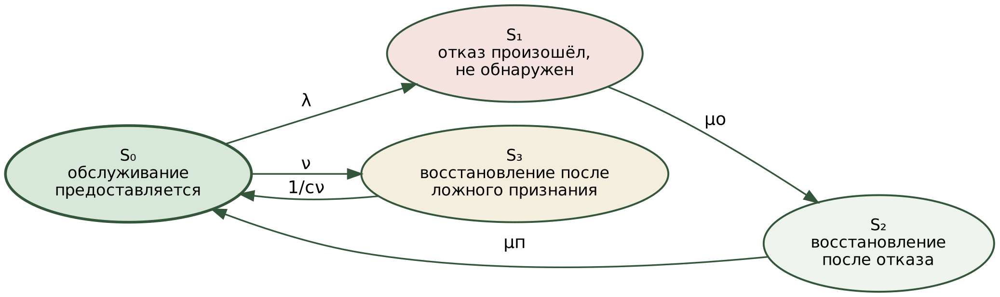

# Статья 1 — текст с ключами источников (рабочая версия)

> **Состояние:** первый полный черновик, 6 ноября 2026 г. Ссылки даны ключами `{D13}`, `{A4}`, `{F10}`, `{R13}` — по `references_pool.md`; перенумерация в порядке первого упоминания выполняется при сборке. Журнал не выбран — оформление по общему шаблону ВАК.
> Все числа раздела 4 получены расчётом и статистическим моделированием (сценарии в этом каталоге); натурных измерений в статье нет, и это оговорено в тексте.

---

УДК *[уточнить по журналу: 621.391 либо 004.7]*

# Модель готовности телекоммуникационной службы с управляемым временем обнаружения отказа и учётом ложных срабатываний

*[Ф. И. О. автора]*, *[организация, город]*, *[e-mail]*

**Аннотация.** Рассматривается выбор параметров контура обнаружения отказа узла обработки в контейнерной инфраструктуре, реализующей виртуализированные сетевые функции. Предложена модель готовности, в которой время обнаружения задаётся периодом и пороговым числом двустороннего контроля пересылки, а ложное признание отказа учитывается как событие с собственной ценой. Доказано, что выражение коэффициента готовности не зависит от вида распределений длительностей, а совместный оптимум параметров лежит на границе минимально реализуемого периода; получено замкнутое выражение для оптимального порогового числа. Результаты подтверждены статистическим моделированием.

**Ключевые слова:** коэффициент готовности; время обнаружения отказа; ложное срабатывание; двусторонний контроль пересылки; контейнерная инфраструктура; виртуализированная сетевая функция; марковская модель.

*[Англоязычный блок: Title, Abstract, Keywords — после согласования русского текста.]*

---

## Введение

Перевод сетевых функций в программную форму и их размещение на инфраструктуре общего назначения закреплены эталонной архитектурой виртуализации {D15}, а переход от виртуальных машин к контейнерной реализации — отраслевыми спецификациями {D16}; размещение контейнерных сетевых функций стало основным предметом исследований в сетях пятого поколения {D30}. Требования к отказоустойчивости при этом не ослаблены: для платформенных служб операторского класса установлена готовность не ниже 0,99999 {D16}, что соответствует 315,4 с недоступности в год, для отдельных видов обслуживания систем пятого поколения требуется 99,9999 % {D31}, а схемы резервирования «1+1», «1:1» и «M+1» предписаны как штатные {D6}. Отраслевой документ по активному контролю называет способы выявления отказавшего компонента, но не задаёт ни времени обнаружения, ни периодичности контроля {D26}.

Платформы контейнерной оркестрации этому требованию по умолчанию не отвечают. Узел обработки признаётся недостижимым через 50 с после прекращения обновления сведений о нём (версия 1.32 и новее; ранее — 40 с), а вытеснение размещённых на нём экземпляров наступает ещё через 300 с {D1, M10, M11}. Единственный отказ узла исчерпывает тем самым годовой бюджет недоступности. Резервирование выводит переразмещение из критического пути, однако и тогда перерыв определяется обнаружением: при отказе узла измерено 38,582 с при резервировании против 300,852 с без него {D13}. Сокращение предельного времени ожидания наталкивается на принципиальное ограничение: отказавший узел неотличим от отвечающего с задержкой {D18}, и учащение контроля повышает частоту ложных признаний отказа; экспериментально показано снижение доступности частым опросом именно по этой причине {D3}. Устойчивость платформ изучается внесением неисправностей {D5, AR14}, а для функций с состоянием — снятием и развёртыванием состояния процесса {D4}, однако выбор параметров контура обнаружения в этих работах остаётся эмпирическим.

Связь качества детектора отказов с его параметрами исследована подробно: определены показатели времени обнаружения и частоты ошибок {D9}, экспериментально изучен компромисс между ними {D10}, показатели распространены на восстанавливаемые объекты {D21}, предложены адаптивные и кооперативные детекторы {F1, F2}, протоколы с пониженной частотой ложных подозрений {F10, F11} и достоверные детекторы ценой принудительного прекращения работы узла {D23}; обнаружение перенесено в программируемую плоскость данных с миллисекундными периодами {F6, F7, F9}, а цена ложного объявления отказа в резервированной паре показана на примере двух одновременно ведущих контроллеров {F3}. Однако предметом этих работ остаётся сам детектор, а не готовность обслуживаемой системы {D22}. Модели готовности, напротив, учитывают неполноту обнаружения коэффициентом охвата {A1, D19, D20}, обнаружение — отдельной стадией {A13} или отказами самого средства обнаружения {A14}, задержку обнаружения — как заданную величину {D33, A4}, виртуализированную и контейнерную реализацию — сетями Петри с вознаграждениями, полумарковскими и структурными моделями {D34, A9, A10, A11, A12, A15, A17, A18, R1, R2, R7}; обзор методов отказоустойчивости облачных систем дан в {AR7}. Внутренний оптимум по временному параметру известен для омоложения программного обеспечения {D37, A16} и для детектора аномалий {A8}, но не для времени обнаружения отказа в модели готовности. В отечественных работах учтён недостоверный контроль {R13, R14, R15, R17, RD2} и оптимизирована периодичность контроля {R11, R12}; во всех случаях речь идёт о периодических проверках, а не о непрерывном пороговом обнаружении, и ложное срабатывание не наделено собственной ценой. Обзоры моделирования готовности виртуализированных сетей {D35} модели, выражающей готовность через настраиваемые параметры контура обнаружения с ущербом от ложного признания отказа как отдельным членом, не приводят.

Цель работы — установить аналитическую связь параметров контура обнаружения с коэффициентом готовности и построить на её основе метод их выбора. Вклад работы составляют три результата: модель готовности с ценой ложного признания отказа и доказательство её нечувствительности к виду распределений; выражение интенсивности ложных признаний через период и пороговое число контроля, включая случай пачечных потерь; метод выбора параметров, указывающий связывающее ограничение и дающий оптимальное пороговое число в замкнутом виде.

## 1. Модель готовности

**Допущения.** Отказы узлов обработки независимы (отказы по общей причине {R16} не рассматриваются), их интенсивность λ = 1/*T*н постоянна в среднем; ложные признания отказа образуют поток интенсивности ν, зависящей от настройки контура. Отказы рассматриваются типа остановки. Обслуживание считается предоставляемым, если экземпляр сетевой функции работоспособен и трафик направлен на него.

**Состояния.** S₀ — обслуживание предоставляется; S₁ — отказ произошёл, но не обнаружен, трафик направляется на отказавший узел; S₂ — отказ обнаружен, выполняется восстановление; S₃ — восстановление вследствие ложного признания отказа (рис. 1). Среднее время пребывания в S₁ есть время обнаружения *T*о, в S₂ — время переразмещения *T*п, в S₃ — цена ложного признания *c*ν.

*Рисунок 1 — Граф состояний телекоммуникационной службы: μо = 1/Tо, μп = 1/Tп, 1/cν — интенсивность выхода из состояния ложного признания*

Уравнения баланса для стационарного режима дают *p*₁ = *p*₀λ*T*о, *p*₂ = *p*₀λ*T*п, *p*₃ = *p*₀ν*c*ν, откуда

$$K_\text{г} = \frac{1}{1 + \lambda\,(T_\text{о} + T_\text{п}) + \nu\,c_\nu}. \tag{1}$$

При ν = 0 выражение (1) переходит в нормативное *K*г = *T*н / (*T*н + *T*в) {D8, D17, R18}, что подтверждает корректность построения.

**Утверждение 1.** Если λ и ν понимать как средние числа отказов и ложных признаний на единицу времени пребывания в S₀, то (1) справедливо при любых распределениях наработки, времени обнаружения, времени переразмещения и цены ложного признания с конечными математическими ожиданиями, при единственном условии: ложное признание не изменяет процесса отказов узла.

*Доказательство.* Процесс есть процесс восстановления с чередованием периодов обслуживания и перерывов. По теореме о процессе восстановления с вознаграждением {D57} доля времени перерыва равна отношению средней длительности перерывов к средней длительности цикла. На единицу времени в S₀ приходится в среднем λ отказов, каждый с перерывом средней длительности *T*о + *T*п, и ν ложных признаний с перерывом *c*ν; суммарный перерыв *x* = λ(*T*о + *T*п) + ν*c*ν, доля перерыва *x* / (1 + *x*), что совпадает с 1 − *K*г по (1). Если бы ложное признание обновляло узел, наработка между отказами зависела бы от потока ложных признаний, и λ перестала бы быть свойством узла. ∎

Утверждение существенно потому, что измерения отказов крупных вычислительных установок показывают распределение наработки по закону Вейбулла с убывающей интенсивностью {D56}, а время обнаружения при периодическом контроле ограничено сверху и показательным быть не может. Показательное допущение, принятое и национальным стандартом применения марковских методов {RX1}, служит тем самым лишь средством вывода (1) и в результат не входит. Приближение первого порядка *K*п ≈ *x* вносит относительную погрешность порядка самого коэффициента простоя.

**Цена ложного признания.** В одиночной конфигурации ложное признание влечёт переразмещение, и *c*ν = *T*п. При резервировании с *N* ≥ 2 экземплярами, рассчитанными на нагрузку силами *N* − 1, исключение из распределения работоспособного экземпляра само по себе обслуживания не прерывает, и *c*ν определяется классом функции: для функции без сохранения состояния — потерями заявок, находившихся в обработке, то есть величиной порядка времени перенаправления трафика *T*р; для функции с таблицей сессий — повторным установлением оборванных соединений. Условие *c*ν ≪ *T*п выполнимо лишь при разделении обнаружения и переразмещения: ложное признание должно изменять таблицу распределения трафика, но не запускать вытеснение.

**Резервирование.** При отказе одного из *N* экземпляров затрагивается доля нагрузки 1/*N* на время *T*о + *T*р, после чего обслуживание продолжают оставшиеся экземпляры; переразмещение восстанавливает уровень резервирования вне критического пути. Усреднение по *N* экземплярам даёт

$$K_\text{п} \approx \lambda\,(T_\text{о} + T_\text{р}) + \nu\,c_\nu, \tag{2}$$

независимо от *N* в первом приближении. При ν = 0 отношение простоя при штатном времени обнаружения *T*о⁰ к простою при сокращённом ограничено сверху величиной

$$G_\text{max} = 1 + \frac{T_\text{о}^0}{T_\text{р}}, \tag{3}$$

что по форме есть закон Амдала {D59}: потолок выигрыша задаёт не детектор, а время перенаправления. Доля *q* этого потолка достигается при *T*о = *T*р(1 − *q*)/*q*; область *T*о ≪ *T*р есть область насыщения. В электросвязи соответствующая величина нормирована — время завершения переключения менее 50 мс для кольцевой защиты {D60, D61}, — тогда как для контейнерной инфраструктуры норматива нет {D55}, а опубликованное значение 0,028 с {D13} относится лишь к обновлению перечня конечных точек на управляющем уровне.

## 2. Интенсивность ложных признаний при двустороннем контроле пересылки

Механизм двустороннего контроля пересылки задаётся периодом отправки контрольных сообщений τ и пороговым числом *k*: сессия признаётся неработоспособной после *k* подряд не принятых сообщений {D2, F12, F13}; оба параметра входят в стандартную модель конфигурации сессии {FR4}. Правило сохранено и в актуальных расширениях стандарта {F4, F5}. Сочетание контроля с резервированием шлюза показало, что обнаружение за десятки миллисекунд не сокращает пропорционально полного времени переключения {D65, RD3}, что согласуется с (3). При равномерном распределении момента отказа внутри периода время обнаружения заключено между (*k* − 1)τ и *k*τ, а его среднее

$$T_\text{о} = \left(k - \tfrac{1}{2}\right)\tau. \tag{4}$$

В литературе и документации производителей встречаются записи *k*τ и (*k* + 1)τ {FR1}; они дают верхнюю границу либо учитывают иную точку отсчёта и с (4), относящимся к среднему по фазе отказа, не расходятся.

Обозначим через *p* вероятность того, что контрольное сообщение не принято за период, — потеряно либо запоздало более чем на τ. Ложное признание наступает, когда серия из *k* и более непринятых сообщений начинается после принятого. При независимости событий непринятия интенсивность таких серий

$$\nu = \frac{(1-p)\,p^{k}}{\tau}, \qquad \nu(T_\text{о}) = \frac{C(k,p)}{T_\text{о}}, \quad C(k,p) = (1-p)\left(k-\tfrac{1}{2}\right)p^{k}. \tag{5}$$

Соотношение (5) получено в настоящей работе из правила стандарта {D2}; рецензируемого источника, выводящего его, не обнаружено. Из (5) следуют убывание и выпуклость ν(*T*о), а при фиксированном *T*о — убывание ν с ростом *k*:

$$\frac{C(k+1,p)}{C(k,p)} = p\,\frac{k+1/2}{k-1/2} < 1 \quad \text{при} \quad p < \frac{k-1/2}{k+1/2}. \tag{6}$$

**Содержание величины p.** В сетях центров обработки данных доля потерянных пакетов составляет 10⁻⁵–10⁻⁴, тогда как хвост распределения задержки тяжёлый: в одном из обследованных центров 99,9-й процентиль межмодульной задержки равен 23,35 мс, 99,99-й — 1397,63 мс, в другом — 11,07 и 105,84 мс {D62}. При периодах в десятки миллисекунд *p* определяется поэтому запаздыванием, а не потерей, и зависит от периода и от конкретной сети; значение подлежит измерению на канале, для которого выполняется настройка.

**Пачечные потери.** Для действительных каналов независимость не выполняется {D50, D51}. В модели Гилберта — Эллиотта с теми же средней вероятностью *p* и средней длиной пачки *b*, в которой сообщение теряется в «плохом» состоянии и принимается в «хорошем», пачки начинаются с интенсивностью *p*/(*b*τ), а пачка длины не менее *k* имеет вероятность (1 − 1/*b*)^(*k*−1), откуда

$$\nu_\text{Г} = \frac{p}{b\,\tau}\left(1 - \frac{1}{b}\right)^{k-1}. \tag{7}$$

Отношение ν_Г/ν растёт с *k* как ((1 − 1/*b*)/*p*)^(*k*−1): соотношение (5) при пачечных потерях занижает интенсивность ложных признаний, и занижение тем сильнее, чем больше пороговое число.

## 3. Метод выбора параметров контура обнаружения

Задача состоит в минимизации (2) по паре (τ, *k*) при ограничениях τ ≥ τ_min, где τ_min — минимально реализуемый период, ν ≤ ν_max и допустимой служебной нагрузке. Период выбирается, кроме того, из набора общеупотребительных значений 3,3; 10; 20; 50; 100 мс и 1 с {D63}.

При фиксированном *k* подстановка (5) в (2) даёт внутренний оптимум

$$T_\text{о}^{*} = \sqrt{\frac{C(k,p)\,c_\nu}{\lambda}}, \qquad \lambda\,T_\text{о}^{*} = \nu\!\left(T_\text{о}^{*}\right) c_\nu, \tag{8}$$

в котором вклады необнаруженного отказа и ложных признаний равны. Существенно, однако, что при свободном выборе *k* этот оптимум не является совместным.

**Утверждение 2.** При *p* < 1/3 совместный минимум (2) по (τ, *k*) при τ ≥ τ_min достигается в полосе τ_min ≤ τ < τ_min(*k* + ½)/(*k* − ½), а при выборе периода из набора {D63} и *k* ≥ 2 — при τ = τ_min.

*Доказательство.* Пусть τ ≥ τ_min(*k* + ½)/(*k* − ½). Пара (*k* + 1, τ(*k* − ½)/(*k* + ½)) реализуема, даёт по (4) то же *T*о и по (6) — меньшее ν, то есть меньший простой. Следовательно, оптимальная точка лежит в указанной полосе. При *k* ≥ 2 верхняя граница полосы не превышает 5τ_min/3, тогда как соседние значения набора различаются не менее чем вдвое, и единственным значением набора в полосе остаётся τ_min. Условие (6) при *k* ≥ 1 выполняется для всех *p* < 1/3. ∎

Утверждение разделяет роли двух ограничений: период задаётся границей реализуемости, пороговое число — компромиссом с ложными признаниями. При τ = τ_min увеличение *k* на единицу добавляет к простою λτ_min и снимает *c*ν(1 − *p*)²*p*^*k*/τ_min, откуда оптимальное пороговое число выражается в замкнутом виде:

$$k^{*} = \max\left(1,\ \left\lceil \frac{\ln\!\left(\lambda\,\tau_{\min}^{2} \big/ \left(c_\nu\,(1-p)^{2}\right)\right)}{\ln p} \right\rceil\right), \qquad \nu\!\left(k^{*}\right) c_\nu \le \frac{\lambda\,\tau_{\min}}{1-p}. \tag{9}$$

Второе соотношение (9) даёт содержательную гарантию: при оптимальной настройке простой от ложных признаний не превышает простоя, вносимого одним периодом контроля на каждый действительный отказ.

**Алгоритм 1 — выбор параметров контура обнаружения.**

1. Измерить на настраиваемом канале *p* (непринятие за период), τ_min, *T*р; определить *c*ν для класса сетевой функции; принять λ по данным эксплуатации.
2. Принять τ = τ_min, округлённое вверх к набору {D63}.
3. Вычислить *k*\* по (9).
4. Если ν(*k*\*) > ν_max, увеличивать *k* до выполнения ν ≤ ν_max.
5. Проверить служебную нагрузку 2(1/τ)*L* на наиболее нагруженном узле; при превышении увеличить τ и повторить шаги 3–4.
6. Вычислить *T*о по (4), простой по (2) и сопоставить вклады λ*T*о и ν*c*ν: их неравенство указывает, что связывающим является τ_min, а не компромисс (8).
7. Исключение экземпляра из таблицы распределения выполнять без подтверждения, возврат — после *m* подряд принятых сообщений, причём *m*τ ≪ 1/ν.

Метод отличается от подбора параметров по показателям детектора тем, что пороговое число определяется по цене ложного признания для данного класса сетевой функции и по измеренной вероятности непринятия, а результат сопровождается указанием связывающего ограничения.

## 4. Численные результаты и статистическая проверка

**Исходные данные.** Значения параметров приняты по опубликованным данным и приведены в таблице 1.

**Таблица 1 — Исходные данные расчёта**

| Величина | Значение | Основание |
|---|---|---|
| Интенсивность отказов узла λ, 1/год | 1 (диапазон 0,08–2,8) | {D56, M1, M2, M4} |
| Штатное время обнаружения *T*о⁰, с | 50 | {D1}, версия 1.32 и новее |
| Время перенаправления *T*р, с | 1; 0,05 | оценка пути через интерфейс управления; норматив {D61} |
| Цена ложного признания *c*ν, с | *T*р; 1 | функция без состояния; с таблицей сессий |
| Вероятность непринятия *p* | 10⁻⁴; 10⁻³; 10⁻² | порядок по {D62} |
| Минимальный период τ_min, мс | 10 | {D63} |

Интенсивность отказов, полученная делением числа отказов на число узлов и длительность наблюдения {D56}, занижена, поскольку большинство установок наблюдалось не весь период; опубликованные оценки по центрам обработки данных охватывают от ≈ 0,08 до ≈ 2,8 событий на узел в год, и значение 1 в год лежит внутри диапазона. Простой пропорционален λ, поэтому отношения между настройками от λ не зависят. Время запуска экземпляра, входящее в *T*п, составляет от сотен миллисекунд до десятков секунд {M5} и при резервировании на результат не влияет.

**Результаты метода.** Результаты алгоритма 1 приведены в таблице 2. Во всех случаях связывающим оказывается τ_min: внутренний оптимум (8) требует периода от 0,5 до 3,6 мс. Пороговое число растёт с ухудшением канала — 3, 4 и 6 при *p*, равном 10⁻⁴, 10⁻³ и 10⁻², — а интенсивность ложных признаний остаётся около 0,003 в год в согласии с (9).

**Таблица 2 — Параметры контура, выбранные алгоритмом 1 (расчёт)**

| *T*р, с | *c*ν, с | *p* | *k*\* | *T*о, мс | ν, 1/год | Простой, с/год | Выигрыш против штатного |
|---|---|---|---|---|---|---|---|
| 1 | 1 | 10⁻⁴ | 3 | 25 | 0,0032 | 1,028 | 50 |
| 1 | 1 | 10⁻³ | 4 | 35 | 0,0032 | 1,038 | 49 |
| 1 | 1 | 10⁻² | 6 | 55 | 0,0031 | 1,058 | 48 |
| 0,05 | 0,05 | 10⁻⁴ | 3 | 25 | 0,0032 | 0,075 | 666 |
| 0,05 | 0,05 | 10⁻³ | 4 | 35 | 0,0032 | 0,085 | 588 |
| 0,05 | 0,05 | 10⁻² | 6 | 55 | 0,0031 | 0,105 | 476 |
| 0,05 | 1 | 10⁻² | 6 | 55 | 0,0031 | 0,108 | 463 |

Таблица подтверждает (3): при *T*р = 1 с выигрыш ограничен величиной 51 и достигает 48–50, то есть насыщения; лишь сокращение *T*р до нормативных 50 мс поднимает его до сотен раз. Бюджет 315,4 с в год выполняется во всех случаях с запасом не менее чем в 290 раз. Простой при штатной настройке и резервировании составляет 51 и 50,05 с в год соответственно.

**Проверка утверждения 1 (статистическое моделирование).** Моделировались отказы как процесс восстановления по наработке с распределением Вейбулла при параметре формы 0,7, 1,0 и 1,5 и средней наработке 2·10⁴ с, ложные признания — пуассоновским потоком с интенсивностью 5·10⁻⁶ 1/с, время обнаружения — равномерным на [40; 55] с, время переразмещения — логарифмически нормальным со средним 300 с и коэффициентом вариации 0,5; *c*ν = *T*п. Наработка сжата, чтобы погрешность приближения первого порядка была различима. Выполнено 30 прогонов по 2·10⁴ отказов; доверительные интервалы построены по распределению Стьюдента {D52, D53} (табл. 3).

**Таблица 3 — Коэффициент простоя: моделирование против расчёта (статистическое моделирование)**

| Форма Вейбулла | *K*п, моделирование (ДИ 95 %) | Отклонение (1) | Отклонение приближения 1-го порядка |
|---|---|---|---|
| 0,7 | 0,01852 ± 0,00008 | +0,02 % | +1,90 % |
| 1,0 | 0,01852 ± 0,00006 | +0,04 % | +1,93 % |
| 1,5 | 0,01852 ± 0,00004 | +0,05 % | +1,94 % |

Отклонение (1) лежит в пределах доверительного интервала при всех формах распределения, тогда как приближение первого порядка завышает простой на величину, близкую к самому *K*п = 0,0185, что соответствует утверждению 1.

**Проверка (5) и (7) (статистическое моделирование).** Моделировалась сессия контроля из 2·10⁶ сообщений при *k* = 5, 30 прогонов на точку, по двум моделям непринятия с одинаковой средней *p* (табл. 4). Диапазон *p* = 0,10–0,30 выбран завышенным, чтобы число событий было достаточным для оценки.

**Таблица 4 — Интенсивность ложных признаний на одно сообщение, k = 5 (статистическое моделирование)**

| *p* | Независимые: моделирование | Расчёт по (5) | Пачечные, *b* = 2: моделирование | Расчёт по (7) | Занижение (5) |
|---|---|---|---|---|---|
| 0,10 | (9,98 ± 0,95)·10⁻⁶ | 9,00·10⁻⁶ | 3,120·10⁻³ | 3,125·10⁻³ | 347 раз |
| 0,15 | (6,42 ± 0,20)·10⁻⁵ | 6,45·10⁻⁵ | 4,678·10⁻³ | 4,688·10⁻³ | 72 раза |
| 0,20 | (2,554 ± 0,055)·10⁻⁴ | 2,560·10⁻⁴ | 6,227·10⁻³ | 6,250·10⁻³ | 24 раза |
| 0,25 | (7,363 ± 0,071)·10⁻⁴ | 7,324·10⁻⁴ | 7,832·10⁻³ | 7,813·10⁻³ | 11 раз |
| 0,30 | (1,696 ± 0,010)·10⁻³ | 1,701·10⁻³ | 9,370·10⁻³ | 9,375·10⁻³ | 5,5 раза |

Расчёт по (5) лежит в доверительных границах моделирования во всех точках; наклон зависимости ln ν от ln *p* составил 4,69 при расчётном среднем *k* − *p*/(1 − *p*) = 4,74. Выражение (7) воспроизводит моделирование с расхождением не более 0,4 %. Занижение интенсивности ложных признаний при пачечных потерях составляет от 5,5 до 347 раз и растёт с уменьшением *p*, то есть именно в эксплуатационной области. Отсюда практическое следствие: *p* в (9) надлежит заменять эквивалентной величиной, оцениваемой по измеренному распределению длин серий непринятия, а не по средней доле.

## Заключение

Получены три результата. Построена модель готовности телекоммуникационной службы, в которой время обнаружения отказа выражено через параметры контура контроля, а ложное признание отказа учтено ценой *c*ν, зависящей от класса сетевой функции; доказано, что выражение коэффициента готовности не зависит от вида распределений длительностей. Получено выражение интенсивности ложных признаний через период, пороговое число и вероятность непринятия контрольного сообщения для независимых и пачечных потерь; моделирование подтвердило оба выражения. Доказано, что совместный оптимум параметров лежит на границе минимально реализуемого периода, и получено замкнутое выражение оптимального порогового числа с гарантией, что вклад ложных признаний не превышает одного периода контроля на отказ; на этой основе построен алгоритм выбора параметров.

При опубликованных значениях параметров предложенная настройка снижает простой при резервировании в 48–50 раз при времени перенаправления 1 с и в 460–670 раз при 50 мс, что указывает на время перенаправления как на следующий предмет сокращения. Ограничения работы — независимость отказов узлов и неизмеренность цены ложного признания для конкретных функций; их снятие составляет предмет натурного эксперимента.

## Список литературы

*[80–90 позиций из `references_pool.md` в порядке первого упоминания; ГОСТ Р 7.0.100-2018 либо по журналу.]*
