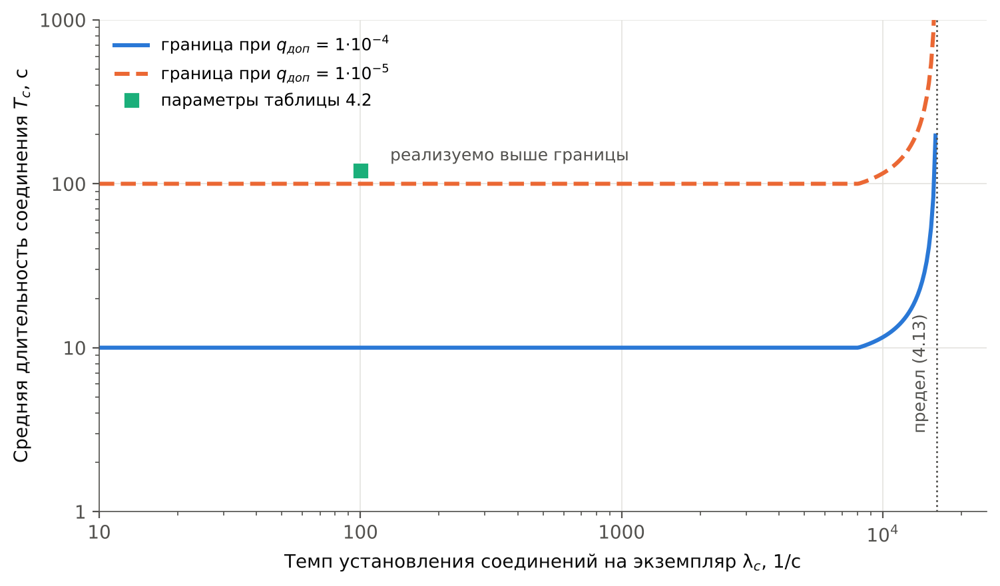
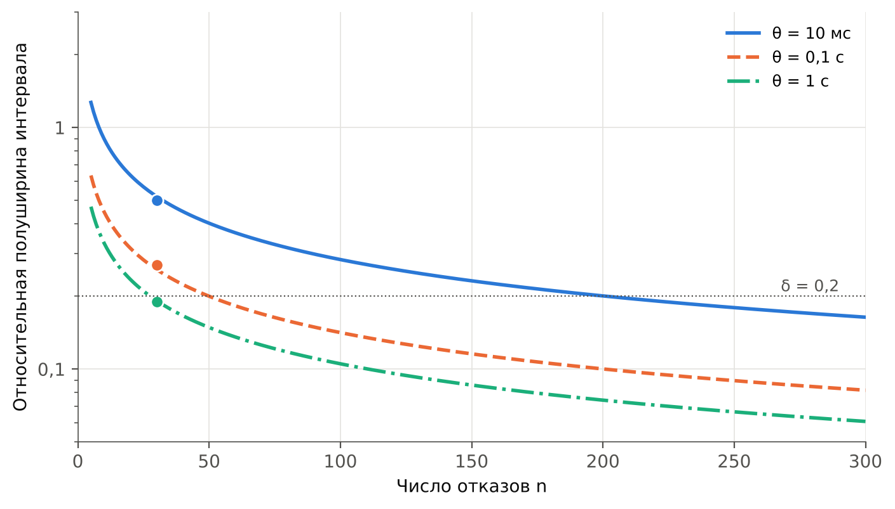

# ГЛАВА 4. Обеспечение непрерывности обслуживания сетевых функций с сохранением состояния

В главе снимается допущение раздела 3.1 о равенстве восстановления экземпляра и восстановления обслуживания. В разделе 4.1 виды состояния сетевых функций разделяются по темпу изменения и последствиям утраты. Раздел 4.2 расширяет модель готовности состоянием утраты контекста соединений и вводит второй показатель — долю сохранённых соединений. Раздел 4.4 определяет период синхронизации по допустимой доле утраченных соединений, раздел 4.3 излагает метод переноса состояния, раздел 4.5 — программу эксперимента Э4.

## 4.1 Классификация состояния сетевых функций и последствий его утраты

Модель главы 3 считает обслуживание восстановленным в момент, когда трафик направлен на работоспособный экземпляр. Для функции без сохранения состояния это верно: любой пакет обрабатывается любым экземпляром одинаково. Для функции, сохраняющей сведения об установленных соединениях, в этот момент восстанавливается лишь обслуживание новых соединений, тогда как соединения, закреплённые за отказавшим экземпляром, обрываются, если сведения о них резервному экземпляру неизвестны. Восстановление экземпляра, следовательно, не эквивалентно восстановлению обслуживания, и разница между ними составляет предмет настоящей главы.

Объектом работы служит пересылающий балансировщик нагрузки транспортного уровня: он не завершает соединения, а направляет пакеты каждого соединения на выбранный при его установлении сервер и хранит этот выбор в таблице потоков. Построение такого рода принято и в известных программных балансировщиках, где таблица соединений дополняется согласованным хешированием [68]. Завершающий посредник, на котором соединение клиента оканчивается, к рассматриваемому классу не относится: его состояние есть состояние сокетов, и перенос сводится к переносу образа процесса, рассмотренному в [4].

Различия видов состояния определяются тремя признаками: тем, когда состояние изменяется, можно ли его вычислить заново и что происходит с обслуживанием при его утрате.

**Состояние, изменяющееся на границах соединения.** Запись таблицы потоков балансировщика создаётся при установлении соединения и удаляется при его завершении; в промежутке она не изменяется. Тем же свойством обладают записи трансляции адресов. Темп изменения таблицы определяется интенсивностью установления соединений, а не интенсивностью пакетов, вследствие чего объём синхронизации мал и от темпа передачи данных не зависит.

**Состояние, изменяющееся с каждым пакетом.** Контекст защищённого туннеля содержит порядковый номер, увеличиваемый с каждым отправленным пакетом и не допускающий повторения при защите от повторной передачи [76]. Синхронизация такого состояния после каждого пакета признана слишком затратной, и в отраслевом документе для отказоустойчивых групп узлов принята периодическая синхронизация с увеличением счётчика после переключения на заведомо большое значение [77]. Темп изменения здесь равен темпу передачи пакетов, и компромисс между частотой синхронизации и служебной нагрузкой становится содержательным. Ключевой материал того же контекста, напротив, изменяется лишь при установлении нового контекста и относится к первому классу; его утрата требует повторного согласования контекста оконечными устройствами, а синхронизация состояния протокола согласования ключей рассматривается в том же отраслевом документе наряду со счётчиками [77].

**Сведения о привязке клиента.** Балансировщик может закреплять за клиентом сервер на время, превышающее длительность отдельного соединения, чтобы последовательные соединения клиента обслуживались одним сервером, хранящим его прикладную сессию. Запись привязки создаётся при первом обращении клиента и живёт минуты и часы, то есть изменяется на границах сеанса клиента и относится к первому классу, но с большей длительностью жизни записи. Её утрата соединений не обрывает: новое соединение клиента будет направлено на другой сервер, и утрачивается прикладная сессия, цена чего определяется приложением, а не транспортным уровнем. Синхронизация таких записей выполняется тем же механизмом, а выражение для доли утраченных, получаемое в разделе 4.2, применимо к ним с подстановкой длительности жизни записи вместо длительности соединения, вследствие чего при длительной привязке доля утраченных записей много меньше доли утраченных соединений.

**Состояние, восстановимое вычислением.** Выбор сервера для соединения может быть получен заново согласованным хешированием признаков соединения, если состав серверов с момента установления соединения не изменился. Такое состояние переноса не требует. Однако при смене состава экземпляров балансировщика соединения попадают на экземпляры, не имеющие записей, и при одновременном изменении состава серверов обрываются [68]; разделение таблицы между всеми экземплярами при этом отвергнуто как ухудшающее производительность пересылки [68]. Известен и подход, исключающий таблицу на балансировщике и опирающийся на состояние, уже имеющееся у серверов [69]; он требует изменения серверов и в работе не рассматривается. Отсюда признак, отделяющий состояние, подлежащее переносу: перенос нужен там, где вычисление заново не гарантирует прежнего результата, то есть при изменяемом составе серверов.

**Известные подходы к сохранению состояния.** Подходы к сохранению состояния сетевых функций при отказе различаются тем, где хранится копия состояния и когда она обновляется; в каждом из них цена сохранения выражена в своей величине.

*Вычисление заново.* Согласованное хеширование восстанавливает выбор сервера без копии состояния, пока состав серверов неизменен [68]; балансировка без состояния переносит необходимые сведения на серверы и пересылает пакеты между ними цепочкой [69]. Синхронизации не требуется, но первое не защищает соединения при изменении состава серверов, а второе требует изменения серверов.

*Репликация состояния потоков.* Состояние снимается и передаётся резервному узлу для каждого потока отдельно, с частотой до 1000 Гц; по сравнению с репликацией виртуальной машины накладные расходы по задержке снижены с 280 до 15,5 %, по пропускной способности — с 99,5 до 3,2 % [71]. Подход ближе всего к рассматриваемому в работе, однако частота задаётся как параметр системы, а не выводится из требования к сохранности соединений.

*Журналирование и воспроизведение.* При нормальной работе записывается журнал сведений, достаточных для восстановления, и после отказа состояние воспроизводится; ценой служат 30 мкс прибавки к медианной задержке пакета и снижение пропускной способности на 5–30 %, а восстановление утраченного состояния занимает 40–275 мс [72]. Подход обеспечивает точное воспроизведение и для состояния, изменяющегося с каждым пакетом.

*Вынесение состояния во внешнее хранилище.* Обработка выполняется экземплярами без состояния, а состояние хранится в отдельном слое хранения данных в оперативной памяти [70]. Отказ экземпляра состояния не затрагивает, но обращение к хранилищу входит в путь обработки пакета.

*Перенос по командам плоскости управления.* Состояние переносится между экземплярами при изменении их состава средствами плоскости управления с согласованным изменением правил пересылки [73]. Подход предназначен для масштабирования и плановых изменений, когда исходный экземпляр работоспособен.

*Снятие образа процесса.* Образ процесса периодически снимается и развёртывается на другом узле при отказе; медианное время восстановления 5,87 с при накладных расходах 2–6 % процессорного времени [4].

*Синхронная репликация.* Каждое изменение применяется ко всем копиям до подтверждения, как при репликации конечного автомата [12]; окно утраты равно нулю, а цена — задержка каждого изменения на время согласования.

Сопоставление показывает общий пробел: ни в одном из подходов частота обновления копии не определяется по допустимой доле утраченных соединений, хотя именно эта доля, как показано в разделе 4.2, является показателем, нормируемым для функции с таблицей сессий. Предлагаемый метод относится к классу репликации состояния потоков и восполняет этот пробел.

**Последствия утраты.** Пакет оборванного соединения, поступивший на экземпляр без записи, либо отбрасывается, либо вызывает ответный сброс: сегмент, не принадлежащий существующему соединению, по правилам протокола управления передачей влечёт сброс [75]. Различие существенно для времени восстановления. При сбросе оконечное устройство узнаёт об обрыве за время передачи сегмента в обе стороны и устанавливает соединение заново. При отбрасывании отправитель повторяет неподтверждённый сегмент по истечении предельного времени повторной передачи, начальное и наименьшее значение которого составляет 1 с, а каждое следующее удваивается [74], как показывает таблица 4.1.

**Таблица 4.1 — Моменты повторной передачи неподтверждённого сегмента при начальном предельном времени 1 с [74]**

| Номер повторной передачи | 1 | 2 | 3 | 4 | 5 | 6 |
|---|---|---|---|---|---|---|
| Предельное время перед повторной передачей, с | 1 | 2 | 4 | 8 | 16 | 32 |
| Время от первой отправки, с | 1 | 3 | 7 | 15 | 31 | 63 |

Из таблицы 4.1 следует, что при отбрасывании пакетов оборванного соединения его восстановление задерживается на секунды и десятки секунд, причём обрыв обнаруживается отправителем лишь после исчерпания повторных передач. Время повторного установления оборванного соединения, обозначаемое далее *T*у, определяется поэтому не только оконечным устройством, но и поведением экземпляра, получившего пакет без записи; ограничение *T*у составляет одно из требований к методу раздела 4.3. Существенно и то, что обрыв проявляется лишь при обмене: бездействующее в момент отказа соединение не испытывает перерыва, пока по нему не отправлен следующий пакет, и время повторного установления отсчитывается от этого пакета. Для длительных соединений, обменивающихся сообщениями редко, утрата состояния может проявиться спустя минуты после отказа, когда сам отказ уже устранён, и связь её с отказом без регистрации на стороне балансировщика не прослеживается.

**Соединения без установления.** Для потоков протоколов, не устанавливающих соединения, запись таблицы создаётся первым пакетом потока и удаляется по истечении предельного времени бездействия. Такие записи также изменяются лишь на границах потока, и класс их тот же; длительность потока, входящая в дальнейшие выражения, включает при этом и предельное время бездействия. Межсетевой экран, отслеживающий допустимые окна порядковых номеров соединения, напротив, изменяет запись с каждым сегментом и относится ко второму классу.

**Объём состояния.** При иллюстративных параметрах раздела 4.2 экземпляр одновременно ведёт 12 080 соединений; при размере записи 32 байта таблица занимает 378 КиБ и пересылается целиком за 3,1 мс по каналу 1 Гбит/с и за 31 мс по каналу 100 Мбит/с. Отсюда два следствия. Полная повторная синхронизация при запуске экземпляра выполняется за единицы миллисекунд и на время восстановления резервирования практически не влияет. Пересылка же таблицы целиком в каждом периоде обошлась бы при периоде 23 мс в 133 Мбит/с, тогда как передача одних изменений, как показано в разделе 4.4, — в 75 кбит/с, то есть в 1800 раз меньше; синхронизация строится поэтому на передаче изменений, а не снимков таблицы.

Раздел тем самым снимает условие, отнесённое разделом 3.1 к границам применимости модели: восстановление обслуживания эквивалентно восстановлению работоспособности экземпляра лишь при отсутствии состояния, подлежащего переносу. Для функций с таким состоянием модель требует дополнительного состояния, вводимого в разделе 4.2.

## 4.2 Расширение модели готовности на функции с сохранением состояния

**Исходные величины.** Пусть каждый из N экземпляров функции обслуживает поток соединений с интенсивностью установления λс и длительностью соединения D, имеющей функцию выживания S(x) = P(D > x) и среднее *T*с. Число одновременно существующих соединений экземпляра составляет по формуле Литтла λс*T*с. Резервному экземпляру изменения таблицы потоков передаются пакетами с периодом θ; задержка доставки пакета изменений, включающая передачу и применение, равна d. Отказ приходится на случайную фазу внутри периода, вследствие чего время A от последней отправки до отказа равномерно распределено на отрезке [0; θ].

**Доля утраченных при отказе соединений.** Резервному экземпляру неизвестны записи соединений, установленных за последние A + d до отказа. В стационарном потоке доля существующих соединений, возраст которых меньше a, равна

$$F_\text{в}(a) = \frac{1}{T_\text{с}} \int_0^{a} S(x)\,dx, \tag{4.1}$$

поскольку соединение возраста x существует, если его длительность превышает x. Строго соотношение следует из формулы Литтла, применённой к соединениям возраста меньше a: интенсивность поступления в эту совокупность равна λс, а среднее время пребывания в ней — ∫₀ᵃ S(x) dx, вследствие чего среднее число таких соединений составляет λс∫₀ᵃ S(x) dx, а доля среди всех λс*T*с — правую часть (4.1). Пуассонность потока установления для (4.1) не требуется, достаточно стационарности. При пуассоновском потоке, кроме того, число существующих соединений распределено по закону Пуассона, а их возрасты независимы и имеют плотность S(x)/*T*с; это свойство используется в разделе 4.5 при планировании числа повторностей. Существенно и обратное: (4.1) неверно в нестационарном режиме, например в первые *T*д после запуска нагрузки, когда длительных соединений старше времени работы нет. Доля соединений отказавшего экземпляра, утрачиваемых при отказе, получается усреднением (4.1) по фазе отказа:

$$q(\theta) = \frac{1}{\theta\,T_\text{с}} \int_0^{\theta} \int_0^{a + d} S(x)\,dx\,da. \tag{4.2}$$

Выражение (4.2) обладает тремя свойствами, существенными для дальнейшего. Во-первых, q(θ) возрастает с θ, поскольку есть среднее возрастающей функции по расширяющемуся отрезку. Во-вторых, при θ → ∞ величина q стремится к единице, что отвечает отсутствию переноса. В-третьих, поскольку S(x) ≤ 1, выполняется оценка сверху

$$q(\theta) \le \frac{\theta/2 + d}{T_\text{с}}, \tag{4.3}$$

обращающаяся в приближённое равенство, когда окно θ + d мало по сравнению с длительностью почти всех соединений. Поскольку функция выживания не возрастает, на отрезке интегрирования S(x) ≥ S(θ + d), и справедлива также оценка снизу

$$S(\theta + d)\,\frac{\theta/2 + d}{T_\text{с}} \le q(\theta) \le \frac{\theta/2 + d}{T_\text{с}}. \tag{4.3а}$$

Относительная погрешность оценки сверху не превышает поэтому 1 − S(θ + d), то есть доли соединений, длительность которых меньше окна. При параметрах таблицы 4.2 и θ = 10 мс эта доля составляет 0,8 %, а фактическое расхождение — 0,3 %; при θ = 1 с доля равна 51 %, и оценка сверху теряет практическое значение. В этой области, названной далее областью малого окна, доля утраченных зависит от распределения длительностей лишь через среднее *T*с: вид распределения, как и в модели главы 3, на результат не влияет. Вне её (4.3) завышает долю утраченных, и расчёт ведётся по (4.2).

**Проверка выражения статистическим моделированием.** Выражения (4.2) и (4.3) проверены событийным моделированием потока соединений: пуассоновский поток установления, смесь коротких соединений с показательной длительностью и длительных соединений по профилю таблицы 2.3, отказ в случайной фазе периода синхронизации, 300 отказов на точку. Параметры моделирования иллюстративны и приведены в таблице 4.2.

**Таблица 4.2 — Иллюстративные параметры расчётов главы 4**

| Величина | Обозначение | Значение |
|---|---|---|
| Интенсивность установления соединений на экземпляр, 1/с | λс | 100 |
| Доля длительных соединений | — | 0,2 |
| Длительность длительного соединения, с | — | 600 |
| Средняя длительность короткого соединения, с | — | 1 |
| Средняя длительность соединения, с | *T*с | 120,8 |
| Задержка доставки изменений, мс | d | 0,5 |
| Время повторного установления оборванного соединения, с | *T*у | 1 |
| Размер записи об изменении, байт | e | 32 |
| Заголовки пакета изменений, байт | h | 62 |
| Полезная нагрузка пакета изменений, байт | M | 1456 |
| Затраты процессора на пакет изменений, мкс | *c*м | 5 |
| Затраты процессора на запись, мкс | *c*з | 0,2 |

Доля длительных соединений и их длительность взяты из основного профиля нагрузки (таблица 2.3), прочие значения приняты иллюстративно и подлежат измерению в эксперименте Э4. Время повторного установления принято равным иллюстративной цене ложного срабатывания функции с таблицей сессий раздела 3.1, поскольку обе величины выражают одно и то же — длительность восстановления оборванных соединений. Размер записи и заголовки пакета соответствуют формату, принятому в методе раздела 4.3. Результаты проверки приведены в таблице 4.3.

**Таблица 4.3 — Доля утраченных при отказе соединений: моделирование и расчёт (статистическое моделирование, 300 отказов на точку)**

| θ, с | q, моделирование | Доверительный интервал 95 % | q по (4.2) | q по (4.3) |
|---|---|---|---|---|
| 0,01 | 3,95·10⁻⁵ | ±0,70·10⁻⁵ | 4,54·10⁻⁵ | 4,55·10⁻⁵ |
| 1 | 3,20·10⁻³ | ±0,19·10⁻³ | 3,27·10⁻³ | 4,14·10⁻³ |
| 10 | 1,46·10⁻² | ±0,07·10⁻² | 1,42·10⁻² | 4,14·10⁻² |
| 60 | 5,48·10⁻² | ±0,34·10⁻² | 5,62·10⁻² | 24,8·10⁻² |

Во всех четырёх точках значение (4.2) лежит в доверительном интервале моделирования. Доверительный интервал вычислен по отказам, а не по числу утраченных соединений: утраты при одном отказе зависимы, поскольку определяются общей фазой отказа, и расчёт по пуассоновскому закону дал бы ложно узкий интервал. Оценка (4.3) совпадает с (4.2) при θ = 0,01 с и завышает долю утраченных в 1,3, 2,9 и 4,4 раза при θ = 1, 10 и 60 с, когда окно становится соизмеримым с длительностью коротких соединений. Первоначально принятая для раздела формула вида (4.3) без оговорки об области применимости моделированием была опровергнута; выражение (4.2) построено как её исправление. Сценарий моделирования — `harness/ch4_state_model.py`.

**Замкнутый вид для профиля нагрузки.** Для профиля, в котором доля *p*д соединений имеет детерминированную длительность *T*д, а остальные — показательную со средним *T*к, интеграл в (4.2) вычисляется явно. При θ + d ≤ *T*д

$$q(\theta) = \frac{1}{T_\text{с}}\left[\left(1 - p_\text{д}\right) T_\text{к}\left(1 - \frac{T_\text{к}}{\theta}\left(e^{-d/T_\text{к}} - e^{-(\theta + d)/T_\text{к}}\right)\right) + p_\text{д}\left(\frac{\theta}{2} + d\right)\right], \qquad T_\text{с} = \left(1 - p_\text{д}\right)T_\text{к} + p_\text{д} T_\text{д}. \tag{4.4}$$

Первое слагаемое — вклад коротких соединений: при θ ≫ *T*к оно стремится к (1 − *p*д)*T*к, то есть утрачиваются почти все короткие соединения, установленные в окне, но их мало, поскольку они быстро завершаются. Второе слагаемое — вклад длительных соединений, линейный по θ. Выражение (4.4) совпадает с численным расчётом по (4.2) до четвёртой значащей цифры при всех периодах таблицы 4.3 и используется в методе раздела 4.3 для расчёта по измеренному профилю, если тот допускает такое описание.

**Зависимость от вида распределения.** Утверждение о том, что в области малого окна доля утраченных определяется лишь средней длительностью, проверено для трёх распределений с одинаковым средним 120,8 с: показательного, логарифмически нормального с параметром формы 1,5 и распределения Парето с показателем 1,5, имеющего тяжёлый хвост. Результаты приведены в таблице 4.4.

**Таблица 4.4 — Доля утраченных при отказе соединений для распределений длительности с одинаковым средним 120,8 с (расчёт по (4.2); распределения иллюстративны)**

| θ, с | Показательное | Логарифмически нормальное | Парето | Оценка (4.3) |
|---|---|---|---|---|
| 0,01 | 4,55·10⁻⁵ | 4,55·10⁻⁵ | 4,55·10⁻⁵ | 4,55·10⁻⁵ |
| 1 | 4,13·10⁻³ | 4,14·10⁻³ | 4,14·10⁻³ | 4,14·10⁻³ |
| 10 | 4,03·10⁻² | 3,92·10⁻² | 4,14·10⁻² | 4,14·10⁻² |
| 60 | 0,212 | 0,177 | 0,243 | 0,248 |

При θ ≤ 1 с значения для трёх распределений расходятся не более чем на 0,3 %, при 10 с — на 5 %, при 60 с — на 27 %. Вид распределения, следовательно, существен лишь при окне, соизмеримом со средней длительностью соединения, то есть вне области, в которой работает метод. Профиль таблицы 4.3 даёт при больших θ значительно меньшую долю утраченных, чем любое из трёх распределений, поскольку значительная часть его соединений коротка и к моменту отказа уже завершена; для него оценка (4.3) особенно консервативна.

**Утрата пакетов изменений.** При надёжной доставке утраченный пакет изменений повторяется по истечении времени *t*повт, и содержащиеся в нём записи становятся известны резервному экземпляру позже. При вероятности утраты пакета *p*и и независимых утратах среднее число повторов равно *p*и / (1 − *p*и), и в (4.2)–(4.4) вместо d подставляется

$$d_\text{эфф} = d + t_\text{повт}\,\frac{p_\text{и}}{1 - p_\text{и}}. \tag{4.5}$$

При *t*повт = 10 мс утрата 1 % пакетов увеличивает задержку с 0,5 до 0,60 мс, а 10 % — до 1,6 мс; период, обеспечивающий сохранение 99,99 % соединений, сокращается при этом с 23,2 до 23,0 и 20,9 мс соответственно. Для канала внутри площадки, где вероятность непринятия контрольных сообщений по модельным данным раздела 3.5 составляет 2·10⁻⁴, поправка пренебрежима; при доставке изменений без подтверждения она была бы не поправкой, а неограниченной утратой, что и исключает такой режим в методе раздела 4.3.

**Граф состояний.** Утрата контекста вводится в граф раздела 3.1 отдельным состоянием S₄ — «обслуживание восстановлено, контекст утрачен», отличающимся от S₀ тем, что новые соединения обслуживаются, а доля q прежних соединений отказавшего экземпляра ожидает повторного установления. Переход в S₄ совершается из состояния перенаправления как после действительного отказа, так и после ложного признания, поскольку в обоих случаях соединения экземпляра переходят к резервному. Граф приведён на рисунке 4.1.

*Рисунок 4.1 — Граф состояний модели готовности функции с сохранением состояния: состояние S₄ затрагивает долю q нагрузки отказавшего экземпляра, прочие состояния — всю его нагрузку*

**Уравнения баланса.** Для графа рисунка 4.1 при средних длительностях пребывания *T*о в S₁, *T*р в S₂ и S₃ и *T*у в S₄ стационарные вероятности состояний, отнесённые к вероятности π₀ состояния S₀, составляют

$$\frac{\pi_1}{\pi_0} = \lambda T_\text{о}, \qquad \frac{\pi_2}{\pi_0} = \lambda T_\text{р}, \qquad \frac{\pi_3}{\pi_0} = \nu T_\text{р}, \qquad \frac{\pi_4}{\pi_0} = \left(\lambda + \nu\right) T_\text{у}, \tag{4.5а}$$

поскольку в S₄ ведут оба пути — после действительного отказа и после ложного признания. Состояния S₁–S₃ затрагивают всю нагрузку отказавшего экземпляра, S₄ — долю q, и доля потерянной нагрузки равна

$$K_\text{п}^\text{сост} = \frac{\lambda\left(T_\text{о} + T_\text{р}\right) + \nu T_\text{р} + \left(\lambda + \nu\right) q\,T_\text{у}}{1 + \lambda\left(T_\text{о} + T_\text{р}\right) + \nu T_\text{р} + \left(\lambda + \nu\right) T_\text{у}}. \tag{4.5б}$$

Выражение (4.5б) точное в том же смысле, что и (3.5): оно не зависит от вида распределений длительностей пребывания, поскольку согласно разделу 3.1 коэффициент готовности процесса восстановления с чередованием определяется лишь средними. Знаменатель отличается от единицы на величину порядка λ*T*у, при наработке один год — на 3·10⁻⁸, вследствие чего с погрешностью того же порядка справедливо приближение первого порядка.

Независимость (4.5б) от вида распределений проверена моделированием процесса по графу рисунка 4.1 при завышенных интенсивностях, обеспечивающих достаточное число событий, — λ = 10⁻², ν = 5·10⁻³ с⁻¹, *T*о = 2 с, *T*р = 0,5 с, *T*у = 10 с, q = 0,3, — для показательных, детерминированных и логарифмически нормальных длительностей пребывания с коэффициентом вариации 2 при одинаковых средних, по 4·10⁵ циклов. Расчёт по (4.5б) даёт 0,06157; моделирование — 0,06150, 0,06146 и 0,06178 соответственно, с отклонением не более 0,33 %, тогда как приближение первого порядка при столь завышенных интенсивностях даёт 0,0725. Сценарий — `harness/ch4_insensitivity.py`.

**Коэффициент простоя.** Каждое состояние затрагивает свою долю нагрузки отказавшего экземпляра: S₁ и S₂ — всю нагрузку на время *T*о и *T*р, S₄ — долю q на время *T*у. Приближение первого порядка к (4.5б) даёт при резервировании

$$K_\text{п}^\text{сост} \approx \lambda\left(T_\text{о} + T_\text{р}\right) + \lambda\,q(\theta)\,T_\text{у} + \nu\,c_\nu^\text{сост}, \tag{4.6}$$

где цена ложного срабатывания функции с сохранением состояния складывается из перенаправления и утраты контекста:

$$c_\nu^\text{сост} = T_\text{р} + q(\theta)\,T_\text{у}. \tag{4.7}$$

Выражение (4.6), как и (3.11), есть доля потерянной нагрузки. Предельный переход подтверждает согласованность с главой 3: при q = 0 выражения (4.6) и (4.7) совпадают с (3.11) при цене ложного срабатывания функции без сохранения состояния *c*ν = *T*р. Без переноса состояния q = 1, и (4.7) даёт цену *T*р + *T*у, совпадающую с принятой в разделе 3.1 оценкой цены ложного срабатывания функции с таблицей сессий через длительность повторного установления соединений.

**Второй показатель.** Коэффициент простоя (4.6) мал при любом θ, поскольку отказы редки, и потому недостаточен как требование: служба может удовлетворять нормативу готовности и при этом обрывать при каждом отказе все соединения отказавшего экземпляра. Вводится второй показатель — доля сохранённых при отказе соединений 1 − q(θ), — нормируемый отдельно. Связь с долговременной долей соединений, оборванных отказами, следует из подсчёта: за единицу времени экземпляр отказывает с интенсивностью λ и теряет при этом qλс*T*с соединений, тогда как устанавливает λс, откуда

$$\eta = \lambda\,T_\text{с}\,q(\theta) \approx \lambda\left(\theta/2 + d\right). \tag{4.8}$$

Приближённое равенство относится к области малого окна. Величина η при наработке на отказ один год ничтожна — 1,7·10⁻¹⁰ при θ = 10 мс, — вследствие чего требование к функции с сохранением состояния формулируется через долю сохранённых при отказе соединений, а не через долговременную долю.

**Вероятность отказа без обрывов.** Требование может формулироваться и иначе — как доля отказов, не оборвавших ни одного соединения. При пуассоновском потоке установления число соединений, утрачиваемых при отказе с фазой A, распределено по закону Пуассона со средним m(A) = λс∫₀^(A+d) S(x) dx, поскольку возрасты существующих соединений независимы (раздел 4.2), откуда

$$P_0(\theta) = \frac{1}{\theta}\int_0^{\theta} e^{-m(a)}\,da. \tag{4.8а}$$

При параметрах таблицы 4.2 вероятность отказа без обрывов составляет 0,91 при θ = 1 мс, 0,60 при 10 мс, 0,096 при 0,1 с и 0,010 при 1 с, тогда как доля сохранённых соединений при тех же периодах не ниже 99,67 %. Два показателя различаются по существу: доля сохранённых соединений характеризует среднюю потерю, вероятность отказа без обрывов — то, как часто отказ вообще замечается пользователями. Требование второго рода много строже: отказ без обрывов в 90 % случаев обеспечивается лишь при периоде около 1 мс, на пределе таймера, тогда как сохранение 99,99 % соединений — при 23 мс. В работе нормируется показатель первого рода, а второй приводится как справочный.

**Вклад утраты контекста в простой.** Значение (4.6) при параметрах таблицы 4.2 и настройке контура контроля по таблице 3.8 для внутриплощадочного канала приведено в таблице 4.10 раздела 4.4. Без переноса состояния член λ*T*у равен 1 с в год и превосходит вклад обнаружения и перенаправления, составляющий 0,027 с в год, почти в сорок раз: для функции с таблицей сессий сокращение времени обнаружения, полученное в главе 3, без переноса состояния утрачивает практическое значение. Это и есть количественное содержание утверждения о том, что восстановление экземпляра не равно восстановлению обслуживания.

**Признак целесообразности переноса.** Из (4.6) следует простой признак: перенос состояния существен, когда член утраты контекста без переноса, λ*T*у, сравним с членом обнаружения и перенаправления λ(*T*о + *T*р) или превосходит его, то есть при *T*у ≳ *T*о + *T*р. После настройки контура контроля по главе 3 правая часть составляет десятки миллисекунд, тогда как *T*у даже при сбросе соединений включает повторное установление соединения оконечным устройством, — признак выполняется для любой функции с таблицей сессий. При штатном времени обнаружения около 50 с картина обратная: член утраты контекста почти в 50 раз меньше члена обнаружения (1 против 48,6 с в год), и перенос без сокращения времени обнаружения сократил бы простой лишь на 2 %. Методы глав 3 и 4 тем самым дополняют друг друга, и каждый реализует свой выигрыш лишь при наличии другого.

Признак относится к конфигурации с резервированием. В одиночной конфигурации резервного экземпляра нет, переносить состояние некуда, и метод раздела 4.3 неприменим: время восстановления там определяется ожиданием переразмещения, как установлено в разделе 3.1.

## 4.3 Метод переноса состояния между экземплярами сетевой функции

Метод строится на четырёх положениях: асинхронная пакетная синхронизация таблицы потоков с периодом, определяемым в разделе 4.4 по допустимой доле утраченных соединений, закреплённый резервный экземпляр для каждого экземпляра, сброс соединений, отсутствующих в таблице, и использование контура контроля главы 3 для переключения.

**Схема резервирования.** Каждому из N экземпляров назначается резервный — следующий по кругу, вследствие чего каждый экземпляр одновременно служит основным для своих соединений и резервным для соединений соседа. Такая схема относится к классу «M плюс один» с распределением нагрузки, предусмотренному для функций массового обслуживания [6], и к рассмотренному в [16] варианту резервирования «n плюс k» с распределением нагрузки; в отличие от схемы «один плюс один» она не требует простаивающих экземпляров. При N = 2, принятом на стенде, схема вырождается во взаимное резервирование двух экземпляров.

**Синхронизация.** Экземпляр накапливает записи об установлении и завершении соединений и с периодом θ отправляет их резервному экземпляру пакетами изменений, каждый из которых несёт порядковый номер. Запись содержит признаки соединения, номер выбранного сервера, вид изменения и метку времени; состав записи и пакета приведён в таблице 4.5. Доставка подтверждается, утраченные пакеты повторяются, а при запуске или перезапуске экземпляра выполняется полная повторная синхронизация — порядок, совпадающий с надёжным режимом известного средства синхронизации таблиц соединений [78]. Режим без подтверждения [78] для метода непригоден: утрата пакета изменений оставляет записи неизвестными резервному экземпляру неограниченно долго, и (4.2) перестаёт быть верхней оценкой утрат.

**Таблица 4.5 — Состав записи об изменении и заголовка пакета изменений, байт**

| Поле | Четвёртая версия сетевого протокола | Шестая версия сетевого протокола |
|---|---|---|
| Адреса отправителя и получателя | 8 | 32 |
| Порты отправителя и получателя | 4 | 4 |
| Протокол транспортного уровня | 1 | 1 |
| Номер выбранного сервера | 2 | 2 |
| Вид изменения | 1 | 1 |
| Метка времени | 8 | 8 |
| Выравнивание | 8 | 0 |
| Итого запись | 32 | 48 |
| Заголовок пакета: номер пакета, отправитель, число записей, контрольная сумма | 16 | 16 |

Для шестой версии протокола запись увеличивается до 48 байт; постоянная часть служебной нагрузки, выражение для которой получено в разделе 4.4, возрастает при этом в полтора раза, до 80 кбит/с при параметрах таблицы 4.2, предельный темп установления соединений по тому же разделу снижается с 16 100 до 13 700 в секунду, а период синхронизации, определяемый возрастом соединений, не меняется.

**Порядок работы отправителя.** **О1.** При установлении или завершении соединения запись помещается в буфер изменений. **О2.** При заполнении буфера до M байт или по истечении периода θ с последней отправки буфер отправляется пакетом с очередным порядковым номером и сохраняется до подтверждения. **О3.** При отсутствии подтверждения в течение *t*повт пакет повторяется. **О4.** При потере связи с резервным экземпляром более чем на заданное время отправитель прекращает накопление и после восстановления связи инициирует полную повторную синхронизацию.

**Порядок работы получателя.** **П1.** Пакет с очередным порядковым номером применяется к таблице резервных записей и подтверждается. **П2.** Пакет с номером больше ожидаемого сохраняется до получения пропущенных, пакет с номером меньше ожидаемого лишь подтверждается повторно. **П3.** Запись об удалении удаляет резервную запись, запись о создании — создаёт или заменяет её, если метка времени новее. **П4.** Резервные записи, не обновлявшиеся дольше предельного времени хранения, удаляются.

**Порядок переключения.** **Р1.** Детектор главы 3 признаёт экземпляр отказавшим и сообщает об этом узлу, направляющему трафик. **Р2.** Узел, направляющий трафик, записывает в таблицу распределения вместо отказавшего экземпляра его резервный. **Р3.** Резервный экземпляр при первом пакете соединения, отсутствующего в основной таблице, ищет его в таблице резервных записей и при нахождении переносит запись в основную. **Р4.** При отсутствии записи применяется согласованное хеширование, а при изменившемся составе серверов — сброс соединения.

**Хранение у резервного экземпляра.** Принятые записи хранятся в отдельной таблице резервных записей и при нормальной работе не используются. При поступлении пакета соединения, отсутствующего в основной таблице, экземпляр обращается к таблице резервных записей и при нахождении записи переносит её в основную; поиск выполняется только при промахе основной таблицы, вследствие чего затрат на пересылку пакетов существующих соединений не вносит.

**Переключение.** Отказ экземпляра обнаруживается контуром контроля главы 3, и узел, направляющий трафик, записывает в таблицу распределения вместо отказавшего экземпляра его резервный. Резервный экземпляр получает пакеты соединений отказавшего, находит их записи в таблице резервных записей и продолжает пересылку на те же серверы. Действие начинается через *T*о + *T*р после отказа и не требует участия платформы оркестрации, вследствие чего переразмещение отказавшего экземпляра, как и в разделе 3.4, остаётся вне критического пути.

**Ограничение времени повторного установления.** Пакет соединения, не найденный ни в основной таблице, ни в таблице резервных записей, относится к доле q утраченных соединений. Для него сначала применяется согласованное хеширование: если состав серверов с момента установления соединения не менялся, выбирается прежний сервер, и соединение сохраняется без записи [68]. Если состав менялся, экземпляр формирует ответный сброс по правилам протокола управления передачей для сегмента, не принадлежащего существующему соединению [75]. Сброс ограничивает время повторного установления временем передачи в обе стороны и установления нового соединения; без него восстановление задерживается на секунды и десятки секунд повторных передач (таблица 4.1).

**Последовательность событий.** Последовательность событий при отказе экземпляра без переноса состояния и с переносом приведена на рисунке 4.2.

*Рисунок 4.2 — Последовательность событий при отказе экземпляра функции с таблицей сессий без переноса состояния и с переносом при θ = 10 мс (расчёт при иллюстративных параметрах таблицы 4.2 и настройке контура контроля по таблице 3.8)*

Рисунок 4.2 показывает, что перенос не сокращает время обнаружения и перенаправления: оно определяется методом главы 3. Перенос устраняет следующую за ним стадию повторного установления, которая без переноса длится *T*у для всех соединений отказавшего экземпляра, а с переносом — лишь для доли q.

**Выбор асинхронной синхронизации.** Синхронная передача каждой записи до подтверждения установления соединения обращает окно утраты в нуль, как при репликации конечного автомата [12], но добавляет время передачи в обе стороны к установлению каждого соединения. Асинхронная синхронизация не задерживает установление и, как показывает расчёт раздела 4.4 (таблица 4.7), обеспечивает сохранение 99,99 % соединений при периоде 23 мс; синхронная оправдана лишь при требованиях, для которых асинхронная нереализуема.

**Отличие от известных подходов.** Снятие и развёртывание образа процесса [4] переносит состояние процесса целиком и даёт медианное время восстановления 5,87 с, из которых около 3 с приходится на обнаружение и около 3 с — на развёртывание; предлагаемый метод переносит состояние функции, а не образ процесса, вследствие чего окно утраты определяется темпом установления соединений, а не объёмом памяти, а развёртывание отсутствует. Репликация на уровне потоков [71] снимает состояние потоков с частотой до 1000 Гц и тем самым по порядку частоты совпадает с периодами, получаемыми в разделе 4.4, однако периода по допустимой доле утраченных соединений не определяет. Восстановление по журналу [72] обеспечивает точное воспроизведение состояния ценой журналирования при нормальной работе; функции, изменяющей состояние лишь на границах соединения, такая точность не требуется. Перенос состояния между экземплярами по командам плоскости управления [73] и вынесение состояния во внешнее хранилище [70] адресованы иной задаче — изменению состава экземпляров при масштабировании и общему хранению — и вносят обращение к хранилищу или плоскости управления в путь обработки. Согласованное хеширование [68] и балансировка без состояния [69] используются методом не как замена переноса, а как дополнение: первое — для соединений, утраченных при неизменном составе серверов, второе в работе не применяется, поскольку требует изменения серверов. Отличие метода состоит, следовательно, в определении периода синхронизации по допустимой доле утраченных соединений на основе (4.2) и в использовании контура контроля главы 3 для переключения на резервный экземпляр, уже имеющий записи.

**Запас производительности резервного экземпляра.** После отказа резервный экземпляр несёт собственную нагрузку и нагрузку отказавшего. При круговой схеме это означает удвоение нагрузки одного экземпляра независимо от N, вследствие чего загрузка каждого экземпляра при нормальной работе не должна превышать половины его производительности. Если требование это обременительно, резервный экземпляр назначается не экземпляру целиком, а каждому соединению по хешу его признаков среди остальных N − 1 экземпляров; тогда после отказа нагрузка отказавшего распределяется поровну, и допустимая загрузка возрастает до (N − 1) / N. Объём синхронизации при этом не меняется — каждая запись по-прежнему передаётся одному резервному экземпляру, — но узел, направляющий трафик, должен распределять соединения отказавшего экземпляра по тому же хешу. При N = 2, принятом на стенде, обе схемы совпадают.

**Поведение после ложного признания.** При ложном признании соединения работоспособного экземпляра переходят к резервному так же, как при действительном отказе, и сохраняются в той же доле 1 − q. После восстановления контрольных сообщений экземпляр вновь включается в распределение лишь для новых соединений; перенесённые соединения обратно не возвращаются, поскольку обратный перенос потребовал бы второго переключения с той же долей утрат. Порядок с подтверждающими сообщениями (3.28) исключает при этом многократные переключения одного и того же экземпляра при неустойчивом канале.

**Взаимодействие с ограничителем доверия.** Правило (3.29) запрещает детектору исключать из распределения долю экземпляров, превышающую α, при массовой недоступности, вызванной неисправностью самого наблюдателя. Переключение на резервный экземпляр подчиняется тому же правилу и выполняется лишь тогда, когда резервный экземпляр сам не признан недоступным; в противном случае соединения отказавшего экземпляра переходят к следующему по кругу, у которого записей нет, и относятся к доле утраченных. Для N = 2 это означает, что при одновременной недоступности обоих экземпляров переключение не выполняется, что и соответствует назначению ограничителя.

**Повторный отказ и восстановление резервирования.** После переключения у оставшегося экземпляра резервного нет до тех пор, пока отказавший не будет переразмещён и не выполнит полную повторную синхронизацию. Переразмещение занимает время порядка *T*п, полная синхронизация — единицы миллисекунд. Вероятность отказа второго экземпляра в этом окне при наработке один год и *T*п = 300 с составляет λ*T*п = 9,5·10⁻⁶ на отказ, что на порядок меньше доли утраченных при выбранном периоде и в (4.6) не учитывается. Вернувшийся экземпляр становится резервным для оставшегося; соединения обратно не переносятся, а новые распределяются между экземплярами обычным порядком, вследствие чего возврат экземпляра обрывов не вызывает.

**Согласованность записей.** Записи пересылаются с порядковыми номерами пакетов изменений и применяются резервным экземпляром в порядке номеров, вследствие чего удаление записи не может опередить её создание. Запись соединения, завершившегося в окне синхронизации, остаётся у резервного экземпляра до получения записи об удалении или до истечения предельного времени хранения; такая запись безвредна, поскольку пакетов по ней не поступает. Повторное использование тех же признаков соединения новым соединением различается меткой времени записи. Ни одна из этих ситуаций не приводит к направлению пакетов на неверный сервер: расхождение таблиц приводит лишь к избыточным записям у резервного экземпляра, но не к ошибочной пересылке.

**Реализация.** Синхронизация реализуется в той же программе, что и детектор раздела 3.4, на языке Go; таблица потоков и таблица резервных записей размещаются в программируемом тракте передачи [64], допускающем обновление таблиц во время работы. Пакеты изменений передаются по частной сети площадки, по которой проходят и контрольные сообщения детектора.

**Переключение во времени.** От отказа до возобновления обслуживания соединений отказавшего экземпляра проходит *T*о + *T*р — при настройке по таблице 3.8 для внутриплощадочного канала 25 и 1,6 мс. Первый пакет каждого соединения, поступивший после переключения, не находится в основной таблице резервного экземпляра и вызывает один поиск в таблице резервных записей; последующие пакеты обрабатываются обычным путём. Дополнительная задержка, таким образом, вносится однократно на соединение и определяется временем поиска в хеш-таблице, много меньшим *T*р.

**Объём памяти.** Таблица резервных записей хранит записи соседнего экземпляра и при параметрах таблицы 4.2 занимает 378 КиБ, то есть удваивает объём, отводимый таблице потоков. Для программируемого тракта передачи, ограничивающего размер таблиц при их создании, это требование учитывается при задании наибольшего числа записей.

**Защита канала синхронизации.** Контрольная сумма пакета изменений защищает от искажения, но не от подмены. Подложный пакет позволил бы внести в таблицу резервных записей несуществующие соединения и при переключении направить пакеты на выбранный подложившим сервер. В частной сети площадки, недоступной извне, подмена исключается построением сети; при передаче изменений через сеть, не являющуюся доверенной, пакеты изменений подлежат проверке подлинности кодом аутентификации сообщения, затраты на которую входят в затраты процессора на пакет и на запись, учитываемые в разделе 4.4.

Синхронизация выполняется отдельной сопрограммой отправителя, накапливающей записи в буфере и отправляющей пакет по заполнению или по таймеру периода, и сопрограммой получателя, применяющей пакеты к таблице резервных записей и отправляющей подтверждения; повторная передача неподтверждённых пакетов выполняется по отдельному таймеру. Параметры, задаваемые при развёртывании, приведены в таблице 4.6.

**Таблица 4.6 — Параметры конфигурации метода по умолчанию при параметрах таблицы 4.2**

| Параметр | Значение | Основание |
|---|---|---|
| Период синхронизации θ, мс | 23 | раздел 4.4 при *q*доп = 10⁻⁴ |
| Полезная нагрузка пакета изменений M, байт | 1456 | 1500 − 28 − 16 |
| Время до повторной передачи *t*повт, мс | 10 | 20 задержек доставки d |
| Предельное время хранения резервной записи, с | 900 | 1,5 наибольшей длительности соединения |
| Время отсутствия связи до полной повторной синхронизации, с | 1 | около 40 периодов θ |
| Приращение счётчика туннеля J | 256 | раздел 4.4 при 10⁴ пакетов/с, округлено вверх до степени двух |
| Наибольшая загрузка экземпляра при нормальной работе, % | 50 | круговая схема при N = 2 |

Значения таблицы 4.6 относятся к иллюстративным параметрам и пересчитываются по порядку настройки после измерения величин части 2 эксперимента Э4.

*[Листинг А.2 — Реализация синхронизации таблицы потоков; приводится в приложении А]*

## 4.4 Определение частоты синхронизации по допустимой доле утраченных соединений

**Служебная нагрузка.** Изменения таблицы потоков возникают при установлении и завершении соединений, то есть с интенсивностью 2λс на экземпляр. Записи накапливаются и отправляются пакетами: заполненный пакет уходит немедленно, неполный — по истечении периода θ. В среднем за единицу времени отправляется 1/θ + 2λс e / M пакетов, и нагрузка на канал и доля одного ядра процессора, расходуемая на синхронизацию, составляют

$$B(\theta) = 8\left[2\lambda_\text{с} e\left(1 + \frac{h}{M}\right) + \frac{h}{\theta}\right], \tag{4.9}$$

$$U(\theta) = \frac{c_\text{м}}{\theta} + 2\lambda_\text{с}\left(c_\text{з} + \frac{c_\text{м}\,e}{M}\right). \tag{4.10}$$

Обе величины строго убывают с θ и стремятся к постоянным, которые от периода не зависят и определяются темпом установления соединений. При параметрах таблицы 4.2 постоянная часть нагрузки составляет 53,4 кбит/с, а период влияет лишь на долю заголовков: при θ = 1 мс нагрузка равна 549 кбит/с, при θ = 10 мс — 103 кбит/с, при θ = 0,1 с — 58 кбит/с. Даже наибольшее из этих значений составляет 0,055 % канала 1 Гбит/с.

**Постановка задачи.** Доля утраченных (4.2) возрастает с θ, служебная нагрузка (4.9), (4.10) убывает. Компромисс того же рода, что компромисс быстродействия обнаружения и ложных срабатываний раздела 3.3, связывает здесь сохранность соединений и затраты на синхронизацию. Требование задаётся допустимой долей утраченных соединений *q*доп, нагрузка ограничивается допустимой долей процессора *U*доп и наименьшим реализуемым периодом таймера θmin. Требуется наименьшая нагрузка при q(θ) ≤ *q*доп.

**Утверждение о периоде синхронизации.** Если требование q(θ) ≤ *q*доп совместимо с ограничениями θ ≥ θmin и U(θ) ≤ *U*доп, то наименьшая нагрузка достигается при наибольшем периоде, удовлетворяющем требованию, то есть на границе q(θ\*) = *q*доп.

*Доказательство.* Доля утраченных (4.2) возрастает с θ, как установлено в разделе 4.2, поэтому множество периодов, удовлетворяющих требованию, есть отрезок (0; θ\*]. Нагрузка (4.9) и загрузка (4.10) строго убывают с θ, поэтому на пересечении этого отрезка с ограничениями минимум обеих достигается в правом конце, то есть при θ\*; ограничение U(θ) ≤ *U*доп задаёт левую границу допустимых периодов и правый конец не сдвигает. ∎

**Решение.** Период находится из условия

$$q\left(\theta^{*}\right) = q_\text{доп}, \qquad \theta^{*} \approx 2\left(q_\text{доп}\,T_\text{с} - d\right). \tag{4.11}$$

Приближённое выражение получено из (4.3) и в силу оценки сверху даёт период, не превышающий точного решения, то есть идёт в запас. Решение реализуемо, если найденный период не меньше нижней границы, задаваемой таймером и допустимой загрузкой процессора:

$$\theta^{*} \ge \max\left(\theta_{\min},\ \theta_U\right), \qquad \theta_U = \frac{c_\text{м}}{U_\text{доп} - 2\lambda_\text{с}\left(c_\text{з} + c_\text{м}\,e / M\right)}. \tag{4.12}$$

Знаменатель θ\*U* положителен лишь при ограниченном темпе установления соединений на экземпляр:

$$\lambda_\text{с} < \frac{U_\text{доп}}{2\left(c_\text{з} + c_\text{м}\,e / M\right)}. \tag{4.13}$$

При нарушении (4.13) постоянная часть загрузки сама превышает допустимую, и никакое значение периода не делает синхронизацию допустимой.

При нарушении (4.12) асинхронная синхронизация требования не обеспечивает, и остаётся синхронная передача каждой записи до подтверждения установления соединения либо снижение темпа установления соединений на экземпляр увеличением N. Оптимум, таким образом, лежит на границе, как и в разделе 3.3, но на противоположной: там связывающим было ограничение снизу на период контроля, здесь — требование к доле сохранённых соединений, а ограничение снизу на период лишь определяет, выполнимо ли требование.

**Сопоставление с постановкой без требования.** Если требования к доле сохранённых соединений нет, а загрузка процессора выражена в единицах простоя с весом w, задача обращается в минимизацию суммы λq(θ)*T*у + wU(θ), имеющей в области малого окна внутренний минимум при θ° = (2w*c*м*T*с / (λ*T*у))^(1/2). Внутренний минимум лежит левее решения θ\* лишь при w < λ*T*у(θ\*)² / (2*c*м*T*с), что при параметрах таблицы 4.2 и θ\* = 23,3 мс соответствует оценке одного процента ядра ниже 4,5 мс простоя в год. Любая практически осмысленная оценка ресурса процессора выше, и внутренний минимум лежит правее θ\*, при периодах, на которых требование к сохранности нарушено. Отсюда тот же вывод, что и в разделе 3.3 для обнаружения: при действительных значениях параметров решение определяется ограничением, а не равенством предельных вкладов.

Результаты расчёта по (4.2), (4.9)–(4.12) при параметрах таблицы 4.2, *U*доп = 1 % и θmin = 1 мс приведены в таблице 4.7 и на рисунке 4.3; нижняя граница (4.12) при этих значениях задаётся таймером, поскольку θ\*U* = 0,50 мс, а предельный темп (4.13) составляет 16 100 соединений в секунду на экземпляр против принятых 100.

**Таблица 4.7 — Период синхронизации по допустимой доле утраченных соединений (расчёт при иллюстративных параметрах таблицы 4.2)**

| *q*доп | θ\*, мс | θ\* по приближению (4.11), мс | Сохраняется соединений, % | B, кбит/с | B, % канала 1 Гбит/с | U, % ядра |
|---|---|---|---|---|---|---|
| 10⁻³ | 257 | 241 | 99,9 | 55,3 | 0,0055 | 0,008 |
| 10⁻⁴ | 23,3 | 23,2 | 99,99 | 74,7 | 0,0075 | 0,028 |
| 10⁻⁵ | 1,42 | 1,42 | 99,999 | 403 | 0,040 | 0,36 |
| 5·10⁻⁶ | 0,21 | 0,21 | — | — | — | — |

Последняя строка таблицы 4.7 нарушает (4.12): период 0,21 мс ниже реализуемого, и требование сохранить 99,9995 % соединений асинхронной синхронизацией при принятых параметрах невыполнимо. Предел задаётся задержкой доставки: при θ → 0 доля утраченных стремится к d / *T*с = 4,1·10⁻⁶, и никакое учащение синхронизации не опускает её ниже этого значения.

*Рисунок 4.3 — Доля утраченных соединений и загрузка процессора в зависимости от периода синхронизации (расчёт при иллюстративных параметрах таблицы 4.2): затенена область периодов, допустимых при *q*доп = 10⁻⁴ и *U*доп = 1 %; квадратом отмечено решение (4.11)*

Рисунок 4.3 показывает, что для состояния, изменяющегося на границах соединения, требование к сохранности соединений выполняется при нагрузке, пренебрежимой по любому из двух ресурсов: сохранение 99,99 % соединений обходится в 0,0075 % канала и 0,028 % ядра. Отсюда практический вывод: для балансировщика транспортного уровня частота синхронизации ограничена не нагрузкой, а задержкой доставки изменений, и сокращать следует прежде всего её.

**Смена связывающего ограничения.** Вывод предыдущего абзаца относится к принятому темпу установления соединений. С ростом λс постоянная часть загрузки (4.10) растёт, нижняя граница θ\*U* поднимается, и при достаточно высоком темпе связывающим становится ограничение по нагрузке, а не таймер. Расчёт при прочих параметрах таблицы 4.2 приведён в таблице 4.8.

**Таблица 4.8 — Период синхронизации и загрузка в зависимости от темпа установления соединений на экземпляр (расчёт при иллюстративных параметрах таблицы 4.2, *U*доп = 1 %)**

| λс, 1/с | θ\*U*, мс | θ\* при *q*доп = 10⁻⁴, мс | U(θ\*), % ядра | B(θ\*), Мбит/с | θ\* при *q*доп = 10⁻⁵, мс | *q*доп = 10⁻⁵ выполнимо |
|---|---|---|---|---|---|---|
| 100 | 0,50 | 23,3 | 0,028 | 0,075 | 1,42 | да |
| 1000 | 0,53 | 23,3 | 0,083 | 0,56 | 1,42 | да |
| 10 000 | 1,32 | 23,3 | 0,64 | 5,4 | 1,42 | да |
| 15 000 | 7,11 | 23,3 | 0,95 | 8,0 | 1,42 | нет |

Период θ\* от темпа установления не зависит: доля утраченных (4.2) определяется возрастом соединений, а не их числом. Меняется лишь его реализуемость. Требование сохранить 99,999 % соединений выполнимо до темпа около 1,04·10⁴ соединений в секунду на экземпляр, при котором θ\*U* достигает 1,42 мс; при большем темпе оно требует увеличения числа экземпляров. Требование 99,99 % выполнимо вплоть до предела (4.13), но вблизи него загрузка приближается к допустимой. Таблица 4.8 показывает тем самым, что двустороннее ограничение задачи — по сохранности снизу и по нагрузке сверху — сходится к одной точке при темпе, определяемом (4.12) и (4.13), и что число экземпляров служит управляющей величиной, позволяющей развести ограничения.

**Чувствительность к задержке доставки.** Задержка d входит в (4.2) аддитивно с половиной периода и определяет наименьшую достижимую долю утраченных. Расчёт при различных значениях d приведён в таблице 4.9.

**Таблица 4.9 — Период синхронизации θ\*, мс, в зависимости от задержки доставки изменений (расчёт по (4.2) при иллюстративных параметрах таблицы 4.2)**

| d, мс | *q*доп = 10⁻³ | *q*доп = 10⁻⁴ | *q*доп = 10⁻⁵ |
|---|---|---|---|
| 0,1 | 258 | 24,1 | 2,22 |
| 0,5 | 257 | 23,3 | 1,42 |
| 1 | 256 | 22,3 | 0,42 |
| 2 | 254 | 20,3 | — |
| 5 | 248 | 14,3 | — |

При требовании 10⁻³ задержка практически не влияет на период; при 10⁻⁴ увеличение задержки с 0,1 до 5 мс сокращает период с 24 до 14 мс; при 10⁻⁵ задержка становится решающей: при 1 мс найденный период ниже реализуемого θmin = 1 мс, а при 2 мс и более требование невыполнимо при любом периоде, поскольку d / *T*с превышает 10⁻⁵. Отсюда требование к размещению: резервный экземпляр должен находиться в пределах площадки, где задержка доставки составляет доли миллисекунды, — то же требование Т5, которым в разделе 2.1 обосновано размещение участников пути трафика на одной площадке. При размещении резервного экземпляра на другой площадке задержка определяется транспортной сетью между площадками и при строгих требованиях к сохранности делает асинхронную синхронизацию неприменимой.

**Зависимость решения от профиля.** В области малого окна θ\* ≈ 2(*q*доп*T*с − d) линейно зависит от средней длительности соединения, а наименьшая достижимая доля утраченных равна d / *T*с. При d = 0,5 мс профиль со средней длительностью 600 с допускает при *q*доп = 10⁻⁴ период 119 мс, профиль таблицы 4.2 — 23 мс, профиль со средней длительностью 10 с — около 1 мс, то есть на пределе таймера. Для профиля со средней длительностью 1 с наименьшая доля утраченных составляет 5·10⁻⁴, и требование 10⁻⁴ асинхронной синхронизацией невыполнимо при любом периоде. Чем короче соединения, тем выше требования к задержке доставки изменений; для коротких соединений, однако, и утрата их менее значима, поскольку они вскоре завершились бы сами.

**Карта реализуемости.** Условия (4.11)–(4.13) совместно задают в плоскости «темп установления соединений — средняя длительность соединения» область, в которой асинхронная синхронизация обеспечивает требование. В области малого окна граница области есть *T*с = (d + max(θmin, θ*U*)/2) / *q*доп. Карта приведена на рисунке 4.4.

*Рисунок 4.4 — Область реализуемости асинхронной синхронизации в зависимости от темпа установления и средней длительности соединений (расчёт в приближении малого окна при иллюстративных параметрах таблицы 4.2): требование выполнимо выше соответствующей границы и левее предела (4.13)*

Рисунок 4.4 показывает два режима. При темпе ниже примерно 8000 соединений в секунду граница горизонтальна и определяется таймером и задержкой: требование 10⁻⁴ выполнимо при средней длительности соединений не менее 10 с, требование 10⁻⁵ — не менее 100 с. При большем темпе граница круто поднимается к пределу (4.13), и решающим становится ограничение по нагрузке. Параметры таблицы 4.2 лежат в первом режиме и вблизи границы требования 10⁻⁵, что согласуется с таблицей 4.8.

**Допущения модели.** Выражения разделов 4.2 и 4.4 получены при следующих допущениях, каждое из которых определяет границу их применимости. Поток соединений стационарен; в нестационарном режиме, в частности в первые *T*д после запуска нагрузки, (4.1) неверно. Отказы экземпляров независимы; совместный отказ основного и резервного экземпляров учтён лишь оценкой раздела 4.3. Отказ есть прекращение работы, а не искажённая работа: экземпляр, продолжающий пересылку с ошибками, контуром контроля не обнаруживается и моделью не описывается. Задержка доставки изменений постоянна и одинакова для всех записей; при её разбросе в (4.2) подставляется среднее, поскольку выражение линейно по d в области малого окна. Соединения, установление которых пришлось на время обнаружения *T*о, не входят в долю q: их первые пакеты поступают на отказавший экземпляр и повторяются отправителем по истечении предельного времени повторной передачи, вследствие чего они претерпевают задержку установления, учтённую членом λ(*T*о + *T*р), но не обрыв.

**Состояние, изменяющееся с каждым пакетом.** Для контекста защищённого туннеля задача ставится иначе. Утрата счётчика исходящих пакетов недопустима ни в какой доле: повторение порядкового номера вызывает отбрасывание пакетов получателем как повторных [76]. Поэтому после переключения резервный экземпляр продолжает счёт с последнего синхронизированного значения, увеличенного на величину J [77], и требование сохранности обращается в условие на J:

$$J \ge r\left(\theta + d\right), \tag{4.14}$$

где r — наибольшая интенсивность отправки пакетов по контексту. Служебная нагрузка пропорциональна числу контекстов, делённому на θ, и от интенсивности пакетов не зависит. Компромисс здесь — между нагрузкой, убывающей с θ, и расходом пространства порядковых номеров J на одно переключение, растущим с θ. Расход этот мал: при иллюстративной интенсивности r = 10⁴ пакетов в секунду и θ = 1 с одно переключение расходует около 10⁴ номеров из 2³² [76], то есть 2,3·10⁻⁶ пространства. Период синхронизации счётчиков может быть поэтому выбран много большим, чем у таблицы потоков, а требование сохранности обращается из условия на период в условие (4.14) на J. Значение условия видно из сопоставления с отраслевым документом, допускающим при затруднительной оценке увеличение счётчика на очень большое число, например на 2³⁰ [77]: такое приращение исчерпывает пространство 2³² номеров за четыре переключения и вынуждает установление нового контекста, тогда как приращение по (4.14) при r = 10⁴ пакетов в секунду и θ = 23 мс составляет 238 номеров и допускает около 1,8·10⁷ переключений. Проверка этого класса выполняется в разделе 4.5.

**Пример настройки для стенда.** Порядок настройки, сводимый ниже к шагам, при параметрах таблицы 4.2 даёт следующее. По шагу 1 интенсивность установления составляет 100 соединений в секунду, профиль длительностей описывается (4.4), задержка доставки 0,5 мс, вероятность утраты пакета изменений внутри площадки принимается равной модельному значению раздела 3.5, 2·10⁻⁴, что по (4.5) увеличивает задержку до 0,502 мс. По шагу 2 требуется сохранение 99,99 % соединений, *q*доп = 10⁻⁴. По шагу 3 период составляет 23,3 мс по (4.2) и 23,2 мс по приближению (4.11). По шагу 4 нижняя граница равна 1 мс и задаётся таймером, темп установления в 160 раз ниже предела (4.13). По шагу 5 для шлюза туннелей при 10⁴ пакетов в секунду по контексту приращение счётчика составляет не менее 238. По шагу 6 загрузка экземпляров при нормальной работе ограничивается половиной производительности. Результат: сохраняется 99,99 % соединений при нагрузке синхронизации 74,7 кбит/с, или 0,0075 % канала 1 Гбит/с, и загрузке 0,028 % ядра.

**Порядок настройки метода.** Результаты разделов 4.2 и 4.4 сводятся к следующему порядку настройки метода раздела 4.3.

**Шаг 1.** Измерить интенсивность установления соединений на экземпляр λс и функцию выживания длительности соединений S(x) по записям измерителя, задержку доставки изменений d и вероятность утраты пакетов изменений *p*и.

**Шаг 2.** Задать допустимую долю утраченных при отказе соединений *q*доп из требования к доле сохранённых соединений.

**Шаг 3.** Вычислить период синхронизации θ\* по (4.11), подставляя в (4.2) задержку (4.5); для профиля вида (4.4) — по замкнутому выражению; в области малого окна допустимо приближение (4.11), идущее в запас.

**Шаг 4.** Проверить условия реализуемости (4.12) и (4.13); при их нарушении увеличить число экземпляров N, снижая λс, либо перейти к синхронной передаче записей.

**Шаг 5.** Для контекстов, изменяющихся с каждым пакетом, назначить приращение счётчика J по (4.14).

**Шаг 6.** Включить сброс соединений, отсутствующих в таблицах, и проверить запас производительности резервного экземпляра.

**Вклад переноса в простой и в настройку контура контроля.** Выражения (4.6), (4.7) и (3.24) при параметрах таблицы 4.2 и вероятностях непринятия раздела 3.5 дают значения, приведённые в таблице 4.10.

**Таблица 4.10 — Простой и пороговое число контроля для функции с таблицей сессий без переноса состояния и с переносом при θ = 10 мс (расчёт при иллюстративных параметрах; p — модельные значения раздела 3.5)**

| Показатель | Без переноса | С переносом |
|---|---|---|
| Доля утраченных при отказе соединений q | 1 | 4,5·10⁻⁵ |
| Вклад утраты контекста λq*T*у, с/год | 1,0 | 4,5·10⁻⁵ |
| Вклад обнаружения и перенаправления λ(*T*о + *T*р), с/год | 0,027 | 0,027 |
| Цена ложного срабатывания (4.7), мс | 1002 | 1,6 |
| Пороговое число k\* по (3.24), внутриплощадочный канал | 4 | 3 |
| Пороговое число k\* по (3.24), межплощадочный канал | 5 | 4 |

Перенос состояния действует на готовность двумя путями. Прямой путь — исключение члена утраты контекста, который без переноса почти в сорок раз превосходит прочие составляющие. Косвенный путь — снижение цены ложного срабатывания до уровня функции без сохранения состояния, вследствие чего по (3.24) оптимальное пороговое число уменьшается на единицу на обоих каналах, а время обнаружения при τ = 10 мс сокращается с 35 до 25 мс на внутриплощадочном и с 45 до 35 мс на межплощадочном канале. Методы глав 3 и 4 тем самым не просто складываются: перенос состояния делает допустимой более быструю настройку контура контроля.

**Поэтапный эффект для функции с таблицей сессий.** Совокупное действие резервирования, метода главы 3 и переноса состояния при одних и тех же иллюстративных параметрах — наработке один год, времени повторного установления 1 с, внутриплощадочном канале — сведено в таблицу 4.11. Простой включает для всех строк член утраты контекста λq*T*у, а в первых двух строках и время обнаружения и перенаправления штатного механизма по таблице 3.1.

**Таблица 4.11 — Поэтапное сокращение простоя функции с таблицей сессий (расчёт при иллюстративных параметрах разделов 3.1, 3.5 и таблицы 4.2)**

| Конфигурация | *T*о, с | Доля сохранённых при отказе соединений, % | Простой, с/год | Отношение к бюджету 315,4 с/год |
|---|---|---|---|---|
| Одиночная, штатный механизм | 50 | 0 | 351 | 1,11 |
| Резервирование, штатный механизм | 50 | 0 | 52 | 0,16 |
| Резервирование, метод главы 3, без переноса состояния | 0,035 | 0 | 1,04 | 0,0033 |
| Резервирование, метод главы 3, перенос состояния при θ = 10 мс | 0,025 | 99,995 | 0,027 | 0,000085 |

Таблица 4.11 показывает, что каждый этап сокращает простой на порядок и более, но по разным причинам: резервирование выводит с критического пути ожидание переразмещения, метод главы 3 — обнаружение, перенос состояния — повторное установление соединений. Совокупное сокращение составляет 13 000 раз, из них последний этап даёт 39 раз. Без последнего этапа простой функции с таблицей сессий в 39 раз больше, чем у функции без сохранения состояния при той же настройке контура контроля, а ни одно соединение отказавшего экземпляра не сохраняется.

## 4.5 Экспериментальная проверка

Раздел содержит программу эксперимента Э4 и предсказания, назначаемые до измерений. Стенд и порядок обработки — по главе 2: экземпляры размещаются на узлах С2 и С1 первой площадки, отказ вносится снятием питания узла С2, обработка результатов выполняется по разделу 2.4 и не переопределяется.

**Проверяемые утверждения.**

**Утверждение У4.** Доля соединений, утрачиваемых при отказе экземпляра, соответствует (4.2) при измеренных функции выживания длительности соединений, периоде θ и задержке доставки d.

**Утверждение У5.** Служебная нагрузка синхронизации на канал и процессор соответствует (4.9) и (4.10).

**Утверждение У6.** Перенос состояния снижает цену ложного срабатывания функции с таблицей сессий до значения (4.7).

**Величины, определяемые экспериментом.** Помимо проверки утверждений эксперимент доставляет величины, принятые в таблице 4.2 иллюстративно: задержку доставки изменений d, время повторного установления *T*у при сбросе и без него, затраты процессора *c*м и *c*з. Каждая из величин, входящих в расчёт, измеряется определённой частью эксперимента: интенсивность установления соединений λс и функция выживания S(x) — по записям измерителя за время прогрева части 1; задержка доставки d и вероятность утраты пакетов изменений *p*и — в части 2, первая по времени подтверждения, вторая по числу повторных передач; затраты *c*м и *c*з — в части 2 по зависимости загрузки от темпа пакетов и записей; время повторного установления *T*у — в части 3; цена ложного срабатывания — в части 4; наибольшая интенсивность отправки по контексту туннеля r — в части 5. Величина, для которой такой части нет, в расчёт по измеренным данным не входит.

**Критерии подтверждения.** Критерии назначаются до проведения измерений.

**Критерий К4.** В каждой из двух точек θ = 0,1 и 1 с расчётное значение (4.2) лежит в доверительном интервале уровня 0,975 измеренной доли утраченных соединений, вычисленном по отказам, а не по числу утраченных соединений, по причине, установленной в разделе 4.2. Уровень 0,975 в каждой точке обеспечивает вероятность ложного опровержения не более 0,05 для критерия в целом; при уровне 0,95 в каждой из трёх точек она составила бы около 0,14. Точка θ = 10 мс в критерий не входит и служит контролем порядка величины.

**Критерий К5.** Измеренные нагрузка на канал и загрузка процессора отличаются от (4.9) и (4.10) не более чем на 15 %. Допуск обоснован не учитываемыми выражениями повторными передачами пакетов изменений и служебными кадрами канального уровня.

**Критерий К6.** Измеренная с переносом состояния цена ложного срабатывания не превышает (4.7) более чем на 20 % и не менее чем в десять раз ниже измеренной без переноса.

При невыполнении любого из критериев соответствующее утверждение считается опровергнутым; корректировка критерия для приведения его в соответствие с результатом не допускается.

**Угрозы достоверности.** Первая — смешение утраты состояния с иными причинами обрыва: соединение может завершиться в окне наблюдения само. Она устраняется сопоставлением с серией без отказа той же длительности, задающей естественную долю завершений. Вторая — зависимость задержки доставки от нагрузки: d измеряется под той же нагрузкой, что и отказы, а не в покое. Третья — расхождение функции выживания профиля, заданной генератором, и фактической, искажённой повторными передачами; функция выживания определяется по записям измерителя, а не по настройкам генератора. Четвёртая — малое число утрат при малых периодах, учтённое выбором точек проверки.

**Часть 1 — сохранность соединений при отказе.** Под нагрузкой по основному профилю таблицы 2.3 вносится отказ узла С2 при трёх значениях периода синхронизации — 10 мс, 0,1 с и 1 с; число отказов на значение — 30, 50 и 30 соответственно, по расчёту числа повторностей, приведённому ниже. Измеритель вне инфраструктуры ведёт перечень установленных соединений и после отказа определяет, какие из них продолжили обмен, а какие оборваны. Функция выживания длительности соединений определяется по тем же записям измерителя за время прогрева. Наименьшее значение периода выбрано так, чтобы число утраченных соединений за 30 отказов было достаточным для проверки по критерию К4: при θ = 10 мс ожидается около 0,55 утраченного соединения на отказ, то есть около 16 за серию. Проверка по К4 при наименьшем периоде служит поэтому контролем порядка величины, а доказательную силу несут точки 0,1 и 1 с.

**Число повторностей.** При пуассоновском потоке установления число соединений, утрачиваемых при отказе с фазой A, распределено по закону Пуассона со средним m(A) = λс∫₀^(A+d) S(x) dx (раздел 4.2), а фаза случайна. Число утраченных при одном отказе имеет поэтому среднее E m и дисперсию E m + Var m, где второе слагаемое отражает разброс фазы:

$$\mathrm{E}\,N = \mathrm{E}\,m, \qquad \mathrm{D}\,N = \mathrm{E}\,m + \mathrm{Var}\,m. \tag{4.15}$$

Отсюда число отказов, обеспечивающее относительную полуширину δ доверительного интервала с вероятностью 0,95:

$$n = \frac{1{,}96^{2}\left(\mathrm{E}\,m + \mathrm{Var}\,m\right)}{\delta^{2}\left(\mathrm{E}\,m\right)^{2}}. \tag{4.16}$$

При параметрах таблицы 4.2 среднее число утраченных на отказ составляет 0,55, 4,9 и 39,5 при θ = 10 мс, 0,1 с и 1 с, а разброс фазы вносит в дисперсию 0,083, 7,7 и 409 соответственно. По (4.16) при 30 отказах полуширина составит 52, 26 и 19 %, что совпадает со статистическим моделированием по сценарию раздела 4.2 (50, 27 и 19 %). Для δ = 0,2 требуется 201, 50 и 28 отказов. Число отказов при θ = 0,1 с увеличено поэтому до 50; при θ = 1 с достаточно 30; при θ = 10 мс требуемые 201 отказ неприемлемы по продолжительности, и точка оставлена контрольной. Зависимость полуширины от числа отказов приведена на рисунке 4.4.

*Рисунок 4.5 — Относительная полуширина доверительного интервала доли утраченных соединений в зависимости от числа отказов по (4.16) (расчёт при иллюстративных параметрах таблицы 4.2); маркеры — статистическое моделирование при 30 отказах*

**Стационарность.** Выражение (4.1) верно лишь в стационарном режиме, когда возрасты соединений успели распределиться по (4.1), то есть по истечении наибольшей длительности соединения после запуска нагрузки на экземпляре. После каждого отказа соединения переходят к резервному экземпляру, а вернувшийся экземпляр начинает с пустой таблицей; следующий отказ вносится поэтому не ранее чем через *T*д = 600 с после возобновления нагрузки на нём. Внесение отказа раньше занизило бы долю длительных соединений среди существующих и сместило бы результат.

**Порядок выполнения повторности частей 1 и 3.** **В1.** Убедиться, что оба экземпляра работоспособны, синхронизация установлена и с момента возобновления нагрузки на экземпляре узла С2 прошло не менее 600 с. **В2.** Зафиксировать у измерителя перечень существующих соединений. **В3.** Назначить момент отказа со случайной фазой относительно периода синхронизации и снять питание узла С2. **В4.** В течение 60 с регистрировать у измерителя возобновление обмена и сбросы по каждому соединению из перечня В2. **В5.** Восстановить питание узла С2, дождаться готовности экземпляра и полной повторной синхронизации, зарегистрировав её длительность. **В6.** Занести в протокол число соединений перечня В2, число сохранённых и оборванных, длительность восстановления резервирования.

**Оценка функции выживания.** Функция S(x), входящая в (4.2), оценивается по записям измерителя о соединениях, установленных за время прогрева. Часть соединений к концу записи не завершена, и их длительность известна лишь снизу; отбрасывание таких соединений смещает оценку в сторону коротких, а подстановка времени окончания записи вместо длительности — тоже. Оценка выполняется поэтому множительной оценкой для неполных наблюдений [79], учитывающей незавершённые соединения как цензурированные. Для (4.2) существенна лишь начальная часть функции выживания до θ + d, где цензурирование мало сказывается, и среднее *T*с, для которого запись должна охватывать не менее наибольшей длительности соединения.

**Измерение задержки доставки.** Задержка d соизмерима с рассогласованием часов узлов, установленным в главе 2, и потому не может определяться разностью меток времени отправителя и получателя. Она измеряется по часам одного узла — отправителя — как половина времени от отправки пакета изменений до получения подтверждения его применения, увеличенная на время применения, регистрируемое получателем как длительность, а не как момент. Погрешность такого измерения определяется несимметричностью пути, которая в пределах одной площадки мала по сравнению с самой задержкой.

**Обработка результатов части 1.** Доля утраченных оценивается отношением суммарного числа утраченных соединений к суммарному числу соединений, существовавших в моменты отказов; доверительный интервал вычисляется по отказам как по независимым повторностям, поскольку утраты внутри одного отказа зависимы. Момент отказа назначается со случайной фазой относительно периода синхронизации, иначе распределение A в (4.2) не было бы равномерным и расчёт был бы смещён; фаза внесения отказа рандомизирована и в сценариях эксперимента Э3. Соединение считается сохранённым, если обмен по нему возобновился в течение 5 с после отказа, и оборванным, если получен сброс или обмен не возобновился. Для различимости длительные соединения профиля должны обмениваться сообщениями не реже раза в секунду; требование это дополняет профиль таблицы 2.3 и вносится в протокол стенда.

**Часть 2 — служебная нагрузка.** Без внесения отказов при тех же трёх периодах и дополнительно при θ = 1 мс измеряются объём переданных пакетов изменений и загрузка процессора процессом синхронизации на основном и резервном экземплярах. Нагрузка на канал определяется по счётчикам интерфейса частной сети за вычетом фонового обмена, измеренного при выключенной синхронизации; загрузка процессора — по времени процессора, израсходованному процессом синхронизации, отнесённому ко времени прогона. Из тех же измерений по методу наименьших квадратов определяются *c*м и *c*з как коэффициенты зависимости загрузки от темпа пакетов и темпа записей. Там же регистрируются время от отправки каждого пакета изменений до получения подтверждения, по которому определяется d (порядок измерения изложен ниже), и число повторных передач, по которому оценивается *p*и.

**Часть 3 — время повторного установления.** Повторяется часть 1 при θ, заведомо превышающем длительность соединений, то есть без переноса, дважды: со сбросом соединений, отсутствующих в таблице, и без него. Измеряется время от отказа до возобновления обмена по каждому оборванному соединению. Предсказание: при сбросе *T*у определяется временем передачи в обе стороны и установлением нового соединения и измеряется миллисекундами; без сброса первая повторная передача происходит не ранее чем через 1 с [74], и *T*у больше по меньшей мере на эту величину.

**Часть 4 — цена ложного срабатывания.** Повторяется часть 5 эксперимента Э3 (раздел 3.5) с переносом состояния и без него. Предсказание по (4.7): с переносом при θ = 10 мс цена составляет *T*р + q*T*у ≈ 1,6 мс, без переноса — *T*р + *T*у, то есть порядка измеренного в части 3 времени повторного установления.

**Часть 5 — проверка переносимости на шлюзе туннелей.** Для второй сетевой функции, шлюза защищённых туннелей, вносится отказ при значении J по (4.14) и при значении, вдвое меньшем, и регистрируется отбрасывание пакетов получателем как повторных после переключения. Подтверждением переносимости служит отсутствие отбрасывания в первом случае и его наличие во втором — в той части отказов, что приходится на вторую половину периода синхронизации. Часть выполняется при наличии времени и полной характеризации второй функции не составляет, как установлено в главе 2. При интенсивности отправки 10⁴ пакетов в секунду по контексту и периоде синхронизации счётчиков 23 мс значение по (4.14) составляет 238, вдвое меньшее — 119.

**Предсказания.** Значения, ожидаемые при параметрах таблицы 4.2, приведены в таблице 4.12; при натурном эксперименте расчёт повторяется по измеренным величинам, а не по иллюстративным.

**Таблица 4.12 — Предсказания для эксперимента Э4 (расчёт при иллюстративных параметрах таблицы 4.2)**

| θ | q по (4.2) | Утрачивается соединений на отказ | Сохраняется, % | B, кбит/с | U, % ядра |
|---|---|---|---|---|---|
| 1 мс | 8,3·10⁻⁶ | 0,10 | 99,9992 | 547 | 0,50 |
| 10 мс | 4,5·10⁻⁵ | 0,55 | 99,995 | 101 | 0,054 |
| 0,1 с | 4,1·10⁻⁴ | 4,9 | 99,96 | 56,2 | 0,009 |
| 1 с | 3,3·10⁻³ | 39,5 | 99,67 | 53,7 | 0,006 |

Число утраченных соединений на отказ получено умножением q на 12 080 одновременно существующих соединений экземпляра.

**Объём эксперимента.** Продолжительность одной повторности частей 1 и 3 складывается из загрузки отключённого узла и приведения его в готовность, выдержки 600 с до стационарности и наблюдения после отказа; при оценке время загрузки и приведения в готовность принято 5 мин и подлежит измерению. Объём частей приведён в таблице 4.13.

**Таблица 4.13 — Объём эксперимента Э4 (оценка; время загрузки узла принято 5 мин)**

| Часть | Значений параметра | Повторностей | Длительность повторности, мин | Продолжительность, ч |
|---|---|---|---|---|
| 1 — сохранность соединений | 3 | 30 / 50 / 30 | 16 | 29 |
| 2 — служебная нагрузка | 4 | 1 прогон по 30 мин | 30 | 2 |
| 3 — время повторного установления | 2 | 30 | 16 | 16 |
| 4 — цена ложного срабатывания | 2 | 30 | 2 | 2 |
| 5 — шлюз туннелей | 2 | 30 | 16 | 16 |

Основная доля продолжительности приходится на выдержку до стационарности и восстановление узла, а не на сами измерения; части 1 и 3 выполняются автоматически сценарием внесения отказов, рандомизирующим фазу отказа, и укладываются в двое суток работы стенда.

**Пример обработки части 1.** Порядок обработки части 1 отработан на модельных данных, порождённых событийным моделированием по разделу 4.2 при параметрах таблицы 4.2 и зерне 20261108, заданном до прогона; сценарий — `harness/synth4.py`. Модельные данные порождены самой моделью, и потому пример проверяет не модель, а порядок обработки и критерий. Результаты приведены в таблице 4.14.

**Таблица 4.14 — Пример обработки части 1 эксперимента Э4 (статистическое моделирование, зерно 20261108; результатами измерений не является)**

| θ | Отказов | Утрачено соединений | На отказ | Оценка q | Полуширина интервала 0,975 | q по (4.2) | В интервале |
|---|---|---|---|---|---|---|---|
| 10 мс | 30 | 9 | 0,30 | 2,49·10⁻⁵ | 2,33·10⁻⁵ | 4,54·10⁻⁵ | да |
| 0,1 с | 50 | 237 | 4,74 | 3,92·10⁻⁴ | 0,97·10⁻⁴ | 4,07·10⁻⁴ | да |
| 1 с | 30 | 1485 | 49,5 | 4,10·10⁻³ | 0,65·10⁻³ | 3,27·10⁻³ | нет |

В точке θ = 1 с расчётное значение вне интервала, и формально критерий К4 в примере не выполнен, хотя данные порождены той же моделью. Это ложное опровержение, возможность которого заложена в любой статистический критерий: при уровне 0,975 в точке его вероятность составляет 0,025. Фактическое покрытие интервала, оценённое повторением процедуры 2000 раз по смеси законов Пуассона (4.15), составляет 0,95 при θ = 0,1 и 1 с и 0,92 при θ = 10 мс, то есть интервал откалиброван, а занижение покрытия в контрольной точке объясняется малым числом утрат. При четырёх других значениях зерна расчётное значение попало в интервал во всех точках. Пример устанавливает два правила обработки натурных данных. Первое — критерий не переназначается после получения результата: при натурном опровержении в одной точке причина устанавливается сопоставлением с независимыми величинами — измеренными d и S(x), — а не повторением серии до получения согласия. Второе — повторная серия допустима лишь как самостоятельный эксперимент с назначенным заранее числом отказов, и её результат приводится вместе с первой, а не вместо неё.

**Диагностика расхождений.** Вид расхождения измеренной доли утраченных с расчётом по (4.2) указывает на его причину, и диагностика выполняется по измеренным величинам без изменения критерия. Расхождение, одинаковое по абсолютной величине во всех трёх точках, указывает на неучтённую задержку: доля утраченных линейна по d, и постоянная прибавка к ней соответствует прибавке к d, которую следует искать в применении изменений получателем. Расхождение, возрастающее с θ, указывает на неверную функцию выживания в области коротких длительностей, где (4.2) чувствительнее всего к её виду при больших периодах. Расхождение, не убывающее с уменьшением θ и сопровождающееся в журнале части 2 пакетами, оставшимися без подтверждения, указывает на утрату пакетов изменений без повторной передачи, то есть на нарушение надёжной доставки. Наконец, утраты, сосредоточенные в первых отказах серии, указывают на нестационарность — несоблюдение выдержки В1. Измеренные значения доли сохранённых соединений и служебной нагрузки при выбранном периоде составят числа положения 3, выносимого на защиту; до проведения эксперимента они не приводятся.

**Связь с положением 3.** Число X положения 3 определяется как 100(1 − q̂), где q̂ — измеренная доля утраченных соединений при периоде θ\*, назначенном по порядку настройки для требования, принятого до эксперимента; число Y — как отношение измеренной нагрузки синхронизации B к пропускной способности канала частной сети площадки, в процентах. Расчётные значения при иллюстративных параметрах — 99,99 и 0,0075 % — служат лишь предсказанием и в положение не переносятся.

## Выводы по главе 4

Установлено, что для функции с таблицей сессий восстановление экземпляра не равно восстановлению обслуживания: без переноса состояния утрата контекста соединений вносит в простой почти в сорок раз больше, чем обнаружение и перенаправление после настройки главы 3. Модель готовности расширена состоянием утраты контекста и вторым показателем — долей сохранённых при отказе соединений. Получено выражение доли утраченных соединений через период синхронизации и функцию выживания длительности соединения; моделирование подтвердило его и опровергло линейное приближение при больших периодах. Показано, что период синхронизации определяется на границе требования к сохранности соединений, а реализуемость ограничена задержкой доставки изменений. Перенос состояния снижает цену ложного срабатывания и тем самым пороговое число контроля на единицу.
