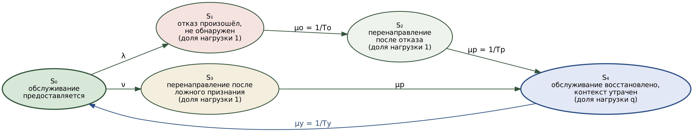
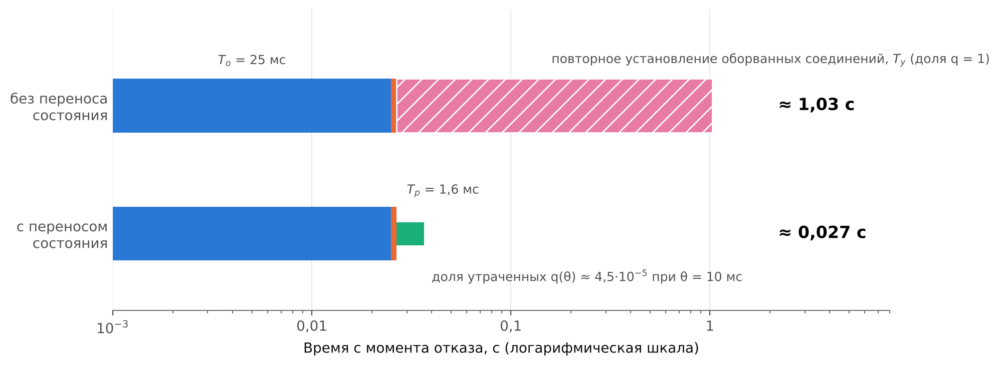
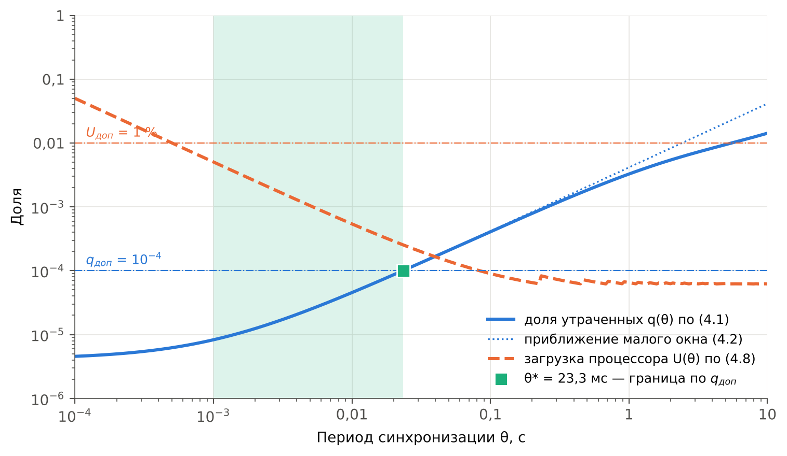

# ГЛАВА 4. Обеспечение непрерывности обслуживания сетевых функций с сохранением состояния

В главе снимается допущение раздела 3.1 о равенстве восстановления экземпляра и восстановления обслуживания. В разделе 4.1 виды состояния сетевых функций разделяются по темпу изменения и последствиям утраты. Раздел 4.2 расширяет модель готовности состоянием утраты контекста соединений и вводит второй показатель — долю сохранённых соединений. Раздел 4.4 определяет период синхронизации по допустимой доле утраченных соединений, раздел 4.3 излагает метод переноса состояния, раздел 4.5 — программу эксперимента Э4.

## 4.1 Классификация состояния сетевых функций и последствий его утраты

Модель главы 3 считает обслуживание восстановленным в момент, когда трафик направлен на работоспособный экземпляр. Для функции без сохранения состояния это верно: любой пакет обрабатывается любым экземпляром одинаково. Для функции, сохраняющей сведения об установленных соединениях, в этот момент восстанавливается лишь обслуживание новых соединений, тогда как соединения, закреплённые за отказавшим экземпляром, обрываются, если сведения о них резервному экземпляру неизвестны. Восстановление экземпляра, следовательно, не эквивалентно восстановлению обслуживания, и разница между ними составляет предмет настоящей главы.

Объектом работы служит пересылающий балансировщик нагрузки транспортного уровня: он не завершает соединения, а направляет пакеты каждого соединения на выбранный при его установлении сервер и хранит этот выбор в таблице потоков. Построение такого рода принято и в известных программных балансировщиках, где таблица соединений дополняется согласованным хешированием [68]. Завершающий посредник, на котором соединение клиента оканчивается, к рассматриваемому классу не относится: его состояние есть состояние сокетов, и перенос сводится к переносу образа процесса, рассмотренному в [4].

Различия видов состояния определяются тремя признаками: тем, когда состояние изменяется, можно ли его вычислить заново и что происходит с обслуживанием при его утрате.

**Состояние, изменяющееся на границах соединения.** Запись таблицы потоков балансировщика создаётся при установлении соединения и удаляется при его завершении; в промежутке она не изменяется. Тем же свойством обладают записи трансляции адресов. Темп изменения таблицы определяется интенсивностью установления соединений, а не интенсивностью пакетов, вследствие чего объём синхронизации мал и от темпа передачи данных не зависит.

**Состояние, изменяющееся с каждым пакетом.** Контекст защищённого туннеля содержит порядковый номер, увеличиваемый с каждым отправленным пакетом и не допускающий повторения при защите от повторной передачи [76]. Синхронизация такого состояния после каждого пакета признана слишком затратной, и в отраслевом документе для отказоустойчивых групп узлов принята периодическая синхронизация с увеличением счётчика после переключения на заведомо большое значение [77]. Темп изменения здесь равен темпу передачи пакетов, и компромисс между частотой синхронизации и служебной нагрузкой становится содержательным.

**Состояние, восстановимое вычислением.** Выбор сервера для соединения может быть получен заново согласованным хешированием признаков соединения, если состав серверов с момента установления соединения не изменился. Такое состояние переноса не требует. Однако при смене состава экземпляров балансировщика соединения попадают на экземпляры, не имеющие записей, и при одновременном изменении состава серверов обрываются [68]; разделение таблицы между всеми экземплярами при этом отвергнуто как ухудшающее производительность пересылки [68]. Известен и подход, исключающий таблицу на балансировщике и опирающийся на состояние, уже имеющееся у серверов [69]; он требует изменения серверов и в работе не рассматривается. Отсюда признак, отделяющий состояние, подлежащее переносу: перенос нужен там, где вычисление заново не гарантирует прежнего результата, то есть при изменяемом составе серверов.

**Последствия утраты.** Пакет оборванного соединения, поступивший на экземпляр без записи, либо отбрасывается, либо вызывает ответный сброс: сегмент, не принадлежащий существующему соединению, по правилам протокола управления передачей влечёт сброс [75]. Различие существенно для времени восстановления. При сбросе оконечное устройство узнаёт об обрыве за время передачи сегмента в обе стороны и устанавливает соединение заново. При отбрасывании отправитель повторяет неподтверждённый сегмент по истечении предельного времени повторной передачи, начальное и наименьшее значение которого составляет 1 с, а каждое следующее удваивается [74], как показывает таблица 4.1.

**Таблица 4.1 — Моменты повторной передачи неподтверждённого сегмента при начальном предельном времени 1 с [74]**

| Номер повторной передачи | 1 | 2 | 3 | 4 | 5 | 6 |
|---|---|---|---|---|---|---|
| Предельное время перед повторной передачей, с | 1 | 2 | 4 | 8 | 16 | 32 |
| Время от первой отправки, с | 1 | 3 | 7 | 15 | 31 | 63 |

Из таблицы 4.1 следует, что при отбрасывании пакетов оборванного соединения его восстановление задерживается на секунды и десятки секунд, причём обрыв обнаруживается отправителем лишь после исчерпания повторных передач. Время повторного установления оборванного соединения, обозначаемое далее *T*у, определяется поэтому не только оконечным устройством, но и поведением экземпляра, получившего пакет без записи; ограничение *T*у составляет одно из требований к методу раздела 4.3.

Раздел тем самым снимает условие, отнесённое разделом 3.1 к границам применимости модели: восстановление обслуживания эквивалентно восстановлению работоспособности экземпляра лишь при отсутствии состояния, подлежащего переносу. Для функций с таким состоянием модель требует дополнительного состояния, вводимого в разделе 4.2.

## 4.2 Расширение модели готовности на функции с сохранением состояния

**Исходные величины.** Пусть каждый из N экземпляров функции обслуживает поток соединений с интенсивностью установления λс и длительностью соединения D, имеющей функцию выживания S(x) = P(D > x) и среднее *T*с. Число одновременно существующих соединений экземпляра составляет по формуле Литтла λс*T*с. Резервному экземпляру изменения таблицы потоков передаются пакетами с периодом θ; задержка доставки пакета изменений, включающая передачу и применение, равна d. Отказ приходится на случайную фазу внутри периода, вследствие чего время A от последней отправки до отказа равномерно распределено на отрезке [0; θ].

**Доля утраченных при отказе соединений.** Резервному экземпляру неизвестны записи соединений, установленных за последние A + d до отказа. В стационарном потоке доля существующих соединений, возраст которых меньше a, равна

$$F_\text{в}(a) = \frac{1}{T_\text{с}} \int_0^{a} S(x)\,dx, \tag{4.1}$$

поскольку соединение возраста x существует, если его длительность превышает x. Доля соединений отказавшего экземпляра, утрачиваемых при отказе, получается усреднением (4.1) по фазе отказа:

$$q(\theta) = \frac{1}{\theta\,T_\text{с}} \int_0^{\theta} \int_0^{a + d} S(x)\,dx\,da. \tag{4.2}$$

Выражение (4.2) обладает тремя свойствами, существенными для дальнейшего. Во-первых, q(θ) возрастает с θ, поскольку есть среднее возрастающей функции по расширяющемуся отрезку. Во-вторых, при θ → ∞ величина q стремится к единице, что отвечает отсутствию переноса. В-третьих, поскольку S(x) ≤ 1, выполняется оценка сверху

$$q(\theta) \le \frac{\theta/2 + d}{T_\text{с}}, \tag{4.3}$$

обращающаяся в приближённое равенство, когда окно θ + d мало по сравнению с длительностью почти всех соединений. В этой области, названной далее областью малого окна, доля утраченных зависит от распределения длительностей лишь через среднее *T*с: вид распределения, как и в модели главы 3, на результат не влияет. Вне её (4.3) завышает долю утраченных, и расчёт ведётся по (4.2).

**Проверка выражения статистическим моделированием.** Выражения (4.2) и (4.3) проверены событийным моделированием потока соединений: пуассоновский поток установления, смесь коротких соединений с показательной длительностью и длительных соединений по профилю таблицы 2.3, отказ в случайной фазе периода синхронизации, 300 отказов на точку. Параметры моделирования иллюстративны и приведены в таблице 4.2.

**Таблица 4.2 — Иллюстративные параметры расчётов главы 4**

| Величина | Обозначение | Значение |
|---|---|---|
| Интенсивность установления соединений на экземпляр, 1/с | λс | 100 |
| Доля длительных соединений | — | 0,2 |
| Длительность длительного соединения, с | — | 600 |
| Средняя длительность короткого соединения, с | — | 1 |
| Средняя длительность соединения, с | *T*с | 120,8 |
| Задержка доставки изменений, мс | d | 0,5 |
| Время повторного установления оборванного соединения, с | *T*у | 1 |
| Размер записи об изменении, байт | e | 32 |
| Заголовки пакета изменений, байт | h | 62 |
| Полезная нагрузка пакета изменений, байт | M | 1456 |
| Затраты процессора на пакет изменений, мкс | *c*м | 5 |
| Затраты процессора на запись, мкс | *c*з | 0,2 |

Доля длительных соединений и их длительность взяты из основного профиля нагрузки (таблица 2.3), прочие значения приняты иллюстративно и подлежат измерению в эксперименте Э4. Время повторного установления принято равным иллюстративной цене ложного срабатывания функции с таблицей сессий раздела 3.1, поскольку обе величины выражают одно и то же — длительность восстановления оборванных соединений. Размер записи и заголовки пакета соответствуют формату, принятому в методе раздела 4.3. Результаты проверки приведены в таблице 4.3.

**Таблица 4.3 — Доля утраченных при отказе соединений: моделирование и расчёт (статистическое моделирование, 300 отказов на точку)**

| θ, с | q, моделирование | Доверительный интервал 95 % | q по (4.2) | q по (4.3) |
|---|---|---|---|---|
| 0,01 | 3,95·10⁻⁵ | ±0,70·10⁻⁵ | 4,54·10⁻⁵ | 4,55·10⁻⁵ |
| 1 | 3,20·10⁻³ | ±0,19·10⁻³ | 3,27·10⁻³ | 4,14·10⁻³ |
| 10 | 1,46·10⁻² | ±0,07·10⁻² | 1,42·10⁻² | 4,14·10⁻² |
| 60 | 5,48·10⁻² | ±0,34·10⁻² | 5,62·10⁻² | 24,8·10⁻² |

Во всех четырёх точках значение (4.2) лежит в доверительном интервале моделирования. Доверительный интервал вычислен по отказам, а не по числу утраченных соединений: утраты при одном отказе зависимы, поскольку определяются общей фазой отказа, и расчёт по пуассоновскому закону дал бы ложно узкий интервал. Оценка (4.3) совпадает с (4.2) при θ = 0,01 с и завышает долю утраченных в 1,3, 2,9 и 4,4 раза при θ = 1, 10 и 60 с, когда окно становится соизмеримым с длительностью коротких соединений. Первоначально принятая для раздела формула вида (4.3) без оговорки об области применимости моделированием была опровергнута; выражение (4.2) построено как её исправление. Сценарий моделирования — `harness/ch4_state_model.py`.

**Граф состояний.** Утрата контекста вводится в граф раздела 3.1 отдельным состоянием S₄ — «обслуживание восстановлено, контекст утрачен», отличающимся от S₀ тем, что новые соединения обслуживаются, а доля q прежних соединений отказавшего экземпляра ожидает повторного установления. Переход в S₄ совершается из состояния перенаправления как после действительного отказа, так и после ложного признания, поскольку в обоих случаях соединения экземпляра переходят к резервному. Граф приведён на рисунке 4.1.

*Рисунок 4.1 — Граф состояний модели готовности функции с сохранением состояния: состояние S₄ затрагивает долю q нагрузки отказавшего экземпляра, прочие состояния — всю его нагрузку*

**Коэффициент простоя.** Каждое состояние затрагивает свою долю нагрузки отказавшего экземпляра: S₁ и S₂ — всю нагрузку на время *T*о и *T*р, S₄ — долю q на время *T*у. Поскольку согласно разделу 3.1 коэффициент готовности зависит лишь от средних длительностей пребывания, а не от их распределений, усреднение по долям нагрузки даёт при резервировании

$$K_\text{п}^\text{сост} \approx \lambda\left(T_\text{о} + T_\text{р}\right) + \lambda\,q(\theta)\,T_\text{у} + \nu\,c_\nu^\text{сост}, \tag{4.4}$$

где цена ложного срабатывания функции с сохранением состояния складывается из перенаправления и утраты контекста:

$$c_\nu^\text{сост} = T_\text{р} + q(\theta)\,T_\text{у}. \tag{4.5}$$

Выражение (4.4), как и (3.11), есть доля потерянной нагрузки. Предельный переход подтверждает согласованность с главой 3: при q = 0 выражения (4.4) и (4.5) совпадают с (3.11) при цене ложного срабатывания функции без сохранения состояния *c*ν = *T*р. Без переноса состояния q = 1, и (4.5) даёт цену *T*р + *T*у, совпадающую с принятой в разделе 3.1 оценкой цены ложного срабатывания функции с таблицей сессий через длительность повторного установления соединений.

**Второй показатель.** Коэффициент простоя (4.4) мал при любом θ, поскольку отказы редки, и потому недостаточен как требование: служба может удовлетворять нормативу готовности и при этом обрывать при каждом отказе все соединения отказавшего экземпляра. Вводится второй показатель — доля сохранённых при отказе соединений 1 − q(θ), — нормируемый отдельно. Связь с долговременной долей соединений, оборванных отказами, следует из подсчёта: за единицу времени экземпляр отказывает с интенсивностью λ и теряет при этом qλс*T*с соединений, тогда как устанавливает λс, откуда

$$\eta = \lambda\,T_\text{с}\,q(\theta) \approx \lambda\left(\theta/2 + d\right). \tag{4.6}$$

Приближённое равенство относится к области малого окна. Величина η при наработке на отказ один год ничтожна — 1,7·10⁻¹⁰ при θ = 10 мс, — вследствие чего требование к функции с сохранением состояния формулируется через долю сохранённых при отказе соединений, а не через долговременную долю.

**Вклад утраты контекста в простой.** Значение (4.4) при параметрах таблицы 4.2 и настройке контура контроля по таблице 3.8 для внутриплощадочного канала приведено в таблице 4.5 раздела 4.4. Без переноса состояния член λ*T*у равен 1 с в год и превосходит вклад обнаружения и перенаправления, составляющий 0,027 с в год, почти в сорок раз: для функции с таблицей сессий сокращение времени обнаружения, полученное в главе 3, без переноса состояния утрачивает практическое значение. Это и есть количественное содержание утверждения о том, что восстановление экземпляра не равно восстановлению обслуживания.

## 4.3 Метод переноса состояния между экземплярами сетевой функции

Метод строится на четырёх положениях: асинхронная пакетная синхронизация таблицы потоков с периодом, определяемым в разделе 4.4 по допустимой доле утраченных соединений, закреплённый резервный экземпляр для каждого экземпляра, сброс соединений, отсутствующих в таблице, и использование контура контроля главы 3 для переключения.

**Схема резервирования.** Каждому из N экземпляров назначается резервный — следующий по кругу, вследствие чего каждый экземпляр одновременно служит основным для своих соединений и резервным для соединений соседа. Такая схема относится к классу «M плюс один» с распределением нагрузки, предусмотренному для функций массового обслуживания [6], и к рассмотренному в [16] варианту резервирования «n плюс k» с распределением нагрузки; в отличие от схемы «один плюс один» она не требует простаивающих экземпляров. При N = 2, принятом на стенде, схема вырождается во взаимное резервирование двух экземпляров.

**Синхронизация.** Экземпляр накапливает записи об установлении и завершении соединений и с периодом θ отправляет их резервному экземпляру пакетами изменений, каждый из которых несёт порядковый номер. Запись содержит признаки соединения, номер выбранного сервера, вид изменения и метку времени; размер записи для четвёртой версии сетевого протокола составляет 32 байта. Доставка подтверждается, утраченные пакеты повторяются, а при запуске или перезапуске экземпляра выполняется полная повторная синхронизация — порядок, совпадающий с надёжным режимом известного средства синхронизации таблиц соединений [78]. Режим без подтверждения [78] для метода непригоден: утрата пакета изменений оставляет записи неизвестными резервному экземпляру неограниченно долго, и (4.2) перестаёт быть верхней оценкой утрат.

**Хранение у резервного экземпляра.** Принятые записи хранятся в отдельной таблице резервных записей и при нормальной работе не используются. При поступлении пакета соединения, отсутствующего в основной таблице, экземпляр обращается к таблице резервных записей и при нахождении записи переносит её в основную; поиск выполняется только при промахе основной таблицы, вследствие чего затрат на пересылку пакетов существующих соединений не вносит.

**Переключение.** Отказ экземпляра обнаруживается контуром контроля главы 3, и узел, направляющий трафик, записывает в таблицу распределения вместо отказавшего экземпляра его резервный. Резервный экземпляр получает пакеты соединений отказавшего, находит их записи в таблице резервных записей и продолжает пересылку на те же серверы. Действие начинается через *T*о + *T*р после отказа и не требует участия платформы оркестрации, вследствие чего переразмещение отказавшего экземпляра, как и в разделе 3.4, остаётся вне критического пути.

**Ограничение времени повторного установления.** Пакет соединения, не найденный ни в основной таблице, ни в таблице резервных записей, относится к доле q утраченных соединений. Для него сначала применяется согласованное хеширование: если состав серверов с момента установления соединения не менялся, выбирается прежний сервер, и соединение сохраняется без записи [68]. Если состав менялся, экземпляр формирует ответный сброс по правилам протокола управления передачей для сегмента, не принадлежащего существующему соединению [75]. Сброс ограничивает время повторного установления временем передачи в обе стороны и установления нового соединения; без него восстановление задерживается на секунды и десятки секунд повторных передач (таблица 4.1).

**Последовательность событий.** Последовательность событий при отказе экземпляра без переноса состояния и с переносом приведена на рисунке 4.2.

*Рисунок 4.2 — Последовательность событий при отказе экземпляра функции с таблицей сессий без переноса состояния и с переносом при θ = 10 мс (расчёт при иллюстративных параметрах таблицы 4.2 и настройке контура контроля по таблице 3.8)*

Рисунок 4.2 показывает, что перенос не сокращает время обнаружения и перенаправления: оно определяется методом главы 3. Перенос устраняет следующую за ним стадию повторного установления, которая без переноса длится *T*у для всех соединений отказавшего экземпляра, а с переносом — лишь для доли q.

**Выбор асинхронной синхронизации.** Синхронная передача каждой записи до подтверждения установления соединения обращает окно утраты в нуль, как при репликации конечного автомата [12], но добавляет время передачи в обе стороны к установлению каждого соединения. Асинхронная синхронизация не задерживает установление и, как показывает расчёт раздела 4.4 (таблица 4.4), обеспечивает сохранение 99,99 % соединений при периоде 23 мс; синхронная оправдана лишь при требованиях, для которых асинхронная нереализуема.

**Отличие от известных подходов.** Снятие и развёртывание образа процесса [4] переносит состояние процесса целиком и даёт медианное время восстановления 5,87 с, из которых около 3 с приходится на обнаружение и около 3 с — на развёртывание; предлагаемый метод переносит состояние функции, а не образ процесса, вследствие чего окно утраты определяется темпом установления соединений, а не объёмом памяти, а развёртывание отсутствует. Репликация на уровне потоков [71] снимает состояние потоков с частотой до 1000 Гц и тем самым по порядку частоты совпадает с периодами, получаемыми в разделе 4.4, однако периода по допустимой доле утраченных соединений не определяет. Восстановление по журналу [72] обеспечивает точное воспроизведение состояния ценой журналирования при нормальной работе; функции, изменяющей состояние лишь на границах соединения, такая точность не требуется. Перенос состояния между экземплярами по командам плоскости управления [73] и вынесение состояния во внешнее хранилище [70] адресованы иной задаче — изменению состава экземпляров при масштабировании и общему хранению — и вносят обращение к хранилищу или плоскости управления в путь обработки. Согласованное хеширование [68] и балансировка без состояния [69] используются методом не как замена переноса, а как дополнение: первое — для соединений, утраченных при неизменном составе серверов, второе в работе не применяется, поскольку требует изменения серверов. Отличие метода состоит, следовательно, в определении периода синхронизации по допустимой доле утраченных соединений на основе (4.2) и в использовании контура контроля главы 3 для переключения на резервный экземпляр, уже имеющий записи.

**Реализация.** Синхронизация реализуется в той же программе, что и детектор раздела 3.4, на языке Go; таблица потоков и таблица резервных записей размещаются в программируемом тракте передачи [64], допускающем обновление таблиц во время работы. Пакеты изменений передаются по частной сети площадки, по которой проходят и контрольные сообщения детектора.

*[Листинг А.2 — Реализация синхронизации таблицы потоков; приводится в приложении А]*

## 4.4 Определение частоты синхронизации по допустимой доле утраченных соединений

**Служебная нагрузка.** Изменения таблицы потоков возникают при установлении и завершении соединений, то есть с интенсивностью 2λс на экземпляр, и передаются пакетами с периодом θ; число пакетов за период n(θ) = ⌈2λсθe / M⌉. Нагрузка на канал и доля одного ядра процессора, расходуемая на синхронизацию, составляют

$$B(\theta) = 8\left(2\lambda_\text{с} e + \frac{h\,n(\theta)}{\theta}\right), \tag{4.7}$$

$$U(\theta) = \frac{c_\text{м}\,n(\theta)}{\theta} + 2\lambda_\text{с}\,c_\text{з}. \tag{4.8}$$

Обе величины убывают с θ и стремятся к постоянным 2λс·8e и 2λс*c*з, которые от периода не зависят и определяются темпом установления соединений. При параметрах таблицы 4.2 постоянная часть нагрузки составляет 51,2 кбит/с, а период влияет лишь на долю заголовков: при θ = 1 мс нагрузка равна 547 кбит/с, при θ = 10 мс — 101 кбит/с, при θ = 0,1 с — 56 кбит/с. Даже наибольшее из этих значений составляет 0,05 % канала 1 Гбит/с.

**Постановка задачи.** Доля утраченных (4.2) возрастает с θ, служебная нагрузка (4.7), (4.8) убывает. Компромисс того же рода, что компромисс быстродействия обнаружения и ложных срабатываний раздела 3.3, связывает здесь сохранность соединений и затраты на синхронизацию. Требование задаётся допустимой долей утраченных соединений *q*доп, нагрузка ограничивается допустимой долей процессора *U*доп и наименьшим реализуемым периодом таймера θmin. Требуется наименьшая нагрузка при q(θ) ≤ *q*доп.

**Решение.** Поскольку нагрузка убывает с θ, минимум достигается при наибольшем допустимом периоде, то есть на границе ограничения по доле утраченных:

$$q\left(\theta^{*}\right) = q_\text{доп}, \qquad \theta^{*} \approx 2\left(q_\text{доп}\,T_\text{с} - d\right). \tag{4.9}$$

Приближённое выражение получено из (4.3) и в силу оценки сверху даёт период, не превышающий точного решения, то есть идёт в запас. Решение реализуемо, если найденный период не меньше нижней границы, задаваемой таймером и допустимой загрузкой процессора:

$$\theta^{*} \ge \max\left(\theta_{\min},\ \theta_U\right), \qquad \theta_U = \frac{c_\text{м}}{U_\text{доп} - 2\lambda_\text{с}\,c_\text{з}}. \tag{4.10}$$

При нарушении (4.10) асинхронная синхронизация требования не обеспечивает, и остаётся синхронная передача каждой записи до подтверждения установления соединения либо снижение темпа установления соединений на экземпляр увеличением N. Оптимум, таким образом, лежит на границе, как и в разделе 3.3, но на противоположной: там связывающим было ограничение снизу на период контроля, здесь — требование к доле сохранённых соединений, а ограничение снизу на период лишь определяет, выполнимо ли требование.

Результаты расчёта по (4.2), (4.7)–(4.10) при параметрах таблицы 4.2, *U*доп = 1 % и θmin = 1 мс приведены в таблице 4.4 и на рисунке 4.3; нижняя граница (4.10) при этих значениях задаётся таймером, поскольку θ*U* = 0,50 мс.

**Таблица 4.4 — Период синхронизации по допустимой доле утраченных соединений (расчёт при иллюстративных параметрах таблицы 4.2)**

| *q*доп | θ*, мс | θ* по приближению (4.9), мс | Сохраняется соединений, % | B, кбит/с | B, % канала 1 Гбит/с | U, % ядра |
|---|---|---|---|---|---|---|
| 10⁻³ | 257 | 241 | 99,9 | 55,1 | 0,0055 | 0,008 |
| 10⁻⁴ | 23,3 | 23,2 | 99,99 | 72,5 | 0,0073 | 0,025 |
| 10⁻⁵ | 1,42 | 1,42 | 99,999 | 401 | 0,040 | 0,36 |
| 5·10⁻⁶ | 0,21 | 0,21 | — | — | — | — |

Последняя строка таблицы 4.4 нарушает (4.10): период 0,21 мс ниже реализуемого, и требование сохранить 99,9995 % соединений асинхронной синхронизацией при принятых параметрах невыполнимо. Предел задаётся задержкой доставки: при θ → 0 доля утраченных стремится к d / *T*с = 4,1·10⁻⁶, и никакое учащение синхронизации не опускает её ниже этого значения.

*Рисунок 4.3 — Доля утраченных соединений и загрузка процессора в зависимости от периода синхронизации (расчёт при иллюстративных параметрах таблицы 4.2): затенена область периодов, допустимых при *q*доп = 10⁻⁴ и *U*доп = 1 %; квадратом отмечено решение (4.9)*

Рисунок 4.3 показывает, что для состояния, изменяющегося на границах соединения, требование к сохранности соединений выполняется при нагрузке, пренебрежимой по любому из двух ресурсов: сохранение 99,99 % соединений обходится в 0,007 % канала и 0,025 % ядра. Отсюда практический вывод: для балансировщика транспортного уровня частота синхронизации ограничена не нагрузкой, а задержкой доставки изменений, и сокращать следует прежде всего её.

**Состояние, изменяющееся с каждым пакетом.** Для контекста защищённого туннеля задача ставится иначе. Утрата счётчика исходящих пакетов недопустима ни в какой доле: повторение порядкового номера вызывает отбрасывание пакетов получателем как повторных [76]. Поэтому после переключения резервный экземпляр продолжает счёт с последнего синхронизированного значения, увеличенного на величину J [77], и требование сохранности обращается в условие на J:

$$J \ge r\left(\theta + d\right), \tag{4.11}$$

где r — наибольшая интенсивность отправки пакетов по контексту. Служебная нагрузка пропорциональна числу контекстов, делённому на θ, и от интенсивности пакетов не зависит. Компромисс здесь — между нагрузкой, убывающей с θ, и расходом пространства порядковых номеров J на одно переключение, растущим с θ. Расход этот мал: при иллюстративной интенсивности r = 10⁴ пакетов в секунду и θ = 1 с одно переключение расходует около 10⁴ номеров из 2³² [76], то есть 2,3·10⁻⁶ пространства. Период синхронизации счётчиков может быть поэтому выбран много большим, чем у таблицы потоков, а требование сохранности обращается из условия на период в условие (4.11) на J. Проверка этого класса выполняется в разделе 4.5.

**Вклад переноса в простой и в настройку контура контроля.** Выражения (4.4), (4.5) и (3.24) при параметрах таблицы 4.2 и вероятностях непринятия раздела 3.5 дают значения, приведённые в таблице 4.5.

**Таблица 4.5 — Простой и пороговое число контроля для функции с таблицей сессий без переноса состояния и с переносом при θ = 10 мс (расчёт при иллюстративных параметрах; p — модельные значения раздела 3.5)**

| Показатель | Без переноса | С переносом |
|---|---|---|
| Доля утраченных при отказе соединений q | 1 | 4,5·10⁻⁵ |
| Вклад утраты контекста λq*T*у, с/год | 1,0 | 4,5·10⁻⁵ |
| Вклад обнаружения и перенаправления λ(*T*о + *T*р), с/год | 0,027 | 0,027 |
| Цена ложного срабатывания (4.5), мс | 1002 | 1,6 |
| Пороговое число k\* по (3.24), внутриплощадочный канал | 4 | 3 |
| Пороговое число k\* по (3.24), межплощадочный канал | 5 | 4 |

Перенос состояния действует на готовность двумя путями. Прямой путь — исключение члена утраты контекста, который без переноса почти в сорок раз превосходит прочие составляющие. Косвенный путь — снижение цены ложного срабатывания до уровня функции без сохранения состояния, вследствие чего по (3.24) оптимальное пороговое число уменьшается на единицу на обоих каналах, а время обнаружения при τ = 10 мс сокращается с 35 до 25 мс на внутриплощадочном и с 45 до 35 мс на межплощадочном канале. Методы глав 3 и 4 тем самым не просто складываются: перенос состояния делает допустимой более быструю настройку контура контроля.

## 4.5 Экспериментальная проверка

Раздел содержит программу эксперимента Э4 и предсказания, назначаемые до измерений. Стенд и порядок обработки — по главе 2: экземпляры размещаются на узлах С2 и С1 первой площадки, отказ вносится снятием питания узла С2, обработка результатов выполняется по разделу 2.4 и не переопределяется.

**Проверяемые утверждения.**

**Утверждение У4.** Доля соединений, утрачиваемых при отказе экземпляра, соответствует (4.2) при измеренных функции выживания длительности соединений, периоде θ и задержке доставки d.

**Утверждение У5.** Служебная нагрузка синхронизации на канал и процессор соответствует (4.7) и (4.8).

**Утверждение У6.** Перенос состояния снижает цену ложного срабатывания функции с таблицей сессий до значения (4.5).

**Величины, определяемые экспериментом.** Помимо проверки утверждений эксперимент доставляет величины, принятые в таблице 4.2 иллюстративно: задержку доставки изменений d, время повторного установления *T*у при сбросе и без него, затраты процессора *c*м и *c*з.

**Критерии подтверждения.** Критерии назначаются до проведения измерений.

**Критерий К4.** Расчётное значение (4.2) лежит в доверительном интервале 95 % измеренной доли утраченных соединений, вычисленном по отказам, а не по числу утраченных соединений, по причине, установленной в разделе 4.2.

**Критерий К5.** Измеренные нагрузка на канал и загрузка процессора отличаются от (4.7) и (4.8) не более чем на 15 %. Допуск обоснован не учитываемыми выражениями повторными передачами пакетов изменений и служебными кадрами канального уровня.

**Критерий К6.** Измеренная с переносом состояния цена ложного срабатывания не превышает (4.5) более чем на 20 % и не менее чем в десять раз ниже измеренной без переноса.

При невыполнении любого из критериев соответствующее утверждение считается опровергнутым; корректировка критерия для приведения его в соответствие с результатом не допускается.

**Часть 1 — сохранность соединений при отказе.** Под нагрузкой по основному профилю таблицы 2.3 вносится отказ узла С2 при трёх значениях периода синхронизации — 10 мс, 0,1 с и 1 с — не менее 30 раз на значение. Измеритель вне инфраструктуры ведёт перечень установленных соединений и после отказа определяет, какие из них продолжили обмен, а какие оборваны. Функция выживания длительности соединений определяется по тем же записям измерителя за время прогрева. Наименьшее значение периода выбрано так, чтобы число утраченных соединений за 30 отказов было достаточным для проверки по критерию К4: при θ = 10 мс ожидается около 0,55 утраченного соединения на отказ, то есть около 16 за серию.

**Часть 2 — служебная нагрузка.** Без внесения отказов при тех же трёх периодах и дополнительно при θ = 1 мс измеряются объём переданных пакетов изменений и загрузка процессора процессом синхронизации на основном и резервном экземплярах.

**Часть 3 — время повторного установления.** Повторяется часть 1 при θ, заведомо превышающем длительность соединений, то есть без переноса, дважды: со сбросом соединений, отсутствующих в таблице, и без него. Измеряется время от отказа до возобновления обмена по каждому оборванному соединению.

**Часть 4 — цена ложного срабатывания.** Повторяется часть 5 эксперимента Э3 (раздел 3.5) с переносом состояния и без него.

**Часть 5 — проверка переносимости на шлюзе туннелей.** Для второй сетевой функции, шлюза защищённых туннелей, вносится отказ при значении J по (4.11) и при значении, вдвое меньшем, и регистрируется отбрасывание пакетов получателем как повторных после переключения. Подтверждением переносимости служит отсутствие отбрасывания в первом случае и его наличие во втором — в той части отказов, что приходится на вторую половину периода синхронизации. Часть выполняется при наличии времени и полной характеризации второй функции не составляет, как установлено в главе 2.

**Предсказания.** Значения, ожидаемые при параметрах таблицы 4.2, приведены в таблице 4.6; при натурном эксперименте расчёт повторяется по измеренным величинам, а не по иллюстративным.

**Таблица 4.6 — Предсказания для эксперимента Э4 (расчёт при иллюстративных параметрах таблицы 4.2)**

| θ | q по (4.2) | Утрачивается соединений на отказ | Сохраняется, % | B, кбит/с | U, % ядра |
|---|---|---|---|---|---|
| 1 мс | 8,3·10⁻⁶ | 0,10 | 99,9992 | 547 | 0,50 |
| 10 мс | 4,5·10⁻⁵ | 0,55 | 99,995 | 101 | 0,054 |
| 0,1 с | 4,1·10⁻⁴ | 4,9 | 99,96 | 56,2 | 0,009 |
| 1 с | 3,3·10⁻³ | 39,5 | 99,67 | 53,7 | 0,006 |

Число утраченных соединений на отказ получено умножением q на 12 080 одновременно существующих соединений экземпляра. Измеренные значения доли сохранённых соединений и служебной нагрузки при выбранном периоде составят числа положения 3, выносимого на защиту; до проведения эксперимента они не приводятся.

## Выводы по главе 4

Установлено, что для функции с таблицей сессий восстановление экземпляра не равно восстановлению обслуживания: без переноса состояния утрата контекста соединений вносит в простой почти в сорок раз больше, чем обнаружение и перенаправление после настройки главы 3. Модель готовности расширена состоянием утраты контекста и вторым показателем — долей сохранённых при отказе соединений. Получено выражение доли утраченных соединений через период синхронизации и функцию выживания длительности соединения; моделирование подтвердило его и опровергло линейное приближение при больших периодах. Показано, что период синхронизации определяется на границе требования к сохранности соединений, а реализуемость ограничена задержкой доставки изменений. Перенос состояния снижает цену ложного срабатывания и тем самым пороговое число контроля на единицу.
